# IGNIÇÃO — Volume 9: Maturidade, Governança, Crise, Exit e Family Office

**Segunda Curva, Conselho (Board), Internacionalização, Crise, Spin-offs, M&A, IPO, Cash Cow e Family Office (Fases 19 e 20, Capítulos 1 a 23 e Epílogo)**

*João Prado · 2026 — Edição Autocontida (v4.0)*

---

## Sobre este Volume

Este é o **Volume 9 (Maturidade, Governança, Crise, Exit e Family Office)** da coleção **IGNIÇÃO — O manual operacional do empreendedor brasileiro** (10 volumes autocontidos).

Volume 100% autocontido sobre o ciclo longo da companhia consolidada, governança de conselho, expansão internacional, sobrevivência a crises severas, execução de saída (exit), geração perpétua de dividendos (Cash Cow) e gestão patrimonial em Family Office. Abre com a Fase 19 (Reinvenção e Segunda Curva) e a Fase 20 (Estratégia de Saída / Exit Strategy) — trazendo embutidos todos os 8 frameworks de planejamento de longo prazo e inovação (Scenario Planning, Hoshin Kanri, OGSM, Balanced Scorecard, Innovator's Dilemma, Ambidextrous Organization, Open Innovation e S-Curves), o Wardley Map Canvas e o template de Board Deck —, seguidas por 23 capítulos em ordem cronológica sobre Board Management, empresas familiares e sucessão, conflito societário, ESG/Sistema B, internacionalização e Cayman/Delaware Flip, imigração/vistos, hedge cambial, tesouraria multi-moeda, gestão e comunicação em crise, layoffs, recuperação judicial e wind-down, M&A buy-side e roll-ups, Search Funds (ETA), Spin-offs e Carve-outs Corporativos, Liquidez Secundária (Secondaries unificado), IPO na B3 e Nasdaq/NYSE, tributação de exit na pessoa física, transição pós-aquisição, retenção pós-M&A/earnout, post-mortems brasileiros, second-time founders, a Empresa Cash Cow (dividendos vitalícios com CEO profissional) + Holdings Patrimoniais, Offshores (Lei 14.754/2023) e Family Office pós-liquidez, e o Epílogo da coleção.

---

## Mapa da Coleção IGNIÇÃO

```mermaid
graph LR
    subgraph J1["Do Zero à Validação"]
        V1["<b>Vol. 1 — Ideação</b><br/>Fases 0 a 3 · Fundador e Teoria"]
        V2["<b>Vol. 2 — Descoberta e Mercado</b><br/>Fases 4 a 6 · Cliente e Cunha"]
        V3["<b>Vol. 3 — Hipóteses e Protótipo</b><br/>Fases 7 a 10 · Testes e Modelos"]
        V1 --> V2 --> V3
    end
    subgraph J2["Tração e Escala"]
        V4["<b>Vol. 4 — Tração e PMF</b><br/>Fases 11 a 13 · MVP, GTM e Vendas"]
        V5["<b>Vol. 5 — Finanças e Captação</b><br/>Fase 14 · Caixa, VC, Tributário e FP&A"]
        V6["<b>Vol. 6 — Receita e Pessoas</b><br/>Fases 15 e 16 · Enterprise, Líderes e Cultura"]
        V7["<b>Vol. 7 — Produto e Engenharia</b><br/>Fase 17 · Operações, IA e Arquitetura"]
        V8["<b>Vol. 8 — Jurídico e Segurança</b><br/>Fase 18 · Societário, Contratos e LGPD"]
        V3 --> V4 --> V5 --> V6 --> V7 --> V8
    end
    subgraph J3["Ciclo Longo e Setores"]
        V9["<b>Vol. 9 — Maturidade, Exit e Family Office</b><br/>Fases 19 e 20 · Board, Crise, M&A, IPO e Cash Cow"]
        V10["<b>Vol. 10 — Economia da Inovação e 40 Verticais</b><br/>Hubs Globais, Regulação, 40 Setores e Dicionário"]
        V8 --> V9
    end
    V10 -. "Consulta Setorial e Dicionário" .-> J1
    V10 -. "Consulta Setorial e Dicionário" .-> J2
    V10 -. "Consulta Setorial e Dicionário" .-> J3
```

---

## Sumário deste Volume

### Fases da Etapa (Fases 19 e 20)
- [[#FASE 19 — REINVENÇÃO E SEGUNDA CURVA|FASE 19 — REINVENÇÃO E SEGUNDA CURVA]]
- [[#FASE 20 — ESTRATÉGIA DE SAÍDA (EXIT STRATEGY)|FASE 20 — ESTRATÉGIA DE SAÍDA (EXIT STRATEGY)]]
### Governança Corporativa, Board, Sucessão e Sociedade (Capítulos 1 a 4)
- [[#CAPÍTULO 1 — BOARD E GOVERNANCE|CAPÍTULO 1 — BOARD E GOVERNANCE]]
- [[#CAPÍTULO 2 — EMPRESA FAMILIAR E SUCESSÃO: GOVERNANÇA, DINÂMICA E PSICOLOGIA|CAPÍTULO 2 — EMPRESA FAMILIAR E SUCESSÃO: GOVERNANÇA, DINÂMICA E PSICOLOGIA]]
- [[#CAPÍTULO 3 — DISPUTA SOCIETÁRIA E SAÍDA DE SÓCIO|CAPÍTULO 3 — DISPUTA SOCIETÁRIA E SAÍDA DE SÓCIO]]
- [[#CAPÍTULO 4 — ESG, IMPACT E GOVERNANÇA PARA STARTUP|CAPÍTULO 4 — ESG, IMPACT E GOVERNANÇA PARA STARTUP]]
### Internacionalização, Imigração, Câmbio e Tesouraria Multi-Moeda (Capítulos 5 a 8)
- [[#CAPÍTULO 5 — INTERNACIONALIZAÇÃO: ESTRUTURA E PRODUTO PARA MÚLTIPLOS MERCADOS|CAPÍTULO 5 — INTERNACIONALIZAÇÃO: ESTRUTURA E PRODUTO PARA MÚLTIPLOS MERCADOS]]
- [[#CAPÍTULO 6 — VISTO E IMIGRAÇÃO PARA FUNDADOR BRASILEIRO|CAPÍTULO 6 — VISTO E IMIGRAÇÃO PARA FUNDADOR BRASILEIRO]]
- [[#CAPÍTULO 7 — HEDGING CAMBIAL E GESTÃO DE MOEDA MULTICOUNTRY|CAPÍTULO 7 — HEDGING CAMBIAL E GESTÃO DE MOEDA MULTICOUNTRY]]
- [[#CAPÍTULO 8 — TESOURARIA EM ESCALA: GESTÃO DE CAIXA MULTI-MOEDA, MULTI-PAÍS E MULTI-CONTA|CAPÍTULO 8 — TESOURARIA EM ESCALA: GESTÃO DE CAIXA MULTI-MOEDA, MULTI-PAÍS E MULTI-CONTA]]
### Gestão de Crise, Comunicação Crítica, Layoffs e Recuperação Judicial (Capítulos 9 a 12)
- [[#CAPÍTULO 9 — CRISE E CONTINUIDADE: PREVENÇÃO, RESPOSTA, RECUPERAÇÃO|CAPÍTULO 9 — CRISE E CONTINUIDADE: PREVENÇÃO, RESPOSTA, RECUPERAÇÃO]]
- [[#CAPÍTULO 10 — COMUNICAÇÃO EM CRISE|CAPÍTULO 10 — COMUNICAÇÃO EM CRISE]]
- [[#CAPÍTULO 11 — LAYOFFS E DOWNSIZING: COMO DEMITIR EM ESCALA SEM DESTRUIR A EMPRESA|CAPÍTULO 11 — LAYOFFS E DOWNSIZING: COMO DEMITIR EM ESCALA SEM DESTRUIR A EMPRESA]]
- [[#CAPÍTULO 12 — RECUPERAÇÃO JUDICIAL E WIND-DOWN — QUANDO A STARTUP NÃO CONSEGUE CONTINUAR|CAPÍTULO 12 — RECUPERAÇÃO JUDICIAL E WIND-DOWN — QUANDO A STARTUP NÃO CONSEGUE CONTINUAR]]
### M&A, Search Funds, Spin-offs, Liquidez Secundária, IPO, Tributação, Pós-Exit, Cash Cow e Family Office (Capítulos 13 a 23)
- [[#CAPÍTULO 13 — M&A ATIVO E ROLL-UPS: FUNDADOR COMO COMPRADOR|CAPÍTULO 13 — M&A ATIVO E ROLL-UPS: FUNDADOR COMO COMPRADOR]]
- [[#CAPÍTULO 14 — SEARCH FUNDS E ETA (ENTREPRENEURSHIP THROUGH ACQUISITION)|CAPÍTULO 14 — SEARCH FUNDS E ETA (ENTREPRENEURSHIP THROUGH ACQUISITION)]]
- [[#CAPÍTULO 15 — SPIN-OFFS, CARVE-OUTS E VENTURE BUILDING CORPORATIVO: CRIANDO NOVAS EMPRESAS A PARTIR DE ATIVOS INTERNOS|CAPÍTULO 15 — SPIN-OFFS, CARVE-OUTS E VENTURE BUILDING CORPORATIVO: CRIANDO NOVAS EMPRESAS A PARTIR DE ATIVOS INTERNOS]]
- [[#CAPÍTULO 16 — LIQUIDEZ SECUNDÁRIA (SECONDARIES): REALIZAÇÃO PARCIAL DE CAPITAL PARA FUNDADORES, EXECUTIVOS E INVESTIDORES ANTES DO EXIT|CAPÍTULO 16 — LIQUIDEZ SECUNDÁRIA (SECONDARIES): REALIZAÇÃO PARCIAL DE CAPITAL PARA FUNDADORES, EXECUTIVOS E INVESTIDORES ANTES DO EXIT]]
- [[#CAPÍTULO 17 — IPO NO BRASIL: QUANDO, COMO E O QUE MUDA|CAPÍTULO 17 — IPO NO BRASIL: QUANDO, COMO E O QUE MUDA]]
- [[#CAPÍTULO 18 — TRIBUTAÇÃO DO EXIT PARA FUNDADORES BRASILEIROS|CAPÍTULO 18 — TRIBUTAÇÃO DO EXIT PARA FUNDADORES BRASILEIROS]]
- [[#CAPÍTULO 19 — SUCESSÃO NO EXIT E TRANSIÇÃO PÓS-AQUISIÇÃO|CAPÍTULO 19 — SUCESSÃO NO EXIT E TRANSIÇÃO PÓS-AQUISIÇÃO]]
- [[#CAPÍTULO 20 — RETENÇÃO DE TALENTOS APÓS M&A: O QUE MUDA E O QUE SE PERDE|CAPÍTULO 20 — RETENÇÃO DE TALENTOS APÓS M&A: O QUE MUDA E O QUE SE PERDE]]
- [[#CAPÍTULO 21 — POST-MORTEMS BRASILEIROS: CATÁLOGO DE CASOS EM PROFUNDIDADE|CAPÍTULO 21 — POST-MORTEMS BRASILEIROS: CATÁLOGO DE CASOS EM PROFUNDIDADE]]
- [[#CAPÍTULO 22 — SECOND-TIME FOUNDER|CAPÍTULO 22 — SECOND-TIME FOUNDER]]
- [[#CAPÍTULO 23 — A EMPRESA CASH COW (DIVIDENDOS PERPÉTUOS), HOLDINGS PATRIMONIAIS, FAMILY OFFICE E GESTÃO DE FORTUNA PÓS-EXIT|CAPÍTULO 23 — A EMPRESA CASH COW (DIVIDENDOS PERPÉTUOS), HOLDINGS PATRIMONIAIS, FAMILY OFFICE E GESTÃO DE FORTUNA PÓS-EXIT]]
### Encerramento
- [[#EPÍLOGO|EPÍLOGO]]
### Glossário e Siglas deste Volume
- [[#Glossário e Siglas deste Volume|GLOSSÁRIO E SIGLAS DESTE VOLUME]]

---

# FASES DA ETAPA — MATURIDADE, SEGUNDA CURVA E ESTRATÉGIA DE SAÍDA (FASES 19 E 20)

### Arquitetura deste Domínio: Reinvenção de Longo Prazo e Estratégia de Saída (Fases 19 e 20)

Este **Volume 9** cobre o horizonte mais alto da jornada empreendedora: o que acontece quando a empresa domina seu primeiro mercado e precisa disparar uma **segunda curva de crescimento** antes que o negócio principal sature (**[[#FASE 19 — REINVENÇÃO E SEGUNDA CURVA|Fase 19]]**), ou quando chega a hora de transformar o valor construído em liquidez definitiva por meio de **M&A, liquidez secundária ou IPO** (**[[#FASE 20 — ESTRATÉGIA DE SAÍDA (EXIT STRATEGY)|Fase 20]]**). O volume é **100% autocontido**:

1. **A [[#FASE 19 — REINVENÇÃO E SEGUNDA CURVA|Fase 19 (Reinvenção e Segunda Curva)]]** ensina a diagnosticar precocemente a desaceleração da curva S original e a alocar capital e talentos em novos motores de crescimento sem destruir a operação principal. Traz embutidos **todos os 8 frameworks de Planejamento de Longo Prazo e Inovação** (*Scenario Planning*, *Hoshin Kanri*, *OGSM*, *Balanced Scorecard*, *Innovator's Dilemma*, *Ambidextrous Organization*, *Open Innovation* e *S-Curves of Innovation*), o *Wardley Map Canvas* e as métricas de maturidade e segunda curva.
2. **A [[#FASE 20 — ESTRATÉGIA DE SAÍDA (EXIT STRATEGY)|Fase 20 (Estratégia de Saída / Exit Strategy)]]** disseca o planejamento e a execução da saída — mapeamento de compradores estratégicos e financeiros, preparação de 18 a 24 meses, negociação de *valuation* e *earnout*, e fechamento da transação. Traz embutidos as métricas de *exit* e o template completo de *Board Deck (Apresentação para o Conselho)*.

---

## FASE 19 — REINVENÇÃO E SEGUNDA CURVA

> [!question] Pergunta de FMF nessa fase
> Você atingiu desaceleração, e está considerando segunda curva. A pergunta crítica. *Você tem founder-market-fit com a nova curva também, ou está projetando a sua competência da curva atual numa área onde não tem a mesma profundidade?* Fundadores de sucesso na curva 1 frequentemente falham na curva 2 porque assumem que a vantagem transfere. Frequentemente não transfere. Mergulho de validação (Fases 2 a 4) é obrigatório na curva 2. Não é redundância. É reconhecimento de que você é iniciante no novo terreno.

### O que esta fase cobre

Detecção antecipada de saturação do modelo de crescimento vigente, e construção deliberada da próxima fonte de crescimento antes que a atual colapse. O entregável é o Diagnóstico de Saturação, mais o Plano de Segunda Curva — pivot (mudança de direção estratégica) maduro, expansão transformacional, ou autodisrupção controlada.

> [!abstract] Resumo operacional
> **Entregável:** Diagnóstico de Saturação com dados (não intuição) mais Plano de Segunda Curva — tipo de pivot escolhido com justificativa, ambidestria organizacional 70/20/10 instalada e segunda curva em operação com primeiros sinais de tração.
>
> **Sinais de saída:**
> - Três ou mais candidatas a segunda curva avaliadas em TAM e FMF, com tipo de pivot escolhido e critério go/no-go explícito com métricas e prazo.
> - Time dedicado à nova curva com orçamento separado e métricas próprias (de aprendizado, não de resultado financeiro), e clientes-piloto ou receita inicial mensurável.
> - Comunicação ao board e ao time documentada, sem êxodo motivado por incerteza.
>
> **Três armadilhas mais comuns:**
> 1. Negação de saturação — "o nosso canal ainda vai voltar" quando quase nunca volta no mesmo formato.
> 2. Segunda curva cosmética — lançar "nova feature" ou "nova marca" sem mudar a natureza do motor de crescimento.
> 3. Abandonar o core cedo demais — o core financia a segunda curva, e matá-lo prematuramente mata a empresa inteira.

### POR QUE

Nenhum modelo de crescimento dura para sempre. O princípio de "a cada doze a dezoito meses o modelo satura" (ver [[IGNICAO-Vol-4-Tracao-e-PMF#FASE 13 — PRODUCT-MARKET FIT|Fase 13 (Vol. 4)]]) opera em toda empresa pós-PMF. Fundadores que anteveem a curva de saturação entram em novos ciclos de crescimento exponencial. Fundadores que não anteveem vivem a decadência da curva anterior, frequentemente sem perceber que já passaram do pico até que fique tarde demais.

Essa fase é recorrente, não pontual. Empresas saudáveis entram nela a cada doze a vinte e quatro meses e saem com uma nova aposta estratégica em execução, enquanto a aposta anterior ainda roda. A falha clássica é esperar que o modelo principal quebre antes de construir o próximo. Nessa altura, não há mais caixa, nem moral, para reinventar.

### Quando usar

Comece quando pelo menos dois dos sinais antecedentes de saturação (listados no COMO) aparecem por dois ou mais trimestres consecutivos. Termine quando a segunda curva está em operação com sinais iniciais de tração — não apenas decidida no papel. Revisite ciclicamente. Em grandes empresas maduras, o ideal é que sempre haja uma "[[#FASE 19 — REINVENÇÃO E SEGUNDA CURVA|Fase 19]]" rodando em paralelo com a operação principal.

### Quem envolve

O executor principal é o CEO, diretamente. Essa não é tarefa delegável. Exige visão estratégica e autoridade para alocar recursos contra inércia organizacional. Os participantes são a liderança C-level, board, advisors estratégicos, e clientes-âncora em modo consultivo. O decisor é o CEO, com input do board em decisões sobre alocação de capital ou pivôs drásticos.

### Como executar

Sete passos. Mais uma pergunta de pré-checagem.

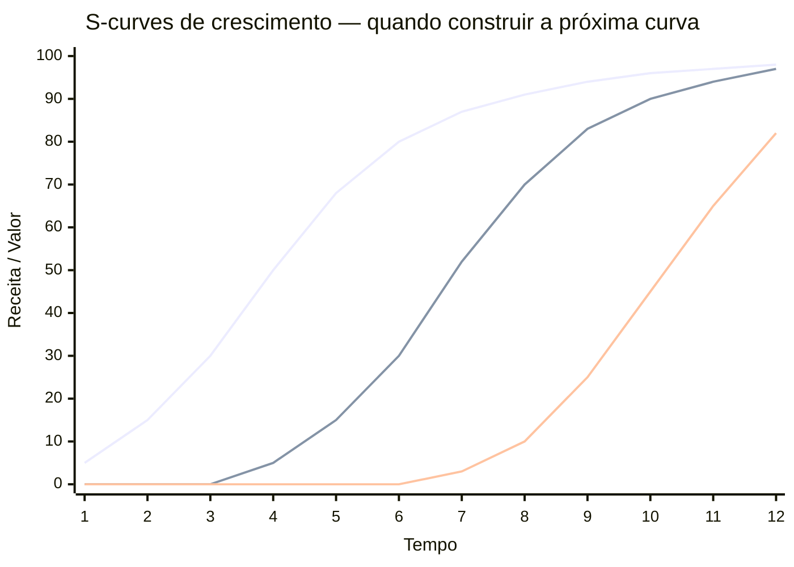

> [!note] Como ler as três curvas
> Curva 1 (superior) é o core atual: cresce rápido, depois desacelera e satura. Curva 2 (média) é a segunda aposta: deve começar a ser construída enquanto a curva 1 ainda está crescendo — não depois de saturar. Curva 3 (inferior) é a aposta futura. Empresas que constroem a próxima curva tarde ficam sem caixa e moral para fazê-lo. Empresas que constroem cedo têm a curva 1 financiando a construção da curva 2.

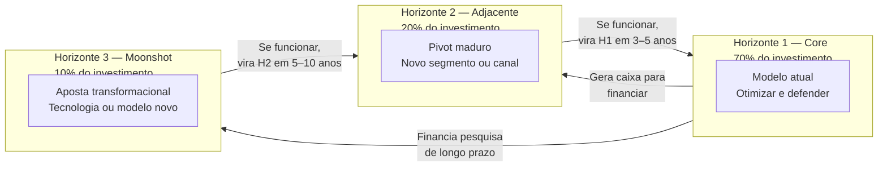

#### Antes de começar, esgotou os seis caminhos de expansão?

Uma confusão comum em fundadores é tomar saturação de *um* caminho de crescimento como saturação *geral*, e partir prematuramente para reinvenção — quando ainda há espaço na [[IGNICAO-Vol-6-Receita-e-Pessoas#FASE 16 — TIME, LIDERANÇA EXECUTIVA E CULTURA EM ESCALA|Fase 16 (Vol. 6)]] (Crescimento e Capital).

Antes de abrir um ciclo de reinvenção, faça o diagnóstico honesto. A [[IGNICAO-Vol-6-Receita-e-Pessoas#FASE 16 — TIME, LIDERANÇA EXECUTIVA E CULTURA EM ESCALA|Fase 16 (Vol. 6)]] traz seis caminhos de expansão disciplinada: três intra-conta (workflow adjacente, papel adjacente, ownership de sistema) e três extra-conta (segmento, geografia, produto). Quantos você efetivamente ativou e esgotou? Fundadores experientes entram na [[#FASE 19 — REINVENÇÃO E SEGUNDA CURVA|Fase 19]] real só depois de ter rodado pelo menos três ou quatro dos seis caminhos com seriedade.

> [!warning] Saturação real versus cansaço do fundador
> Saturação real existe, e exige reinvenção. Mas "saturação" invocada para justificar troca de direção antes da hora é frequentemente uma racionalização para o cansaço do fundador. E troca de direção feita por cansaço produz segundas curvas que nascem mortas. Se você ainda não tentou expandir intra-conta com método, o que parece saturação do negócio pode ser apenas saturação de um canal específico. Resolvível com movimento muito mais barato do que reinvenção.

#### Passo 1, monitore os sinais antecedentes de saturação

> [!note]
> O ambiente macroeconômico — SELIC, inflação, câmbio e ciclos de VC — afeta diretamente o timing ideal para declarar reinvenção e iniciar a segunda curva. Ver [[IGNICAO-Vol-10-Playbooks-Setoriais-e-Glossario#CAPÍTULO 3 — CICLOS MACROECONÔMICOS E A STARTUP BRASILEIRA|Capítulo 3 — Ciclos Macroeconômicos (Vol. 10)]].

A saturação não acontece de repente. Dá sinais seis a dezoito meses antes da queda visível. Monitore mensalmente, em cinco categorias.

**Sinais de saturação de canal.** CAC crescente por três ou mais meses consecutivos, sem aumento proporcional de LTV. Pipeline coverage diminuindo trimestre a trimestre. Taxa de conversão por etapa do funil degradando. "Custos escondidos" crescendo: mais SDRs por AE, mais ads por lead, mais conteúdo por MQL.

**Sinais de saturação de produto.** NPS decrescente em coortes novas (comparado com coortes antigas na mesma época). As features mais usadas são as mesmas há doze ou mais meses — estagnação do surface product. Os clientes-top começam a pedir o que os concorrentes já oferecem. Retention D90 degradando por coorte.

**Sinais de saturação de mercado.** Crescimento absoluto da indústria desacelera. Múltiplos concorrentes entrando (antes eram dois ou três, agora são dez ou mais). Consolidação por M&A entre concorrentes. Grandes players generalistas (Microsoft, Google, SAP, Salesforce) entrando no seu nicho.

**Sinais de saturação de ICP.** Taxa de penetração no ICP-alvo acima de quarenta por cento — sobrou pouco mercado virgem. Novos deals vêm crescentemente de segmentos adjacentes "por acidente". NRR caindo porque contas grandes já estão no limite de expansion.

**Sinais de saturação interna.** Time sênior em platô: ficam na empresa, mas param de gerar ideias novas. Reuniões de estratégia viram reuniões de otimização. Talento sênior externo recusa ofertas, citando "não vi o próximo capítulo".

> [!important] Regra operacional
> Se dois ou mais sinais em duas ou mais categorias aparecem por dois ou mais trimestres, você está em saturação. Se três ou mais categorias, a saturação é urgente.

> [!tip] Canvases Visuais — Wardley Map (Fase 19)
> O [[#Canvas: Wardley Map|Canvas: Wardley Map]] é a ferramenta literal de Reinvenção e Segunda Curva. Mapeia cada componente do negócio (produto, cadeia de valor, capacidades) num eixo de evolução (Genesis → Custom → Product → Commodity) e revela quais componentes estão saturando rumo a Commodity (precisam saltar para próxima curva) e quais ainda estão em Custom (vantagem competitiva sustentável por enquanto). Sem o mapa, decisão de "onde apostar a segunda curva" vira intuição não-falsificável.

#### Passo 2, diagnostique o tipo de saturação e o caminho de reinvenção

> [!tip] Capítulo 16 (Vol. 4) — Pivot: Tipos, Gatilhos e Execução
> Taxonomia completa de pivôs (produto, segmento, canal, modelo de receita), quando cada tipo é adequado, como comunicar internamente e externamente, e como medir se o pivô funcionou.

Nem toda saturação exige a mesma resposta. Há seis tipos clássicos de pivot maduro — cada um com gatilho e resposta diferentes.

| Tipo de pivô | Quando aplicar | Exemplo |
|---|---|---|
| Platform pivot (produto vira plataforma) | Produto virou feature, há espaço para plataforma sob o produto | Slack era jogo (Glitch), virou plataforma de mensagens |
| Segment pivot (troca de segmento-alvo) | PMF em um ICP, mas mercado adjacente é maior | Superhuman começou em fundadores tech, expandiu enterprise |
| Technology pivot (troca da base tecnológica) | Base tecnológica ficou obsoleta (IA, cloud, mobile-first) | Muitos SaaS pré-2023 reconstruíram sobre LLMs |
| Customer need pivot (mesma base, dor diferente) | Mesmo cliente, dor diferente que descobriu-se mais valiosa | Instagram era Burbn (check-in app), virou fotos |
| Value capture pivot (troca do modelo de receita) | Produto funciona, modelo de monetização errado | Freemium para enterprise. Transacional para SaaS |
| Engine of growth pivot (troca do motor de crescimento) | Canal saturou, precisa trocar motor | PLG para Sales-led. Viral para Paid. Inbound para Outbound |

Cada tipo exige intervenção diferente em quatro frentes: produto (quanto reconstruir), time (que skills adicionar), GTM (que canal e motion), e capital (quanto, e de quem).

O processo de diagnóstico dura de três a seis semanas e tem quatro etapas. Semanas 1-2: análise dos sinais de saturação por categoria, com dados quantitativos e entrevistas qualitativas com clientes — churn (cancelamento) interviews, won/lost analysis, top clientes felizes. Semana 3: workshop de liderança em off-site de dois a três dias para mapear possíveis pivôs. Semana 4: scoring dos pivôs por tamanho da oportunidade, fit com capacidades, custo de execução e reversibilidade. Semanas 5-6: decisão, planejamento inicial, comunicação ao time e — se houver — ao board.

#### Passo 3, aplique o modelo quantitativo de decisão pivot vs. persevere

> [!tip] Capítulo 6 (Vol. 1) — Tomada de Decisão em Condições de Incerteza
> Frameworks para decisões de alto impacto e baixa reversibilidade: expected value, análise de cenários, pre-mortem e como evitar vieses cognitivos (sunk cost, confirmation bias) na decisão de pivotar ou perseverar.

A decisão de "pivotar ou persevere (persistir na direção atual)" é a mais difícil em qualquer fase. Na Fase 15, ela reaparece em forma mais complexa: não é "abandonar o produto" — é "abandonar a curva atual antes que expire". A pressão é diferente: a empresa tem receita, tem time, tem investidores. Cada pivô tem custo de confiança, de operação e de capital.

O modelo abaixo transforma a decisão em scorecard quantitativo. Não elimina o julgamento, mas obriga a tornar explícitas as premissas que sustentam "continuar" ou "mudar".

**Scorecard de pivot vs. persevere (adaptado de Steve Blank + Eric Ries + dados propriamente calibrados).**

Para cada dimensão, atribua de 1 a 5, onde 1 = forte sinal de pivot e 5 = forte sinal de perseverar.

| Dimensão | 1 (pivotar) | 3 (neutro) | 5 (perseverar) | Sua nota |
|---|---|---|---|---|
| **Tendência de crescimento** | Crescimento desacelerou por 3+ trimestres sem explicação externa | Crescimento estável mas sem aceleração | Crescimento acelerando ou acima de mercado | — |
| **NPS / percepção de valor** | NPS < 20 e caindo; clientes usam mas não recomendam | NPS 20-40 estável | NPS > 50 e crescente; clientes são advocates | — |
| **Churn estrutural** | Churn (cancelamento) > 5%/mês em SaaS, sem melhora nos últimos 6 meses | Churn estável em nível aceitável | Churn < 2%/mês e caindo, ou logo churn quase zero | — |
| **Competição** | Competidor com produto materialmente melhor crescendo mais rápido | Competição intensa mas equilibrada | Você está ganhando participação de mercado | — |
| **CAC payback** | CAC payback > 24 meses e piorando | CAC payback 12-24 meses estável | CAC payback < 12 meses e melhorando | — |
| **Energia do time** | Time sênior perdendo fé; perguntas sobre direção frequentes | Time neutro, executando sem entusiasmo | Time animado, ownership alto, propostas proativas | — |

**Interpretação.**

Soma 24-30: persevere. Os fundamentos são sólidos. Se há saturação, é de crescimento — explore expansão de segmento, canal ou geografia antes de pivotar o produto.

Soma 15-23: zona de alerta. Reinvenção necessária, mas não total. Explore movimentos de Horizonte 2 (adjacências) sem abandonar Horizonte 1.

Soma 6-14: sinal forte de pivot. A estratégia atual não tem os fundamentos para escalar. Pivot não significa fracasso — significa atualizar a aposta com base em aprendizado real.

**O que pivot significa em Fase 15 (vs. Fase 6-9).**

Em Fase 6-9, pivot frequentemente é mudança de produto, segmento ou modelo de negócio fundamental. Em Fase 15, pivot é mais granular: mudar o motor de crescimento (de PLG para enterprise sales), mudar o segmento de expansão (de SMB para enterprise), mudar a proposta de valor para novos clientes, ou entrar em categoria adjacente (plataforma vs. produto ponto). O custo é maior, mas o aprendizado também é. Empresa que chegou na Fase 15 tem vantagens que empresa em Fase 6 não tem: base instalada, dados, equipe, marca e capital.

> [!important] O maior erro em Fase 15
> Pivotar para algo completamente novo porque é empolgante — e não porque os dados indicam. "Vamos para IA" sem evidência de que o segmento atual está saturado é distração disfarçada de estratégia. O scorecard serve para separar as duas coisas.

#### Passo 4, aplique ambidestria organizacional (70/20/10 modificado)

> [!tip] Capítulo 11 (Vol. 6) — Founder Mode: Delegação e Quando Manter Presença Direta
> Como o fundador decide onde manter controle operacional direto versus delegar, especialmente em momentos de reinvenção — quando o Founder Mode é vantagem competitiva e quando vira gargalo.

Reinvenção não significa parar o negócio atual. Significa rodar duas ou três apostas em paralelo, com alocação deliberada.

Setenta por cento do investimento e do time vão para o core atual — otimização, defesa e extensão da curva. Vinte por cento para o adjacente — pivot maduro, expansão de ICP, nova geografia. Dez por cento para moonshot — aposta transformacional, tecnologia nova, modelo novo.

Essa alocação varia por estágio. Empresas muito maduras, ou em saturação aguda, aumentam adjacente para trinta a quarenta por cento. Empresas com core em crescimento forte mantêm em dez a quinze por cento.

> [!warning] Erros comuns de implementação
> Alocação no papel, não na prática. Dez por cento de moonshot vira dois por cento em dinheiro real, e zero por cento em atenção do CEO. Se não é defendido ativamente, morre. Time misto. Pessoas do core tentando tocar moonshot em vinte por cento do tempo. Resultado. Nenhum dos dois anda. Moonshot exige time dedicado. Métricas iguais. Exigir do moonshot as mesmas métricas do core (NRR, CAC payback) mata a aposta. Moonshot tem métricas de *aprendizado*, não de *resultado financeiro*.

A estrutura organizacional para ambidestria tem três camadas. Core business unit: CEO ou COO tocando, com métricas de crescimento e eficiência. New venture unit: líder dedicado reportando direto ao CEO, com métricas de validação — hipóteses testadas, clientes-piloto, aprendizados. Governança separada: board review distinto para cada unit, com cadência diferente e critérios de sucesso diferentes.

#### Passo 5, lide com o Innovator's Dilemma (autodisrupção)

Clayton Christensen documentou por que empresas bem-sucedidas tendem a ser disrompidas. Elas continuam otimizando racionalmente para clientes atuais — que pagam mais e pedem mais do mesmo — enquanto novos entrantes atacam por baixo com produtos mais simples e baratos, que eventualmente ficam bons o suficiente para o mercado principal.

> [!warning] Sinais de que você está do lado errado do Innovator's Dilemma
> Os seus clientes top pedem features incrementais cada vez mais complexas. Você tem três ou mais concorrentes "muito pequenos para levar a sério". Os seus clientes do SMB estão migrando para os entrantes. A sua margem vem crescentemente dos top vinte por cento de clientes.

A estratégia de autodisrupção tem quatro elementos. Separe o experimento disruptivo em unit própria, com brand distinta, time distinto e margem inferior tolerada. Aceite que pode canibalizar parte do core — melhor canibalizar você mesmo do que deixar outro fazer. Meça diferente: volume de adoção e velocidade de aprendizado, não receita imediata. Dê tempo: dezoito a trinta e seis meses é prazo realista para autodisrupção mostrar tração.

O exemplo clássico: a Microsoft se autodisrompendo de licenças perpétuas (Office) para subscrição cloud (Office 365). No início, cada usuário que migrava gerava menos receita imediata. Em cinco anos, transformou a empresa.

> [!tip] Canvases Visuais — Strategy Canvas (Fase 19)
> Para reposicionar a empresa na nova curva, o [[#Canvas: Strategy Canvas (W. Chan Kim & Renée Mauborgne, 2005)|Canvas: Strategy Canvas (W. Chan Kim & Renée Mauborgne, 2005)]] compara o perfil de valor da empresa contra concorrentes em fatores de competição, e o ERRC Grid (Eliminar, Reduzir, Aumentar, Criar) força repensar a categoria. Útil em pivot transformacional (não cosmético) — a unidade disruptiva precisa de perfil de valor distinto do core, não uma versão "melhor um pouco" do mesmo produto.

#### Passo 6, considere M&A como alavanca de reinvenção

Quando construir a segunda curva internamente é lento ou arriscado demais, comprar pode ser mais rápido. As três modalidades (acqui-hire, tuck-in, strategic) e o processo operacional completo de M&A como comprador — três condições inegociáveis, processo em seis passos, modelos de integração, alternativas — estão tratados no [[#CAPÍTULO 13 — M&A ATIVO E ROLL-UPS: FUNDADOR COMO COMPRADOR|Capítulo 13 — M&A como Comprador]] (já referenciado na Fase 14).

A diferença específica de M&A para reinvenção (vs M&A para escala normal da Fase 14) é o gatilho: aqui você compra para acelerar a **segunda curva**, não para amplificar o core. Os critérios de avaliação ficam mais rigorosos em duas dimensões. **Tempo até impacto**: internamente 18-36 meses, M&A 6-12 meses + integração — só compre se a janela competitiva da segunda curva é menor que 18 meses. **Fit cultural com a unidade nova, não com o core**: a empresa adquirida vai operar dentro da new venture unit, com cultura da segunda curva. Não com cultura do core. Avaliar fit cultural com a velha matriz é o erro mais caro de M&A para reinvenção.

> [!note] Alternativas a M&A em reinvenção
> Antes de M&A para reinvenção, considere parcerias e canais. Grandes corporações como canal de distribuição para a segunda curva, incluindo estrutura de parceria, co-desenvolvimento e acesso a base instalada, estão no [[IGNICAO-Vol-6-Receita-e-Pessoas#CAPÍTULO 5 — PARCERIA COM GRANDES CORPORAÇÕES BRASILEIRAS|Capítulo 5 — Parceria com Grandes Corporações (Vol. 6)]]. JVs, acordos de distribuição e alianças tecnológicas estão no [[IGNICAO-Vol-6-Receita-e-Pessoas#CAPÍTULO 4 — BUSINESS DEVELOPMENT|Capítulo 4 — Business Development (Vol. 6)]]. Resolvem 60-80% dos casos de "preciso entrar nesse mercado/tecnologia" sem o custo de integração.

#### Passo 7, comunique a reinvenção ao time

> [!tip] Capítulo 21 — Post-Mortems Estratégicos
> Como conduzir post-mortems de estratégias ou apostas que não funcionaram: estrutura de análise, como separar causas de sintomas, e como transformar aprendizado coletivo em mudança de processo — especialmente relevante ao encerrar a primeira curva.

> [!tip] Capítulo 4 (Vol. 2) — Casos de Fracasso
> Análise de empresas brasileiras e globais que falharam na transição de curvas ou em pivôs mal-executados: padrões recorrentes de erro e o que distingue fracasso evitável de fracasso estrutural.

Essa costuma ser a parte mais difícil. O time que construiu a primeira curva é emocionalmente investido nela. Comunicar que "agora vamos construir uma segunda coisa em paralelo" gera ansiedade, fofoca e saída de talento.

Use cinco elementos no playbook de comunicação.

Transparência sobre o porquê: compartilhe os dados de saturação. Não é "mudança por mudança" — é diagnóstico sério.

Respeito pelo que foi construído: a primeira curva não é "errada", é "ciclo natural".

Convite, não imposição: quem quer trabalhar na nova curva se oferece; quem prefere o core fica no core.

Commitment temporal: "Nos próximos dezoito meses, vamos testar X. Se funcionar, expandimos. Se não, voltamos ao foco exclusivo no core."

Celebre mini-wins públicos da segunda curva assim que aparecerem — isso mantém a moral do time.

### Caso brasileiro real, análise de Segunda Curva da Magazine Luiza reconstruída para 2014-2016 sob Frederico Trajano

Reconstrução do diagnóstico que Frederico Trajano e a liderança da Magazine Luiza poderiam ter feito por volta de 2014 e 2016. Quando a empresa decidiu transformar profundamente a operação digital. A análise que segue é didática. Não é documento interno da Magalu. Mas espelha as alavancas que a literatura empresarial, e a comunicação pública da empresa, indicam que foram avaliadas.

**Sinais de saturação da primeira curva (varejo físico de eletrodomésticos, interior do Sudeste).** Crescimento de same-store sales (lojas comparáveis em períodos comparáveis) desacelerando. O varejo físico no Brasil entrava em fase de baixa expansão, com pressão competitiva crescente. Ticket médio em produtos categoria âncora (eletrodomésticos linha branca, eletrônicos) sob pressão por concorrência online. Concorrentes online (Americanas, Submarino, Mercado Livre) crescendo a taxas de trinta a cinquenta por cento ao ano, enquanto o varejo físico crescia em um dígito. Perfil do consumidor jovem (dezoito a trinta e cinco anos) majoritariamente comprando online. Varejo físico ficando concentrado em consumidor mais de quarenta e cinco anos, e em geografias específicas. Margem do varejo físico estável, mas comprimida por aluguel, mais folha, mais concorrência.

**Candidatas a segunda curva.**

| Candidata | TAM | Vantagem competitiva potencial | Observação |
|---|---|---|---|
| A. E-commerce próprio integrado a lojas físicas (omnichannel) | Mercado de e-commerce BR, ~R$ 100 bi+ em 2015 | Alta. Uso da rede física como nó logístico que pure players online não têm | Exige reinventar tecnologia, equipe, cultura |
| B. Marketplace abrindo plataforma para terceiros | Sub-segmento do TAM e-commerce | Média. Mercado Livre já tinha vantagem de rede | Exige escala e tecnologia de plataforma |
| C. Verticalizar para serviços financeiros (crédito ao consumidor) | Mercado de crédito popular | Média. Base de clientes existente | Exige licença bancária ou parceria, risco regulatório |
| D. Vender dados e inteligência de varejo para terceiros | Pequeno mas crescente | Baixa. Não era posicionamento natural | TAM modesto |

**FMF Check, Candidata A (omnichannel).** A organização tem conhecimento profundo do mercado de varejo? Sim. Quase sessenta anos de operação no setor. A empresa tem ativos diferenciados? Sim. Rede de lojas físicas em cidades onde concorrentes online não tinham presença logística. A liderança tem energia, e convicção, para sustentar transformação de cinco a dez anos? Sim. Frederico Trajano publicamente comprometido. Conselho alinhado. Controle familiar permitindo horizonte longo de pagamento. Veredito: aposta-âncora natural.

**FMF Check, Candidata B (marketplace).** Conhecimento do mercado? Sim, indireto (varejo). Vantagem competitiva contra Mercado Livre, líder consolidado? Difícil. Mercado Livre já tinha rede massiva de sellers e consumidores. Veredito: vale como complemento da Candidata A. Não como aposta isolada.

**FMF Check, Candidata C (serviços financeiros).** Conhecimento? Limitado. Varejo conhece consumidor. Não conhece banking. Veredito: considerar via parceria, não construção própria, em fase posterior.

**Decisão estratégica que de fato aconteceu.** Aposta-âncora: Candidata A. Omnichannel integrado, com tecnologia própria, e investimento massivo em equipe digital. Complemento: Candidata B. Abrir o marketplace Magalu progressivamente para sellers de terceiros, usando a base logística como diferencial. Posterior: variantes da Candidata C. Magalu Pay (carteira digital) e parcerias financeiras vieram nos anos seguintes, depois que o omnichannel já estava consolidado.

**Critério de sucesso de longo prazo (cinco a dez anos).** Receita digital crescer de minoria para maioria do faturamento total. Margem combinada (físico mais digital) estável ou crescente, mesmo com mix mudando para online — que tipicamente tem margem menor. Capitalização da empresa refletindo a tese transformacional (múltiplos de tech, não de retail tradicional).

**O que de fato aconteceu, resultado público.** Entre 2015 e 2020, a Magalu investiu massivamente em tecnologia. Contratação de engenheiros e designers em escala atípica para varejo. Escritório tech em São Paulo. Aquisições de empresas digitais (Netshoes em 2019, Estante Virtual, Época Cosméticos, e outras). A integração físico-digital virou diferencial real. As lojas funcionavam como pontos de retirada, devolução, e como hub logístico para entrega rápida em cidades onde Mercado Livre não tinha presença. O marketplace Magalu abriu para sellers terceiros, e cresceu até virar parte significativa da receita. O pico de valuation da empresa em 2020 (durante a pandemia, com aceleração de e-commerce) foi de ordem de R$ 130 bilhões — múltiplos de empresa tech, não de varejista tradicional. A correção posterior em 2022 a 2024 (alta de juros, pós-pandemia) mostrou volatilidade do mercado, mas a transformação estrutural do negócio se consolidou. A Magalu já não era a Magalu de 2010.

> [!important] A lição transferível da Magalu
> Análise de segunda curva exige três coisas que a Magalu fez certo. Diagnóstico honesto da saturação da curva atual — não esperar a curva atual cair antes de investir na próxima. Escolha de candidata baseada em ativo diferenciado que a empresa já tem (no caso, lojas físicas como rede logística), não em "o que está na moda". Comprometimento de longo prazo da liderança: transformação digital de varejista tradicional é trabalho de uma década, e exige CEO disposto a defender o investimento em todos os trimestres ruins do caminho. Quem trata segunda curva como "projeto especial" com prazo de doze meses sempre falha. Quem trata como nova curva de receita sustentada por cinco a dez anos pode ter êxito.

### PERGUNTAS A RESPONDER

- Em quais das cinco categorias de saturação eu tenho sinais acumulados nos últimos dois trimestres?
- Qual é o tipo de pivot maduro que melhor responde ao meu diagnóstico?
- Tenho ambidestria organizacional real, ou os dez por cento de moonshot existem apenas no papel?
- Estou do lado certo, ou errado, do Innovator's Dilemma?
- Construir, ou comprar, é mais rápido para a segunda curva?
- O meu time entende o porquê da reinvenção, ou está em modo "espera para ver"?
- Tenho caixa suficiente para financiar dezoito a trinta e seis meses de segunda curva, enquanto o core sustenta a empresa?

> [!tip] Capítulo 4 (Vol. 1) — Bootstrap vs Venture Capital: a Escolha Fundacional
> Como o modelo de financiamento escolhido na Fase 14 determina as opções de segunda curva: empresa bootstrapped tem liberdade de ritmo mas limitação de capital para apostas; empresa VC-backed tem expectativa de crescimento acelerado que pode conflitar com a paciência necessária para a segunda curva.

### SAÍDA DESTA FASE

Você conclui a [[#FASE 19 — REINVENÇÃO E SEGUNDA CURVA|Fase 19]] (em qualquer ciclo) quando todos os critérios abaixo estão cumpridos.

- [ ] Diagnóstico de saturação escrito com dados, não intuição. Sinais de desaceleração documentados nas cinco categorias (canal, produto, mercado, ICP, interno). Taxa de crescimento do core monitorada (alerta se desacelera ≥2 trimestres consecutivos); concentração de revenue nos top 20% de clientes acompanhada como sinal de saturação; NPS por coorte temporal (coortes novas devem ter NPS ≥ coortes antigas).
- [ ] Três ou mais candidatas a segunda curva avaliadas em TAM e FMF. FMF Check aplicado à escolhida.
- [ ] Tipo de pivot maduro escolhido com justificativa (platform, segment, technology, customer need, value capture, ou engine of growth).
- [ ] Scorecard pivot vs persevere aplicado, com soma e interpretação documentadas.
- [ ] Critério go/no-go explícito, com métricas e prazo definidos.
- [ ] Ambidestria organizacional real (não apenas no papel): time dedicado à nova curva, orçamento separado, métricas de aprendizado (não de resultado financeiro).
- [ ] Alocação 70/20/10 (ou variante calibrada ao estágio) implementada e defendida pelo CEO mensalmente.
- [ ] Segunda curva com primeiros sinais de tração (clientes-piloto, receita inicial, adoção mensurável). Métricas próprias da segunda curva: ≥5 hipóteses bet-the-company testadas por trimestre; ≥3 clientes-piloto ativos no primeiro semestre; learning velocity ≥ Fase 7 original (se menor, está sendo tratada como projeto lateral). Percentual de revenue de produtos novos (últimos 24 meses) ≥15-25% em scale-up.
- [ ] Alocação de tempo do CEO entre core e new ventures medida mensalmente (calendar audit). Alvo mínimo: 15% em new ventures nos primeiros 6 meses; ≥25% se há sinais positivos iniciais. Abaixo de 10% por 3 meses consecutivos indica risco de matar a segunda curva por negligência.
- [ ] Plano de sucessão na curva atual definido, caso o fundador migre prioridade para a nova.
- [ ] Comunicação ao board e ao time documentada, sem êxodo motivado por incerteza.

> [!warning] Critério de saída
> Reinvenção é estrutural, não projeto auxiliar. Quem trata como projeto de doze meses falha. Quem trata como segunda curva sustentada por cinco a dez anos pode ter êxito.

**Primeiros passos práticos.**

1. Listar sinais de desaceleração objetivos. Números. Não intuição.
2. Brainstormar três a cinco possíveis "segundas curvas", com avaliação inicial de TAM mais FMF.
3. Aplicar o FMF Check sobre cada candidata.
4. Escolher uma para explorar seriamente. Alocar recurso específico por seis meses antes de decidir.

### Armadilhas

Negação de saturação. "O nosso canal ainda vai voltar". Quase nunca volta no mesmo formato.

Pivot reflexivo. Mudar tudo aos primeiros sinais ruins, sem diagnóstico. Saturação real, e flutuação normal, são diferentes.

Segunda curva cosmética. Lançar "nova feature!", ou "nova marca!", sem mudar a natureza do motor de crescimento.

Abandonar o core cedo demais. O core financia a segunda curva. Matar core prematuramente mata a empresa inteira.

Segunda curva em comitê. Envolver quinze VPs em cada decisão da nova aposta mata velocidade. New venture unit precisa de autonomia.

"Vamos contratar um VP de Inovação". Sem autonomia real e sem poder de decisão, viram teatros caros.

Ignorar o Innovator's Dilemma. Achar que "somos diferentes, o nosso setor não é assim". Os clientes top sempre querem mais do mesmo. Os disruptores sempre começam por baixo.

---

### FERRAMENTAS DESTA FASE

Três essenciais para a fase. Canvases complementares: [[#Canvas: Strategy Canvas (W. Chan Kim & Renée Mauborgne, 2005)|Canvas: Strategy Canvas (W. Chan Kim & Renée Mauborgne, 2005)]] e [[#Canvas: Wardley Map|Canvas: Wardley Map]].

**Essenciais para a Fase 19:**

- **Innovator's Dilemma / Disruptive Innovation** (Christensen, 1997) — por que empresas bem-sucedidas falham com tecnologias disruptivas. Low-end vs new-market disruption. Diagnóstico-base da fase. [[#Framework: Innovator's Dilemma / Disruptive Innovation (Clayton Christensen, 1997)|Framework: Innovator's Dilemma / Disruptive Innovation (Clayton Christensen, 1997)]].
- **Three Horizons Framework** (McKinsey) — H1 core, H2 emergente, H3 apostas futuras. Estrutura a alocação 70/20/10. [[#Framework: Three Horizons Framework (McKinsey, 1999)|Framework: Three Horizons Framework (McKinsey, 1999)]].
- **Wardley Mapping** — componente em estágio evolutivo (custom, product, commodity). Revela o que está saturando rumo a commodity (precisa saltar) e o que ainda é Custom (vantagem por enquanto). [[#Framework: Wardley Mapping (Simon Wardley, 2005)|Framework: Wardley Mapping (Simon Wardley, 2005)]].

**Complementares (consulte conforme o caso):**

- Ambidextrous Organization (O'Reilly/Tushman), Open Innovation (Chesbrough), S-Curves of Innovation (Foster), Category Design (Play Bigger, para reposicionar na nova curva), Crossing the Chasm (Moore, para atravessar para mercado principal em adjacências), Blitzscaling (Hoffman/Yeh, para reinvenção em winner-takes-most), Playing to Win (Martin/Lafley, para reexaminar as cinco escolhas), Scenario Planning (Shell, Schwartz). Detalhamento passo a passo na subseção **[[#MANUAL PASSO A PASSO DOS FRAMEWORKS DESTA FASE|Manual Passo a Passo dos Frameworks desta Fase]]** logo a seguir.1, [[#Framework: Scenario Planning (Pierre Wack na Royal Dutch Shell, anos 1970)|Framework: Scenario Planning (Pierre Wack na Royal Dutch Shell, anos 1970)]] e [[#Framework: Blitzscaling (Reid Hoffman & Chris Yeh, 2018)|Framework: Blitzscaling (Reid Hoffman & Chris Yeh, 2018)]] a [[#Framework: S-Curves of Innovation (Richard Foster, 1986)|Framework: S-Curves of Innovation (Richard Foster, 1986)]].

---


---

### MÉTRICAS E BENCHMARKS DESTA FASE (FASE 19)

| Métrica | O que medir | Referência saudável |
|---|---|---|
| Crescimento do core | Deceleração do modelo atual | Alerta se declina 2 trimestres |
| Revenue de produtos novos | % da receita de lançamentos <24 meses | ≥ 15-25% em scaleup |
| NPS por coorte temporal | Coortes novas vs antigas | Coorte nova ≥ coorte antiga |
| Concentração de receita | Top 20% dos clientes como % da receita | Crescente é sinal de saturação |
| Learning velocity (2ª curva) | Hipóteses resolvidas por mês na aposta nova | ≥ igual à [[IGNICAO-Vol-3-Experimentos-e-Prototipagem#FASE 8 — EXPERIMENTOS DE VALIDAÇÃO DO PROBLEMA E DA SOLUÇÃO|Fase 8 (Vol. 3)]] original |
| Alocação de tempo do CEO | % em new ventures vs core | ≥ 15-25% em new ventures |
| Pipeline segunda curva | Clientes-piloto ativos | ≥ 3 em primeiros 6 meses |

---

### MANUAL PASSO A PASSO DOS FRAMEWORKS DESTA FASE

> [!tip] Uso autocontido neste volume
> Todos os frameworks abaixo estão detalhados integralmente com origem, estrutura, passo a passo de aplicação, exemplo brasileiro e armadilhas para execução imediata nesta **Fase 19**.

#### Framework: Scenario Planning (Pierre Wack na Royal Dutch Shell, anos 1970)

##### Origem

Scenario planning corporativo foi desenvolvido por Pierre Wack na Royal Dutch Shell nos anos 1970, sobre a base intelectual do método de cenários criado por Herman Kahn no RAND e depois no Hudson Institute (1961). Wack permitiu à Shell antecipar e responder melhor que concorrentes aos choques do petróleo em 1973 e 1979, convertendo a empresa de uma das menores das "Sete Irmãs" para uma das maiores. O método foi refinado por Peter Schwartz em *The Art of the Long View* (1991), e continua como padrão em planejamento estratégico de longo prazo (especialmente em setores de capital intensivo, energia, defesa, saúde).

##### O que é

Método estruturado para **planejar em ambientes de alta incerteza**. Em vez de prever "o que vai acontecer", desenvolve **múltiplos cenários plausíveis** e identifica estratégias que funcionam em cada, ou estratégias robustas que funcionam em todos.

##### Princípios / estrutura

1. Cenários ≠ previsões.** Não se está tentando prever, está-se preparando para múltiplos futuros possíveis.

2. Tipicamente 3-4 cenários.** Dois são insuficientes (viés bimodal), muitos dilui foco.

3. Cenários são narrativas, não listas de variáveis.** Contados como história: o que aconteceu, por quê, quais consequências.

4. Driven por drivers e incertezas.** Drivers são forças que impactam todos os cenários (ex.: envelhecimento demográfico), incertezas criam divergência entre cenários (ex.: Trump reeleito vs. Democrata vence).

##### Como aplicar do jeito certo

Passo 1, Pergunta foco. "O que acontece com nosso setor nos próximos 5 anos?" ou "Como nosso negócio deveria se preparar para próxima década?"

Passo 2, Identifique drivers e incertezas. Drivers: forças certas (demografia, tendências tecnológicas). Incertezas: forças com resultado ambíguo (geopolítica, regulação).

Passo 3, Selecione 2 dimensões críticas de incerteza. Forma uma matriz 2x2. Cada célula é um cenário.

Passo 4, Desenvolva as narrativas. Para cada cenário, o que está acontecendo? Como chegamos lá? Quem ganha, quem perde? Indicadores precoces.

Passo 5, Teste estratégia atual em cada cenário. Funciona em todos? Só em alguns? Identifique robustez.

Passo 6, Desenvolva estratégias por cenário. Movimentos contingentes.

Passo 7, Identifique estratégias robustas. O que você faria em todos os 4 cenários? Essas são prioridade, são "no-regret moves".

Passo 8, Monitore indicadores de cenário. Quais sinais antecipam qual cenário está se materializando? Atualize planejamento conforme.

##### Exemplo aplicado

Empresa brasileira de SaaS B2B planejando 5 anos (2026-2031):

Pergunta foco: como nossa posição deveria ser em 2031, considerando incertezas?

Drivers (certos): digitalização continua. AI se torna infra, competição global intensifica.

2 incertezas críticas:

- X (economia brasileira): recuperação forte vs. estagnação prolongada.
- Y (regulação de IA): ligeira/permissiva vs. pesada/restritiva.

4 cenários:

1. Boom tecnológico brasileiro (X+ Y+): Brasil cresce, IA flui, PMEs investem em SaaS. Cenário ótimo.
2. Brasil rico, mas restrito (X+ Y-): crescimento, mas regulação pesada força adaptações de produto e custo de compliance.
3. Brasil pobre, mas liberado (X- Y+): PMEs em dificuldade, mas tech livre. Competição por preço intensa.
4. Brasil pobre e restrito (X- Y-): mercado fraco + compliance caro. Cenário pior.

Estratégias contingentes:

- Em cenário 1: escalar agressivo, levantar capital, capturar market share.
- Em cenário 2: investir em compliance layer como diferenciação.
- Em cenário 3: produto low-end, self-serve, bootstrapped.
- Em cenário 4: reduzir, buscar nicho rentável, sobreviver.

Estratégias robustas (no-regret):

- Investir em marca, funciona em todos.
- Eficiência operacional, importante em todos.
- Diversificação de receita (não depender só de PMEs novas), importante nos 4.

##### Erros comuns

Criar cenários plausíveis mas não extremos: cenários muito parecidos não preparam para surpresa. Tratar como previsão: apostar num cenário e ignorar outros. Perde todo valor. Narrativas genéricas: cenários que podem ser aplicados a qualquer empresa. Sem especificidade, sem valor. Não traduzir em estratégia acionável: scenario planning vira exercício intelectual sem integração com decisões. Fazer uma vez e esquecer: cenários precisam ser revisados quando eventos novos emergem. Incertezas erradas: escolher variáveis que são na verdade certas (drivers) ou irrelevantes. Reconhecer um cenário tarde demais: monitoramento de indicadores é parte essencial.

##### Quando NÃO usar

Para planejamento operacional de curto prazo (OKRs, orçamento anual), Em ambientes muito estáveis onde variabilidade de cenários é baixa, Como substituto de estratégia, cenários informam estratégia, não a substituem.

##### Leitura adicional

- Schwartz, P. (1991). *The Art of the Long View*. Currency.
- Van der Heijden, K. (1996). *Scenarios: The Art of Strategic Conversation*. Wiley.
- Shell (publicações regulares): *Shell Scenarios* (disponíveis online).

---

#### Framework: Hoshin Kanri (Japão, anos 1950-1970)

##### Origem

Hoshin Kanri ("gestão de direção") foi desenvolvido no Japão nos anos 1950-60, sintetizando contribuições americanas (Deming, Juran, Drucker, Sarasohn, Protzman) com a engenharia local liderada por Kaoru Ishikawa. O termo *hoshin kanri* foi cunhado em 1964 por Bridgestone Tire, que publicou o primeiro manual da metodologia em 1965 a partir de estudo das empresas vencedoras do Deming Prize. Toyota e Komatsu refinaram o método ao longo dos anos 1960-1970. Chegou ao ocidente nos anos 1980 via adoção de HP, Xerox, Florida Power & Light e outras. Hoje é o método preferido em empresas industriais japonesas e em algumas ocidentais como Danaher, Intel.

##### O que é

Sistema de **planejamento estratégico em cascata** que alinha toda a organização a 3-5 objetivos estratégicos de longo prazo (3-5 anos), desdobrados em metas anuais e atividades mensais. O **valor distintivo** é a **catchball**: negociação iterativa entre níveis (cima-baixo e baixo-cima) até alinhamento.

##### Princípios / estrutura

Componentes:

1. True North (Norte Verdadeiro): aspiração de longo prazo (10+ anos), frequentemente inatingível. Orienta direção, não meta.
2. Breakthrough Objectives: 3-5 objetivos estratégicos de 3-5 anos. São "quebra-paradigmas", não incrementais.
3. Annual Objectives: desdobramento do breakthrough para o ano.
4. Táticas (iniciativas) e Indicadores: como atingir anual + como medir.
5. Reviews: mensais em todos os níveis.

Catchball process: objetivos não são impostos. Liderança propõe, times revisam e propõem ajustes, ciclo de 2-4 rodadas até alinhamento. Isso gera comprometimento (accountability), diferentemente de objetivos "top-down puros" que geram compliance sem buy-in.

##### Como aplicar do jeito certo

Passo 1, Defina o True North (3-6 meses de trabalho executivo sênior).

Passo 2, Identifique 3-5 Breakthrough Objectives (BOs): não mais. Cada BO deve exigir transformação real, não melhoria incremental.

Passo 3, Cascateie via catchball. Equipe executiva propõe anual. VPs propõem como atingem, diretores propõem iniciativas, etc. Cada nível negocia com o acima.

Passo 4, X-Matrix: ferramenta visual clássica que alinha, em uma única página, BOs, objetivos anuais, iniciativas, indicadores, e responsáveis. Tudo conecta.

Passo 5, Revisão mensal em todos os níveis. Não é cadência de performance (exige compliance), é cadência de aprendizado.

Passo 6, Anual review do Hoshin. O que funcionou? O que não? Ajustar BOs.

##### Exemplo aplicado

Empresa SaaS brasileira madura (R$ 120M ARR):

- True North: ser a plataforma de gestão financeira mais adotada por PMEs brasileiras (10+ anos).
- Breakthrough Objectives (3 anos):

 1. Dobrar ARR mantendo margem bruta ≥ 75%.
 2. Expandir LatAm (México + Colômbia).
 3. Lançar vertical de crédito + folha integrada.

- Annual Objectives (Ano 1):
- Atingir R$ 180M ARR.
- Validar entry em México com 100 clientes.
- Lançar Crédito Beta com 500 clientes.
- Iniciativas: hire Head of LatAm, parceiria com banco para Crédito, consolidar onboarding digital.
- Indicadores: MRR, NPS, NRR, cobertura de pipeline LatAm.

##### Erros comuns

BOs ambíguos: "melhorar qualidade" é slogan, não é Hoshin. Precisa ser testável, Mais de 5 BOs: destrói foco, Catchball ignorado: objetivos impostos sem negociação = Hoshin em nome, comando-e-controle na prática, X-Matrix decorativa: se não conecta, não é X-Matrix, Revisões pulam níveis: cascata exige revisão em todos os níveis, Adotado sem cultura de aprendizagem: Hoshin pressupõe que "falha é aprendizado", não "punição". Sem essa cultura, catchball vira farsa.

##### Quando NÃO usar

Startup pré-PMF: Hoshin é de escala (empresas de 100+ pessoas, usualmente 500+), Culturas muito hierárquicas/punitivas: catchball não funciona.

##### Leitura adicional

- Jackson, T. (2006). *Hoshin Kanri for the Lean Enterprise*. Productivity Press.
- Akao, Y. (1991). *Hoshin Kanri: Policy Deployment for Successful TQM*. Productivity Press.

---

#### Framework: OGSM (Japão anos 1950, modernizado por P&G nos anos 1990)

##### Origem

OGSM (Objective, Goals, Strategies, Measures) tem origem na indústria japonesa pós-Segunda Guerra (montadoras como Honda nos anos 1950), construída sobre a ideia de Management by Objectives de Peter Drucker. P&G adotou e modernizou o framework nos anos 1990 sob A.G. Lafley, e foi a partir daí que se tornou referência global, exportado para outras grandes empresas (Coca-Cola, Mars). É o "irmão ocidental" do Hoshin Kanri, mais simples de explicar e implementar.

##### O que é

Framework de planejamento estratégico em 4 níveis que cabe em uma página:

- O, Objective (Objetivo): visão qualitativa do sucesso em 3-5 anos.
- G, Goals (Metas): tradução quantitativa, 3-5 números.
- S, Strategies (Estratégias): como atingiremos, 3-5 escolhas.
- M, Measures (Medidas): KPIs operacionais, 5-10.

##### Como aplicar do jeito certo

Passo 1, Objective narrativo, não genérico. "Ser empresa de R$ 500M em 2030 servindo 200k PMEs com experiência ímpar."

Passo 2, Goals SMART. 3-5 números. "Atingir R$ 150M em 2027."

Passo 3, Strategies como decisões. "Focaremos em varejo e saúde" (excluindo outros setores).

Passo 4, Measures operacionais. ARR, NRR, NPS, CAC:LTV, etc.

Passo 5, Uma página. Princípio inegociável do OGSM.

Passo 6, Review trimestral.

##### Exemplo aplicado

Mesma empresa SaaS:

- O: ser a plataforma #1 de gestão financeira para PMEs BR até 2030.
- G (2028): R$ 300M ARR, 100k clientes pagantes. NRR ≥ 115%. EBITDA positivo.
- S: foco em PMEs de varejo e saúde, canal de contadores, pricing diferenciado por setor, expansão LatAm gradual.
- M: novos logos/mês, churn logo, NPS, CAC, LTV, margem, % crescimento receita.

##### Erros comuns

Objective como slogan: vazio, não narrativo, Goals sem quantificação: "crescer substancialmente" não é goal, Strategies como lista de ações: estratégia é escolha, não to-do list, Measures ausentes: sem medida, execução é invisível, Mais de uma página: sinal de falta de escolha.

##### Quando NÃO usar

Startup muito early: objetivos de 5 anos são prematuros, Organizações com cadência de mudança extrema (mensal/semanal), OGSM é anual/trianual.

##### Leitura adicional

- Van Eikenhorst, M. & Koenders, L. (2018). *OGSM: The One Page Strategy*. Scriptum Publishing.

---

#### Framework: Balanced Scorecard (Robert Kaplan & David Norton, 1992)

##### Origem

Kaplan (Harvard) e Norton (Renaissance Solutions) publicaram "The Balanced Scorecard: Measures That Drive Performance" na HBR em 1992. O framework respondeu à crise das métricas financeiras dos anos 80: empresas focavam só em trimestrais, negligenciando investimentos de longo prazo (P&D, treinamento). Balanced Scorecard adicionou 3 dimensões não-financeiras para balancear.

##### O que é

Sistema de medição e gestão estratégica que mede performance em **4 perspectivas**:

1. Financeira: "como nos vemos para acionistas?" (receita, lucro, ROI).
2. Cliente: "como nos vemos para clientes?" (satisfação, retenção, share).
3. Processos Internos: "no que devemos ser excelentes?" (qualidade, velocity, custo).
4. Aprendizagem e Crescimento: "como continuar melhorando?" (capabilities, cultura, inovação).

Tese: **medir só financeiro é como dirigir olhando só pelo retrovisor**. Financeiro é resultado, os outros 3 são drivers.

##### Princípios / estrutura

Cada perspectiva tem: objetivos, medidas, targets, iniciativas.

Strategy Map: evolução do framework (Kaplan & Norton, 2001) que visualiza relações causais entre perspectivas. Exemplo: aprendizagem → processos → cliente → financeiro.

##### Como aplicar do jeito certo

Passo 1, Identifique 3-5 objetivos por perspectiva. Não mais. Sobrepõe = diluição.

Passo 2, Para cada objetivo, 1-2 medidas. Financeiras (lagging), outras (leading).

Passo 3, Relações causais. Melhoria em "aprendizagem" causa melhoria em "processos" que causa "cliente" que causa "financeiro". Ou não. Teste causalidade.

Passo 4, Strategy Map. Uma página com todas as conexões.

Passo 5, Cascateie para unidades. Cada unidade tem seu BSC alinhado.

Passo 6, Review trimestral. Métricas não-financeiras puxam, financeiras confirmam.

##### Erros comuns

Virar relatório de KPIs: 47 métricas, sem priorização. Confusão. Medidas financeiras ainda dominam: rituais antigos. Precisa disciplina para honrar não-financeiras. Relações causais assumidas, não testadas: "treinamento melhora satisfação do cliente". Será? Testar. Cascade mecânica: cada unidade tem mesmas medidas, sem adaptação. Sem linking com remuneração: se bonus só depende de financeiro, outras 3 são decorativas.

##### Quando NÃO usar

Startup early: 4 perspectivas é overkill, foque em 1-2 North Star metrics, Organizações que precisam de simplicidade radical.

##### Leitura adicional

- Kaplan, R. & Norton, D. (1996). *The Balanced Scorecard*. HBS Press.
- Kaplan, R. & Norton, D. (2001). *The Strategy-Focused Organization*. HBS Press.

---

#### Framework: Innovator's Dilemma / Disruptive Innovation (Clayton Christensen, 1997)

##### Origem

**Clayton Christensen**, professor de Harvard Business School, publicou *The Innovator's Dilemma* em 1997 após anos de pesquisa em indústria de hard drives. Teoria responde a mistério: **por que empresas líderes de mercado, bem administradas, com recursos abundantes, falham em adotar tecnologias que no fim as destroem?** Christensen foi nomeado o pensador de management mais influente por décadas. Faleceu em 2020.

##### O que é

Teoria que distingue **2 tipos de inovação**:

1. Sustaining Innovation: melhora produtos existentes para clientes atuais. Empresas incumbentes fazem bem, é seu core.

2. Disruptive Innovation: tecnologia inicialmente inferior em dimensões que clientes atuais valorizam, mas **superior em dimensões diferentes** (preço, simplicidade, conveniência) que atraem novos mercados ou segmentos underserved. Cresce e eventualmente **destrói** o incumbente.

##### Princípios / estrutura

Por que incumbentes falham:

1. Clientes atuais rejeitam disruptiva: "não tem performance que precisamos". Empresa ouve clientes, ignora disrupção.

2. Unit economics ruins no início: disruptiva tem margem baixa, incumbente tem overhead que não cabe.

3. Distribuição diferente: disruptiva vende em canais que incumbente não serve.

4. Execução é racional mas miope: cada decisão incremental faz sentido, conjunto leva à morte.

Low-end disruption: começa vendendo o mais barato para clientes mais sensíveis a preço. Incumbente cede segmento "não-lucrativo", feliz de se livrar dele. Disruptiva melhora, sobe. Eventualmente, domina.

New-market disruption: atende non-consumers (pessoas que não consumiam pelo preço ou complexidade do incumbente). Expande mercado total, incumbente não percebe até tarde.

##### Exemplos clássicos

- Hard drives: drives de 8" (1970s) substituíram 14", 5.25" substituiu 8", 3.5" substituiu 5.25, 2.5" substituiu 3.5". Cada transição, empresas líderes perderam liderança.
- Aço: mini-mills disrompeu integrated mills.
- Cameras digitais: destruíram Kodak e Polaroid.
- Netflix: streaming disrompeu Blockbuster (que rejeitou comprar Netflix por $50M em 2000).
- Smartphones: disromperam câmeras compactas, GPS dedicado, MP3 players, calculadoras, PDAs.

##### Como aplicar do jeito certo

Para incumbente:

1. Monitore low-end do mercado: competidores atendendo segmentos que você abandonou?

2. Monitore non-consumers: quem não usa seu produto e por quê?

3. Autonomous disruption unit: times separados com freedom para experimentar, sem amarras de processo, margem, clientes atuais. (Este é o padrão em companies that survived disruption.)

4. "Jobs to Be Done" framework (também Christensen): entende o job que cliente contrata produto para fazer, não features.

Para startup:

1. Disrupt alguém grande: atende non-consumers ou low-end.

2. Aceite margem baixa inicialmente: incumbente não vai competir em low-end.

3. Cresça para cima: sobre no mercado com produto melhorando.

##### Erros comuns

Rotular tudo como "disruptive": Christensen tem teoria específica. Inovação é ampla, disruptive é subset. Incumbentes tentando disromper internamente: processo de core business mata disrupção nascente. Precisa unidade autônoma. Esperar "momento único de decisão": disruption é processo de anos, não evento.

##### Quando NÃO usar

Como framework único (inovação tem múltiplas teorias), Para prever com precisão quem vai disromper quem (teoria é descritiva em retrospectiva).

##### Leitura adicional

- Christensen, C. (1997). *The Innovator's Dilemma*. Harvard Business Review Press.
- Christensen, C., Raynor, M. & McDonald, R. (2015). "What Is Disruptive Innovation?". *HBR*.

---

#### Framework: Ambidextrous Organization (Charles O'Reilly & Michael Tushman, 2004)

##### Origem

Charles O'Reilly (Stanford) e **Michael Tushman** (Harvard) publicaram "The Ambidextrous Organization" na HBR em 2004 e livro *Lead and Disrupt* em 2016. Respondem à pergunta: **dado que disruption mata incumbentes (Christensen), como empresas podem evitar o destino?** Resposta: estrutura organizacional com **exploit + explore simultaneamente**.

##### O que é

Teoria organizacional que argumenta que empresas sustentáveis operam **dois modos simultâneos**:

- Exploitation: otimizar core business atual. Eficiência, quality, previsibilidade.
- Exploration: experimentar inovações disruptivas. Autonomia, experimentação, tolerância a erro.

Problema: exploit e explore requerem **culturas e processos incompatíveis**. Rodar ambos na mesma estrutura falha.

Solução: **ambidexterity estrutural**: unidades separadas, culturas separadas, mas integradas no topo (CEO alinha ambas).

##### Princípios / estrutura

Características:

- Separação estrutural: explore unit é separada fisicamente, culturalmente, em processos. Não é "20% do time".
- Integração no topo: CEO ou C-level entende ambos, aloca recursos, protege explore de interferência do exploit.
- Recursos compartilhados seletivos: brand, algumas capabilities. Nem tudo separado.
- Senior leadership com tolerância a ambiguidade: exploit exige rigor, explore exige experimentação. Líderes precisam entender ambos.

##### Exemplos clássicos

- IBM: mainframes (exploit) + PC division separada em Boca Raton (explore) nos anos 1980. PC sucesso.
- Ciba-Geigy / Novartis: pharma (exploit) + genomics research (explore).
- Amazon AWS: e-commerce (exploit) + AWS como separate unit que virou gigante.
- Microsoft Azure: Windows/Office (exploit) + Azure (explore, virou driver principal).

Caso negativo: Kodak tinha tecnologia digital internamente mas não deu autonomia, core business (film) "protegeu" e matou oportunidade.

##### Como aplicar

Passo 1, Identifique explore opportunities: onde está o futuro não-óbvio?

Passo 2, Crie unidade separada:

- Localização física distinta (quando possível).
- Métricas diferentes (não receita-per-head, aprendizado-per-quarter).
- Processos próprios (não aprovação corporativa lenta).
- Líder dedicado com autonomia.

Passo 3, CEO aloca recursos explicitamente: quanto para exploit, quanto para explore?

Passo 4, Proteja explore de interferência: executivos de core business frequentemente atacam explore ("não dá receita", "arrisca a marca").

Passo 5, Integre quando explore matura: em algum momento, unidade explore pode virar nova core.

##### Erros comuns

Explore como "afterhour project": times fazem em 20% do tempo, sem foco real, Mesma cultura para ambos: explore com rigor de exploit = experimentação morre, Sem proteção executiva: explore é sabotado por incumbentes internos, Explore isolado demais: sem integração, nunca beneficia core, Explore que vira burocracia: "temos 5 innovation labs", cada um pequeno demais, todos médios em vez de 1 focado.

##### Quando NÃO usar

Startups early-stage (ainda exploratórias por natureza), Empresas em crise de sobrevivência (exploit é prioridade total).

##### Leitura adicional

- O'Reilly, C. & Tushman, M. (2016). *Lead and Disrupt*. Stanford University Press.
- Tushman, M. & O'Reilly, C. (1996). "Ambidextrous Organizations". *California Management Review*.

---

#### Framework: Open Innovation (Henry Chesbrough, 2003)

##### Origem

**Henry Chesbrough**, UC Berkeley, publicou *Open Innovation: The New Imperative for Creating and Profiting from Technology* em 2003. Argumenta que R&D puramente interno (closed innovation) está obsoleto, empresas devem **importar e exportar ideias** sistematicamente.

##### O que é

Modelo em que empresa **não depende só de R&D interno** para inovação. Usa fluxos:

- Outside-in: ideias externas (startups, universidades, parceiros, crowdsourcing) fluem para empresa.
- Inside-out: ideias internas não aproveitadas pela empresa são licenciadas ou spin-out.
- Coupled: alianças, joint ventures, pools de IP.

##### Princípios / estrutura

Mudança de mindset:

| Closed Innovation | Open Innovation |
|-------------------|-----------------|
| "Todas pessoas inteligentes trabalham pra nós" | "Pessoas inteligentes estão em toda parte, temos que colaborar" |
| "Só R&D interno cria valor" | "R&D externa também cria valor. R&D interna captura parte dele" |
| "Precisamos descobrir primeiro para ganhar" | "Construir melhor modelo de negócio > descobrir primeiro" |
| "Precisamos de IP para evitar que concorrentes copiem" | "Empresas devem lucrar com IP de outros e também licenciar o nosso quando conveniente" |

##### Como aplicar

Ferramentas:

- Corporate Venture Capital (CVC): investir em startups relevantes.
- Innovation challenges: prêmios para soluções externas.
- University partnerships: research joint com academia.
- Acqui-hires: adquirir startup por talento + tecnologia.
- Licensing: in e out.
- Incubators/accelerators: programas patrocinados.

##### Exemplos clássicos

- Procter & Gamble "Connect + Develop": busca 50% de inovação vindo de fora. Programa explícito.
- InnoCentive: plataforma que empresas usam para postar problemas, comunidade resolve.
- IBM patents: em vez de só proteger, monetiza via licensing.
- Google Ventures: corporate VC.

##### Erros comuns

Open innovation como outsourcing de R&D: empresa não constrói absorptive capacity, não consegue usar ideias externas. IP não protegido: open innovation vira dar tudo de graça. "NIH syndrome" (Not Invented Here): engineers internos rejeitam ideias externas.

##### Quando NÃO usar

Empresas com IP muito core e ciclos de produto muito longos (pharma pode ser híbrido).

##### Leitura adicional

- Chesbrough, H. (2003). *Open Innovation*. HBS Press.
- Chesbrough, H. (2006). *Open Business Models*.

---

#### Framework: S-Curves of Innovation (Richard Foster, 1986)

##### Origem

**Richard Foster**, consultor da McKinsey, publicou *Innovation: The Attacker's Advantage* em 1986. Formalizou padrão em S: tecnologias começam com adoção lenta, aceleram, e depois platô à medida que atingem limites físicos/econômicos.

##### O que é

Modelo gráfico em que **performance de uma tecnologia ao longo do tempo/investimento forma um S**:

- [[IGNICAO-Vol-1-Ideacao#FASE 2 — ARTICULAÇÃO E CAPTURA DA IDEIA|Fase 2 (Vol. 1)]], Emergência: performance lenta, ceticismo.
- [[IGNICAO-Vol-2-Descoberta-e-Mercado#FASE 4 — DESCOBERTA DO PROBLEMA|Fase 4 (Vol. 2)]], Aceleração: hockey stick, tecnologia domina.
- [[IGNICAO-Vol-2-Descoberta-e-Mercado#FASE 5 — PESQUISA COM USUÁRIOS (CUSTOMER DISCOVERY)|Fase 5 (Vol. 2)]], Maturidade: platô, limites aparecem, investimentos geram pouco retorno.

Nova tecnologia começa outra S (geralmente enquanto a atual está em aceleração). Quando nova ultrapassa antiga, **disruption** acontece.

##### Princípios / estrutura

Discontinuities: pontos em que nova S curve ultrapassa anterior. Incumbentes frequentemente estão em maturity (platô) enquanto entrants estão em aceleração.

Limite físico: cada S tem teto (velocidade do som para aviões, miniaturização para transistors, Moore's Law eventual limite).

Estratégia: saber em que S você está e quando mudar para próxima é diferencial competitivo.

##### Como aplicar

Passo 1, Identifique S do seu tecnologia core: jovem, madura, platô?

Passo 2, Monitore novas S emergentes: quais tecnologias estão em emergência que podem disromper?

Passo 3, Investimento cruzado: dedique recursos a próxima S antes que atual platô.

Passo 4, Transição timing: cedo demais = desperdício, tarde demais = disruption.

##### Exemplos

- Internal combustion engine → **Electric vehicle**: engine em maturity (melhorias marginais). EV em aceleração acentuada em 2020s.
- Traditional advertising → **Digital advertising**: traditional em decline, digital em aceleração.
- Hard disk → **SSD**: HD em platô. SSD em aceleração.

##### Erros comuns

Assumir que S atual nunca acaba: "nossa tecnologia ainda tem décadas". Maybe sim, maybe não, Investir em próxima S cedo demais: tecnologia não estava madura, desperdiça capital, Não investir: incumbente clássico, disruption acontece.

##### Leitura adicional

- Foster, R. (1986). *Innovation: The Attacker's Advantage*. Summit Books.

---

#### Framework: Playing to Win (Roger Martin & A.G. Lafley, 2013)

##### Origem

A.G. Lafley (então CEO da P&G) e Roger Martin (dean da Rotman School) desenvolveram o framework durante a transformação da P&G entre 2000-2013 (receita passou de US$ 39B para US$ 84B, market cap dobrou). Publicaram *Playing to Win: How Strategy Really Works* em 2013. O livro é hoje uma das referências mais sólidas sobre estratégia corporativa, especialmente em contextos de escala.

##### O que é

Framework de **estratégia como cascata de cinco escolhas integradas**. Martin argumenta que estratégia é fazer escolhas, não listar objetivos. E que essas escolhas devem ser **interdependentes e reforçadoras**.

##### Princípios / estrutura — A cascata

Escolha 1, Qual é a nossa aspiração vencedora?
Definição de sucesso em termos qualitativos e quantitativos. "Vencer" significa algo específico, não "ser bom" ou "crescer". Para P&G: "melhorar a vida de clientes em todo o mundo".

Escolha 2, Onde vamos jogar?
Escopo. Em quais mercados/segmentos/canais/geografias/categorias? Explicitamente onde **NÃO** vamos jogar. A maioria dos fracassos estratégicos vem de "jogar em todo lugar".

Escolha 3, Como vamos vencer?
Proposta de valor e vantagem competitiva específica. Duas opções clássicas (Porter): diferenciação de produto ou liderança em custo. Martin expande: qualidade única de experiência, relacionamento, canal, etc.

Escolha 4, Quais capabilities devemos ter?
As 4-6 habilidades organizacionais que precisamos dominar para vencer. Não tudo, as que são distintivas e críticas.

Escolha 5, Quais sistemas de gestão são necessários?
Estruturas, processos, métricas e cultura que sustentam e renovam a estratégia. Sem sistemas, as 4 outras escolhas se erodem com tempo.

##### Como aplicar do jeito certo

Passo 1, Faça em cascata, mas itere. As escolhas influenciam-se mutuamente. Começar pela aspiração, descer até sistemas, voltar e ajustar. Leva semanas ou meses, não é workshop de um dia.

Passo 2, Escolha explícita = rejeição explícita. Cada escolha precisa incluir o que rejeitamos. "Jogamos em PMEs brasileiras" deve incluir "NÃO jogamos em enterprise nem em LatAm neste horizonte".

Passo 3, Teste coerência interna. Aspiração → onde jogar → como vencer → capabilities → sistemas. Se capability definida não serve ao "como vencer", há incoerência. Reajuste.

Passo 4, Envolva o time executivo. Estratégia é dos tomadores de decisão, não do consultor. Playing to Win funciona bem em workshops estruturados com liderança.

Passo 5, Documente em uma página. Strategy on a page. Se não cabe, está excessivamente complexo ou não há escolha clara.

Passo 6, Cadência de revisão. Revisar em profundidade a cada 18-24 meses (mais frequente em early-stage), ajustes táticos trimestralmente.

##### Exemplo aplicado

SaaS brasileiro de onboarding digital para PMEs (ficcional, estilo Hondana):

- Aspiração: ser a primeira ferramenta de onboarding digital adotada por PMEs brasileiras, categoria definida pela marca.
- Onde jogar: PMEs brasileiras de 20-200 funcionários nos setores de varejo e saúde. Canal: digital self-serve + parceiros (contadores). NÃO jogamos em grandes empresas, nem em LatAm hispânica neste horizonte.
- Como vencer: experiência de onboarding nativa brasileira (CLT, LGPD, contratos tipicamente nacionais) + preço acessível (R$ 5-15/funcionário/mês vs. R$ 30+ de concorrentes internacionais).
- Capabilities: (1) Product velocity em território regulatório brasileiro, (2) Canal de parceiros com 500+ contadores, (3) Content marketing em SEO brasileiro, (4) Customer success proativo em PT-BR.
- Sistemas: OKRs trimestrais, weekly business review, program de enablement de contadores, métrica NPS brasileira.

##### Erros comuns

"Estratégia" vira aspiração + objetivos sem escolhas: "seremos líderes" é aspiração, não estratégia. Onde jogar amplo demais: "todas as PMEs do Brasil" é jogar em todo lugar = jogar em lugar nenhum. Focar. Como vencer genérico: "melhor produto" não é vantagem, é clichê. Vantagem precisa ser específica e testável. Capabilities não-diferenciadas: "temos que ter boa tecnologia". Todos precisam. O que é seu distintivo? Sistemas ignorados: times executam escolhas 1-3 mas esquecem que sistemas de gestão (4 e 5) sustentam. Erode em 18 meses. Não rejeitar explicitamente: não dizer "NÃO faremos X" deixa organização tentando fazer tudo. Estratégia escrita em 100 páginas: Martin insiste em strategy on a page. Se não cabe, está incoerente.

##### Quando NÃO usar

Pré-PMF em startup muito early-stage: escolhas 4-5 (capabilities e sistemas) são prematuras, foque em descoberta de problema/solução. Quando urgência operacional não permite iteração multi-semanal. Como ferramenta isolada sem comprometimento da liderança, estratégia sem owner executivo não se executa.

##### Leitura adicional

- Martin, R. & Lafley, A. G. (2013). *Playing to Win: How Strategy Really Works*. Harvard Business Press.
- Martin, R. (2022). *A New Way to Think*. Harvard Business Press.
- Martin, R. (continuous). Blog pessoal *Playing to Win* no Medium, aplicações atualizadas.

---

#### Framework: Three Horizons Framework (McKinsey, 1999)

##### Origem

Desenvolvido por McKinsey no fim dos anos 1990, publicado em *The Alchemy of Growth* (Mehrdad Baghai, Stephen Coley, David White, 1999). Respondia à pergunta: **como empresa madura continua crescendo sem cair na armadilha "dividend trap" (core gera caixa, mas empresa estagna)?** O framework virou padrão em estratégia de inovação corporativa.

##### O que é

Framework que organiza iniciativas de crescimento em **três horizontes temporais**, exigindo que empresa gerencie os três simultaneamente:

##### Princípios / estrutura

Horizon 1, Extend & defend core: melhorias e expansões do core business atual. Retorno em 6-18 meses. 70% do esforço tipicamente.

Horizon 2, Build emerging businesses: novas linhas de negócio em crescimento, adjacentes ao core. Retorno em 2-4 anos. 20% do esforço.

Horizon 3, Create viable options for future: exploração de ideias disruptivas ou novos mercados. Retorno em 5+ anos (se houver). 10% do esforço.

Metáfora da alquimia: H1 gera caixa que financia H2. H2 cresce e alguns viram novos cores. H3 explora futuro.

##### Como aplicar do jeito certo

Passo 1, Defina o core atual com precisão. H1 só é claro quando sabemos o que é "core" vs. adjacência.

Passo 2, Mapeie iniciativas atuais em horizontes. Cada projeto, produto ou investimento vai para H1, H2 ou H3.

Passo 3, Teste balanceamento. Muito H1 = futuro comprometido. Muito H3 = caixa hoje comprometido. Empresa saudável tem distribuição adequada ao estágio.

Passo 4, Separe métricas por horizonte. H1 mede performance (receita, margem). H2 mede crescimento e tração (adoção, engagement). H3 mede aprendizado (hipóteses testadas, opções viáveis).

Passo 5, Governance distinta por horizonte. H1 em comitê operacional. H3 frequentemente em entidade separada (skunkworks, corporate venture) para proteger de lógica de core.

Passo 6, Revise anualmente. Horizontes evoluem: H3 pode virar H2. H2 pode virar novo H1.

##### Exemplo aplicado

Empresa SaaS brasileira com R$ 80M ARR (hipotético):

- H1 (core, gestão financeira PME): acelerar adoção em SP/RJ, lançar mobile app, otimizar pricing. 70% do time e budget. Meta: manter crescimento de 30% ao ano.

- H2 (adjacências): crédito para PMEs baseado em dados da plataforma, folha de pagamento integrada. 20% do esforço. Meta: atingir R$ 15M ARR em 36 meses.

- H3 (apostas): AI-driven forecasting como produto autônomo, marketplace de serviços contábeis. 10% do esforço. Meta: validar 1-2 hipóteses por ano, matar as que não validam.

##### Erros comuns

Ignorar H2 e H3: empresa foca 100% em H1. Parece rentável por 3-5 anos, depois core estagna e não há sucessão. Financiar H3 como se fosse H1: esperar retornos rápidos de apostas de longo prazo. Desestimula experimentação. Misturar métricas e governance: tratar H3 com KPIs de H1 mata a inovação. Time H2/H3 sem proteção: sem autonomia e cobertura do CEO, time H3 é sufocado pelo urgente de H1. Proporções rígidas (70/20/10): são benchmarks, não regras. Ajuste por estágio e contexto. H3 vira "inovação theater": hackathons sem follow-through. Precisa de capital, tempo, foco.

##### Quando NÃO usar

Pré-PMF: empresa ainda está construindo H1, prematuro H2-H3, Startup early Series A focada em PMF: foco total em core é correto, Quando capital ou time é estritamente insuficiente para três horizontes, fingir é pior que focar.

##### Leitura adicional

- Baghai, M., Coley, S. & White, D. (1999). *The Alchemy of Growth*. Perseus.
- McKinsey Quarterly (atualizações periódicas do framework).

---

#### Framework: Wardley Mapping (Simon Wardley, 2005)

##### Origem

Simon Wardley, ex-CEO de empresa inglesa que fazia comércio eletrônico (Fotango), desenvolveu o mapeamento em 2005 após frustração com frameworks estratégicos existentes (SWOT, 5 Forças), que não davam clareza sobre "o que fazer". Wardley Mapping combina **posição** (eixo X: estágio de evolução do componente, de genesis a commodity) com **dependência** (eixo Y: quão próximo do usuário final). Usado hoje em Amazon, governo britânico (cabinet office), muitas big techs. Curiosamente, Wardley publica tudo em Creative Commons, material é open source.

##### O que é

Ferramenta visual para mapear **cadeia de valor** de negócio contra **evolução tecnológica**. Permite ver: onde investir custom vs. onde usar commodity, onde há oportunidade disruptiva, onde temos vantagem vs. onde é ilusão.

##### Princípios / estrutura

Eixo X, Estágios de evolução (da esquerda para direita):

1. Genesis: exploração, custom-built, raro.
2. Custom-built: único, desenvolvido sob medida.
3. Product (+ rental): produto maduro com versões, compete por features.
4. Commodity (+ utility): indiferenciado, competição por preço, fornecido como utility.

Eixo Y, Visibilidade ao usuário: no topo, componentes que o usuário vê direto (UX), embaixo, componentes de infraestrutura invisíveis.

**Componentes são colocados no mapa** e **linhas de dependência** entre eles são desenhadas. Resultado: imagem clara de onde empresa investe valor custom vs. commodity.

##### Doutrinas (princípios derivados do mapping)

- Foque em necessidades do usuário.
- Use mapas apropriados para contextar.
- Remova duplicação e bias.
- Use componentes commoditizados quando disponíveis.
- Use Genesis/Custom quando quer diferenciar.
- Pense sobre movimentos de concorrentes e ambiente.

##### Como aplicar do jeito certo

Passo 1, Identifique o usuário e a necessidade. Topo do mapa sempre começa com usuário e JTBD.

Passo 2, Desça a cadeia de valor. Que componentes são necessários para entregar valor ao usuário? Produtos, dados, infraestrutura, habilidades.

Passo 3, Classifique cada componente no eixo de evolução. É genesis (ainda novo), custom-built (único para nós), product (comprável), ou commodity (utility)?

Passo 4, Analise movimentos. Componentes evoluem da esquerda para direita ao longo do tempo. O que é custom-built hoje será commodity em 5 anos. Planejar essa evolução.

Passo 5, Identifique onde investir custom vs. commodity. Regra: investir pesado em componentes custom quando criam diferenciação, comoditizar tudo mais. Amazon faz isso no extremo (AWS é monetização da comoditização de componentes internos).

Passo 6, Jogue cenários. E se concorrente comoditizar nosso componente custom? E se nova tecnologia acelerar evolução? Wardley usa "climatic patterns", forças inevitáveis de evolução.

##### Exemplo aplicado

Startup de e-commerce para artistas (produtor físico + loja online):

Topo (usuário): artista que quer vender produtos customizados.

Descendo a cadeia:

- Loja online customizada (custom-built → product): Shopify resolve isso bem. Commoditizar via Shopify.
- Integração com produção sob demanda (custom-built): nossa diferenciação. Investir.
- Marketplace de produção (fornecedores) (genesis-to-custom): único aspecto novo, próprio.
- Pagamento (commodity): usar Stripe/Pagar.me, não construir.
- Infraestrutura cloud (commodity): usar AWS/GCP.
- Logística (product): terceirizar com Loggi/Correios.

Conclusão estratégica: investir pesado em marketplace de produção, usar componentes comoditizados em tudo mais. Competir em nosso diferencial, não em logística ou pagamento.

##### Erros comuns

Mapear componente errado: classificar como custom-built algo que é commodity no mercado. Investir em reinventar roda. Ignorar evolução temporal: hoje custom, amanhã commodity. Empresa fica presa em custom por anos. Mapa estático: não revisitar. Mapas devem ser refeitos em ciclos de 6-12 meses. Desconexão com estratégia: mapa lindo mas não vira decisão de investimento. Ferramenta exige compromisso em agir sobre ela. Aplicar sem entendimento prévio: Wardley mapping tem curva de aprendizado. Primeiros mapas geralmente são imprecisos. Prática. Só mapear uma vez: sem iteração, ferramenta tem valor limitado.

##### Quando NÃO usar

Early-stage antes de saber qual é o core produto/valor, difícil mapear sem concreção, Quando organização não está disposta a agir sobre resultados, Em indústrias muito estáveis onde evolução é lenta e irrelevante.

##### Leitura adicional

- Wardley, S. (livre na web): *Wardley Maps* (livro open-source em Medium/GitBook).
- Vídeos da OSCON 2014, 2015 (Wardley apresentando), disponíveis em YouTube.
- Comunidade wardleymaps.com.

---

#### Framework: Jobs to Be Done Framework (Clayton Christensen, Anthony Ulwick, Bob Moesta)

##### Origem

**Theodore Levitt** articulou a semente em 1960 ("Marketing Myopia"): "pessoas não compram uma furadeira de 1/4 de polegada, compram um furo de 1/4 de polegada na parede". **Anthony Ulwick** (Strategyn) formalizou ODI (Outcome-Driven Innovation) nos anos 1990. **Clayton Christensen** (Harvard) popularizou com "milkshake case study" em *Competing Against Luck* (2016) com Moesta, Dillon, Duncan. **Bob Moesta** desenvolveu o protocolo operacional (Switch Interviews). Hoje JTBD é uma das teorias mais influentes em produto.

##### O que é

Framework analítico completo (não só entrevista como Framework: Jobs to Be Done Switch Interviews (Bob Moesta & Chris Spiek, via Clayton Christensen) (Fase 5)) para **entender o que cliente está "contratando" o produto para fazer**. Foco nos "jobs" (tarefas, progressos, resultados) que cliente quer realizar, não em demografia, persona, ou preferência declarada.

##### Princípios / estrutura

Dimensões de um Job:

1. Functional job: o que cliente quer fazer concretamente (ex.: "pagar fornecedor rapidamente").
2. Emotional job: como quer se sentir (ex.: "em controle", "sem ansiedade").
3. Social job: como quer ser percebido (ex.: "empresário organizado").

Circumstâncias: contexto matters. Mesmo cliente tem jobs diferentes em diferentes situações.

Progress: clientes contratam produtos para fazer **progresso** de situação A (dor) para situação B (aspiração).

Competition redefinida: concorrentes são qualquer coisa que cliente considera para fazer o mesmo job, não apenas produtos da mesma categoria. Café pode competir com energético para job "acordar cedo".

##### Como aplicar do jeito certo

Passo 1, Articule jobs em forma padrão: "Quando [situação], quero [motivação], para que [resultado]."

Exemplo: "Quando estou fechando o mês, quero conferir meu fluxo de caixa em segundos, para que eu saia do escritório a tempo de buscar meus filhos."

Passo 2, Identifique jobs via switch interviews (Framework: Jobs to Be Done Switch Interviews (Bob Moesta & Chris Spiek, via Clayton Christensen) (Fase 5)) + observação + análise de concorrência ampla.

Passo 3, Priorize jobs por importância × satisfação**: ODI de Ulwick mede cada outcome em 2 dimensões: importance (1-5) + satisfaction com soluções atuais (1-5). Jobs importantes + insatisfeitos = oportunidade.

Passo 4, Desenhe produto para fazer o job melhor, não apenas adicionar features.

Passo 5, Medir em "jobs made easier", não só "features usadas".

##### Exemplo aplicado

SaaS de gestão financeira, análise JTBD:

Jobs identificados:

Job 1, "Fechar o mês rapidamente" (importância 5/5, satisfação 2/5): OPORTUNIDADE.

- Emotional: "aliviar ansiedade de não saber o resultado".
- Social: "parecer profissional para contador e sócios".

Job 2, "Entender onde o dinheiro foi" (importância 4/5, satisfação 3/5): oportunidade menor.

Job 3, "Descobrir problema financeiro antes que vire crise" (importância 5/5, satisfação 1/5): GRANDE OPORTUNIDADE.

- Emotional: "sentir que está no controle".
- Social: "não parecer incompetente perante sócios ou família".

Implicação: produto que **faz Job 3 (alerta proativo de anomalias)** tem mais valor do que Job 1 ou 2 individualmente. Roadmap prioriza anomaly detection, health score proativo, aprendizados preditivos.

Concorrência redefinida: para Job 3, competidor não é só outros SaaS financeiros, é também "contador que telefona em crise", "WhatsApp com sócio". Design do produto considera essas alternativas.

##### Erros comuns

Confundir job com feature desejada: cliente diz "queria um botão X", job não é "botão X", é o que cliente quer realizar com ele. Jobs demográficos: "jobs de PMEs", jobs são universais dentro de situações, ignorar demografia em favor de circumstance. Esquecer dimensões emotional e social: focar só em functional perde motivação mais profunda. Análise por opinião, sem switch interviews: especulação. Job abstrato demais: "crescer o negócio" é job macro, não acionável. Específico: "decidir se devo contratar mais um funcionário este mês".

##### Quando NÃO usar

Quando dados de comportamento real são limitados (JTBD precisa de pesquisa profunda), Produtos novos sem "jobs" claros no mercado, em exploração puramente.

##### Leitura adicional

- Christensen, C., Dillon, K., Hall, T. & Duncan, D. (2016). *Competing Against Luck*. HarperBusiness.
- Ulwick, A. (2016). *Jobs to Be Done: Theory to Practice*. Idea Bite Press.
- Moesta, B. (2020). *Demand-Side Sales 101*.
- Levitt, T. (1960). "Marketing Myopia". *HBR*.

---

#### Framework: Blitzscaling (Reid Hoffman & Chris Yeh, 2018)

##### Origem

Reid Hoffman (co-fundador LinkedIn, sócio Greylock) e Chris Yeh publicaram *Blitzscaling* em 2018, baseado em curso de Stanford ministrado por Hoffman. Conceito formaliza estratégia de **priorizar velocidade sobre eficiência** para capturar mercados "winner-takes-most", comum em tech (LinkedIn, Airbnb, Uber, Facebook).

##### O que é

Estratégia de crescimento que aceita **ineficiências temporárias massivas** (perder dinheiro, ter caos organizacional, contratar rápido demais) para **escalar muito mais rápido que concorrentes** em mercados onde primeiro a grande escala domina.

##### Princípios / estrutura

5 estágios de Blitzscaling (por número de funcionários):

1. Family (1-9): founder-led, tudo manual.
2. Tribe (10-99): contratação crítica, cultura emerge.
3. Village (100-999): processos necessários, primeira camada de gestão.
4. City (1.000-9.999): divisões autônomas, sistemas de escala.
5. Nation (10.000+): maturidade corporativa, inovação interna.

3 técnicas-chave:

- Aceitar caos: priorizar velocidade vs. perfeição.
- Contraintuitive moves: tocar "fogo no processo" para liberar velocidade (abolir permissões, desligar features).
- Gerir rapidamente "demissão de rules": processos que funcionaram em tribo quebram em village, destruir e reinventar.

Condição para usar: mercado com **network effects**, **escala como vantagem**, ou **winner-takes-most dynamics**. Blitzscaling em mercado fragmentado é suicídio.

##### Como aplicar do jeito certo

Passo 1, Validar que mercado suporta blitzscaling (network effects, escala ou switching costs fortes).

Passo 2, Levantar capital suficiente para 24+ meses de queima agressiva.

Passo 3, Contratação velocidade > qualidade individual: em blitzscaling, 70% de hires ok são melhores que 95% de hires perfeitos (velocidade).

Passo 4, Priorizar adoção sobre unit economics: LTV:CAC ruim no curto prazo é aceitável SE loops de network/escala se manifestam.

Passo 5, Gestão de "fires": aceitar débito em compliance, tech, cultura, a pagar depois.

Passo 6, Quando atingir liderança, mudar modo: blitzscaling não é permanente. Fase de consolidação vem depois.

##### Exemplo aplicado

LinkedIn (exemplo icônico de Hoffman):

- 2003-2006: crescimento moderado, validando modelo.
- 2007-2011: blitzscaling. Contratação agressiva (time cresce 10x), expansão internacional, produtos múltiplos simultâneos, compliance atrasado.
- 2011: IPO a $9B.
- 2016: adquirido Microsoft por $26B.

Empresa aceitou caos temporário para capturar posição dominante em social profissional, mercado winner-takes-most.

Caso negativo: startup de e-commerce fragmentado que tentou blitzscale. Queimou $100M, não atingiu escala onde economia muda, faliu. Mercado não suportava.

##### Erros comuns

Blitzscaling em mercado errado: sem network effects ou escala-moat, queima de capital sem retorno. Ignorar unit economics para sempre: blitzscaling compra tempo, eventualmente unit economics têm que fechar. Caos virando cultura permanente: após escala atingida, caos mata. Transição para rigor é crítica. Hires erradas em velocidade extrema: contratar 100/mês sem filtro, vem demissão em massa depois. Sub-capitalização: iniciou blitzscaling sem runway. Demite em 12 meses, arruína credibilidade.

##### Quando NÃO usar

Mercados fragmentados sem winner-takes-most, Bootstrapped ou sem capital de blitzscaling, Empresas em fase de consolidação (pós-liderança de mercado), Cultura fundadora que valoriza rigor sobre velocidade.

##### Leitura adicional

- Hoffman, R. & Yeh, C. (2018). *Blitzscaling*. Currency.
- Hoffman, R. (podcast "Masters of Scale").

---

### CANVASES VISUAIS DESTA FASE (COM EXEMPLOS BRASILEIROS PREENCHIDOS)

#### Canvas: Wardley Map

##### Origem

Simon Wardley desenvolveu o Wardley Mapping entre 2005 e 2007 enquanto era CEO da Fotango (subsidiária da Canon). Frustrado com a incapacidade de ferramentas estratégicas existentes (SWOT, Porter, BCG Matrix) de capturar a dinâmica de evolução tecnológica, Wardley criou um sistema de mapeamento que combina posicionamento de componentes com seu estágio evolutivo. O primeiro paper foi publicado em 2008; o livro *Wardley Maps* foi disponibilizado gratuitamente em 2020. A ferramenta é amplamente usada em engenharia de plataforma, estratégia de produto e tomada de decisão de build/buy/partner.

##### O que é

Mapa bidimensional onde o eixo X representa o estágio evolutivo de um componente (da esquerda — genesis/custom, para a direita — commodity/utility) e o eixo Y representa a visibilidade para o usuário (de cima — mais visível, para baixo — infraestrutura invisível). Os componentes são conectados por linhas de dependência, criando uma cadeia de valor visível.

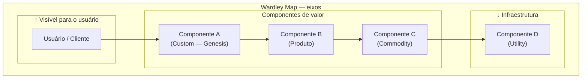

**Os quatro estágios evolutivos:**

| Estágio | Característica | Exemplos |
|---|---|---|
| **Genesis** | Novo, incerto, experimental. Vantagem competitiva se funcionar. | LLMs em 2020, blockchain em 2015 |
| **Custom Built** | Feito sob medida para cada usuário. Caro, difícil de escalar. | Engenharia de dados customizada, algoritmos proprietários |
| **Product** | Produto definido, repetível, com variações. Mercado existe. | SaaS B2B, frameworks de ML |
| **Commodity/Utility** | Padrão de mercado, intercambiável, comprado por preço. | Cloud computing, email, pagamentos |

##### Quando usar

Use o Wardley Map em dois contextos: (1) **decisão de build vs. buy vs. partner** — para cada componente da stack, o estágio evolutivo indica a estratégia correta: construir no Genesis/Custom (diferenciação), comprar/licenciar no Product (time-to-market), usar commodity/utility (sem fricção); (2) **planejamento de plataforma** — para visualizar quais componentes vão se tornar commodity e onde a vantagem competitiva vai se deslocar nos próximos 3-5 anos.

##### Princípios

**Primeiro: tudo evolui da esquerda para a direita.** Um componente que é Genesis hoje (LLMs em 2023) se torna Commodity mais rápido do que parece (LLM-as-a-service via API em 2025). Estratégia baseada em componentes que estão evoluindo para commodity é estratégia baseada em areia movediça.

**Segundo: construa no Genesis, compre no Product, use utilities.** Investir em construir internamente algo que já é commodity é desperdício de capital e talento. O mapa torna essa decisão visual — e discutível.

**Terceiro: a vantagem competitiva está nos componentes à esquerda que seus concorrentes ainda não têm.** Mas atenção: componente Genesis é arriscado porque pode não evoluir para Product, pode demorar mais do que o planejado, ou pode ser ultrapassado por nova abordagem.

##### Como aplicar

**Passo 1 — Identificar o usuário e suas necessidades:** O que o usuário precisa? (ex: "pagamento de fornecedores aprovado em < 1 hora")

**Passo 2 — Mapear a cadeia de valor:** Quais componentes entregam essa necessidade? Decomponha recursivamente: necessidade → componentes de produto → componentes de tecnologia → infraestrutura.

**Passo 3 — Posicionar cada componente no eixo X:** Para cada componente, determinar se é Genesis, Custom, Product ou Commodity no mercado atual.

**Passo 4 — Identificar movimentos estratégicos:**

- Componentes Custom/Genesis onde há diferenciação: proteger e investir
- Componentes Product que concorrentes têm e você não: acelerar adoção
- Componentes que estão evoluindo para Commodity: parar de construir internamente, migrar para solução de mercado
- Gaps na cadeia de valor: onde há componentes ausentes que impedem a entrega?

**Passo 5 — Simular o mapa em 3 anos:** Como cada componente vai ter evoluído? Onde vai surgir nova diferenciação?

##### Exemplo brasileiro — Startup de crédito (simplificado)

| Componente | Estágio atual | Estratégia |
|---|---|---|
| Modelo de crédito proprietário | Custom → Product | Construir internamente — diferenciação |
| Análise de dados alternativos (redes sociais, telecom) | Genesis → Custom | Investir — moat potencial |
| Engine de decisão de crédito (regras) | Product → Commodity | Avaliar plataformas de mercado (Experian, Serasa APIs) |
| Infraestrutura de open banking | Commodity | Usar APIs do Banco Central — não construir |
| Antifraude | Product | Licenciar (Konduto, Sift) — não construir |
| App mobile | Product | Construir UX própria; usar componentes de produto para funcionalidades não-diferenciadoras |

**Insight:** A startup gasta engenharia em antifraude (Product → Commodity) quando deveria gastar em dados alternativos (Genesis → Custom). O Wardley Map torna essa má alocação visível — e debatível com o board.

##### Erros comuns

- Mapear tudo como "nós construímos" por orgulho técnico — não há vantagem em reinventar commodity.
- Confundir "é importante" com "deve ser Genesis" — um componente pode ser crítico e ser commodity.
- Fazer o mapa uma vez e nunca atualizar — o eixo X muda ao longo do tempo; o mapa envelhece.
- Usar o Wardley Map para decisões táticas — é ferramenta estratégica, de horizonte 1-3 anos, não de sprint.

##### Quando NÃO usar

Em decisões táticas de sprint ou trimestre — o eixo evolutivo opera em janela de 1-3 anos. Em produtos sem cadeia de valor técnica significativa (negócios de serviço puramente humano, marketplace de oferta tradicional). Em fase pré-PMF, quando os componentes da cadeia de valor ainda não estão estabilizados — o mapa fica especulativo e pode anchorar decisões em premissas que serão substituídas.

##### Conexão com outros canvases

O Wardley Map **complementa o Strategy Canvas (Fase 19)** — o Strategy Canvas mostra onde competir em dimensões do mercado; o Wardley Map mostra como a tecnologia e os componentes evoluem. **Alimenta decisões de make/buy/partner no Capítulo 7 (Vol. 3) (PLATAFORMA VS PRODUTO: QUANDO CONSTRUIR PLATAFORMA E QUANDO NÃO)** (Plataforma vs. Produto) e no [[IGNICAO-Vol-7-Produto-Engenharia-e-Operacoes#CAPÍTULO 4 — ENGINEERING MANAGEMENT: GESTÃO DO TIME TÉCNICO E DEVELOPER EXPERIENCE|Capítulo 4 — Engineering Management (Vol. 7)]].

##### Leitura adicional

- *Wardley Maps* (Simon Wardley, 2020) — disponível gratuitamente em medium.com/@swardley.
- *Team Topologies* (Skelton & Pais, 2019) — estrutura organizacional alinhada à topologia do sistema.
- [[IGNICAO-Vol-3-Experimentos-e-Prototipagem#CAPÍTULO 7 — PLATAFORMA VS PRODUTO: QUANDO CONSTRUIR PLATAFORMA E QUANDO NÃO|Capítulo 7 — Plataforma vs. Produto (Vol. 3)]].
- Ferramenta online: onlinewardleymaps.com

---

#### Canvas: Strategy Canvas (W. Chan Kim & Renée Mauborgne, 2005)

##### Origem

W. Chan Kim e Renée Mauborgne, professores do INSEAD, publicaram *Blue Ocean Strategy* em 2005 após quinze anos de pesquisa empírica analisando 150 movimentos estratégicos em 30 indústrias ao longo de cem anos. A tese central é que **competir em mercado saturado (red ocean) é destrutivo, e criar novo espaço de mercado (blue ocean) é a estratégia vencedora**. O Strategy Canvas é a ferramenta visual central do framework — gráfico que compara curvas de valor de concorrentes para revelar onde existe espaço de diferenciação real, em vez da disputa palmo-a-palmo nas mesmas dimensões. O livro vendeu mais de quatro milhões de cópias e o Strategy Canvas virou referência em planejamento estratégico, embora tenha sido subutilizado em startup brasileira (frequentemente substituído por Porter's Five Forces ou matriz BCG, que são ferramentas distintas).

##### O que é

Gráfico de duas dimensões. **Eixo X**: fatores de competição relevantes no setor (tipicamente 8-15 fatores listados horizontalmente). **Eixo Y**: nível de oferta de cada fator, em escala de baixo a alto. Para cada concorrente (incluindo você), traça-se uma **curva de valor** — uma linha que conecta os pontos representando quanto desse concorrente oferece em cada fator.

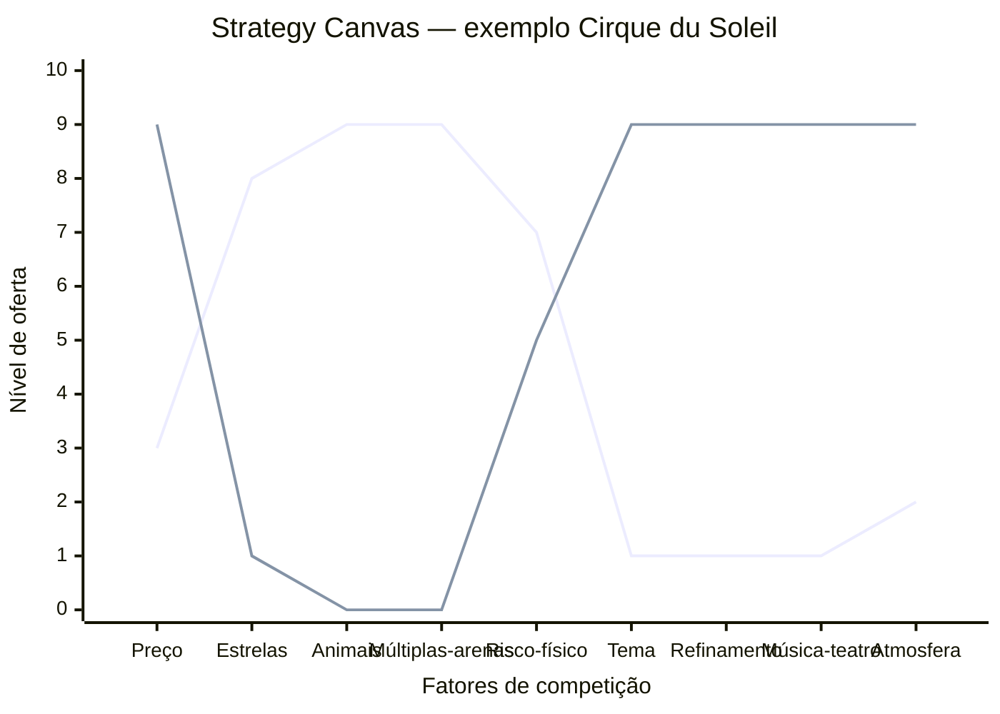

A linha superior representa o circo tradicional (Ringling, Barnum & Bailey): alto em estrelas, animais, múltiplas arenas, risco. A linha inferior representa o Cirque du Soleil: alto em tema, refinamento, música/teatro, atmosfera; baixo em estrelas e animais. Onde as curvas divergem dramaticamente, há diferenciação. Onde se sobrepõem, há comoditização.

A análise associada é o **ERRC Grid** — quatro decisões estratégicas para mover a curva:

- **Eliminate**: que fatores que o setor compete podem ser totalmente eliminados?
- **Reduce**: que fatores podem ser reduzidos abaixo do padrão do setor?
- **Raise**: que fatores devem ser elevados acima do padrão?
- **Create**: que fatores nunca oferecidos pelo setor podem ser criados?

##### Quando usar

Use o Strategy Canvas na Fase 5 (mapeamento de mercado e concorrência) quando o setor parece saturado e você precisa decidir como diferenciar. Também use a cada 18-24 meses como check-up estratégico — concorrência se aproxima da sua curva ao longo do tempo, e o Strategy Canvas revela quando a diferenciação está erodindo. Use também em Fase 15 (reinvenção) quando considerar segunda curva.

##### Princípios

A tese de Kim e Mauborgne é que **competição direta é desperdício de capital**. Se duas empresas oferecem o mesmo conjunto de fatores em níveis ligeiramente diferentes, elas brigam por margem cada vez menor. A saída é **mudar o jogo**, não jogar melhor o mesmo jogo. Para isso, é preciso mapear honestamente o que o setor compete (a maioria não articula explicitamente) e identificar onde você pode oferecer perfil radicalmente distinto. **Diferenciação + Custo Baixo simultâneos** é possível quando você elimina/reduz fatores caros e cria fatores baratos mas valiosos.

##### Como aplicar

**Etapa 1 — Mapear o setor atual.** Liste os 8-15 fatores em que os concorrentes competem. Pergunte: o que o cliente compara antes de comprar? O que aparece nas propagandas? O que aparece nas reviews? Tipicamente: preço, qualidade, marca, conveniência, suporte, customização, velocidade, escala. Seja específico ao seu setor.

**Etapa 2 — Traçar curvas dos concorrentes.** Para cada concorrente principal (3-5), atribua nota 1-10 em cada fator e desenhe a linha. Use dados reais (preço de tabela, NPS, share, reviews) quando disponível.

**Etapa 3 — Aplicar ERRC Grid.** Para cada fator, decida: eliminar, reduzir, elevar, criar. Articule por que (qual job-to-be-done deixa de ser servido vs qual passa a ser).

**Etapa 4 — Traçar a curva nova.** A sua curva deve ser **visualmente distinta** das curvas dos concorrentes. Se ela sobrepõe a média do setor com pequeno offset, não é Blue Ocean — é apenas otimização de Red Ocean.

**Etapa 5 — Validar com cliente.** Mostre as curvas para clientes-alvo. Pergunte: "Se essas duas opções existissem, qual escolheria? Por quê?". Se a resposta é "depende", a diferenciação não é forte o suficiente.

Tempo: 4-8 horas para a primeira versão (exige pesquisa de campo dos concorrentes). Revisar a cada 12-18 meses.

##### Exemplo brasileiro preenchido — Stone vs adquirentes tradicionais (2014)

Em 2014, o setor brasileiro de adquirência (Cielo, Rede, Stone nascente) competia em fatores tipicamente bancários: preço de MDR (taxa por transação), aluguel de máquina, prazo de antecipação, marca, capilaridade. Stone construiu sua curva de valor diferente:

| Fator | Cielo / Rede (média do setor) | Stone (entrante 2014) | Decisão ERRC |
|---|---|---|---|
| MDR (taxa) | 3-4% | 2-3% | Reduce |
| Aluguel da máquina | R$ 50-100/mês | R$ 0 (subsidiado) | Reduce |
| Prazo de antecipação | 30-60 dias | 1 dia (D+1) | Raise |
| Atendimento ao lojista | Call center distante, demora dias | "Ponto-de-Atenção" — humano dedicado, resposta em horas | Raise |
| Capilaridade física | Alta (rede bancária) | Baixa (foco digital) | Reduce |
| Hardware proprietário | Padrão setor (Verifone) | Stone Box (proprietário) | Create |
| Software de gestão integrada | Pouco | Stone Hub (PDV + gestão) | Create |
| Marca corporativa-bancária | Alta | Baixa (mas crescente) | Reduce |

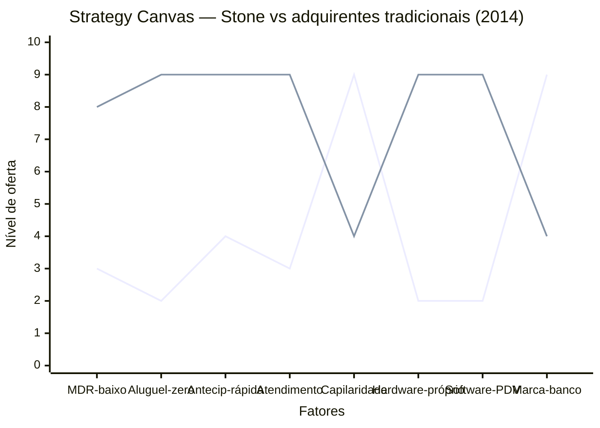

**Insight do caso.** Stone não venceu fazendo o que Cielo fazia mais barato. Venceu **mudando o que o setor competia**: criou Atendimento Diferenciado (Ponto-de-Atenção, não call center), criou hardware/software próprios para lojistas pequenos (não comprou da Verifone), reduziu o aluguel a zero, antecipou pagamento. O resultado foi uma curva visualmente distinta — comprador de Stone NÃO via Stone como "Cielo mais barata", via como **adquirente diferente**. Isso é Blue Ocean: a Stone não tirava clientes da Cielo apenas via preço, abria mercado novo (lojistas pequenos antes desatendidos pela burocracia bancária). O IPO em 2018 (NASDAQ, valuation US$ 7+ bilhões) validou a aposta.

##### Variações e extensões

- **Pioneer-Migrator-Settler Map**: classifica produtos do portfólio em pioneiros (alta diferenciação, alta margem), migradores (alguma diferenciação) e colonos (commodity). Útil para gestão de portfólio.
- **Six Paths Framework**: seis lentes para identificar Blue Ocean (indústria alternativa, grupos estratégicos, cadeia de compradores, oferta complementar, apelo emocional vs funcional, tendências de tempo).
- **Buyer Utility Map**: cruza ciclo de uso do cliente com seis utilidades (produtividade, simplicidade, conveniência, risco, diversão, sustentabilidade).

##### Erros comuns

- Listar fatores genéricos (preço, qualidade) em vez de fatores específicos do setor.
- Curva nova "ligeiramente acima" da média do setor — isso é otimização, não Blue Ocean.
- Eliminar/reduzir fatores que clientes ainda valorizam — pesquisar antes, não decidir no escritório.
- Confundir Strategy Canvas com posicionamento de marketing — é estratégia operacional (o que construir), não slogan.
- Não validar a curva nova com cliente antes de comprometer recursos — Blue Ocean teórico que ninguém prefere é apenas oceano vazio.

##### Quando NÃO usar

Em setores muito regulados onde os fatores de competição são fixados por norma (não há liberdade de Eliminar/Reduzir/Raise/Create). Em commoditização extrema onde o cliente realmente só compara preço. Em produtos B2B muito customizados onde cada deal tem fatores distintos — Strategy Canvas pressupõe oferta padronizada.

##### Conexão com outros canvases

O Strategy Canvas **complementa** o BMC (Fase 2): o BMC olha para dentro (modelo), o Strategy Canvas olha para fora (concorrência). **Pareia com o Canvas da Cunha (Fase 6)**: a Cunha define o nicho de entrada; o Strategy Canvas define a curva de valor distinta nesse nicho. **Sucede o VPC (Fase 5)**: depois de entender Pains e Gains do cliente, o Strategy Canvas decide quais Pain Relievers/Gain Creators construir vs eliminar.

##### Leitura adicional

- *Blue Ocean Strategy* (W. Chan Kim & Renée Mauborgne, 2005).
- *Blue Ocean Shift* (Kim & Mauborgne, 2017) — versão com playbook executivo mais detalhado.
- [blueoceanstrategy.com](https://www.blueoceanstrategy.com) — biblioteca de cases e ferramentas.

---

### SÍNTESE DA FASE 19

Nessa fase você diagnosticou a saturação (com dados, não intuição), avaliou candidatas à segunda curva pelo critério TAM mais FMF, escolheu o tipo de pivot maduro e instalou ambidestria organizacional real — time dedicado, orçamento próprio e métricas de aprendizado, não de resultado financeiro imediato. A reinvenção bem-feita é estrutural: Magalu levou uma década, Microsoft levou cinco anos com canibalização tolerada. Empresas que tratam [[#FASE 19 — REINVENÇÃO E SEGUNDA CURVA|Fase 19]] como "projeto de inovação" com prazo curto sempre falham.

A [[#FASE 20 — ESTRATÉGIA DE SAÍDA (EXIT STRATEGY)|Fase 20]] começa aqui: fundadores que chegaram a esse ponto, com segunda curva rodando ou com decisão clara sobre o próximo capítulo, estão em posição de planejar o exit com poder de barganha.

> [!note] Quando a "segunda curva" é uma empresa nova (fundador serial)
> Há um caminho alternativo à reinvenção dentro da empresa atual: o fundador faz o exit (Fase 20) e relança em empresa nova. Esse caminho é tratado no [[#CAPÍTULO 22 — SECOND-TIME FOUNDER|Capítulo 22 (SECOND-TIME FOUNDER)]], que cobre o que muda quando você empreende com track record (rede mais densa, investidores que voltam, padrões pessoais que ajudam ou prejudicam, decisão entre repetir setor ou pivotar de domínio). Se a sua segunda curva é "outra empresa", não "outro produto na mesma empresa", o Capítulo 21 (Second-Time Founder) é a continuação natural depois do exit da Fase 20.

---

## FASE 20 — ESTRATÉGIA DE SAÍDA (EXIT STRATEGY)

### O que esta fase cobre

Planejamento e execução da saída do(s) fundador(es), total ou parcial, do negócio construído. O entregável é o Plano de Exit (saída — venda ou encerramento da empresa). Contendo cenários, preparação, estrutura fiscal, e decisões estratégicas sobre timing e método.

> [!abstract] Resumo operacional
> **Entregável:** Plano de Exit com cenários (M&A estratégico, M&A financeiro, IPO, secondary, acqui-hire ou shutdown voluntário), preparação operacional/jurídica/fiscal da empresa, data room montado e tax structuring implementado dois ou mais anos antes.
>
> **Sinais de saída:**
> - Tipo de exit definido com clareza, mapa de cinco a vinte e cinco potenciais compradores construído e assessor de M&A ou banker em relação ativa.
> - Data room preenchido em todas as nove categorias (legal, financeiros auditados, KPIs, contratos, IP, RH, compliance) e tax structuring implementado em cem por cento dos fundadores.
> - Acordo de sócios cobre drag-along, tag-along e protective provisions; cofundadores e investidores alinhados sobre "quando vender", com walk-away e alvo definidos.
>
> **Três armadilhas mais comuns:**
> 1. Vender com um único interessado — competição entre dois ou três compradores em paralelo vale vinte a cinquenta por cento do preço final.
> 2. Aceitar earnouts sem cuidado — earnouts de trinta por cento ou mais frequentemente não são pagos; prefira cash no closing quando possível.
> 3. Desconsiderar tax structuring — a diferença entre estrutura bem e mal planejada pode ser trinta a cinquenta por cento do valor realizado.

### POR QUE

Exit é frequentemente tratado como "fim" distante. Algo para se preocupar "quando chegar lá". É um erro. Exit é evento planejado, não sorteado. E decisões tomadas três a cinco anos antes dele determinam o valor realizado e o custo fiscal.

Os fundadores que pensam em exit só quando aparece comprador tipicamente recebem valuations trinta a sessenta por cento menores do que poderiam. Pagam duas a três vezes mais em impostos do que pagariam com estrutura preparada. Vendem em janela ruim (mercado em baixa). E perdem alinhamento com cofundadores e investidores na reta final.

> [!important] O sentido do planejamento de exit
> Planejamento de exit não é sobre vender logo. É sobre *ter a opção* quando fizer sentido vender. Founder que mantém a opção em aberto tem poder de barganha. Founder que precisa vender, quando o telefone toca, vende mal.

### Quando usar

Comece o planejamento estratégico dois a três anos antes de qualquer exit provável. Isso significa: começar a pensar em exit de Série A em diante. A execução leva seis a dezoito meses entre a decisão de vender e o fechamento. Revisite anualmente, mesmo se o exit não é prioridade imediata. As condições de mercado mudam.

### Quem envolve

O executor principal é o CEO, com CFO e advisor de M&A (Fusões e Aquisições). Os participantes são cofundadores, board, maior investidor, advogados especializados em M&A, e banker (se IPO (Oferta Pública Inicial — abertura de capital na bolsa), ou M&A grande). O decisor final são os sócios fundadores, com aprovação do board conforme termos.

### Como executar

Sete passos.

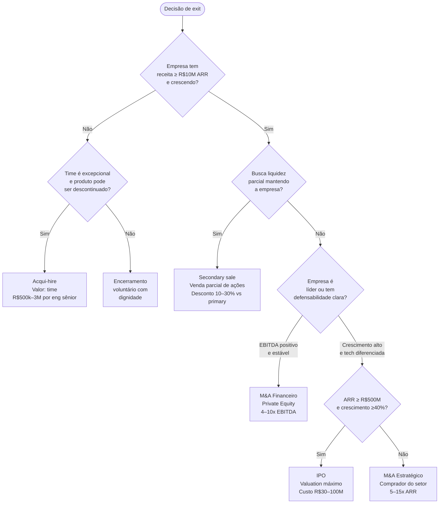

> [!tip] Regra de ouro do exit
> Nenhum tipo de exit é "melhor" em abstrato. O melhor é aquele que combina: sinais de mercado favoráveis (múltiplos altos), empresa preparada (data room, métricas auditáveis), e fundador com clareza sobre o próximo capítulo. Quando os três se alinham, exit flui. Quando um está fora, você negocia em desvantagem.

> [!tip] Storytelling Canvas para a narrativa do exit
> M&A estratégico, IPO e pitch de secondary são, antes de tudo, narrativas. Use o [[#Canvas: Storytelling Canvas|Canvas: Storytelling Canvas]] para construir a narrativa antes de abrir o data room ou montar o deck. Blocos críticos neste contexto: **Herói** (o comprador/investidor, não você — o que *eles* ganham?), **Mundo depois** (como a aquisição/IPO muda o portfólio ou tese do investidor), **Evidências** (métricas auditáveis do Pirate Canvas / AARRR, NRR, LTV/CAC). O caso Omie em Canvas: Storytelling Canvas (Fase 20) ilustra como colocar o contador (intermediário de canal) como herói — e não o dono de PME nem a Omie — produziu uma narrativa que ativou simultaneamente investidores e canal de distribuição.

#### Passo 1, mapeie os 5 tipos principais de exit

Cada um tem timing, valuation, requisitos e implicações fundamentalmente diferentes.

##### Tipo A, M&A estratégico, venda para concorrente ou complementar

O comprador típico é empresa maior do mesmo setor, ou de setor adjacente, buscando consolidação, expansão geográfica ou tecnologia. O valuation típico é cinco a quinze vezes ARR para SaaS B2B. Uma a cinco vezes a receita para serviços. Múltiplos mais altos para tech diferenciada. Os requisitos: ARR de R$ 10-20 milhões ou mais, crescimento saudável e defensibilidade identificável. O tempo do processo: seis a doze meses do primeiro contato ao closing. Os prós: liquidez total rápida e prêmio estratégico possível. Os contras: integração pode destruir valor, cultura se perde e lock-ups longos frequentes (dezoito a trinta e seis meses).

##### Tipo B, M&A financeiro, venda para private equity

O comprador típico é fundo de PE, buscando negócio com fluxo de caixa estável. O valuation típico é quatro a dez vezes EBITDA (dependente de crescimento, recorrência e margem). Os requisitos: EBITDA positivo e crescente, métricas operacionais maduras e time de gestão sólido. O tempo: seis a nove meses. Os prós: preserva a empresa como entidade e oferece liquidez parcial ou total para fundadores. Os contras: PE tipicamente quer setenta a cem por cento do equity, e a direção da empresa passa para eles.

##### Tipo C, IPO (Initial Public Offering)

Viável quando a receita está em R$ 500 milhões a R$ 1 bilhão anualizada, crescimento de quarenta por cento ao ano ou mais, e path to profitability claro. Requer dois a três anos de preparação (auditoria, governança, CFO experiente, banker). O processo formal leva seis a nove meses de S-1 ou prospecto, mais roadshow. Vantagem: valuation potencialmente máximo e liquidez contínua. Desvantagem: custo de R$ 30-100 milhões, escrutínio trimestral e regulação pesada.

> [!tip] Capítulo 17 — IPO: Processo, Preparação e Governança
> Detalhamento do processo de abertura de capital: linha do tempo, requisitos de governança, seleção de bankers, estrutura do prospecto, roadshow e gestão de expectativas de analistas pós-IPO.

##### Tipo D, Secondary sale (venda secundária — fundador vende participação sem a empresa captar novo capital)

Fundadores e funcionários vendem parte das ações antes do exit final — típico em pós-Série B ou C, quando se quer "tirar fichas da mesa" sem vender a empresa. Valuation com desconto de dez a trinta por cento sobre valuation primary. Alivia risco pessoal e preserva upside futuro, mas pode gerar desalinhamento com investidores que ainda não têm liquidez.

> [!tip] Capítulo 16 — Secondary e Liquidez Parcial
> Mercado secundário de ações privadas: como funciona, quem são os fundos de secondary, como estruturar a transação, impacto no cap table e na governança, e quando faz sentido versus esperar pelo exit principal.

> [!tip] Capítulo 16 — Mercado Secundário de Ações Privadas
> Dinâmica do mercado secundário brasileiro e global: plataformas de secondary, precificação com desconto, questões de transferibilidade nos acordos de sócios, e como founders e funcionários com equity podem acessar liquidez antes do exit.

##### Tipo E, Acqui-hire

Usado quando o produto ou mercado não funcionou, mas o time é excelente. O comprador típico: big tech ou scale-up precisando de time técnico. A estrutura: a empresa adquirida é descontinuada e o equity dos fundadores é convertido em pacote de retenção (RSUs com vesting de dois a quatro anos). O "valuation" típico: R$ 500 mil a R$ 3 milhões por engenheiro sênior, mais retention bonus. Os prós: alternativa a fechar a empresa com perdas e time preservado. Os contras: fundadores tipicamente realizam muito pouco e investidores podem não recuperar o capital.

#### Passo 2, entenda os sinais de que é hora de considerar vender

A decisão de vender não é só sobre oportunidade do comprador. É também sobre contexto do mercado, da empresa e dos fundadores. Em três categorias.

**Sinais externos (mercado).** Múltiplos de mercado no topo histórico do setor. Consolidação acelerando (dois ou mais grandes M&A em doze meses no setor). Concorrente levantou rodada gigante e vai investir agressivamente (sua defesa fica mais cara). Mudança regulatória ou tecnológica iminente que pode mudar o jogo.

**Sinais internos (empresa).** Crescimento desacelerando e pivô difícil de executar. Capital necessário para o próximo salto é grande demais para cenários VC realistas. Time fundador em desalinhamento crônico sobre direção. Concentração em clientes ou canais expondo a risco crescente.

**Sinais pessoais (fundador).** Paixão e energia decrescendo depois de cinco a dez anos na jornada. Oportunidades pessoais (outro negócio, saúde, família) competindo. Risco pessoal desproporcional (patrimônio líquido todo concentrado no negócio). O próximo capítulo exige habilidades que você não tem ou não quer desenvolver.

> [!important] Regra operacional sobre sinais de exit
> Dois ou mais sinais em duas ou mais categorias merece considerar a sério. Não significa decidir. Significa abrir a conversa com board e advisors. Sinais isolados em uma única categoria são mais frequentemente ruído do que sinal.

#### Passo 3, prepare a empresa para exit (2-3 anos antes)

Empresa preparada para exit vale vinte a quarenta por cento mais que empresa em estado "operacional normal". O que preparar, em cinco frentes.

##### Preparação financeira

> [!tip] Capítulo 15 (Vol. 5) — Valuation Methods
> DCF, comparáveis de mercado, precedent transactions e regras de múltiplo por setor: como calcular o valuation interno antes de sentar com um comprador, e como interpretar a divergência entre valuation interno e proposta do adquirente.

> [!tip] Canvases Visuais — Capital Stack / Waterfall em exit (Fase 20)
> Em exit (M&A ou IPO), os proceeds não são divididos pro-rata — passam pelo waterfall do [[#Canvas: Capital Stack / Waterfall Canvas|Canvas: Capital Stack / Waterfall Canvas]]: liquidation preferences (1x ou 2x preferred), participation, conversion, ESOP exercise. Fundadores que não modelam o waterfall ANTES de assinar term sheet descobrem em closing que ficaram com fração menor do que esperavam (ex.: liquidation preference 2x participating em rodada de R$ 100M força investidor a receber R$ 200M antes de qualquer split — e em valuations de exit modestos, fundador zera). Use o canvas para simular cenários de exit em diferentes valuations (alto, médio, baixo) ainda dois ou três anos antes da venda.

Contrate auditoria externa das demonstrações dos últimos três anos. Garanta que DRE, balanço e fluxo de caixa estejam limpos e defendíveis. Organize o cap table (tabela de capitalização — registro de quem tem quanto da empresa) sem zonas cinzentas. Documente contratos materiais. Prepare projeções financeiras de três a cinco anos com premissas claras.

##### Preparação operacional

Documente processos críticos (vide [[IGNICAO-Vol-6-Receita-e-Pessoas#FASE 16 — TIME, LIDERANÇA EXECUTIVA E CULTURA EM ESCALA|Fase 16 (Vol. 6)]], Operações). Meça e reporte KPIs de forma recorrente. Limpe o organograma, reduzindo dependências excessivas de pessoas-chave. Organize dados históricos em data warehouse acessível.

##### Preparação jurídica

Faça due diligence (auditoria prévia à aquisição) interno: contratos de trabalho, IP, marcas, licenças, contratos comerciais e compliance regulatório. Confirme que a propriedade intelectual está claramente atribuída à empresa. Mantenha compliance LGPD em dia e auditável. Atualize o acordo de sócios (drag-along, tag-along, saída).

> [!note]
> Due diligence de compliance — Lei 12.846 (anticorrupção), políticas internas e exposições regulatórias que afetam o valuation — está no [[IGNICAO-Vol-8-Juridico-LGPD-e-Seguranca#CAPÍTULO 12 — COMPLIANCE E ANTICORRUPÇÃO PARA STARTUPS|Capítulo 12 — Compliance e Anticorrupção (Vol. 8)]].

##### Preparação de governança

Monte um board formal, com pelo menos um independente. Realize reuniões regulares com atas. Documente decisões estratégicas.

##### Data room pronto

Organize a documentação para apresentar a potenciais compradores. Em nove categorias: estrutura legal e societária; financeiros históricos auditados mais projeções; KPIs operacionais por ano e trimestre; cohort analysis; pipeline comercial; contratos materiais (top vinte clientes, parcerias estratégicas e fornecedores críticos); documentação de IP; contratos trabalhistas e policies de RH; relatórios de compliance (fiscal, LGPD, trabalhista).

##### Preparação do CEO

Pratique a narrativa estratégica da empresa (pitch de trinta minutos para compradores). Construa relações com potenciais compradores (eventos, intros via banker). Contrate advisor de M&A ou banker.

> [!tip] Capítulo 13 (Vol. 5) — Captação e Pitch
> Como construir o pitch para compradores estratégicos e investidores de growth: estrutura do deck, materiais do data room, como posicionar a empresa para valuation máximo e os erros mais comuns na narrativa de exit.

> [!tip] Capítulo 14 (Vol. 5) — Planejamento de Rodada
> Para exits que envolvem rodada de growth ou pré-IPO antes da venda: como planejar valuation, dilution, escolha de investidores e estrutura de instrumentos para maximizar o poder de barganha na transação final.

> [!tip] Capítulo 16 (Vol. 5) — Instrumentos de Captação (SAFE, CRI, Debênture)
> Instrumentos alternativos de captação que podem preceder ou estruturar um exit: quando usar SAFE, nota conversível ou dívida em vez de equity, e as implicações de cada um no momento da venda.

#### Passo 4, estruture o processo de venda (quando decidir executar)

> [!note]
> M&A acima dos limites de faturamento do CADE exige notificação obrigatória de Ato de Concentração antes do closing. Ver [[IGNICAO-Vol-10-Playbooks-Setoriais-e-Glossario#CAPÍTULO 5 — CADE E ANTITRUSTE — QUANDO O CRESCIMENTO ATRAI O REGULADOR|Capítulo 5 — CADE e Antitruste (Vol. 10)]] para os critérios e o processo.

> [!tip] Capítulo 13 — M&A Ativo: Estratégia de Aquisições
> Para fundadores que, após a venda ou durante a escala, querem usar M&A como alavanca estratégica — seja para consolidar o setor, entrar em adjacências ou construir portfolio: tese de M&A, processo de sourcing e integração pós-deal.

**Timeline típica de M&A estratégico, em seis janelas.** Mês 1-2: contrate banker ou M&A advisor e prepare o material. Mês 2-4: crie shortlist de potenciais compradores (dez a vinte e cinco empresas) e inicie primeiras conversas via banker ou network. Mês 4-6: assine NDAs, envie o CIM (Confidential Information Memorandum — documento confidencial que descreve a empresa para compradores) e receba IOIs (Indications of Interest — manifestações de interesse). Mês 6-8: faça management presentations com três a cinco compradores sérios e receba LOIs (Letters of Intent — cartas de intenção). Mês 8-10: selecione o comprador preferido, entre em exclusividade (sessenta a noventa dias) e avance para due diligence profunda. Mês 10-12: negocie o SPA (Share Purchase Agreement — contrato de compra e venda de participação) e feche o deal.

> [!note]
> Comunicação durante processo de venda — vazamentos, reação de clientes, time e mercado — exige protocolo específico tratado no [[#CAPÍTULO 10 — COMUNICAÇÃO EM CRISE|Capítulo 10 — Comunicação em Crise]].

> [!important] O papel do banker ou advisor
> Cobra dois a cinco por cento do valor da transação. Mas tipicamente aumenta o preço em quinze a trinta por cento versus venda direta e evita armadilhas legais e fiscais. Em deals acima de R$ 50 milhões, praticamente obrigatório. O fee parece alto até você ver o que ele recupera em negociação.

> [!tip] Capítulo 11 (Vol. 4) — Negociação em M&A
> Táticas e estratégias específicas para negociação de deals de M&A: BATNA em contexto de exit, como criar competição entre compradores, concessões e proteções no SPA, e como negociar earnout, lock-up e non-compete de forma integrada.

**Os elementos-chave do SPA (Share Purchase Agreement), em sete pontos.**

Purchase price. Valor total e forma (cash, equity, seller note, earnout (bônus pós-fechamento atrelado a metas futuras)).

#### Passo 5, negocie earnout com proteções (mecânica e armadilhas)

O earnout é o mecanismo mais frequentemente mal compreendido em M&A. Fundadores aceitam a estrutura pensando que vão receber o valor total se "continuarem fazendo o que fazem". Na prática, a maioria dos earnouts é parcialmente ou totalmente não pago — não por má-fé, mas por mudanças operacionais pós-aquisição que tornam as métricas impossíveis de atingir.

**Como earnout é estruturado na prática.**

Valor total do deal: R$ 100M. Estrutura típica: R$ 65M no closing (upfront) + R$ 35M em earnout.

O earnout de R$ 35M é dividido em janelas anuais: R$ 12M se atingir meta no Ano 1, R$ 12M no Ano 2, R$ 11M no Ano 3. Cada janela tem métrica-gatilho (receita, EBITDA, churn, usuários ativos, ou combinação).

**Os quatro tipos de métrica de earnout e seus riscos.**

*Receita total*: mais simples, mas facilmente manipulável pelo adquirente — pode alocar receita de produtos do adquirente que usam sua plataforma em linhas contábeis diferentes. Exija definição de receita atribuída à unidade adquirida especificamente.

*EBITDA*: perigoso para o fundador. O adquirente pode alocar custos corporativos (overhead de escritório, software, serviços compartilhados) para a unidade adquirida, reduzindo o EBITDA abaixo do threshold. Exija capped corporate allocations com valor máximo definido no SPA.

*Crescimento de receita*: percentual de crescimento sobre base. Problema: se o adquirente migra clientes da unidade adquirida para outros produtos da holding, a base diminui e o crescimento percentual fica impossível de atingir. Exija anti-dilution covenant que impede migração de clientes sem compensação.

*Métricas operacionais (usuários, ativação, NPS)*: mais defensável para o fundador porque dependem menos de alocação contábil do adquirente. Mas exigem definição precisa de como cada métrica é calculada — pré-definir no contrato, não deixar para o adquirente definir depois.

**Negociação de earnout — cinco cláusulas que protegem o fundador.**

1. *Autonomia operacional mínima*: o fundador mantém controle sobre headcount, produto e go-to-market por período definido (12-18 meses). Sem isso, o adquirente pode mudar tudo e depois argumentar que "as metas não foram atingidas por má gestão" — sua culpa, não deles.

2. *Anti-sandbagging na métrica*: se o adquirente tomar ação que torne a métrica impossível de atingir (exemplo: desligar canal de vendas que gerava 40% da receita), o earnout é pago integralmente ou proporcionalmente compensado.

3. *Aceleração em change of control*: se o adquirente for adquirido por terceiro antes do earnout terminar, o saldo restante é pago integralmente no closing do deal seguinte.

4. *Dispute resolution mechanism*: se houver divergência sobre o cálculo da métrica, qual é o processo de resolução? Árbitro independente, big four auditora, ou mecanismo específico acordado. Sem isso, o processo judicial dura anos.

5. *Earnout não como incentivo — como deferred price*: no SPA, descreva o earnout como "parcela diferida do preço de compra sujeita a condições", não como "bônus de performance". Isso muda a interpretação fiscal e pode reduzir o imposto pago quando recebido.

> [!warning] A estatística que fundadores ignoram
> Estudos de M&A (Cass Business School, Harvard) mostram que 40-60% dos earnouts não são pagos integralmente. A razão mais comum: integração pós-aquisição cria mudanças que o fundador não antecipou e que as cláusulas do SPA não protegiam. Regra prática: negocie como se o earnout não vai ser pago. O upfront deve ser suficiente para você considerar o deal justo mesmo sem o earnout. Se não for, negocie mais upfront — não mais earnout.

Lock-up. Fundadores ficam X meses ou anos pós-closing. Típico: dezoito a trinta e seis meses, com retention bonus.

Non-compete. Fundadores não podem competir por X anos em Y mercados.

> [!tip] Capítulo 4 (Vol. 8) — Cláusulas de Não-Concorrência
> Validade, alcance e negociação de non-compete no contexto brasileiro: o que é legalmente executável, como negociar períodos e geografias, e as diferenças entre non-compete, non-solicitation e NDA.

Representations and Warranties. Declarações sobre estado da empresa. Falsidade gera indenização.

Escrow. Parcela do preço retida em conta-escrow (tipicamente dez a quinze por cento por doze a dezoito meses) para cobrir eventuais claims.

Closing conditions. O que precisa acontecer entre assinatura e closing (aprovações regulatórias, consentimentos de terceiros, etc.).

#### Passo 6, planeje tax structuring (pode salvar 20-40% do exit)

Esse é o ponto mais negligenciado pelos fundadores. Decisões feitas *anos antes* do exit afetam drasticamente o IR pago. As quatro estruturas principais no Brasil: pessoa física (IR de quinze a vinte e dois vírgula cinco por cento progressivo — simples, mas caro), holding pessoal (dividendos isentos na regra atual, mas há IR sobre ganho de capital na venda subjacente), estrutura offshore (Delaware, Cayman, BVI — legal se estruturada cedo, com compliance alto) e Seção 1202 QSBS para empresas americanas (isenção em até US$ 10 milhões se ações mantidas por cinco anos ou mais).

> [!tip] Capítulo 18 — Tributação do Exit
> Tributacao do exit no Brasil, holding patrimonial, JCP, exit tax, ganho de capital PF vs PJ. Para detalhes, ver Capítulo 18 (TRIBUTAÇÃO DO EXIT PARA FUNDADORES BRASILEIROS) e Capítulo 2 (Vol. 5) (CONTABILIDADE, TRIBUTÁRIO E REGIMES FISCAIS PARA STARTUP BRASILEIRA).

> [!warning] Princípio sobre tax structuring
> Qualquer estrutura exige preparação de dois a cinco anos antes do exit. Fazer na última hora é fazer errado. E fazer errado, em deal de R$ 100 milhões, custa R$ 10-30 milhões em imposto evitável.

> [!important] Recomendação firme sobre tax advisor
> Contrate tax advisor especializado em M&A (não contador regular) dois ou mais anos antes do exit esperado. O custo: R$ 50-200 mil. O retorno: frequentemente R$ 1-20 milhões ou mais economizados.

#### Passo 7, alinhe com cofundadores, investidores e time-chave

Exit gera conflitos previsíveis. Em três frentes.

**Entre cofundadores.** Um quer vender, outro não. O valuation "satisfatório" diverge entre sócios. Lock-up pós-venda é tolerável para um, prisão para outro. Prevenção: o acordo de sócios deve prever drag-along (maioria obriga minoria a vender), tag-along (minoria pode exigir vender junto), e critério claro para decisão de venda (percentual de aprovação).

**Entre fundadores e investidores.** Investidor quer liquidez. Fundador quer continuar crescendo. Liquidation preference (preferência de liquidação — investidores recebem antes dos fundadores até certo valor) gera desalinhamento. Se o preço é menor que duas a três vezes o valuation, o investidor preferencial recebe mais e o fundador recebe menos. Prevenção: o acordo de sócios deve prever protective provisions claras e alinhamento formal sobre quando vender (por exemplo, "se a oferta é maior ou igual a X, o board vota").

**Com time-chave.** Exit frequentemente significa saída de C-level pós-lockup. Use retention bonuses pós-closing para reter talento crítico. Stock options precisam ter aceleração em change-of-control para funcionar como ferramenta de retenção.

> [!tip] Capítulo 20 — Retenção Pós-M&A
> Como estruturar retention bonuses, aceleração de vesting, earnout de time e comunicação cultural durante a integração — os primeiros doze meses pós-closing são onde a maioria das aquisições perdem o time que justificou o deal.

### Quando exit é shutdown, encerramento voluntário com dignidade

A maior parte desse livro trata a saída da empresa como venda (M&A) ou listagem (IPO). Mas existe uma forma de exit que raramente aparece em manuais e que, na prática, é mais comum: *o encerramento voluntário*. Não é fracasso dramático nem venda negociada. É decisão consciente de encerrar a operação enquanto ainda é possível fazê-lo com dignidade, preservando relações e recursos.

Os fundadores dedicam anos a construir as suas empresas e, com frequência, apenas semanas a encerrá-las — por pressa, por vergonha, por ter ficado longo demais. O resultado é encerramento mal feito: relacionamentos rompidos, lições não internalizadas, marca pessoal prejudicada e dinheiro perdido que poderia ter sido preservado. O encerramento bem-feito é trabalho tão profissional quanto o começo bem-feito e merece planejamento específico.

> [!note]
> Quando o encerramento não é voluntário — recuperação judicial, falência e wind-down em insolvência — os procedimentos legais estão no [[#CAPÍTULO 12 — RECUPERAÇÃO JUDICIAL E WIND-DOWN — QUANDO A STARTUP NÃO CONSEGUE CONTINUAR|Capítulo 12 — Recuperação Judicial e Wind-Down]]. Responsabilidade pessoal do sócio após o exit (desconsideração da personalidade jurídica, véu societário) está no [[IGNICAO-Vol-8-Juridico-LGPD-e-Seguranca#CAPÍTULO 2 — RESPONSABILIDADE DO SÓCIO E DO ADMINISTRADOR|Capítulo 2 — Responsabilidade do Sócio (Vol. 8)]].

#### Três cenários de encerramento voluntário

**Cenário A, o modelo não fecha.** A empresa tem produto e alguns clientes, mas os unit economics não chegam no território viável e você testou todas as variações razoáveis. Diferente de fracasso: aqui, você *validou* que o modelo não funciona — o que é aprendizado real. O capital restante permite encerramento ordenado.

**Cenário B, mudança da situação pessoal do fundador.** Você continua a acreditar na empresa, mas não pode continuar operando: doença grave, situação familiar que exige tempo integral, oportunidade profissional externa impossível de recusar. A empresa é viável — você é quem não pode continuar. A escolha entre encerrar e transferir a liderança é real.

**Cenário C, pivot que exigiria recomeçar.** A empresa atual não é mais o que você quer construir e o pivot necessário é tão grande que equivale a começar outra empresa. Encerrar a atual, devolver capital ainda disponível e começar a nova é mais honesto do que fingir que é pivot da atual.

Em todos os três, *o encerramento voluntário acontece enquanto ainda existe capital e escolha*. Diferente do encerramento por insolvência — que é imposto e tem regras legais rígidas — o voluntário permite escolhas sobre ritmo, comunicação e preservação de valor residual.

#### Os seis passos do encerramento ordenado

##### Passo 1, confirme a decisão com três perspectivas externas, antes de comunicar

Converse com cofounder (se houver), um mentor sênior e pelo menos um investidor, antes de anunciar. Não para pedir permissão — a decisão é sua. Mas para testar se não existe rota que você não viu. Se as três pessoas confirmam que encerrar é a decisão certa, você reduz a chance de arrependimento posterior.

##### Passo 2, mapeie obrigações e recursos antes de comunicar

Quanto de caixa resta? Quantos contratos vigentes? Quantos funcionários e com que obrigações trabalhistas? Quais clientes em serviço ativo? Quais fornecedores com contratos em curso? Esse mapa de duas a três páginas é o que permite fazer o encerramento ordenado. Sem ele, você entra em modo reativo conforme cada parte descobre.

##### Passo 3, comunique ao time antes de qualquer parte externa

Sempre. Sem exceção. Time que descobre por boato ou por terceiros é time que nunca mais confia. E você vai trabalhar com algumas dessas pessoas por décadas na vida, direta ou indiretamente. A comunicação ao time é presencial, se possível. Em horário pensado (idealmente manhã de segunda, não sexta à tarde). Com tempo para perguntas.

O conteúdo da comunicação: a decisão foi tomada; por que foi tomada; timeline do encerramento; o que acontece com cada funcionário (quando é o último dia, qual rescisão, quais referências prometidas, quais ajudas de recolocação); qual o papel esperado de cada um nas próximas semanas.

##### Passo 4, comunique aos investidores de forma estruturada

Investidor profissional prefere ser informado cedo e com plano do que tarde e em caos. O formato: reunião individual (por videoconferência, se necessário) com cada investidor de equity significativo, idealmente vinte e quatro a quarenta e oito horas antes da comunicação pública. Explique a decisão, o plano de encerramento, o valor residual de capital a ser devolvido (se houver) e o timeline. Peça feedback sobre o plano antes de executar.

> [!tip] Como investidores reagem a encerramento bem-feito
> Os investidores reagem melhor do que os fundadores tipicamente esperam. Porque VC que viu muitos portfolios sabe que a maioria não dá certo. Fundador que encerra bem preserva relação para a próxima empresa. Fundador que some ou faz encerramento caótico queima ponte profissional.

##### Passo 5, comunique a clientes, fornecedores e parceiros no momento certo

Clientes ativos merecem aviso antecipado (trinta a noventa dias, tipicamente), com plano de transição: ajuda para encontrar alternativas, exportação de dados e contratos que podem ser transferidos. Fornecedores precisam saber da não-renovação de contratos. Parceiros (integradores, revendedores) merecem conversa individual sobre implicações.

A comunicação pública formal (LinkedIn post do fundador, post no blog da empresa se houver, nota de imprensa se a empresa tinha perfil público) acontece *depois* dessas conversas privadas — não antes. Comunicação pública genérica antes de avisos privados é percebida como frieza e prejudica relações de longo prazo.

##### Passo 6, encerramento operacional e contábil

Quite débitos existentes. Receba recebíveis. Cancele contratos recorrentes (SaaS, infraestrutura, contador, etc.). Faça rescisões trabalhistas corretas. Dê baixa em órgãos relevantes (Junta Comercial, Receita, CNPJ). Preserve documentação para eventuais obrigações fiscais futuras. Esse trabalho leva três a nove meses depois do anúncio e é tipicamente conduzido em conjunto com contador e advogado.

> [!warning] A tentação de delegar tudo e ir embora
> A tentação de delegar tudo e ir embora é forte depois do desgaste emocional. Resistir a essa tentação preserva você de problemas futuros com a Receita ou com ex-funcionários. Encerramento mal-feito tem cauda longa — reaparece em audits fiscais três anos depois ou em ações trabalhistas cinco anos depois.

#### O que preservar ao encerrar

Em cinco frentes.

Valor residual de capital. Se há caixa, devolva aos investidores na proporção do que investiram (respeitando liquidation preferences no contrato de investimento). Mesmo quantia pequena devolvida é sinalização poderosa.

Relações com o time. Escreva carta pessoal de recomendação para cada funcionário. Faça intros para recolocação. Esteja disponível para referências futuras.

Relações com investidores. Converse sobre aprendizados específicos. Documente o que deu errado — essa documentação tem valor de pesquisa para o VC. Esteja disponível para apoiar em due diligence de outras empresas.

Lições documentadas. Escreva para si um documento de três a cinco páginas com o que aprendeu, o que faria diferente e o que valeu do esforço. Esse documento é insumo crítico para a próxima empresa (se houver).

Marca pessoal. Encerrar bem tipicamente *fortalece* a reputação do fundador. Muitos founders que viraram second-time founders ou advisors começam essa segunda fase com equity na nova empresa porque encerraram a primeira com dignidade.

#### Armadilhas típicas do encerramento

Adiar a decisão por esperança irrealista. Cada mês adicional com a decisão adiada corrói capital, relações e energia.

Encerrar sem comunicar adequadamente. Time ou investidor descobrindo por terceiros.

Encerrar sem preservar documentação fiscal. Obrigações residuais aparecem dois a três anos depois.

Comunicação pública de encerramento com tom amargo ou acusatório. Marca pessoal prejudicada por anos.

Não buscar apoio profissional (contador, advogado, terapeuta) durante o processo.

Isolamento social pós-encerramento. Muitos fundadores sofrem depressão situacional.

> [!important] Encerrar bem é insumo da próxima empresa
> Encerramento voluntário feito bem é, muitas vezes, o que separa fundador que recomeça do que desiste de empreender para sempre. *Como você encerra a empresa anterior é a maior variável preditiva de como será a próxima*.

### EXEMPLO PRÁTICO

**Plano de Exit, RD Station reconstruído para 2020-2021, ano da venda à TOTVS.**

Reconstrução do plano de exit que a RD Station, pioneira brasileira de marketing automation, fundada em 2011 em Florianópolis por Eric Santos, Pedro Ivo Sebba, André Siqueira, Bruno Vargas, e Guilherme Lopes, poderia ter formalizado nos meses que antecederam a venda à TOTVS. Anunciada em outubro de 2021, por R$ 1,86 bilhão.

**O que os fundadores queriam pessoalmente, hipóteses razoáveis.** Valor: realização de capital substancial depois de uma década de construção. Liquidez parcial para founders e early team já alcançada em rodadas anteriores. Exit consolida o restante. Controle pós-exit: continuar liderando a operação dentro do grupo TOTVS por um período de transição, com autonomia operacional preservada. Lock-up e earnout: aceitáveis dado o perfil de comprador estratégico de longo prazo (TOTVS, não fundo financeiro). Pós-exit: continuidade na operação no curto prazo. Investimento e empreendedorismo como caminho de longo prazo.

**Tipo de exit priorizado.** Strategic sale a um player brasileiro de software empresarial, que pudesse acelerar a tese da RD em mid-market e enterprise e oferecer canal cruzado para a base instalada do comprador.

**Mapa de potenciais compradores, provavelmente avaliados.**

| Comprador | Racional estratégico | Prioridade |
|---|---|---|
| TOTVS | Líder em ERP brasileiro, sem braço de marketing automation, canal massivo de PMEs, sinergia clara | Alta |
| Salesforce | Player global em CRM, já tem Marketing Cloud, mas integraria base BR | Média (preço potencial alto, mas integração complicada) |
| HubSpot | Concorrente direto em marketing automation, aquisição de mercado-país | Média (overlap de produto, antitruste possível) |
| Locaweb / Stone (via Linx) | Players brasileiros com base PME | Média |
| Private Equity | Buy-and-build em SaaS B2B brasileiro | Média (preço típico abaixo de strategic) |

**Preparação do data room (seis a doze meses antes do processo).** Em sete frentes: balanços e DREs auditados dos últimos cinco anos; métricas SaaS detalhadas (ARR, NRR, GRR, CAC, payback, magic number, expansão por coorte); cap table detalhado com vesting de fundadores e early team e opções outstanding; contratos-chave (top cinquenta clientes, parceiros de canal e fornecedores de tecnologia); IP (patentes, marcas registradas, repositórios de código documentados e dependências open source); compliance (LGPD — a RD lida com dados de marketing, material —, trabalhista e fiscal); documentação organizacional (estrutura de C-level, planos de retenção e pipeline de talento).

**Banco de investimento contratado.** Bancos brasileiros com prática consolidada em tech M&A (Itaú BBA, BTG Pactual ou XP Investimentos têm divisões competentes; boutiques como Riza Capital e Vinci Partners também atuam). Fee típico: um a três por cento para deals desse porte.

**Janela temporal, reconstrução.** Iniciar preparação: cerca de doze meses antes da carta de intenção. Data room pronto: cerca de seis meses antes. Conversas exploratórias com três a cinco compradores em paralelo: quatro a seis meses antes da carta de intenção. Processo formal de due diligence: três a quatro meses. Fechamento: anúncio público em outubro de 2021. Closing depois das aprovações regulatórias.

**Implicações pessoais e fiscais.** Ganho de capital pessoa física: alíquota progressiva de quinze a vinte e dois vírgula cinco por cento (faixa máxima para deals desse porte). Planejamento tributário via advogado fiscal: estrutura de offshore controlado, holdings e timing de reconhecimento do ganho. Earnout estruturado: parte do valor condicionado a metas operacionais nos vinte e quatro a trinta e seis meses pós-deal, alinhando interesses dos fundadores remanescentes com o comprador.

**Plano pós-exit, provável.** Continuidade operacional com integração progressiva à TOTVS. Eric Santos como CEO da RD Station dentro do grupo nos primeiros anos. Founders eventualmente migrando para investimento e empreendedorismo (Eric Santos virou figura ativa do ecossistema brasileiro pós-deal; outros fundadores em trajetórias paralelas).

**O que de fato aconteceu, resultado público.** Em outubro de 2021, a TOTVS anunciou aquisição da RD Station por R$ 1,86 bilhão (combinação de cash, mais ações TOTVS, mais earnout). A operação foi descrita como uma das maiores aquisições de SaaS já feitas no Brasil até aquele momento e tornou a TOTVS uma plataforma com oferta integrada de ERP mais marketing automation para mid-market brasileiro. Eric Santos seguiu como CEO da RD Station dentro do grupo nos anos seguintes. A integração foi descrita como bem-sucedida em comunicação pública da TOTVS. Para o ecossistema brasileiro, o deal funcionou como prova de conceito de exit estratégico de SaaS B2B brasileiro vendido para comprador também brasileiro, em escala bilionária — sem ter que ir para fora.

> [!important] A lição transferível da RD Station
> Exit não é evento de um dia. É processo de doze a vinte e quatro meses, que começa com preparação operacional muito antes de o telefone tocar. Métricas SaaS auditáveis, governança madura, equipe que sobrevive à saída do fundador, e relacionamento prévio com bancos de investimento e potenciais compradores são pré-requisitos. Quem improvisa essas peças quando o comprador aparece negocia em desvantagem e perde vinte a quarenta por cento do preço final.

---

### CASO BRASILEIRO, Movile e a estratégia de exits sequenciais

A Movile é holding brasileira de tecnologia, fundada em 1998. Ao longo dos anos 2000 e 2010, acumulou participações em dezenas de startups brasileiras e latino-americanas em setores variados (delivery, educação infantil, eventos, mídia móvel, pagamentos). O acionista principal foi Fabrício Bloisi (CEO por longo período (Bloisi assumiu como CEO global da Prosus em meados de 2024, sucedendo a sua atuacao no Brasil)), com participação relevante da Naspers, depois Prosus, como investidora.

A decisão estratégica. Em vez de perseguir IPO único da holding (caminho natural para grupo com portfolio), a Movile executou estratégia de *exits sequenciais por ativo*. Cada empresa do portfolio era desenvolvida até amadurecimento, monetizada em momento favorável individualmente, e o caixa reinvestido no ativo-chave (iFood).

**Exits representativos.** Sympla foi vendida em parte para a Movile consolidar controle e posteriormente teve movimentos estratégicos adicionais. PlayKids teve evolução e exits em momentos distintos. iFood tornou-se o ativo central: em transações progressivas, a Naspers/Prosus aumentou participação e a Movile reestruturou o seu papel em torno do iFood como negócio principal. Outros ativos (Wavy em mídia mobile, entre outros) tiveram trajetórias específicas.

O papel do iFood no grupo. iFood tornou-se a maior empresa de delivery de comida da América Latina, com participação dominante no mercado brasileiro e presença relevante em outros países. Discussões públicas sobre IPO de iFood recorreram durante a década, com janelas abertas e fechadas dependendo de condições de mercado.

**Cinco lições transferíveis.**

Exit não precisa ser evento único. Em portfolio com múltiplos ativos, exits sequenciais podem maximizar valor total e reduzir risco de timing. Se um mercado está ruim no ano, outro pode estar bom.

Concentração de capital no vencedor. Reinvestir recursos dos exits menores no ativo de maior escala (iFood) acelera posição competitiva do ativo-chave.

Strategic versus financial optionality. A Movile manteve flexibilidade ao não se comprometer com IPO único ou venda única. Isso tem custo em complexidade de governança, mas preserva janelas de decisão.

Investidor de longo prazo como viabilizador. Naspers/Prosus como investidora principal, com horizonte longo, permitiu estratégia não-linear que VC tradicional com fundos de sete a dez anos teria dificuldade em tolerar.

Fundador com capital de paciência. Executar estratégia de décadas sem exit imediato exige fundador que não esteja financeiramente pressionado a liquidar. A incompatibilidade entre pressa pessoal do fundador e paciência institucional do grupo é fratura comum em holdings.

### PERGUNTAS A RESPONDER

- Qual dos cinco tipos de exit é mais provável no meu horizonte de três a cinco anos?
- A minha empresa está preparada operacionalmente, financeiramente e juridicamente para exit?
- O meu tax structuring foi feito com antecedência de dois ou mais anos?
- Tenho board, banker e advisors especializados quando a hora chegar?
- O meu acordo de sócios cobre drag-along, tag-along e protective provisions claras?
- Cofundadores e investidores estão alinhados sobre "quando vender"?
- Qual é o meu número mínimo aceitável (walk-away) e qual é o alvo?
- Tenho plano de vida pós-exit (próximo capítulo profissional e pessoal)?

### SAÍDA DESTA FASE

A execução da [[#FASE 20 — ESTRATÉGIA DE SAÍDA (EXIT STRATEGY)|Fase 20]] está concluída quando todos os critérios abaixo estão cumpridos.

- [ ] Critério pessoal de exit definido em uma página: valor mínimo, controle desejado, lock-up tolerável, visão pós-exit.
- [ ] Tipo de exit priorizado entre os cinco (M&A estratégico, M&A financeiro, IPO, secondary, acqui-hire) com justificativa baseada no contexto da empresa e dos fundadores.
- [ ] Empresa preparada em cinco frentes: financeira (auditoria, cap table limpo), operacional (processos documentados, KPIs), jurídica (DD interno, IP, LGPD), governança (board formal), data room organizado (checklist de 40-60 itens preenchido). Tempo de preparação pré-exit ≥18 meses.
- [ ] Múltiplos de saída comparáveis no setor mapeados (≥3 transações comparáveis por trimestre, mesmo setor/estágio/geografia). Dispersão entre comps <30% sinaliza base sólida para negociação; >50% indica que o setor não tem preço consensual.
- [ ] Diferencial entre valuation interno (DCF) e valuation de mercado comparável <20% de divergência.
- [ ] Pipeline de 10-25 compradores potenciais mapeados, com relacionamento em construção.
- [ ] Tax structuring implementado em cem por cento dos fundadores, idealmente dois ou mais anos antes do exit.
- [ ] Mapa de cinco a vinte e cinco potenciais compradores com racional estratégico para cada.
- [ ] Banker, M&A advisor ou banco de investimento contratado ou em relação ativa.
- [ ] Acordo de sócios cobre drag-along, tag-along, protective provisions e critério de aprovação para venda.
- [ ] Cofundadores e investidores alinhados sobre quando vender, com walk-away e alvo definidos.
- [ ] Pelo menos dois compradores em paralelo no processo (competição vale 20-50% do preço final).
- [ ] Earnout com proteções negociadas (autonomia operacional, anti-sandbagging, aceleração em change of control, dispute resolution, descrição como deferred price).
- [ ] Plano de transição pós-closing documentado (lock-up, retention bonuses, sucessão de C-level, próximos seis meses do fundador).

> [!warning] Critério de saída
> Exit é processo de doze a vinte e quatro meses, não evento de um dia. Quem improvisa quando o telefone toca recebe valuations 30-60% menores e paga 2-3x mais em impostos. Preparação dois ou mais anos antes é diferencial.

**Primeiros passos práticos.**

1. Escreva em uma página o que você quer pessoalmente do exit: valor, controle, lock-up aceitável e visão pós-exit.
2. Liste cinco a quinze potenciais compradores ou investidores, com racional estratégico para cada um.
3. Agende conversa preliminar (sem commitment) com um a dois bancos de investimento ou M&A advisors.
4. Comece a organizar o data room, mesmo que o processo seja em dezoito meses. Preparação leva tempo.

### Armadilhas

"Exit quando chegar a hora". Decisões retroativas não funcionam. Prepare desde Série A.

Venda com um único interessado. Nunca negocie exit sem pelo menos dois ou três compradores em paralelo. Competição vale vinte a cinquenta por cento do preço final.

Aceitar earnouts sem cuidado. Earnouts de trinta por cento ou mais frequentemente não são pagos. Prefira cash no closing quando possível. Se earnout alto for inevitável (cenário comum em compra estratégica de empresa que ainda depende do fundador para integração), o [[#CAPÍTULO 19 — SUCESSÃO NO EXIT E TRANSIÇÃO PÓS-AQUISIÇÃO|Capítulo 19 (SUCESSÃO NO EXIT E TRANSIÇÃO PÓS-AQUISIÇÃO)]] cobre como estruturá-lo com proteções: metas controláveis pelo time vendedor, definições objetivas (não "esforços razoáveis"), cap em decisões pós-closing do comprador que possam afetar metas, e cláusulas de aceleração se o comprador atrapalha a operação que sustenta o earnout. Earnout de trinta por cento ou mais sem essas proteções = "promessa que provavelmente não será paga".

Ignorar lock-up. Três anos de lock-up em empresa que você vendeu pode ser pior do que não vender. Avalie.

Desconsiderar tax structuring. A diferença entre estrutura bem-planejada e mal-planejada pode ser trinta a cinquenta por cento do valor realizado.

Vender por exaustão, não por estratégia. Se você vende porque não aguenta mais, o seu preço será ruim. Se possível, resolva a exaustão antes (descanso, advisor, delegação) e depois avalie o exit racionalmente.

"Não preciso de banker". Em deals acima de R$ 30 milhões, banker quase sempre paga o próprio fee em preço adicional.

Falar com comprador sem NDA. Informação estratégica vazada sem proteção legal.

Due diligence superficial do comprador. Você está comprando-o também, especialmente se há earnout ou lock-up. Veja-o operar antes de assinar.

---

### FERRAMENTAS DESTA FASE

Quatro essenciais para a fase. Canvases complementares: [[#Canvas: Storytelling Canvas|Canvas: Storytelling Canvas]] e [[#Canvas: Capital Stack / Waterfall Canvas|Canvas: Capital Stack / Waterfall Canvas]].

**Essenciais para a Fase 20:**

- **Comparable Company Analysis e Precedent Transactions** ([[#Framework: Comparable Company Analysis / Precedent Transactions|Framework: Comparable Company Analysis / Precedent Transactions]]) — múltiplos de empresas similares públicas ou M&A recentes (EV/Revenue, EV/EBITDA). Em triangulação com DCF, é o que sustenta valuation em negociação real.
- **Harvard Negotiation, BATNA e ZOPA** (Fisher e Ury, 1981) — separa pessoas de problemas, foca em interesses. BATNA = melhor alternativa caso o acordo não feche (em M&A, continuar o negócio ou outras ofertas). Essencial em term sheet. [[#Framework: Harvard Negotiation / BATNA & ZOPA (Roger Fisher & William Ury, 1981)|Framework: Harvard Negotiation / BATNA & ZOPA (Roger Fisher & William Ury, 1981)]].
- **Pre-mortem** (Klein, 2007) — imaginar que o deal fracassou e trabalhar de trás para frente. Revela riscos de integração, earnout e retenção antes de assinar. [[#Framework: Pre-mortem (Gary Klein, 2007)|Framework: Pre-mortem (Gary Klein, 2007)]].
- **Unit Economics e Rule of 40** ([[#Framework: Unit Economics|Framework: Unit Economics]], [[#Framework: Rule of 40 (Brad Feld / SaaS community)|Framework: Rule of 40 (Brad Feld / SaaS community)]]) — sinais de saúde que o comprador analisa. Acima dos benchmarks = múltiplo maior.

**Complementares (consulte conforme o caso):**

- DCF (Discounted Cash Flow, padrão em corporate finance), Never Split the Difference (Voss, empatia tática para motivações reais do comprador), Ackerman Method (contra-propostas em escada com extras não-monetários), Getting Past No (Ury, para impasses), Expected Value e Bayesian Thinking (aceitar oferta vs continuar crescendo), Cost-Benefit Analysis (NPV de opções), Red Team/Blue Team (contestar valuation antes de assinar), Pyramid Principle (Minto, para teaser, memorandum, management presentations), Positioning (Ries/Trout, categoria como múltiplo prêmio). Detalhamento passo a passo na subseção **[[#MANUAL PASSO A PASSO DOS FRAMEWORKS DESTA FASE|Manual Passo a Passo dos Frameworks desta Fase]]** logo a seguir.4 a [[#Framework: Discounted Cash Flow (DCF)|Framework: Discounted Cash Flow (DCF)]].

---


---

### MÉTRICAS E BENCHMARKS DESTA FASE (FASE 20)

| Métrica | O que medir | Referência saudável |
|---|---|---|
| Múltiplos de comparáveis | EV/ARR de transações similares no setor | Mapear 3+ por trimestre |
| Data room completude | % da documentação de DD organizada | ≥ 90% antes do processo |
| Pipeline de compradores | Potenciais compradores mapeados | 10 a 25 contatos |
| Diferença DCF vs market comp | Divergência entre métodos | ≤ 20% |
| Tax structuring implementado | Estrutura tributária preparada | Sim, ≥ 2 anos antes |
| Acordo de sócios robusto | Drag-along, tag-along, protections | Sim |
| Tempo de preparação | Meses antes do processo formal | ≥ 18 meses |

---

### MANUAL PASSO A PASSO DOS FRAMEWORKS DESTA FASE

> [!tip] Uso autocontido neste volume
> Todos os frameworks abaixo estão detalhados integralmente com origem, estrutura, passo a passo de aplicação, exemplo brasileiro e armadilhas para execução imediata nesta **Fase 20**.

#### Framework: Comparable Company Analysis / Precedent Transactions

##### Origem

Método de valuation consagrado em investment banking e M&A. Usado há décadas, texto referência: Rosenbaum & Pearl, *Investment Banking* (atualizado).

##### O que é

Valuation baseado em **múltiplos** de empresas comparáveis:

- Comparable Company (public companies com atividade similar): EV/Revenue, EV/EBITDA, P/E.
- Precedent Transactions (M&A recentes): múltiplos pagos em transações similares.

##### Múltiplos típicos SaaS

- EV/Revenue (ARR): 5-15x em SaaS crescendo. Em mercados otimistas (2020-2021): 25-50x. Em mercados deprimidos (2022-2023): 4-8x.
- EV/EBITDA: 15-30x para empresas lucrativas.
- Rule of 40 adjusted: empresas com Rule of 40 alto ganham prêmio.

##### Como aplicar

Passo 1, Seleção de comparáveis: empresas similares em setor, tamanho, growth, geografia.

Passo 2, Cálculo de múltiplos de cada comparável.

Passo 3, Estatísticas: média, mediana, range.

Passo 4, Aplicar ao alvo: target's revenue × múltiplo mediano = valor implícito.

Passo 5, Ajustar por especificidades: discount/premium por size, growth, profitability.

##### Exemplo aplicado

Valuation de SaaS B2B brasileiro com R$ 30M ARR, crescendo 60% a.a.:

Comparáveis públicos (ajustados para BR):

- Empresa A: 8x ARR.
- Empresa B: 12x ARR.
- Empresa C: 10x ARR.
- Empresa D: 6x ARR.

Mediana: 9x. Para empresa crescendo 60% (acima da média dos comparáveis), prêmio modesto.

Valuation implícito: R$ 30M × 10x = **R$ 300M** (range R$ 270-360M).

Precedent transactions: busca M&A de SaaS similares nos últimos 24 meses. Múltiplos pagos variam.

Valuation final: triangulação. Ex.: R$ 280-340M.

##### Erros comuns

Comparáveis não comparáveis: comparar SaaS B2B enterprise com SaaS consumer distorce, Ignorar ciclo de mercado: múltiplos variam 3-5x com ciclo (2021 hot → 2023 cold), Cherry-picking: escolher só comparáveis altos.

##### Leitura adicional

- Rosenbaum, J. & Pearl, J. *Investment Banking: Valuation, Leveraged Buyouts, and Mergers & Acquisitions*. Wiley.

---

#### Framework: Discounted Cash Flow (DCF)

##### Origem

DCF tem raízes em trabalhos de **John Burr Williams** (*The Theory of Investment Value*, 1938) e **Irving Fisher**. Consolidou-se como método de valuation em finanças corporativas ao longo do séc. XX. Texto clássico: McKinsey's *Valuation* (Koller, Goedhart, Wessels, atualizado periodicamente).

##### O que é

Método de valuation que calcula **valor presente de fluxos de caixa futuros esperados**, descontando pelo custo de capital (WACC).

##### Princípios / estrutura

Fórmula básica:
Valor = Σ (FCFt / (1+r)^t) + Terminal Value

Onde:

- FCFt = free cash flow no ano t.
- r = taxa de desconto (custo de capital).
- Terminal Value = valor dos fluxos após projeção explícita (geralmente 5-10 anos).

Terminal Value típico: Gordon Growth, FCF_(n+1) / (r - g), onde g = growth rate perpétuo.

##### Como aplicar

Passo 1, Projete FCF para 5-10 anos: receita, COGS, OpEx, CapEx, taxes, working capital changes.

Passo 2, Calcule WACC: custo de dívida + custo de equity ponderados.

Passo 3, Desconte FCFs a valor presente.

Passo 4, Calcule Terminal Value.

Passo 5, Some. Ajuste por net debt.

##### Limitações em startups

DCF é **ruim para early-stage startups** porque:

- FCF negativo por anos, projeções são ficção.
- Growth rates imprevisíveis.
- WACC difícil de estimar.

Pre-revenue startups usam **Comparable Company Analysis** (Framework: Comparable Company Analysis / Precedent Transactions (Fase 20)) ou **método de Berkus** (ajustes qualitativos).

##### Erros comuns

Projeções otimistas: todas crescem 50% a.a, WACC subestimado: risco real é alto em startup, Terminal Value dominando valuation: Terminal > 60% do valor = perigoso, DCF em startup pre-revenue: método errado.

##### Leitura adicional

- Koller, Goedhart & Wessels. *Valuation: Measuring and Managing the Value of Companies*. Wiley.
- Damodaran, A. (damodaran.com, recursos gratuitos).

---

#### Framework: Harvard Negotiation / BATNA & ZOPA (Roger Fisher & William Ury, 1981)

##### Origem

Roger Fisher e William Ury, fundadores do Harvard Negotiation Project, publicaram *Getting to Yes* em 1981, livro mais vendido da história em negociação (15M+ cópias). Pesquisa baseada em décadas de negociações internacionais reais, incluindo Camp David Accords (1978). Virou método-padrão ensinado em Harvard Law School e escolas de negócio globalmente.

##### O que é

Framework de **principled negotiation** (negociação por princípios) que se opõe a "hard bargaining" (posicional) e "soft" (concessivo). Foca em **interesses**, não **posições**, busca **mutual gain** em vez de "win-lose".

##### Princípios / estrutura — 4 princípios

1. Separe as pessoas do problema: emoções e relacionamento não devem distorcer análise.
2. Foque em interesses, não posições: posição é "quero X", interesse é "por que quero X". Interesses frequentemente são compatíveis mesmo quando posições parecem opostas.
3. Invente opções de ganho mútuo: antes de decidir, gerar alternativas.
4. Insista em critérios objetivos: legitimar decisões via padrões independentes (mercado, precedente, expertise).

Conceitos-chave:

- BATNA (Best Alternative to a Negotiated Agreement): o que você faz se a negociação fracassar? BATNA forte = alavanca forte.

- ZOPA (Zone of Possible Agreement): range entre o mínimo aceitável de A e o máximo aceitável de B. Se existe, deal é possível. Se não, não é.

- Reservation value: ponto em que "sair" é melhor que "fechar".

##### Como aplicar do jeito certo

Passo 1, Prepare (70% do resultado depende de preparação):

- Seu BATNA.
- BATNA estimado do outro.
- Seus interesses (não só posições).
- Interesses esperados do outro.
- Critérios objetivos aplicáveis.

Passo 2, Na mesa, explore interesses antes de apresentar posições.

Passo 3, Brainstorming conjunto: "antes de decidir, que opções existem?"

Passo 4, Critérios objetivos: "mercado paga X para essa role, vamos usar isso como base".

Passo 5, Teste deal contra BATNA: se deal oferecido é pior que BATNA, recuse.

##### Exemplo aplicado

Negociação de aquisição de startup:

- Fundador BATNA: continuar crescendo empresa (valor esperado R$ 80M em 3 anos, probabilidade 60%).
- Comprador BATNA: construir internamente (custo R$ 30M + 2 anos).
- Posição inicial fundador: R$ 100M agora.
- Posição inicial comprador: R$ 50M.

Parece impasse. Mas explorando **interesses**:

- Fundador quer: liquidez pessoal + continuar dirigindo por 3 anos + proteção para time.
- Comprador quer: tecnologia + time + velocidade (não quer construir).

Opções criativas: R$ 60M upfront + R$ 30M earn-out atrelado a métricas + equity retention em NewCo + retention bonuses para time.

ZOPA existe, apenas não era visível só via posições.

Critério objetivo: múltiplo de ARR em deals comparáveis = 5-8x, empresa tem R$ 12M ARR, range saudável = R$ 60-96M. Legitima conversa.

Deal fecha a R$ 75M total package.

##### Erros comuns

Negociar sem BATNA claro: você não sabe quando sair, pode aceitar deal ruim, Fixar em posições: "eu quero $100M" sem flexibilidade, outro também fixa, impasse, Confundir interesses com posições: negociador experiente extrai interesses do outro, Pressão para fechar: decisão emocional "no momento". Pausar é sempre direito, Sem critérios objetivos: vira disputa de vontades, outro lado cede menos.

##### Quando NÃO usar

Negociações ultra-adversariais onde outra parte não joga por princípios, Transações puramente commodity onde não há interesses complexos.

##### Leitura adicional

- Fisher, R. & Ury, W. (1981, rev. 2011). *Getting to Yes*. Penguin.
- Ury, W. (2007). *Getting Past No*. Bantam (para negociações difíceis).
- Harvard Negotiation Project (pon.harvard.edu).

---

#### Framework: Pre-mortem (Gary Klein, 2007)

##### Origem

Gary Klein, psicólogo pesquisador de decisão em ambientes complexos (recipient da APA Award for Outstanding Lifetime Contributions to Applied Psychology), publicou "Performing a Project Pre-mortem" na HBR em 2007. Baseado em décadas de pesquisa em decisão militar e de emergência. Inverte post-mortem (aprender após fracasso) para **aprender antes**.

##### O que é

Exercício estruturado onde time **imagina que projeto/decisão fracassou** e analisa retrospectivamente por que falhou, **antes** do projeto começar. Revela riscos e premissas frágeis que excesso de otimismo do planejamento esconde.

##### Princípios / estrutura

Base psicológica: "prospective hindsight" (pesquisa de Mitchell et al., 1989), imaginar fracasso aumenta em 30% a identificação de riscos comparado a "listar riscos".

Processo simples:

1. Após plano estar fechado (mas antes de execução), reunir time.
2. Exercício: "imagine que estamos 1 ano no futuro. O projeto fracassou totalmente. Por que aconteceu?"
3. Cada membro escreve individualmente (5-10 min) razões plausíveis.
4. Compartilhar e discutir.
5. Identificar riscos mitigáveis, ajustar plano.

##### Como aplicar do jeito certo

Passo 1, Após plano existir. Fazer pre-mortem antes de existir plano gera lista teórica sem tração.

Passo 2, Escrita individual primeiro. Se começa em discussão, primeiros a falar ancoram os outros. Escrita individual gera diversidade.

Passo 3, Gerar riscos especificamente, não genericamente. "Faltou capital" é genérico, "não captamos a Série A em Q3/2026 porque mercado de venture esfriou + nossos números de retenção caíram no Q2" é específico.

Passo 4, Categorizar riscos. Externos vs. internos, controláveis vs. incontroláveis, altos vs. baixos impacto.

Passo 5, Mitigar controláveis. Para cada risco alto + controlável, o que fazemos para reduzir probabilidade?

Passo 6, Monitorar incontroláveis. Os que não controla, mas pode antecipar, entram em radar com triggers.

##### Exemplo aplicado

Pre-mortem antes de iniciar expansão para México:

Cada membro escreve por que expansão fracassou em 12 meses:

- Não conseguimos contratar Country Manager adequado.
- Produto não se adaptou a CFDI (regulação fiscal mexicana).
- Competição local (Clip, Kueski) é mais forte que imaginamos.
- Dedicamos muito tempo de engineering, atrasando roadmap do BR.
- Real desvalorizou, custo operacional ficou insustentável.
- Cultura organizacional não suportou diferença geográfica.
- Canal de aquisição (que funcionou no BR) não funcionou no México.
- Parceria estratégica não se materializou como esperado.

Análise: 4 riscos são controláveis (contratação, produto, dedicação de eng, canal), 4 são externos mas mitigáveis (competição, câmbio, cultura, parceria).

Ajustes no plano: contratar Country Manager antes de anunciar expansão, alocar time dedicado, não emprestado do BR, pilot de 3 meses com canal local antes de investimento pesado.

##### Erros comuns

Feito depois que projeto começou: perde valor preventivo, vira check-the-box. Discussão aberta sem escrita individual: primeiros a falar influenciam. Diversidade perdida. Otimismo "performativo": time escreve "talvez algo desse errado", sem comprometimento com riscos reais. Cultura tem que aceitar crítica. Mitigar tudo: nem todo risco é mitigável com custo aceitável. Alguns são "aceitáveis". Esquecer do pre-mortem: documentar, mas não voltar a consultar. Sem revisão, exercício é wasted.

##### Quando NÃO usar

Projetos triviais, overkill, Em urgência extrema, decisão precisa ser rápida, Em cultura de punição, riscos identificados viram "você falhou em prever".

##### Leitura adicional

- Klein, G. (2007). "Performing a Project Pre-mortem". *HBR*, September.
- Klein, G. (1998). *Sources of Power: How People Make Decisions*. MIT Press.
- Kahneman, D. (2011). *Thinking, Fast and Slow*, discute prospective hindsight.

---

#### Framework: Unit Economics

##### Origem

Conceito vindo de economia clássica (análise de custo marginal/receita marginal), popularizado em startups nos anos 2010 via SaaS analysts (David Skok, Tomasz Tunguz, Bill Gurley). Hoje é vocabulário universal em VC e startup finance.

##### O que é

Análise da **rentabilidade de um único cliente** ao longo de sua vida com a empresa. Se unit economics negativas, empresa perde dinheiro a cada cliente, crescer acelera falência. Se positivas, empresa ganha com escala.

##### Princípios / estrutura

Componentes essenciais:

- CAC (Customer Acquisition Cost): total de sales + marketing ÷ novos clientes. Fully-loaded (incluindo salários de sales).

- LTV (Lifetime Value): receita líquida total esperada de um cliente durante sua vida.

Fórmulas básicas LTV para SaaS:

- LTV simples = ARPU × Gross Margin × (1 / Monthly Churn).
- LTV sofisticado considera expansion e decline.

- Payback period: meses até recuperar CAC. Padrão saudável: < 12 meses, ideal < 6.

- Contribution margin: gross margin - CAC allocation.

##### Benchmarks (SaaS B2B)

- LTV:CAC: saudável 3:1+, excelente 5:1+, problemático < 1.5:1.
- Payback < 12 meses: saudável para growth stage.
- Gross margin > 70%: padrão SaaS.
- Burn Multiple (ver Framework: Burn Multiple (David Sacks, 2020) (Fase 14)) < 1: elite.

##### Como aplicar

Passo 1, Instrumente métricas em seu sistema (CRM + billing + marketing).

Passo 2, Segmente por canal, vertical, tamanho. Unit economics blended escondem gigantes negativos.

Passo 3, Decisões baseadas em cohort: LTV requer dados de cohorts reais com tempo.

Passo 4, Ação em canais/segmentos com LTV:CAC < 2: fix ou pare.

##### Exemplo aplicado

SaaS B2B com blended metrics aparentemente ok:

- LTV: R$ 18.000.
- CAC: R$ 4.200.
- LTV:CAC: 4.3, parece bom.

Segmentado:

- PMEs < 10 func: LTV R$ 8k. CAC R$ 2k, ratio 4:1 ✓.
- Mid-market 50-200 func: LTV R$ 35k. CAC R$ 6k, ratio 5.8:1 ✓.
- Enterprise 500+: LTV R$ 80k. CAC R$ 38k, ratio 2.1:1 ⚠.

Blended esconde enterprise sendo marginal. Ou não investir em enterprise, ou ajustar sales (pricing maior, close rate maior, etc.).

##### Erros comuns

Confundir revenue com gross profit: LTV deve usar gross profit, não revenue bruto, CAC não fully-loaded: excluir salários subestima CAC, LTV com churn pré-PMF: muito cedo, dados instáveis, Blended analysis sem segmentação: esconde problemas.

##### Leitura adicional

- Skok, D. (forentrepreneurs.com), ampla biblioteca SaaS metrics.
- Gurley, B. (above-the-crowd.com).

---

#### Framework: Rule of 40 (Brad Feld / SaaS community)

##### Origem

Origem informal em early 2010s, atribuída a **Brad Feld** (Foundry Group) e popularizada em SaaS community. Hoje é benchmark universal para SaaS maduro (> $10M ARR).

##### O que é

Rule of 40: Growth rate (%) + Profit margin (%) ≥ 40%.

Reconhece trade-off entre crescimento e rentabilidade. Empresa pode crescer 50% perdendo 10% (OK). Ou crescer 20% com margem 20% (também OK). 80% growth com -60% margem (não OK, queima demais).

##### Como aplicar

Passo 1, Calcule YoY growth rate (receita ano atual vs. ano anterior).

Passo 2, Calcule EBITDA margin (EBITDA ÷ receita).

Passo 3, Soma. Se ≥ 40%, saudável.

Passo 4, Trade-offs explícitos: decisão "crescer 30% mais queimando 20% mais" passa teste?

##### Benchmarks

- ≥ 40: saudável.
- 40-60: bom.
- > 60: excepcional (empresas como Zoom em 2020, Salesforce em picos).
- < 40: preocupante para SaaS maduro, pode ser ok em early-stage growth-focused.

##### Exemplo aplicado

- Empresa A: cresce 60% a.a., margem -10%. 60 + (-10) = 50. Passa.
- Empresa B: cresce 15% a.a., margem 25%. 15 + 25 = 40. Passa no limite.
- Empresa C: cresce 80% a.a., margem -50%. 80 + (-50) = 30. Falha.

##### Erros comuns

Aplicar a early-stage: Rule of 40 é para SaaS $10M+ ARR. Pré-PMF foca em crescimento, EBITDA cosmética: ajustes agressivos mascaram real burn.

##### Leitura adicional

- SaaS Capital reports (anuais, Rule of 40 benchmarks).

---

#### Framework: Pyramid Principle (Barbara Minto, 1985)

##### Origem

Barbara Minto, primeira mulher MBA contratada pela McKinsey (1963), desenvolveu o método durante os anos 1960 e 1970 para estruturar comunicação escrita de consultores enquanto editava relatórios da firma. Publicou *The Pyramid Principle: Logic in Writing and Thinking* em 1985 (Pearson em 1987), virou padrão em McKinsey e se espalhou por consultorias e empresas globalmente. Até hoje é referência em comunicação executiva estruturada.

##### O que é

Método para **estruturar comunicação** (escrita e oral) em forma de pirâmide: começa com a **conclusão principal** (topo da pirâmide) e desce para argumentos de suporte e dados.

##### Princípios / estrutura

Regra central: SCQA framework para introdução + estrutura de pirâmide para conteúdo.

SCQA (introdução):

- Situation: contexto estabelecido (o que o leitor já sabe).
- Complication: mudança/problema que aparece.
- Question: pergunta-chave que precisa ser respondida.
- Answer: a resposta, que vira o topo da pirâmide.

Pirâmide (corpo):

- Topo: ideia principal (resposta à pergunta).
- Nível 2: 3-5 argumentos de suporte (MECE, mutually exclusive, collectively exhaustive).
- Nível 3 e abaixo: dados, exemplos, detalhes sustentando cada argumento.

Regras:

- Cada nível suporta o nível acima logicamente.
- Ideias do mesmo nível são MECE.
- Ordenar por lógica (dedutiva ou indutiva), não ordem cronológica.

##### Como aplicar do jeito certo

Passo 1, Identifique o destinatário e a pergunta. Pyramid é design centrado no leitor/ouvinte.

Passo 2, Formule a resposta em 1 sentença (o topo). Se não cabe em uma sentença, você não sabe a resposta ainda.

Passo 3, Estruture 3-5 argumentos de suporte. MECE: não se sobrepõem e cobrem o essencial.

Passo 4, Para cada argumento, dados e exemplos.

Passo 5, Teste SCQA na introdução. Leitor entende contexto → problema → pergunta → resposta?

Passo 6, Escreva top-down. Conclusão primeiro, depois suporte. Contrário da tendência natural (contar história cronológica).

##### Exemplo aplicado

Deck de apresentação ao board: "Devemos captar Série B?"

SCQA:

- S: crescemos R$ 40M → R$ 85M ARR em 18 meses.
- C: para sustentar crescimento, runway atual termina em 8 meses.
- Q: devemos captar agora ou esperar?
- A (topo da pirâmide): **devemos captar em Q2/2026, alvo US$ 40M, priorizando fundos tier-1 que já expressaram interesse.**

Pirâmide:

1. Timing é agora. Sub-argumentos: runway, sinal de mercado, tese do produto madura.
2. US$ 40M é o montante certo. Sub: cobre plano de 24 meses com buffer.
3. Tier-1 maximiza valor além do cheque. Sub: sinal, network, expertise.

Cada sub-argumento com dados.

##### Erros comuns

Conclusão no final: escreve "descobertas, análise, conclusão". Leitor lê até conclusão para entender resposta. Pyramid inverte: conclusão primeiro. Argumentos que se sobrepõem: não-MECE. Confusão. Detalhes onde deveriam estar argumentos: detalhes de baixo nível subindo na pirâmide. Ordem cronológica em vez de lógica: "fizemos A, depois B, depois C". Leitor não quer história, quer conclusão + suporte.

##### Quando NÃO usar

Em narrativas genuinamente cronológicas (história de fundação, lição de vida), Em comunicação muito informal.

##### Leitura adicional

- Minto, B. (1978, 2009 ed.). *The Pyramid Principle*. Prentice Hall.
- Reinhart, C. & Rogoff, K. (2009). *This Time is Different*. Exemplo aplicado em livro de economia.

---

### CANVASES VISUAIS DESTA FASE (COM EXEMPLOS BRASILEIROS PREENCHIDOS)

#### Canvas: Storytelling Canvas

##### Origem

Não tem autor único. O Storytelling Canvas emerge da convergência de três tradições ao longo dos anos 2010: (1) o trabalho de Nancy Duarte (*Resonate*, 2010) e Simon Sinek (*Start With Why*, 2009), que sistematizaram estruturas narrativas para comunicação de liderança e pitch; (2) a escola de narrativa estratégica de empresas como Narrative Science e FrameWorks Institute, que estudaram como enquadramento de mensagem afeta percepção de valor; (3) a prática de pitch coaching em aceleradoras (YC, Endeavor, Wayra) onde templates de narrativa viram ferramentas de workshop. O Storytelling Canvas é o artefato visual que condensa essas três tradições — uma tela para construir a narrativa de pitch ou comunicação institucional antes de abrir o PowerPoint.

##### O que é

Tela visual organizada em **oito blocos** que correspondem às oito decisões narrativas centrais:

- **Herói**: quem é o protagonista da história? (O cliente, não a empresa.)
- **Mundo antes**: como era o mundo antes do problema existir — ou o mundo atual do herói, antes da solução.
- **Problema / Tensão**: o que perturba o equilíbrio? Qual a dor do herói?
- **Tentativas falhas**: o que o herói já tentou? Por que não funcionou?
- **A virada**: como a solução entra? Qual é o insight que muda tudo?
- **Mundo depois**: como o mundo do herói muda com a solução?
- **Evidências**: o que prova que a virada é real? (Dados, casos, depoimentos.)
- **Chamada para ação**: o que você quer que o ouvinte faça após ouvir a história?


A estrutura segue o arco narrativo clássico de Joseph Campbell (A Jornada do Herói) aplicado ao contexto de produto e pitch — mas com um twist: **o herói não é o fundador nem a empresa, é o cliente**. A empresa é o "guia" (Gandalf, Yoda) que equipa o herói (Frodo, Luke) para vencer o problema.

##### Quando usar

Use o Storytelling Canvas em três contextos: (1) **pitch de investimento** — qualquer conversa com VC, anjo ou processo de aceleração; (2) **comunicação institucional** — lançamento de produto, entrada em novo mercado, apresentação para board; (3) **venda B2B complexa** — a proposta comercial também é uma narrativa, e o Storytelling Canvas ajuda a estruturá-la do ponto de vista do cliente, não do fornecedor. Preencha o canvas antes de criar o deck — a narrativa define a estrutura; o deck é execução.

##### Princípios

A tese unificada de Duarte, Sinek e da escola de pitch é que **dados sem narrativa não mudam comportamento**. O ser humano toma decisões emocionais e as justifica com lógica (Kahneman, *Thinking, Fast and Slow*). Uma história bem construída ativa a decisão emocional; os dados no bloco "Evidências" fornecem a justificativa racional. Inversamente, decks com dados sem narrativa produzem memorização zero — o investidor sai da reunião sem saber "o que essa empresa faz de diferente". O Storytelling Canvas força articular a narrativa primeiro, os dados depois.

##### Como aplicar

Preencha individualmente primeiro (20-30 min), depois valide em grupo (30 min). A sequência importa:

1. **Herói** — descreva o cliente em uma frase: quem é, em que contexto, qual seu papel. Concreto: "Mariana, diretora de RH de empresa com 200 funcionários em SP, responsável por recrutamento de vagas técnicas."
2. **Mundo antes** — como é a vida de Mariana hoje, no contexto do problema? Sem mencionar a solução. Quanto tempo perde? Que ferramentas usa? Com que frustrações convive?
3. **Problema / Tensão** — qual perturbação ela sofre? Qual é a pergunta que ela não consegue responder? Qual é o custo (tempo, dinheiro, emocional) do problema?
4. **Tentativas falhas** — o que ela já tentou? LinkedIn Recruiter (caro, barulhento), indicações (lentas), agências (caras, incertas). Por que cada um falha?
5. **A virada** — como a solução entra? Não "o que o produto faz" — qual insight muda tudo para Mariana? "E se ela tivesse acesso ao candidato passivo certo, antes de ele atualizar o LinkedIn?"
6. **Mundo depois** — como é a vida de Mariana com a solução? Concreto: "Mariana fecha vagas técnicas em 18 dias em vez de 45, sem agência, com candidatos que ela não encontraria no LinkedIn."
7. **Evidências** — dados, casos, resultados de pilotos. "3 clientes beta fecharam 87% das vagas abertas em <20 dias. NPS de 72 entre candidatos."
8. **Chamada para ação** — o que você quer que o ouvinte faça agora? "Assinar pilot de 60 dias com 3 vagas inclusas." Específico, com urgência.

##### Exemplo brasileiro preenchido — Omie (ERP para PMEs), pitch de Series B (2020)

A Omie levantou Series B em 2020 (R$ 52 milhões, Softbank + Redpoint Eventures) com uma narrativa clara. Reconstrução do Storytelling Canvas:

| Bloco | Conteúdo |
|---|---|
| **Herói** | Carlos, dono de empresa contábil com 80 clientes PME em São Paulo. Responsável por fechar a contabilidade de todos os clientes, muitos dos quais usam sistemas diferentes ou planilhas. |
| **Mundo antes** | Carlos passa 40% do seu tempo recoletando dados de cada cliente — nota fiscal em um sistema, fluxo de caixa em planilha, folha em outro fornecedor. Nenhum sistema conversa. Cada cliente usa software diferente. Fechar o balancete mensal exige 3-4 dias de trabalho manual. |
| **Problema / Tensão** | Carlos não consegue escalar — com os 80 clientes atuais já está no limite. Para crescer para 150, precisaria contratar 3 auxiliares. Mas o problema não é falta de mão de obra — é que o modelo de coleta manual é insustentável em qualquer escala. |
| **Tentativas falhas** | Outros ERPs (Totvs, SAP) são caros demais para PME e exigem implementação. Excel é insustentável. ERPs simples de PME não têm API para o escritório contábil acessar dados do cliente. |
| **A virada** | E se o ERP do cliente PME e o sistema do contador fossem o mesmo ambiente? Cliente lança nota, contador vê em tempo real. Fim do mês de coleta. |
| **Mundo depois** | Carlos atende 150 clientes com a mesma equipe de hoje. Balancete fecha em 4 horas. Carlos se torna consultor estratégico dos clientes, não operador de dados. |
| **Evidências** | 12.000 empresas ativas na plataforma. NPS de 76. Churn mensal < 1%. Tempo médio de onboarding: 3 dias (vs. 3 meses de ERPs tradicionais). |
| **Chamada para ação** | Investimento de R$ 52M para expandir de SP para todo o Brasil e dobrar a equipe de CS/produto nos próximos 18 meses. |

**Insight do caso.** O Storytelling Canvas da Omie colocou o **contador como herói** — não o dono de PME, não a Omie. Isso foi uma decisão estratégica deliberada: o contador é o gatekeeper de adoção (ele indica o ERP para o cliente PME, não o contrário). Ao fazer o contador o herói, a narrativa ativa o interesse do investidor *e* do canal de distribuição ao mesmo tempo. **A lição: quem você escolhe como herói define quem vai abraçar a sua narrativa. Em B2B com canais de distribuição, o herói frequentemente não é o usuário final — é o intermediário que decide a adoção.**

##### Variações e extensões

- **Pitch Deck Canvas**: versão que mapeia cada bloco do Storytelling Canvas para um slide do deck — Herói → slide de problema, Virada → slide de solução, Evidências → slide de tração.
- **Press Release Canvas** (Amazon): variação do "trabalhar de trás para frente" da Amazon — escrever o press release do produto *antes* de construí-lo, forçando articular o "Mundo depois" com precisão.
- **One-Pager Canvas**: comprime o Storytelling Canvas em uma única página A4 para comunicação escrita (email para investidor, proposta comercial).

##### Extensão A — SCQA: narrativa para contextos além do pitch

O **SCQA** (Situation → Complication → Question → Answer), criado por Barbara Minto no McKinsey e sistematizado no *The Minto Pyramid Principle* (1987), é a estrutura de comunicação estruturada mais útil para o fundador em contextos onde o Storytelling Canvas seria pesado demais.

**A lógica do SCQA:**

```text
Situation:    O que todos já sabem — o contexto compartilhado
              (estabelece base comum, não discute)

Complication: O que mudou, o problema, a tensão que apareceu
              (por que estamos tendo essa conversa agora?)

Question:     A pergunta implícita que a Complication gera
              (o que fazemos a respeito?)

Answer:       A resposta — sua recomendação, tese ou pedido
              (o que estou propondo)
```

**Por que SCQA, não Storytelling Canvas:**

| Contexto | Use Storytelling Canvas | Use SCQA |
|---|---|---|
| Pitch de investimento (primeira reunião) | ✅ Narrativa emocional cria conexão | — |
| Update de board (trimestral) | — | ✅ Contexto já existe; foco em problema e ação |
| Investor update mensal (escrito) | — | ✅ Curto, direto, explica por que a questão importa agora |
| Email para parceiro estratégico | — | ✅ Respeita o tempo; faz o ponto sem rodeio |
| PR/press release | — | ✅ Lead jornalístico já é SCQA (who/what/why now) |
| Comunicação interna de mudança | — | ✅ Time precisa entender o porquê antes de aceitar o o quê |
| All-hands em momento de crise | Risco — emoção sem substância | ✅ Explica a situação antes de propor a solução |

**SCQA em prática — exemplos do fundador brasileiro:**

*Investor update mensal — SCQA:*

```text
S: Estamos crescendo MRR 15% ao mês há 6 meses; agendamos 
   100+ demos no trimestre com conversão de 23%.

C: Nos últimos 30 dias, o ciclo de fechamento dobrou de 21 
   para 42 dias. A causa identificada: 80% dos deals agora 
   envolvem aprovação de TI, que não estava no processo original.

Q: Como ajustar o processo sem perder velocidade de vendas?

A: Estamos criando deck técnico específico para TI e adicionando 
   discovery de TI como etapa obrigatória na Fase 2 do pipeline.
   [Pedido: intro para CISOs de 3 empresas mid-market no seu portfólio]
```

*Comunicação interna de layoff — SCQA:*

```text
S: Levantamos R$ 8M em agosto e planejamos crescimento 
   de 40% de headcount ao longo de 2024.

C: O mercado desacelerou. Churn acelerou para 4,5% ao mês. 
   No ritmo atual, atingimos burn crítico em 7 meses.

Q: O que precisamos fazer para preservar a empresa?

A: Vamos reduzir o time em 20%, focando nas áreas de produto 
   e vendas que sustentam o núcleo. Aqui está o que muda para 
   quem fica, e como vamos apoiar quem vai sair.
```

**SCQA no board deck:**
No slide de "Roadblocks e Riscos" do board deck (Template: Board Deck (Apresentação para o Conselho) (Fase 20)), cada problema deve ser apresentado em formato SCQA implícito: a célula "Risco / problema" é a Complication; "Mitigação atual" é a resposta parcial; "Ajuda necessária do board" é a Question. Quando o board member lê o slide, ele já vê Situation (conhece a empresa), Complication (o problema), e sabe que a questão é "o que fazemos". Sua resposta é a Answer colaborativa.

##### Extensão B — Strategic Narrative Framework (Andy Raskin)

O **Strategic Narrative** de Andy Raskin, consultor de pitch que trabalhou com Zuora, Salesforce, GitHub e outras empresas de alto crescimento, é distinto do Storytelling Canvas em um ponto fundamental: o foco não é a jornada do cliente — é a **mudança no mundo** que torna o status quo inaceitável e posiciona a empresa como única capaz de endereçar o novo estado.

**A estrutura de 5 elementos:**

```text
1. MUDANÇA PARADIGMÁTICA NO MUNDO
   "Algo mudou — e isso muda tudo."
   Uma tendência irrefutável que cria um novo estado no mercado.
   Não é o problema do cliente. É a força externa que criou o problema.

2. PERDEDORES E VENCEDORES
   "Quem perde com essa mudança, quem ganha."
   Posiciona o cliente como potencial vencedor se agir.
   Cria urgência sem pressão artificial.

3. A TERRA PROMETIDA
   "Como é o mundo para quem ganhar."
   O estado desejado — específico, vívido, apetecível.
   Não é o produto. É o que o produto permite.

4. OS OBSTÁCULOS (e por que a velha solução falha)
   "Por que o caminho para a Terra Prometida é difícil."
   O que impede os potenciais vencedores de chegar lá.
   Por que as soluções existentes não resolvem.

5. A PONTE
   "Como a empresa remove os obstáculos."
   O produto como instrumento para a Terra Prometida.
   Apresentado por último — quando o interlocutor já acredita no problema.
```

**Por que é diferente do Storytelling Canvas:**

| Aspecto | Storytelling Canvas | Strategic Narrative |
|---|---|---|
| Protagonista | Cliente como herói | A mudança no mundo é o protagonista |
| Tom | Empático, próximo | Estratégico, macro |
| Melhor para | Pitch 1:1 com investidor ou cliente | Comunicação de categoria: site, all-hands, press, keynote |
| Inimigo explícito | Ausente (solução falha, não villain) | Presente — status quo ou concorrente pode ser nomeado |
| Urgência | Via storytelling emocional | Via inevitabilidade da mudança |

**Exemplo brasileiro — Nubank Strategic Narrative (implícito):**

```text
1. MUDANÇA: A internet transformou como consumidores comparam, escolhem 
   e exigem serviços — em todos os setores, exceto bancos.

2. PERDEDORES / VENCEDORES: Brasileiros que continuam com os 5 grandes 
   bancos pagam tarifas e enfrentam burocracia desenhada para outra era. 
   Quem migra para modelo digital tem custo zero e controle real.

3. TERRA PROMETIDA: Serviço financeiro sem agência, sem tarifa, com 
   experiência de produto de tecnologia — não de banco. Controle do 
   dinheiro na palma da mão, sem horário de atendimento.

4. OBSTÁCULOS: Abertura de conta é burocrática. Cartões têm tarifas 
   ocultas. O banco ligo confuso para reter. Os incumbentes têm inércia 
   de décadas de monopólio regulatório.

5. A PONTE: Nubank — conta e cartão digital sem tarifas, com suporte 
   humano via app, abertura em 2 minutos, produto desenhado como software.
```

**Como combinar Strategic Narrative com Storytelling Canvas:**

O Strategic Narrative é o macro — define o posicionamento de categoria. O Storytelling Canvas é o micro — operacionaliza a narrativa para uma audiência e contexto específicos. Em prática:

1. Construa o Strategic Narrative primeiro — essa é a tese da empresa
2. Use o bloco "Mudança Paradigmática" como contexto para o Storytelling Canvas
3. O Storytelling Canvas herda "Mundo antes" e "Tentativas falhas" do Strategic Narrative
4. Para investidor: Strategic Narrative nos primeiros 3 slides do deck; Storytelling Canvas nos próximos 5
5. Para o site: Strategic Narrative no hero section; Storytelling Canvas na página de cases/testimonials

##### Erros comuns

- Fazer a empresa o herói — ouvinte não se importa com a jornada da empresa; se importa com o problema do cliente.
- Pular "Tentativas falhas" — sem esse bloco, a solução não tem contraste; parece mais uma entre muitas.
- "Chamada para ação" vaga ("entre em contato", "vamos conversar") — ouvinte não sabe o próximo passo; taxa de avanço cai.
- Evidências genéricas ("clientes adoram", "crescemos 2x") — não constroem credibilidade; dado específico com contexto é o que convence.
- Usar o mesmo Storytelling Canvas para audiências diferentes — investidor, cliente, parceiro e imprensa têm "Herói" e "Chamada para ação" distintos; o canvas precisa ser refeito para cada audiência.

##### Quando NÃO usar

Em comunicações operacionais internas (status report para time, reunião de sprint) — overhead narrativo não agrega. Em contextos onde a audiência já conhece a narrativa (board recorrente, reunião de acompanhamento) — o canvas é para articular o pitch inicial, não para recapitular.

##### Conexão com outros canvases

O Storytelling Canvas **usa como insumo o BMC (Fase 2)** — os blocos "Segmento de Clientes" e "Proposta de Valor" do BMC alimentam Herói e Virada. **Usa o VPC (Fase 5)** — os Pains do Customer Profile alimentam "Problema / Tensão"; os Gain Creators alimentam "Mundo depois". **Usa métricas do Pirate Canvas (Fase 11)** para o bloco "Evidências" — tração real preenche o que sem AARRR seria só afirmação.

##### Leitura adicional

- *Resonate* (Nancy Duarte, 2010) — estrutura narrativa para apresentações de impacto.
- *Start With Why* (Simon Sinek, 2009) — Golden Circle como framework de narrativa de propósito.
- *Building a StoryBrand* (Donald Miller, 2017) — o cliente como herói, empresa como guia.

---

#### Canvas: Capital Stack / Waterfall Canvas

##### Origem

O Waterfall Canvas não tem um autor único — emerge da prática de M&A e de VC como ferramenta para visualizar a distribuição de valor entre diferentes classes de acionistas em um evento de liquidez. Advogados e banqueiros usam modelos de waterfall em planilhas desde os anos 1990; a versão em canvas surgiu da necessidade de tornar esse cálculo compreensível para fundadores em negociações de term sheet e de saída.

##### O que é

Tela visual que mapeia como o valor total de um evento de liquidez (venda da empresa, IPO, secondary) é distribuído entre os diferentes detentores de participação, respeitando a hierarquia de liquidation preferences. Permite simular múltiplos cenários de exit price e visualizar quem recebe quanto em cada um.

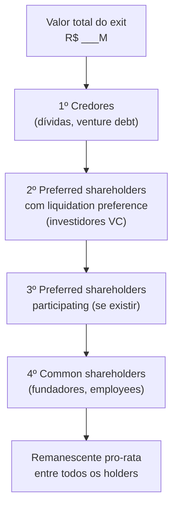

**Os seis campos do canvas:**

- **Cap table atual**: % de cada classe (common, preferred Série Seed, Série A, etc.) e número de ações
- **Liquidation preferences**: 1x, 2x ou participating — por classe e por investidor
- **Anti-dilution adjustments**: se houve down round, qual é o ajuste de preço de conversão
- **Option pool**: opções outorgadas, exercíveis, não-exercidas
- **Preço de exit simulado**: faixa de cenários (pessimista, base, otimista)
- **Distribuição resultante**: R$ por classe e por indivíduo em cada cenário

##### Quando usar

Use o Waterfall Canvas em três momentos: (1) **ao receber um term sheet** — para entender o impacto da liquidation preference proposta em diferentes cenários de exit; (2) **antes de iniciar processo de M&A** — para saber quanto cada sócio recebe em diferentes preços de oferta e identificar onde há conflito de interesse; (3) **ao converter SAFEs ou notas conversíveis** — para visualizar a diluição real e o impacto no cap table pós-conversão.

##### Princípios

**Primeiro: liquidation preference é o mecanismo mais importante que a maioria dos fundadores subestima.** Uma empresa vendida por R$ 50M com R$ 20M de preferred com 2x participating pode entregar menos de R$ 5M para o fundador que detém 30% do cap table. Sem o Waterfall Canvas, essa realidade só aparece no dia da assinatura.

**Segundo: simule sempre pelo menos três cenários.** Exit @ 1x capital investido (resultado fraco), @ 3x (resultado bom), @ 10x (resultado excepcional). O comportamento das liquidation preferences é radicalmente diferente nesses três pontos.

**Terceiro: o conflito de interesse entre fundadores e investidores é estrutural.** Investidores com preferred querem maximum protection; fundadores com common querem maximum upside. Modelar o waterfall revela onde os interesses divergem — antes da negociação, não durante.

##### Como aplicar

**Passo 1 — Montar o cap table completo:**

| Holder | Classe | # Ações | % Fully Diluted | Liq. Pref. | Valor Pref. |
|---|---|---|---|---|---|
| Fundador A | Common | 4.000.000 | 30% | — | — |
| Fundador B | Common | 3.000.000 | 22,5% | — | — |
| Fundo Seed | Preferred A | 2.000.000 | 15% | 1x non-participating | R$ 3M |
| Fundo Série A | Preferred B | 3.000.000 | 22,5% | 1x participating | R$ 12M |
| Option pool | Common | 1.500.000 | 11,25% | — | — |

**Passo 2 — Simular cenários de exit:**

Para cada preço de venda simulado, calcular na sequência:

1. Pagar liquidation preference de cada série preferred (ordem: mais recente primeiro, ou pari passu — checar o acordo de sócios)
2. Se preferred for participating: dividir o remanescente pro-rata entre todos
3. Se preferred for non-participating: comparar o resultado da preference com a conversão — o holder escolhe o maior
4. Distribuir o remanescente entre common shareholders pro-rata

**Exemplo simplificado — exit @ R$ 20M:**

```text
Exit: R$ 20M
Dívidas: zero
Preferred A (Seed): R$ 3M pref. 1x non-participating → recebe R$ 3M OU converte em 15%
Preferred B (Série A): R$ 12M pref. 1x participating → recebe R$ 12M + participa no restante
Remanescente após prefs: R$ 20M - R$ 3M - R$ 12M = R$ 5M
  Preferred A: decide converter → 15% de R$ 20M = R$ 3M → igual à preference → indiferente
  Preferred B (participating): 22,5% de R$ 5M = R$ 1,12M adicional
  Common (fundadores + pool): 62,5% de R$ 5M = R$ 3,12M

Distribuição total @ R$ 20M:
  Fundo Seed: R$ 3M (15%)
  Fundo Série A: R$ 12M + R$ 1,12M = R$ 13,12M (65,6%)
  Fundadores + pool: R$ 3,12M (15,6%)
  → Fundadores com 52,5% do cap table recebem 15,6% do exit
```

**Exit @ R$ 80M (mesmas condições):**

```text
Remanescente após prefs: R$ 80M - R$ 3M - R$ 12M = R$ 65M
  Preferred A: 15% de R$ 65M = R$ 9,75M → melhor converter (R$ 9,75M > R$ 3M preference)
  Preferred B: R$ 12M pref + 22,5% × R$ 65M = R$ 12M + R$ 14,6M = R$ 26,6M
  Common: 62,5% × R$ 65M = R$ 40,6M
  Fundadores (52,5% do common): ≈ R$ 33,8M
  → Exit mais alto = common shareholders recuperam participação real
```

##### Erros comuns

- Não modelar participating preferred separado de non-participating — a diferença é enorme em exits medianos.
- Calcular dilution apenas como % do cap table — a % não conta onde está o dinheiro.
- Ignorar o option pool não-exercido — em muitos acordos, opções não exercidas voltam para o common no momento do exit.
- Usar o cap table "de memória" em vez do documento legal atual — cap tables têm erros; use o documento oficial.

##### Quando NÃO usar

Em estágio pré-seed ou seed early sem investidores institucionais — sem preferred shares, o waterfall é trivial (pro-rata simples). Como decisão estratégica isolada — a ferramenta informa negociação, não substitui análise de mérito do investidor ou do deal. Como projeção de valor da empresa — o canvas mostra distribuição em cenário de exit, não estima o valor.

##### Conexão com outros canvases

O Waterfall Canvas **usa o cap table atual** (não é um canvas de modelo de negócio) e **alimenta diretamente a negociação de term sheet** (Capítulo 13 (Vol. 5) (CAPTAÇÃO DE EQUITY, PITCH E RELACIONAMENTO COM INVESTIDORES) e Template: Term Sheet Anotado — Guia de Leitura (Fase 14)). É o único canvas deste apêndice de natureza financeira — os demais são estratégicos ou operacionais.

##### Leitura adicional

- Template Term Sheet Anotado (Fase 14) — cláusulas de liquidation preference e anti-dilution.
- [[IGNICAO-Vol-8-Juridico-LGPD-e-Seguranca#CAPÍTULO 1 — MARCO LEGAL DAS STARTUPS: LC 182/2021|Capítulo 1 (MARCO LEGAL DAS STARTUPS: LC 182/2021) (Vol. 8)]] — COCP como alternativa ao preferred.
- [[IGNICAO-Vol-6-Receita-e-Pessoas#CAPÍTULO 16 — STOCK OPTIONS E ESOP NO BRASIL|Capítulo 16 (STOCK OPTIONS E ESOP NO BRASIL) (Vol. 6)]] — stock options e impacto no cap table.
- *Venture Deals* (Brad Feld & Jason Mendelson, 2019) — explicação definitiva de waterfall mechanics.

---

### TEMPLATES OPERACIONAIS E CASOS PREENCHIDOS DESTA FASE

#### Template: Board Deck (Apresentação para o Conselho)

> [!note] Quando usar
> Reunião trimestral ou mensal de board. Contexto: fundador apresentando para conselheiros e investidores com assento. Não é pitch — o board já acredita na empresa. É atualização operacional com decisões reais na mesa.

> [!tip] Regra de ouro
> Board deck não é documento de relações públicas. Problemas escondidos viram surpresas ruins seis meses depois. Mostre o que está indo mal com a mesma clareza do que está indo bem.

##### Estrutura-padrão (12–18 slides / ~60 min de reunião)

**Capa**

- Nome da empresa · Data · Período de referência (ex: Q2 2026)
- Confidencial — não circular

**1. Headline do trimestre (1 slide)**

- Uma frase: o que mais importou neste trimestre
- 3 bullets: maior vitória, maior aprendizado, decisão crítica a tomar hoje

**2. Métricas-chave (1–2 slides)**

| Métrica | Meta Q[N] | Real Q[N] | Δ% | Tendência |
|---|---|---|---|---|
| MRR / ARR | `[R$ ___]` | `[R$ ___]` | `[___]%` | `[↑ / → / ↓]` |
| Clientes ativos | `[___]` | `[___]` | `[___]%` | `[↑ / → / ↓]` |
| Churn (MoM) | `[___]%` | `[___]%` | `[___]pp` | `[↑ / → / ↓]` |
| CAC | `[R$ ___]` | `[R$ ___]` | `[___]%` | `[↑ / → / ↓]` |
| LTV / CAC | `[___x]` | `[___x]` | `[___]` | `[↑ / → / ↓]` |
| Burn rate (MoM) | `[R$ ___]` | `[R$ ___]` | `[___]%` | `[↑ / → / ↓]` |
| Runway | `[___ meses]` | `[___ meses]` | — | `[↑ / → / ↓]` |

> Inclua apenas as métricas relevantes para o estágio. Pre-PMF: ativação e retenção. Pós-PMF: crescimento e eficiência. Escala: eficiência e margem.

**3. Financeiro (1–2 slides)**

- P&L simplificado: receita, COGS, gross margin, opex, EBITDA (ou queima)
- Cashflow: saldo inicial, entradas, saídas, saldo final
- Projeção para os próximos 3 meses vs. orçamento
- Variações relevantes: o que saiu fora do plano e por quê

**4. Produto e tecnologia (1 slide)**

- O que foi entregue no trimestre (top 3 itens)
- O que está em construção agora (com ETA)
- Dívida técnica ou incidentes relevantes: `[descrição + status de resolução]`

**5. Time (1 slide)**

- Headcount: início do trimestre vs. final vs. plano
- Contratações críticas abertas: `[cargo] — prioridade [alta/média]`
- Saídas relevantes e impacto
- Nível de engajamento / resultado de pesquisa interna (se houver)

**6. GTM e clientes (1–2 slides)**

- Pipeline: `[R$ ___]` (top of funnel) → `[R$ ___]` (forecast 90d)
- Deals fechados no trimestre: destaque para logo / tamanho / vertical
- Churn e downgrade: causas, padrão, ação
- NPS ou CSAT: `[___]` (vs. último período: `[___]`)

**7. Roadblocks e riscos (1 slide)**

> [!warning] Este slide é o mais importante
> Liste os 3–5 problemas reais que impedem crescimento. Para cada um: causa-raiz, o que já foi tentado, o que você precisa do board.

| Risco / problema | Probabilidade | Impacto | Mitigação atual | Ajuda necessária do board |
|---|---|---|---|---|
| `[Descrever]` | `[Alta/Média/Baixa]` | `[Alto/Médio/Baixo]` | `[Ação em curso]` | `[Sim/Não — o quê]` |

**8. Decisões para o board (1 slide)**

> Itens que requerem aprovação formal ou input estratégico dos conselheiros. Não é espaço para validação — é espaço para decidir.

- [ ] `[Decisão 1]`: proposta do management → `[___]` · Opções: `[A / B / C]`
- [ ] `[Decisão 2]`: proposta do management → `[___]` · Opções: `[A / B]`

**9. Próximo trimestre (1 slide)**

- Top 3 prioridades com responsável e métrica de sucesso
- OKRs ou metas do período
- Eventos críticos: captação, lançamento, evento regulatório, renovação de contrato

**10. Apêndices (opcional)**

- Detalhes de cohort, unit economics, pipeline por vertical, forecast detalhado
- Não ler na reunião — existem para perguntas

##### Dicas de facilitação

- Envie o deck **72h antes** da reunião para os conselheiros lerem
- Reserve os primeiros 10 min para perguntas sobre o material, não para apresentar
- Para cada decisão do slide 8, proponha uma recomendação clara — board que "só escuta" não ajuda
- Documente as decisões tomadas no board memo (preencher após a reunião)

---

### SÍNTESE DA FASE 20

Nessa fase você mapeou os cinco tipos de exit, preparou a empresa operacional e juridicamente (data room, tax structuring, governança), alinhou cofundadores e investidores, e definiu o tipo certo para o seu contexto. O tipo certo é escolha consciente, não default do mercado: M&A estratégico, M&A financeiro, IPO, secondary e acqui-hire servem a fundadores e empresas diferentes.

Exit não é sempre venda. O encerramento voluntário, com dignidade, é o caminho certo em mais cenários do que os manuais admitem. Encerrar bem preserva capital residual, relações com time e investidores, e o próprio fundador para o próximo capítulo. *Como você encerra a empresa anterior é a maior variável preditiva de como será a próxima*.

---

# GOVERNANÇA CORPORATIVA, BOARD, SUCESSÃO E SOCIEDADE (CAPÍTULOS 1 A 4)

### Arquitetura deste Domínio: Governança Corporativa, Board, Sucessão e Sociedade (Capítulos 1 a 4)

Na empresa madura, o poder deixa de ser exercido apenas na mesa operacional e passa pelo **Conselho de Administração (*Board*)** e pela harmonia societária de longo prazo:

- **[[IGNICAO-Vol-10-Playbooks-Setoriais-e-Glossario#C|Capítulo 1 — Board Management e Governança Corporativa (Vol. 10)]]:** Como montar, conduzir e extrair valor real de um Conselho Consultivo ou Conselho de Administração — composição, rituais pré-reunião, atas, comitês e gestão da relação entre CEO e conselheiros.
- **[[IGNICAO-Vol-10-Playbooks-Setoriais-e-Glossario#C|Capítulo 2 — Empresas Familiares e Sucessão (Vol. 10)]]:** Protocolos familiares, separação entre família, propriedade e gestão, holdings familiares e preparação de sucessores.
- **[[IGNICAO-Vol-10-Playbooks-Setoriais-e-Glossario#C|Capítulo 3 — Conflito Societário e Divórcio de Sócios (Vol. 10)]]:** Como destravar impasses societários graves (*deadlocks*), acionar cláusulas de *shotgun* / *buy-or-sell*, conduzir apuração de haveres e evitar que uma briga de sócios paralise a companhia.
- **[[IGNICAO-Vol-10-Playbooks-Setoriais-e-Glossario#C|Capítulo 4 — Impacto Social, ESG e Sistema B (Vol. 10)]]:** Como integrar governança socioambiental e certificação B Corp à estratégia competitiva e ao acesso a capital institucional.

---

## CAPÍTULO 1 — BOARD E GOVERNANCE

> [!note] Nota de validade
> As estruturas e boas práticas de governance (governança) evoluem lentamente (escala de décadas). O que muda mais rápido: ferramentas de board portal (Diligent, BoardEffect, e Notion com templates), padrões de ESG disclosure (divulgação ESG) e regulação societária específica. Revisar anualmente. Os princípios — composição balanceada, preparação estruturada e decisões documentadas — são estáveis.

A [[IGNICAO-Vol-8-Juridico-LGPD-e-Seguranca#FASE 18 — ESTRUTURAÇÃO JURÍDICA, SOCIETÁRIA E BLINDAGEM OPERACIONAL|Fase 18 (Vol. 8)]] cobre constituição e cap table (tabela de capital). O [[IGNICAO-Vol-5-Financas-e-Captacao#CAPÍTULO 13 — CAPTAÇÃO DE EQUITY, PITCH E RELACIONAMENTO COM INVESTIDORES|Capítulo 13 (CAPTAÇÃO DE EQUITY, PITCH E RELACIONAMENTO COM INVESTIDORES) (Vol. 5)]] cobre captação. Operar com board (conselho de administração) saudável é disciplina à parte, raramente tratada em manuais brasileiros de empreendedorismo. Fundador em Série A que nunca preparou material de board, nunca conduziu uma reunião e nunca demitiu membro improdutivo chega despreparado à situação mais consequente do seu calendário trimestral.

Este capítulo cobre board como disciplina operacional: composição, cadência, preparação de materiais, condução de reuniões, gestão de membros difíceis e evolução do board conforme a empresa cresce.

### O que este capítulo cobre

Três camadas.

1. Estrutura do board. Quantos membros. Qual composição (founders, investidores ou independentes). Quando expandir.
2. Operação do board. Cadência de reuniões. Formato. Preparação. Condução. Documentação.
3. Gestão de membros. Relacionamento contínuo com cada membro. Identificação de performance. Substituição quando necessário.

Entregáveis: composição documentada, cadência calendarizada, template de deck de board, atas formais e plano de sucessão ou rotação de membros.

### POR QUE

> [!important] Board é o único fórum onde o CEO é formalmente supervisionado
> Decisões estratégicas críticas passam por ali (rodadas, aquisições, pivôs, demissão de executivos sêniores e exit).

Board saudável é acelerador. Board ruim é freio. Board com membros engajados, preparados e complementares acelera decisões difíceis. Board com políticas internas, membros desengajados ou conflitos não-resolvidos trava a empresa em momentos críticos.

A legislação brasileira atribui responsabilidade jurídica ao conselho. As decisões de M&A (mergers and acquisitions, fusões e aquisições), rodadas e mudanças estatutárias passam por deliberação formal documentada. Sem ata adequada, há exposição legal.

O fundador iniciante raramente foi board member antes. Aprende no próprio gargalo, em momentos de alta pressão. Material preventivo reduz curva de aprendizado.

### Quando usar

[[IGNICAO-Vol-8-Juridico-LGPD-e-Seguranca#FASE 18 — ESTRUTURAÇÃO JURÍDICA, SOCIETÁRIA E BLINDAGEM OPERACIONAL|Fase 18 (Vol. 8)]]. Primeiros "observers" (observadores) ou advisors, como proxy de board embrionário.

Pós-Seed ou pré-Série A. Primeiro board formal (dois a três membros típico).

Série A. Board formal com três a cinco membros (founders, mais um a dois investidores, mais zero a um independente).

Série B em diante. Board com cinco a sete membros. Dois a três independentes. Comitês (audit e compensation).

Pré-IPO. Board formal com maioria de independentes. Comitês completos. Governance madura.

### Quem envolve

**Tipos de membros.**

Inside directors (diretores internos). Founders ou CEO. Conhecem a empresa profundamente. Tomam decisões executivas.

Investor directors (diretores investidores). Representantes de VCs (Venture Capitals, fundos de capital de risco) com cadeira. Trazem visão de mercado, rede e lógica de capital. Podem ter conflito entre o que é melhor para o fundo versus para a empresa.

> [!important] Independent directors (independentes) são os mais valiosos em governance
> Não têm interesse econômico material na empresa (além de stipend, ou seja, remuneração modesta). Trazem perspectiva externa, expertise específica e credibilidade.

Board observers (observadores de conselho). Presença nas reuniões sem direito de voto. Comum para investidores que não têm cadeira formal, mas querem acompanhar.

**Composição por estágio (padrão típico).**

| Estágio | Tamanho | Composição típica |
|---|---|---|
| Pré-Seed | 0-2 | Founders only |
| Seed | 2-3 | 1-2 founders + 1 investidor |
| Série A | 3-5 | 1-2 founders + 1-2 investidores + 0-1 independente |
| Série B | 5-7 | 1-2 founders + 2-3 investidores + 1-2 independentes |
| Série C+ | 5-9 | 1 founder + 2-3 investidores + 2-3 independentes + 0-1 executivo externo |
| Pré-IPO | 7-11 | Maioria de independentes (requisito regulatório) |

### Como executar

#### 1. Composição, quem convidar para independent seat

Quando chega o momento de trazer primeiro independente (tipicamente Série A), critérios.

**Perfil ideal.** Experiência operacional executiva. Ex-CEO, ex-presidente, ou ex-operador sênior em empresa similar, em estágio mais adiantado. Expertise específica que a empresa precisa, e que founders, mais investidores, não cobrem (GTM enterprise, expansão internacional, finance em escala, ou ESG, ou governance). Disponibilidade real. Não acumula dez boards. Química. Capacidade de ser crítico construtivo. Não hostil, nem subserviente. Rede complementar. Abre portas que founders, ou investidores, não abrem.

> [!warning] Armadilhas em independent
> Nome famoso sem engajamento. Celebridade da indústria que aceitou cadeira mas não aparece em reuniões. Custo de equity sem retorno. Conflito latente. Independente que, doze meses depois, está advisando concorrente ou fundador pré-concorrente. Concordância constante. Independente que nunca discorda é teatro. Valor vem da discordância qualificada.

**Compensação típica de independent brasileiro.** Equity. 0,25 por cento a um por cento, com vesting quatro anos, e cliff um ano. Mais próximo a 0,5 por cento em Série A, ou B. Stipend em caixa. Raro em estágio inicial brasileiro. Padrão em empresas maiores. R$ 30 mil a R$ 120 mil por ano. Comitê chair recebe mais.

> [!important] D&O insurance é pré-requisito
> D&O insurance (Directors & Officers). A empresa contrata seguro que cobre responsabilidade pessoal dos diretores. Valor anual. R$ 15 mil a R$ 80 mil em Série A. Cresce com tamanho. Sem D&O, independent qualificado não aceita.

**Como abordar.** Relacionamento prévio de seis a doze meses (não convite cold). Conversa específica sobre contribuição esperada, frequência, e compromisso de tempo. Formalização em documento (Board Service Agreement), com vesting, expectativas, e saída. Primeira reunião. Onboarding estruturado. Tour produto. Meeting com cada executivo sênior. Leitura de material de histórico.

#### 2. Cadência de reuniões

**Padrão típico brasileiro em startup.** Pré-Série A. Mensal, ou a cada seis semanas. Série A a B. Trimestral presencial, mais chamadas mensais de update. Série C em diante. Trimestral presencial, mais chamadas mensais, mais comitês entre reuniões.

**Duração típica.** Trimestral presencial. Quatro a seis horas (mais jantar opcional na noite anterior). Chamadas mensais. Sessenta a noventa minutos.

**Formato recomendado de reunião trimestral.**

Material enviado cinco a sete dias antes da reunião (board book).

Pre-read expectation explícita. "Time espera que material seja lido antes. A reunião é para discussão. Não recap".

Agenda de cinco a seis blocos.

1. Approval da ata anterior, mais follow-ups (dez minutos).
2. CEO Update. Estratégia, highlights, e lowlights (vinte minutos).
3. Financial Update. P&L, caixa, e métricas-chave (vinte minutos).
4. Um a dois tópicos estratégicos de deep-dive (sessenta a noventa minutos).
5. Executive session (membros, mais CEO, sem outros executivos). Trinta minutos.
6. Independent session (só independentes, mais investidores, sem CEO). Trinta minutos opcional.

> [!important] Executive e independent sessions são críticas
> Espaço para conversas francas sobre CEO, estratégia, e riscos, que não funcionam com CEO, ou time presente.

#### 3. Board Book, o material de preparação

Padrão ouro de material de board em startup moderna (seguindo modelo YC).

**Estrutura (doze a vinte e cinco páginas total).**

1. Executive Summary (uma página). Três a cinco highlights. Três a cinco lowlights. Três a cinco decisões, ou inputs necessários.
2. Key Metrics Dashboard (uma a duas páginas). ARR, MRR, churn, NRR, CAC, LTV, burn, runway, e team size. Tendência de seis a doze meses.
3. Financial Detail (três a cinco páginas). P&L detalhado, balanço, fluxo de caixa, e comparação versus plano.
4. Business Update (três a cinco páginas). Produto, go-to-market, pessoas, e operações.
5. Strategic Deep Dives (cinco a dez páginas). Um a dois tópicos específicos, que precisam decisão, ou input do board. Por exemplo, expansão internacional, nova captação, ou aquisição em consideração.
6. Asks (uma página). O que especificamente você pede do board. Intros, decisões, ou feedback em tema X.

> [!important] O CEO escreve o board book
> Não delega integralmente. O material é investimento pessoal do CEO. Não é deck bonito com animações. É documento de análise, com tabelas, e gráficos. Funcional. Não performático.

#### 4. Condução da reunião, papel do CEO como chair

**Antes.** Garantir que material foi enviado a tempo. Chamada 1:1 com membros-chave, três a sete dias antes, para pré-alinhar tópicos sensíveis ("Vou apresentar proposta de captação de R$ 50 milhões. Quero ouvir a sua opinião antes"). Preparar respostas para perguntas previsíveis.

**Durante.** Começar no horário. Terminar no horário. Seguir agenda. Não deixar tangentes tomarem metade da reunião.

> [!tip] Estimular discordância estruturada
> "Quem tem visão contrária? Maria, o que você vê diferente?". Board que só concorda com CEO é inútil.

Tomar notas de commitments (seus, e do board). Registrar decisões formalmente em ata.

**Depois.** Ata enviada em uma semana, para aprovação. Follow-up em duas semanas. "Aqui estão as cinco ações que assumi. Status de cada". Comunicação entre reuniões. Não ficar três meses sem contato com membros-chave.

#### 5. Decisões que requerem aprovação formal

**Estatutariamente (Brasil), e por acordo de acionistas (SHA) típico.**

Rodadas de captação (novos investidores, ou novas condições). Aquisições, e vendas de ativos materiais. Contratação de C-level (CEO, CFO, e às vezes CTO, ou CPO). Demissão, ou promoção a C-level. Ampliação de option pool (ESOP). Distribuição de dividendos (quando aplicável). Entrada em novas categorias de negócio. Entrada em novos mercados geográficos (operação internacional formal). Gastos acima de threshold pré-acordado (capex significativo). Mudanças em estratégia corporativa declarada. Contratação, ou demissão, de auditor externo.

**Matriz de decisão (exemplo).**

| Decisão | Aprovação necessária |
|---|---|
| Gastos até R$ 500k | CEO |
| Gastos R$ 500k-5M | CEO + CFO |
| Gastos R$ 5-20M | Board |
| Gastos > R$ 20M | Board + Majority-of-preferred (em SHA) |
| Nova captação | Board + investor consent |
| Aquisição | Board + investor consent |

Documente essa matriz no início do relacionamento com o board. Evita fricção em cada decisão.

#### 6. Comitês, quando, e para quê

**Audit Committee (Comitê de Auditoria).** Obrigatório em empresas listadas. Recomendado a partir de Série B em diante. Composição. Dois a três independentes. Um financially literate. Responsabilidade. Supervisionar auditoria externa. Revisar demonstrações financeiras. Oversight de controles internos. Frequência. Trimestral.

**Compensation Committee (Comitê de Compensação).** Recomendado a partir de Série B em diante. Composição. Dois a três independentes, mais um investor director. Responsabilidade. Política de compensação de executivos, ESOP, stock options pricing, e bonus. Frequência. Duas a quatro vezes por ano.

**Nominating, ou Governance Committee.** Pré-IPO, e pós-IPO. Responsabilidade. Seleção de novos membros de board. Avaliação anual de performance do board. Políticas de governance.

> [!warning] Em startup pré-Série B, comitês são geralmente desnecessários
> As reuniões de board cobrem tudo. Criar comitê antes da escala gera overhead, sem retorno.

#### 7. Gestão de membros difíceis

**Tipos problemáticos.**

O desengajado. Some entre reuniões. Não lê material. Faz perguntas superficiais. Ação. Conversa 1:1 direta. "Tenho sentido menor engajamento. Precisamos recalibrar expectativa, ou buscar substituto?".

O dominante. Fala setenta por cento do tempo em reuniões. Desencoraja outras vozes. Ação. Chair (CEO) intervém em tempo real. "Obrigada, João. Marina, qual a sua visão?".

O obstrutivo. Bloqueia decisões por razões pessoais, ou de fundo (interesse de fundo conflitante com empresa). Ação. Executive sessions entre outros membros, para calibrar. Em extremo, substituição com negociação formal.

O vazador. Compartilha informação de board com terceiros (outros portfolio, ou mídia). Ação. Conversa imediata, mais revisão de confidentiality obligations. Em reincidência, saída formal.

**Substituição de membro.** Contratualmente complexo (especialmente investor director. Board seat é direito contratual do fundo). Investor director. Negociar com sócio sênior do fundo. Se o problema é a pessoa específica, pode trocar por outra do mesmo fundo. Independent director. Termination cláusulas em Board Service Agreement. Vesting não-exercido geralmente retorna.

> [!warning] Sempre com advogado
> Riscos de disputa, e danos morais.

#### 8. Evolução do board ao longo da trajetória

**Séries iniciais (zero a dois anos pós-Série A).** Board pequeno. Founders, mais investidores. Foco em product-market fit, e growth early. Pouca ênfase em comitês.

**Escala (dois a cinco anos pós-PMF).** Adiciona um a dois independentes, com expertise específica. Formaliza cadência trimestral, mais comitês essenciais. Foco em expansão, M&A, e operações em escala.

**Pré-IPO, ou pré-venda grande.** Reestrutura para composição com maioria de independentes. Formaliza todos os comitês (audit, compensation, e nominating). Governance profissional, e documentação rigorosa. CEO possivelmente prepara para deixar cadeira de chair (transição para Chairman independente).

### Métricas

Difícil quantificar qualidade de board. Mas.

Presença média em reuniões. Maior que noventa por cento.

Preparação evidente (perguntas específicas sobre material). Maior que oitenta por cento dos membros.

Turnover anual. Menor que vinte por cento (exceto transições planejadas).

Cumprimento de follow-ups (CEO, e board). Maior que oitenta por cento em prazo.

Diversidade (gênero, experiência, e background). Deliberadamente monitorada.

Independents como percentual do board. Crescente ao longo dos anos.

Sessions executive, ou independent acontecem. Maior que setenta e cinco por cento das reuniões trimestrais.

### Armadilhas

Fundador vendo board como "inimigo", ou "chefe". A relação que funciona é parceria com tensão construtiva. Não servidão. Não guerra.

Board só com investidores. Falta perspectiva externa crítica. Adicionar independente cedo.

Independent sem engajamento real. Vaidade de nome bonito sem presença. Melhor seat vago, do que independente ausente.

Reuniões sem agenda, ou material. Vira conversa de status. Desperdiça tempo de cinco a sete executivos caríssimos.

Board book produzido em pressa. Sinaliza que CEO não priorizou. Perde credibilidade.

Reuniões dominadas por um membro. Dinâmica que se agrava sem intervenção do chair.

Conflitos de fundos não-endereçados. Investidor em portfolio com concorrente cria problemas estruturais. Discutir antes que exploda.

Sem atas formais. Decisão contestada depois, sem registro. Problemas legais.

D&O insurance ausente em Série A em diante. Independente qualificado recusa cadeira. O fundador expõe-se pessoalmente.

Comitê sem agenda, versus sem existir. Criar comitê "para parecer" não funciona. Só se tiver função real.

Não preparar investor director antes de rodada seguinte. Investor director que descobre em reunião que nova rodada está acontecendo, fica ofendido, e trava apoio.

Substituir membro sem conversa prévia. Drama público desnecessário. Sempre conversa privada primeiro.

### Checklist

Board saudável quando a composição está alinhada ao estágio (nem sub-dimensionada, nem inchada), há pelo menos um independente ativo a partir de Série A, a cadência trimestral é respeitada com board book lido, reuniões geram decisões em ata, executive e independent sessions acontecem, a relação CEO-board tem confiança e discordância construtiva, membros problemáticos são endereçados, e D&O insurance está vigente. Os itens abaixo sustentam isso.

- [ ] Composição do board adequada ao estágio atual.
- [ ] Pelo menos um independente ativo (pós-Série A).
- [ ] D&O insurance contratada, e vigente.
- [ ] Cadência formal de reuniões no calendário de doze meses.
- [ ] Template de board book padronizado.
- [ ] Matriz de decisões documentada (o que requer aprovação de quem).
- [ ] Board Service Agreement assinado com cada membro (termos, equity, confidentiality, e saída).
- [ ] Comitês estabelecidos se Série B em diante.
- [ ] Executive, ou independent sessions, acontecem pelo menos trimestralmente.
- [ ] Relacionamento 1:1 com cada membro, entre reuniões.
- [ ] Atas formais de cada reunião, aprovadas, e arquivadas.
- [ ] Follow-ups rastreados, e reportados na reunião seguinte.

### Ver também

[[#CAPÍTULO 2 — EMPRESA FAMILIAR E SUCESSÃO: GOVERNANÇA, DINÂMICA E PSICOLOGIA|Capítulo 2 (EMPRESA FAMILIAR E SUCESSÃO: GOVERNANÇA, DINÂMICA E PSICOLOGIA)]], Empresa familiar. [[IGNICAO-Vol-8-Juridico-LGPD-e-Seguranca#CAPÍTULO 13 — FRAUDE INTERNA E CONTROLES INTERNOS|Capítulo 13 (FRAUDE INTERNA E CONTROLES INTERNOS) (Vol. 8)]], Fraude, e controles internos. [[IGNICAO-Vol-5-Financas-e-Captacao#CAPÍTULO 13 — CAPTAÇÃO DE EQUITY, PITCH E RELACIONAMENTO COM INVESTIDORES|Capítulo 13 (CAPTAÇÃO DE EQUITY, PITCH E RELACIONAMENTO COM INVESTIDORES) (Vol. 5)]], Captação de equity. [[IGNICAO-Vol-5-Financas-e-Captacao#CAPÍTULO 21 — INVESTOR RELATIONS PÓS-RODADA|Capítulo 21 (INVESTOR RELATIONS PÓS-RODADA) (Vol. 5)]], Investor relations pós-rodada, complementar à condução de board com investidores que ocupam assento.

---

## CAPÍTULO 2 — EMPRESA FAMILIAR E SUCESSÃO: GOVERNANÇA, DINÂMICA E PSICOLOGIA

> [!note] Nota de integridade
> Este capítulo trata de empresa familiar tanto em dimensão operacional (governança, sucessão, estrutura) quanto em dimensão emocional profunda (identidade, conflito entre gerações, papel na família). As duas são inseparáveis. Onde o tema toca em sofrimento psicológico genuíno, o texto sinaliza os limites e recomenda apoio profissional especializado: psicólogo organizacional com formação específica, terapeuta familiar sistêmico, consultores do IBGC ou da FDC. Referências brasileiras relevantes: João Bosco Lodi, IBGC, Fundação Dom Cabral. Referências internacionais: John Ward, Fred Neubauer e John Davis (Harvard).

Este capítulo cobre três tipos de fundador na órbita da empresa familiar. O primeiro é o fundador que herda ou sucede uma empresa familiar. Alguém cuja família tem empresa e que está avaliando, entrando ou já operando. O segundo é o fundador cuja startup é familiar na origem, empresa começada com pai, mãe, irmãos, cônjuge, primos ou parentes diretos. O terceiro é o fundador que traz parentes para a empresa em escala, startup originalmente não-familiar onde o fundador contrata familiares conforme cresce. As três situações têm particularidades, mas compartilham o núcleo: família e empresa misturam dinâmicas que têm lógicas próprias e frequentemente conflitantes. Sem estruturação consciente, as duas sofrem.

O tema é crítico no Brasil por razões estruturais. Empresas familiares dominam a economia brasileira. Estimativas apontam que mais de noventa por cento das empresas brasileiras são familiares em alguma forma, e respondem por parcela muito significativa do PIB e do emprego privado formal. A taxa de sucessão geracional é baixa. Dados internacionais mostram que cerca de trinta por cento das empresas familiares sobrevivem à segunda geração, doze por cento à terceira e apenas três por cento à quarta. O Brasil não foge ao padrão e possivelmente é pior em alguns setores. A cultura brasileira favorece a mistura entre família e negócio: laços familiares fortes, confiança baseada em parentesco, histórico de empresas-família como base do capitalismo industrial brasileiro (Votorantim, Odebrecht, Itaúsa, Gerdau, JBS, Klabin). Mas isso também gera conflito estrutural: herdeiros com níveis diversos de preparo, cônjuges ingressando via casamento, divórcios dividindo patrimônio, irmãos com visões conflitantes.

A startup de fundador com empresa familiar anterior é tema específico. O fundador pode estar fugindo da empresa da família (empreendedorismo como declaração de independência), construindo algo para herdar junto com a empresa familiar, ou usando capital e rede familiar como apoio à startup, o que cria dinâmicas específicas de accountability (prestação de contas). Casar com sócio ou sócia e ter empresa com cônjuge merece tratamento específico. Existe o risco de o casamento virar sociedade forçada, do divórcio que pode paralisar a empresa, e da dinâmica diária que mistura intimidade e profissionalismo.

Os momentos de aplicação são vários. Antes de aceitar entrar em empresa familiar (Fase -1, antes da [[IGNICAO-Vol-1-Ideacao#FASE 0 — PREPARAÇÃO DO EMPREENDEDOR|Fase 0 (Vol. 1)]]), com clareza sobre expectativas, papel e caminho. Fases 0 a 1 com cofundador familiar, com acordo explícito e formal desde o início. [[IGNICAO-Vol-8-Juridico-LGPD-e-Seguranca#FASE 18 — ESTRUTURAÇÃO JURÍDICA, SOCIETÁRIA E BLINDAGEM OPERACIONAL|Fase 18 (Vol. 8)]] em diante com sucessão iminente, com preparação estruturada de cinco a quinze anos. E em qualquer fase com conflito familiar emergente, com intervenção profissional imediata, porque problemas familiares em empresa raramente se resolvem sozinhos.

Os profissionais que ajudam são bem definidos. Conselheiro de família, profissional externo especializado em empresa familiar, custa de quinze a quarenta mil reais por mês em empresas grandes e de cinco a quinze mil em startups e médias. Terapeuta familiar sistêmico, psicólogo com formação em dinâmicas familiares, para situações com sofrimento emocional ou conflito significativo. Advogado especializado em governança familiar, para contratos familiares, holdings e acordos societários específicos. Consultor em sucessão, via IBGC, FDC ou butiques especializadas. E mentor sênior com experiência em empresa familiar, alguém que viveu a transição de geração com sucesso e pode guiar informalmente.

### O modelo dos três círculos

O modelo canônico para entender empresa familiar é o dos três círculos de John Davis (Harvard). Três círculos interdependentes — família (todos os membros, herdeiros, cônjuges, filhos, parentes), propriedade (quem possui ações ou quotas) e empresa (quem trabalha operacionalmente). Cada pessoa está em um, dois ou três círculos simultaneamente, e a lógica muda dependendo da posição.

Na sobreposição dos três círculos está o membro da família que é dono e gestor (CEO fundador ainda ativo, por exemplo). Máximo poder, máxima complexidade. No cruzamento entre família e propriedade sem trabalhar estão os herdeiros não-ativos, com expectativas sobre dividendos e opinião sobre gestão sem accountability. No cruzamento entre família e empresa sem propriedade está o parente trabalhando mas sem ações, num dilema entre tratamento diferenciado (injusto com outros) ou igual a não-família (sem compensação pelo vínculo emocional). No cruzamento entre propriedade e empresa sem família está o executivo não-familiar com participação, em dinâmica entre valores familiares e perfil profissional. E sozinho em cada círculo está o primo sem envolvimento, o acionista externo, o funcionário sem parentesco, cada um com perspectiva diferente. A aplicação prática é mapear sua empresa nesses círculos. Muitos conflitos emergem quando pessoas em posições diferentes assumem que têm a mesma perspectiva.

### Estruturas societárias típicas

A holding familiar é a entidade jurídica (geralmente S.A. ou Ltda) que possui participação nas empresas operacionais. Todos os membros da família têm ações ou quotas da holding, o que simplifica sucessão (as ações passam aos herdeiros) e permite acordo de acionistas único para toda a família. Custo de estruturação entre cinquenta e duzentos mil reais, mantida por contador familiar.

Holding mais conselho de família é a estrutura com órgão de governança familiar específico. O conselho trata de assuntos da família (não da empresa operacional), em reuniões periódicas trimestrais ou semestrais, gerenciando expectativas, comunicação e desenvolvimento da próxima geração. Em famílias grandes, cada ramo (filhos do fundador) tem sua holding, e essas holdings de ramo possuem ações da holding principal. Isso protege contra conflitos interfamiliares e facilita dissolução se necessário.

O acordo de acionistas é documento fundamental. Regula como decisões são tomadas, direito de preferência (se alguém quiser vender, outros têm primeira opção), tag-along e drag-along, valuation em caso de saída por fórmula pré-acordada, mecanismos de resolução de conflito (mediação, arbitragem), regras sobre cônjuges, divórcio e herdeiros, e regras de governança (quem pode ser membro do conselho).

> [!important] Quando assinar o acordo
> Acordo de acionistas deve ser feito quando os relacionamentos estão bons. Fazer em meio a conflito é quase impossível. A inércia aqui é o inimigo: a família que adia o tema "para um momento melhor" é a mesma que vai precisar dele em emergência, sem tempo para negociar com calma.

### Governança corporativa

O Conselho de Administração é distinto do conselho de família. Sua composição é uma mistura de membros da família (propriedade representada) com independentes. A recomendação do IBGC é pelo menos um terço de conselheiros independentes em empresa familiar de qualquer tamanho, idealmente cinquenta por cento ou mais em empresa madura. Sua função é supervisão estratégica, não gestão diária. Decisões típicas incluem nomeação de CEO, aprovação de orçamento e direção estratégica.

O Conselho de Família, composto por membros da família com ou sem participação operacional, tem função distinta: alinhamento familiar, comunicação, desenvolvimento de próximas gerações, resolução de conflitos. Não toma decisões operacionais, mas sintetiza a posição da família para levar ao conselho de administração. A separação entre os dois órgãos é o que faz o sistema funcionar. O conselho de família resolve o que a família quer. O conselho de administração resolve o que é bom para a empresa. Quando alinhados, a empresa prospera. Quando conflitam, o conselho de família tem que ser consultado mas não dita a operação.

### Política de emprego familiar

A pergunta fundamental é se parentes podem trabalhar na empresa, e em que condições. Existem cinco posições principais. A política restritiva, em que parentes não podem trabalhar na empresa, elimina ambiguidade mas pode perder talento genuíno. A meritocracia estrita, em que parentes podem mas sob os mesmos critérios que não-parentes, exige avaliação honesta e na prática é difícil de manter. A preparação obrigatória antes, em que o parente só pode entrar depois de alguns anos de experiência externa, formação específica ou qualificação comprovada, é o padrão em grandes famílias empresariais. A carreira paralela, em que o parente entra por processo formal igual a não-parente mas tem mentor familiar interno, balanceia tratamento justo com aproveitamento do vínculo. E a posição societária sem operação, em que o parente é acionista ou conselheiro mas não trabalha operacionalmente, elimina o conflito diário.

Em qualquer política, alguns elementos são críticos. Processo de entrada formal, mesmo que o parente seja contratado, com etapas documentadas. Reporte direto fora do parentesco — sobrinho não reporta para tio, e o reporte vai para não-familiar. Avaliação periódica honesta, sem tratamento diferenciado. Política de saída clara, para quando o parente não está performando. E comunicação com não-parentes, porque os funcionários não-familiares precisam ver que o sistema é justo.

### Sucessão como projeto de cinco a quinze anos

Sucessão eficaz é projeto, não evento. As fases típicas se desenrolam ao longo de uma década ou mais.

A preparação dura os anos um a três antes da transição. O fundador reconhece a necessidade de sucessão, identifica candidatos (família ou não-família), começa o desenvolvimento estruturado deles e comunica os critérios e o processo com clareza. A transição dura os anos quatro a sete. O sucessor assume responsabilidades crescentes, o fundador gradualmente se afasta das decisões operacionais, o board assume papel mais ativo de supervisão, e candidatos são testados em situações difíceis para validar capacidade. A consolidação dura dos anos oito ao quinze. O fundador está em papel de conselho ou afastado da operação, o sucessor totalmente no comando, e a próxima geração começa a ser preparada para sua eventual transição.

> [!warning] Erros clássicos de sucessão brasileira
> Sucessão não-decidida até tarde demais — o fundador adia a decisão, e a sucessão acontece por crise (morte, doença) em vez de planejamento, levando a empresa a um vácuo de liderança. Filho primogênito "automático" — assumir que o filho mais velho é sucessor natural sem avaliar capacidade, interesse, fit. A cultura brasileira historicamente favorece primogenitura masculina, legado problemático. Dividir igualmente entre filhos sem clareza operacional — quatro filhos, vinte e cinco por cento cada, nenhum no comando, paralisia garantida. CEO familiar sem qualificação — "é da família" não qualifica para CEO. Fundador que não sai — anuncia sucessão mas continua tomando decisões em paralelo, minando a autoridade do sucessor. E fundador que sai abruptamente — corta todos os laços de repente, deixando o sucessor sem apoio em transição.

Casos brasileiros relevantes ajudam a calibrar o que funciona. O Grupo Votorantim, das famílias Ermírio de Moraes e Antunes, é exemplo frequentemente citado de governança familiar estruturada em múltiplas gerações, com conselho de família, separação entre propriedade e gestão e CEO profissional não-familiar por décadas. A Gerdau, da família Gerdau Johannpeter, é grupo multinacional com múltiplas gerações envolvidas, estrutura de holding complexa, processo de sucessão estruturado e abertura gradual para executivos não-familiares em posições-chave. A Itaúsa, das famílias Setubal e Villela, é a holding que controla Itaú Unibanco e outras empresas, com governança famosa pela profissionalização. O Magazine Luiza, da família Trajano, viu Luiza Helena Trajano transferir a operação para o filho Frederico em transição bastante estruturada, e é caso frequentemente estudado de transformação familiar-para-listada com continuidade da família no comando. O Pão de Açúcar é caso mais complexo, com disputas públicas entre Abilio Diniz e o Casino após a venda, ilustrando como dependência de único controlador externo pode destruir a estratégia familiar. Odebrecht, OAS e grandes construtoras envolvidas na Lava Jato ilustram como governança familiar e corporativa pode falhar em níveis múltiplos simultaneamente.

### Profissionalização

Profissionalização é a transição de gestão baseada em intuição familiar para gestão baseada em processos, métricas e executivos qualificados. Os elementos típicos são CFO não-familiar com autonomia real (frequentemente o primeiro executivo sênior não-família), conselho consultivo ou de administração com independentes, processos formais (orçamento anual, planejamento estratégico, avaliação de desempenho), separação de despesa pessoal e empresarial (um dos primeiros pontos problemáticos), relatórios gerenciais mensais estruturados em vez do "eu sei o que está acontecendo", e definição formal de cargos e responsabilidades em vez do "faz tudo que precisar". A dificuldade típica é o fundador que construiu a empresa "na intuição" e resiste à profissionalização, sentindo como crítica ao seu legado. O conselheiro externo frequentemente é a ponte.

> [!warning] Sinais de necessidade urgente de profissionalização
> Crescimento estagnou mesmo com mercado favorável. Próxima geração não quer trabalhar com o estilo do fundador. Talento não-familiar não fica. Due diligence bancária ou de investidor aponta problemas. E o fundador está esgotado ou com saúde comprometida. Quando dois ou mais desses sinais coexistem, a profissionalização deixou de ser opcional.

### A dimensão emocional do tema

Uma verdade pouco discutida: empresa familiar é palco onde dinâmicas familiares mais profundas encontram dimensão operacional. Conflitos antigos entre irmãos, expectativas não-ditas entre pais e filhos, ressentimentos de décadas, tudo pode aparecer numa reunião de orçamento.

A dinâmica fundador/primogênito é típica. O filho cresceu ouvindo "tudo isso será seu", carrega pressão imensa frequentemente desde a infância, e algumas pessoas florescem enquanto outras carregam peso que destrói a saúde. Alguns se rebelam (não querem seguir), outros submetem sem questionar, e ambos os extremos são problemáticos. A dinâmica fundador/filho não-primogênito é diferente: o filho talvez "mais talentoso" mas não-sucessor natural, que pode virar CEO de fato com primogênito como figura, ser preterido (gerando ressentimento), ou sair da empresa e construir identidade separada.

A dinâmica entre irmãos na empresa é particularmente carregada. Competição fraterna canalizada em disputa profissional. Um pode ser mais reconhecido pelo pai, outro pela mãe. Cônjuges de cada irmão entram na equação. Conflitos de infância são reativados em idade adulta. A dinâmica entre cônjuges e herdeiros tem peso próprio: o cônjuge casa com a família empresarial, não escolhe a empresa, pode trabalhar nela ou não. Divórcio pode quebrar a empresa, e reciprocamente, a empresa pode quebrar o casamento (tempo, dinheiro, prioridades). A dinâmica da próxima geração — netos, bisnetos — adiciona dispersão de herdeiros ao longo de gerações, criando acionistas desconectados da operação. Alguns querem dinheiro, outros querem perpetuar legado, e gestão de expectativas é desafio permanente.

A pergunta central de identidade para o fundador-herdeiro é: quem você é fora da empresa da família? O fundador-herdeiro que nunca saiu — entrou na empresa logo após a formação, nunca teve carreira fora, tem identidade quase fundida com a empresa — corre risco grave: quando a empresa fracassa ou a sucessão dá errado, vem crise de identidade profunda, sem referência externa de valor próprio. O fundador-herdeiro que saiu e voltou (experiência externa em outra empresa, outra carreira ou exterior antes de entrar) tem perspectiva adicional e clareza sobre valor próprio independente da empresa, retornando por escolha e não por default. O fundador que rejeita a empresa da família constrói startup intencionalmente fora do círculo familiar, frequentemente em setor diferente, numa declaração de independência onde sucesso é "ter conseguido sem a família" e fracasso traz pressão de retorno ("te disse que não dava certo"). E o fundador que complementa constrói startup em setor adjacente ao da família, usando rede mas com operação separada, aproveitando vínculos familiares como recurso sem absorver a dinâmica de sucessão. Cada caso tem custos e benefícios emocionais distintos. Nenhum é "certo" em absoluto, depende de personalidade, contexto familiar e vocação.

> [!warning] Quando buscar ajuda profissional
> Sinais vermelhos exigindo ajuda urgente: conflito familiar impedindo decisões operacionais há semanas ou meses, comunicação entre membros só via advogados, sintomas de saúde mental em membros (depressão, ansiedade, burnout), ameaças ou confrontos emocionalmente agressivos em reuniões, herdeiro se afastando abruptamente sem explicação, suicídio de membro da família em qualquer contexto. Sinais amarelos pedindo ajuda recomendada: tensão crônica em reuniões familiares, decisões importantes sendo adiadas por desconforto, sensação de "pisar em ovos" ao falar de empresa em família, cônjuges da família distantes ou críticos em privado, próxima geração sinalizando desinteresse, fundador resistindo a qualquer discussão sobre sucessão. E sinais verdes preventivos onde ajuda é recomendada: empresa familiar crescendo e adicionando novos membros, próxima geração começando a entrar, mudanças significativas (casamento, divórcio, morte), planejamento de sucessão iniciando, abertura de capital ou entrada de investidor externo.

Os tipos de ajuda profissional são distintos. Terapeuta familiar sistêmico trata dinâmicas entre membros da família, com foco em comunicação, padrões e traumas. Psicólogo organizacional especializado em empresa familiar é a ponte entre psicologia e governança, e entende os dois mundos. Consultor de empresa familiar estrutura processos, facilita reuniões difíceis e medeia conflitos operacionais. Coach executivo trabalha com indivíduo específico (fundador, sucessor, outro líder familiar). E mediador ou árbitro atua em casos de conflito societário específico com risco de litígio. A resistência comum é "a gente resolve em casa" — empresa familiar frequentemente subestima o valor de ajuda externa. O custo dessa ajuda é fração do custo do conflito não-tratado.

Casos específicos sensíveis exigem tratamento próprio. No divórcio com empresa em comum, o acordo pré-nupcial protege a empresa quando existe; sem pré-nupcial, a empresa é bem comum na maioria dos regimes brasileiros de casamento. As possibilidades incluem venda da empresa, compra da parte do ex-cônjuge ou manutenção de participação cruzada, com implicações emocionais e operacionais simultâneas. Na morte súbita do fundador sem sucessão planejada, há vácuo imediato de liderança e herdeiros em luto tomando decisões sob pressão. Mecanismos de emergência (CEO interino, conselho ativado) e a lição clara: seguro de vida de sócio-chave mais sucessão-emergência documentada são necessários. Em doença séria de membro-chave, há redução gradual de capacidade, dificuldade de discutir saúde abertamente e necessidade de planejamento com dignidade. Na divisão entre ramos familiares (primos, sobrinhos), depois de duas ou três gerações a família pode ter dezenas de membros com interesses divergentes, e a governança precisa ser formal. E na falência da empresa familiar, o luto não é só financeiro — a identidade familiar está vinculada à empresa, e a reconstrução de identidade é processo longo.

### Métricas que importam

As métricas operacionais são poucas e binárias. Acordo de acionistas em vigor (sim ou não, ausência é red flag). Separação entre pessoal e empresarial (despesas, patrimônio, uso de recursos). Política de emprego familiar documentada. Conselho de administração com percentual claro de independentes. Plano de sucessão documentado, comunicado e em execução. Tempo médio de discussão difícil — quanto tempo leva para a família discutir tema sensível. Reuniões familiares regulares, com frequência, participação e eficácia conhecidas.

### Armadilhas

Armadilhas operacionais. Adiar acordo de acionistas, deixando para depois até explodir conflito. Tratamento diferenciado sem política, com parente ganhando mais e tendo menos accountability sem racional documentado. CEO familiar sem qualificação, com "é da família" como único critério. Fundador que não sai, anunciando sucessão mas mantendo poder informal. Misturar pessoal e empresarial — carro, casa, viagem, cartão — gerando passivo tributário e conflito. Herdeiros como acionistas passivos sem engajamento, com expectativa crescente sobre dividendos sem contribuição. E resistir à profissionalização, com "sempre fizemos assim" virando âncora que afunda.

Armadilhas emocionais. "Na família a gente resolve", recusando ajuda profissional. Não falar do indizível — saúde, morte, divórcio, sucessão — porque o silêncio adia mas não resolve. Projetar expectativas na próxima geração, com filhos sentindo obrigação não-escolhida. Pai-fundador que não reconhece os próprios limites de saúde, capacidade, hora de sair. Irmãos replicando dinâmicas de infância no trabalho, com competição que era de brincadeira virando destrutiva. Cônjuges não-familiares isolados, com conversas importantes acontecendo sem eles. E mistura de luto e decisão, com a morte de um membro coincidindo com decisões operacionais simultâneas.

Armadilhas psicológicas do fundador individualmente. Identidade fundida com a empresa, em que "eu sou a empresa" significa que quando a empresa muda, vem a crise. Perfeccionismo que paralisa a sucessão, em que ninguém é "bom o bastante" para suceder. Medo de perder relevância, com a pergunta "se eu não tomar decisão, o que eu faço?". Culpa por pesar na família, com "estou velho, atrapalhando". E dificuldade de lidar com a própria mortalidade, adiando conversas sobre o fim.

### Checklist

Empresa familiar saudável quando a dimensão operacional tem holding estruturada com assessoria jurídico-tributária, acordo de acionistas assinado, conselho com independentes, política de emprego familiar aplicada consistentemente, separação total pessoal e empresarial, plano de sucessão em desenvolvimento três a cinco anos antes da transição, e próxima geração em desenvolvimento estruturado. E quando a dimensão emocional tem comunicação aberta sobre a empresa em ambiente familiar, conflitos com apoio profissional, identidade individual reconhecida além do papel empresarial, cônjuges e não-familiares integrados, escolha genuína da próxima geração, e sensação compartilhada de legado e propósito (não apenas obrigação). Os blocos abaixo sustentam isso.

Estrutura operacional. Holding familiar estruturada. Acordo de acionistas em vigor. Política de emprego familiar documentada. Conselho de administração com independentes. Separação total pessoal e empresarial. Plano de sucessão documentado. Profissionalização de funções-chave (CFO, COO) em andamento.

Dinâmica familiar. Reuniões de família regulares estruturadas. Conselho de família em empresas com múltiplos membros. Comunicação sobre empresa permitida em ambiente familiar. Cônjuges e não-familiares integrados adequadamente. Próxima geração engajada (mas não forçada).

Apoio profissional. Conselheiro externo de empresa familiar. Terapeuta familiar ou psicólogo disponível se necessário. Advogado especializado em governança familiar. Mentor sênior com experiência familiar.

Preparação para eventos críticos. Testamentos atualizados. Seguro de vida de sócios-chave. CEO interino definido para emergência. Protocolo familiar para divórcio, morte e doença grave.

Dimensão pessoal do fundador. Identidade individual além da empresa desenvolvida. Vida pessoal e hobbies fora do trabalho. Conversas honestas sobre expectativas com a família. Preparação emocional para eventual transição.

### Ver também

[[#CAPÍTULO 19 — SUCESSÃO NO EXIT E TRANSIÇÃO PÓS-AQUISIÇÃO|Capítulo 19 (SUCESSÃO NO EXIT E TRANSIÇÃO PÓS-AQUISIÇÃO)]] sobre sucessão no exit, [[#CAPÍTULO 1 — BOARD E GOVERNANCE|Capítulo 1 (BOARD E GOVERNANCE)]] sobre board e governance, e [[IGNICAO-Vol-1-Ideacao#CAPÍTULO 2 — SAÚDE MENTAL, DINÂMICA DE CO-FOUNDERS E HUMANIDADE DO FUNDADOR|Capítulo 2 (SAÚDE MENTAL, DINÂMICA DE CO-FOUNDERS E HUMANIDADE DO FUNDADOR) (Vol. 1)]] sobre humanidade do fundador.

---

## CAPÍTULO 3 — DISPUTA SOCIETÁRIA E SAÍDA DE SÓCIO

> [!note] Nota de validade
> Processo societário brasileiro é regulado principalmente pelo Código Civil (artigos 997 a 1.141 para Ltda) e pela Lei 6.404 de 1976 para S.A., com jurisprudência em evolução. Advogado societário especializado é essencial. Este capítulo é mapa operacional, não parecer jurídico.

O [[IGNICAO-Vol-1-Ideacao#CAPÍTULO 2 — SAÚDE MENTAL, DINÂMICA DE CO-FOUNDERS E HUMANIDADE DO FUNDADOR|Capítulo 2 (SAÚDE MENTAL, DINÂMICA DE CO-FOUNDERS E HUMANIDADE DO FUNDADOR) (Vol. 1)]] cobre a dinâmica entre cofundadores como relação humana. O [[IGNICAO-Vol-8-Juridico-LGPD-e-Seguranca#CAPÍTULO 5 — CONTRATOS E ASPECTOS LEGAIS OPERACIONAIS|Capítulo 5 (CONTRATOS E ASPECTOS LEGAIS OPERACIONAIS) (Vol. 8)]] cobre contratos. Este capítulo cobre o evento operacional mais comum e mal-executado nas startups brasileiras: o dia em que um sócio vai sair. Seja por decisão mútua, por conflito, por desempenho, por mudança de vida ou por oferta externa, cada startup tem probabilidade não-zero de passar por isso. A diferença entre fazer bem e mal pode definir se a empresa sobrevive.

Saída de sócio é processo multidimensional. Tem dimensão relacional, com conversas difíceis, emoções e ruptura de vínculo que frequentemente foi constitutivo da empresa. Tem dimensão jurídica, com alteração de contrato social ou estatuto, formalização da saída e cláusulas específicas como vesting (aquisição gradual de equity), lock-up (período de bloqueio de venda), non-compete (não-concorrência) e confidentiality (confidencialidade). Tem dimensão financeira, com apuração de haveres, pagamento, divisão de equity (participação societária) e possível buyout (recompra). Tem dimensão operacional, com transição de responsabilidades, relacionamentos e conhecimento institucional. Tem dimensão reputacional, com narrativa pública e privada da saída, impacto em time, investidores, clientes e mercado. E tem dimensão estratégica, com mudanças na empresa, na governança e no plano. Os entregáveis típicos são termo de saída formal, alteração contratual registrada, acordo financeiro documentado, comunicação estruturada a stakeholders (partes interessadas) e plano de transição executado.

> [!warning] Por que tratar bem
> Saída mal-executada destrói empresa. Conflito entre sócios é causa direta ou indireta de encerramento em parte significativa das startups que fecham nos primeiros três anos. Passivo jurídico de saída mal-feita sobrevive por anos: sócio que saiu contestando acordo pode processar por cinco a dez anos, e acordo mal-estruturado vira ativo-problema na due diligence de rodada ou exit. Mercado sabe — o ecossistema brasileiro é pequeno, e saída complicada circula rapidamente em VCs, outros empreendedores e mercado de talento, com reputação que demora anos para reconstruir. Time sofre, com funcionários observando, especulando e questionando lealdade, e comunicação ruim gera onda de resignations. Investidor exige resolução: nenhum VC investe em empresa com "disputa societária em curso" como status, e fechar a questão é pré-requisito para próxima rodada. Psicologicamente é caro: o fundador que passa por saída mal-feita carrega peso emocional que afeta capacidade de liderar por meses ou anos.

Saída de sócio pode ser necessária em diversos momentos. Pré-PMF, com early cofundador que não se encaixa mais, decisão de não continuar junto antes de a empresa crescer, ou realinhamento de visão. Pós-PMF e Série A, com cofundador que quer coisa diferente, papel que virou obsoleto com a escala, ou performance abaixo do esperado. Série B em diante, com executive early founder que não escala, founder que decide sair por questões pessoais ou conflito estratégico com investidores. Pré-exit, com preparação societária para venda ou founder que não quer continuar pós-aquisição. Após exit, na continuidade do fundador que quer sair (tema do [[#CAPÍTULO 19 — SUCESSÃO NO EXIT E TRANSIÇÃO PÓS-AQUISIÇÃO|Capítulo 19 (SUCESSÃO NO EXIT E TRANSIÇÃO PÓS-AQUISIÇÃO)]]).

Os sinais de que a saída é necessária são reconhecíveis. Performance — sócio não entrega consistentemente em sua área de responsabilidade, com feedback estruturado tentado e sem melhora. Alinhamento estratégico — visões divergentes sobre direção, não-reconciliáveis após tentativas. Conflito interpessoal — hostilidade aberta, incapacidade de colaborar, lados polarizando o time. Mudança pessoal — sócio quer outra coisa (voltar para emprego, fazer outro projeto, dedicar-se à família, mudar de cidade). Ética ou conduta — quebra de confiança, conflito de interesse não-declarado, má conduta comprovada. Ou saúde — condição que impede continuidade com dignidade.

Os sinais de que a saída ainda não é necessária também merecem atenção. Desavença em uma decisão específica resolve com conversa. Fase difícil emocional pode ser resolvida com pausa, terapia e apoio. Performance ruim em um ou dois meses pode ser corrigível com feedback. E conflito por falta de clareza de papéis se resolve com recontratação interna.

Os protagonistas diretos são os sócios remanescentes (quem fica, e lidera a decisão e o processo), o sócio saindo (parte interessada com voz, não só objeto) e os demais cofundadores (cujo alinhamento interno é pré-requisito). O apoio essencial inclui advogado societário não-generalista mas especialista em disputa entre sócios, com custo entre oitocentos e dois mil e quinhentos reais por hora, e casos típicos entre trinta e cento e cinquenta mil reais. Advogado trabalhista, se o sócio também é funcionário. Mediador ou facilitador, em casos de conflito, terceiro neutro que facilita a conversa, podendo ser advisor sênior, mentor, psicólogo organizacional ou ex-founder respeitado. Auditor independente, para apuração de haveres em casos complexos. E contador, para avaliação patrimonial e ajustes fiscais. Como apoio secundário entram investidores principais (se a empresa é investida, informados cedo, podendo ajudar com rede ou mediação), board (em empresas com governança madura, participa da decisão) e advisors e mentores sêniors (perspectiva externa).

Quem não deve estar envolvido também merece menção: funcionários de linha (o processo é confidencial até a comunicação formal), familiares dos sócios (a opinião pode nublar, embora o apoio emocional seja válido) e mídia (nunca, até o processo estar totalmente resolvido e a decisão de comunicação pública ter sido tomada).

### Antes da conversa

A clareza interna entre os sócios remanescentes é o primeiro passo. Antes de qualquer conversa com o sócio que vai sair, é preciso responder com firmeza: a saída é necessária, e quais são os motivos específicos documentados? Foram esgotadas alternativas (recontratação de papéis, pausa, coaching, mudança de scope)? Qual é o outcome desejado (saída amigável, buyout, manter como advisor, afastamento total)? Qual a urgência (precisa sair em trinta dias, seis meses, negociar com calma)? Quais são as implicações em cap table, governança e funções operacionais?

A revisão dos acordos existentes vem em seguida. Contrato social ou estatuto, com cláusulas de saída, direito de preferência, drag-along, tag-along, vesting. Acordo de sócios, com vesting schedule do sócio saindo, cláusulas de forfeit, compra e venda. Vesting schedule, com a pergunta sobre qual percentual já vestiu e qual não vestiu. Cláusulas de confidentiality e non-compete, com duração, abrangência e enforceabilidade. Direitos de IP, com a pergunta sobre o que do código ou produto pertence ao sócio saindo versus a empresa. Se não há acordo de sócios — comum em startups early — o documento formal precisa ser estruturado agora, antes da conversa.

A simulação financeira é o terceiro passo. Qual o valuation atual da empresa (409A formal ou estimativa recente de rodada)? Qual percentual o sócio tem do total e do vestido? Qual o valor teórico das quotas dele em evento de liquidez? A empresa tem caixa para buyout? Se não, como estruturar o pagamento (parcelado, contingente)? Qual o impacto fiscal para ambas as partes? E o quarto passo é a consultoria jurídica: o advogado societário especializado revisa documentos existentes e aconselha sobre opções, que podem ser saída com buyout (empresa ou outros sócios compram quotas), saída sem buyout (sócio mantém quotas mas fora da operação) ou saída por exclusão judicial (último recurso, em conflito severo).

### A conversa com o sócio

A preparação imediata para a conversa importa muito. Agendar conversa presencial sempre que possível, nunca por telefone, nunca por mensagem. Lugar neutro e privado, não escritório da empresa nem casa. Tempo reservado de duas a quatro horas sem interrupção. Presença ideal de um a dois sócios remanescentes, não a turma toda nem só um. Mental readiness: reconhecer que é conversa difícil, não entrar em raiva, desprezo ou culpa.

A estrutura da conversa segue um arco previsível, adaptável ao caso. A abertura, de cinco a dez minutos, agradece a disponibilidade e reconhece que é conversa importante: "queremos ter uma conversa honesta com você sobre a sua continuidade na empresa". A mensagem central, clara e sem floreio, dura de dez a vinte minutos: "chegamos à conclusão de que sua saída da empresa é o melhor caminho", seguida do porquê em fatos não acusações ("os últimos seis meses mostraram que [situação específica, comportamento observado, resultados ou falta deles]"), confirmando que não é impulso ("essa foi uma decisão estruturada, conversada, e não tomada de última hora"). O espaço para reação, de trinta a sessenta minutos, é momento de ouvir sem interromper, validar emoções sem concordar com conclusões ("entendo que isso é difícil, queremos entender sua perspectiva"), e crucialmente, não entrar em debate sobre os fatos do passado, focando em olhar para frente.

A apresentação de como vai ser a saída ocupa de trinta a sessenta minutos. Apresenta opções e termos iniciais propostos, timing (saída em trinta a noventa dias tipicamente, com transição estruturada), financeiro (buyout, vesting cleanup, compensação durante transição), operacional (o que muda na empresa, como funções serão reassumidas), comunicação (quando e como time, investidores e clientes vão saber) e pós-saída (advisor role, clean break, non-compete). Os próximos passos, em dez a quinze minutos, fecham o encontro: "você não precisa responder agora, recomendo que consulte advogado próprio", com prazos realistas de duas a quatro semanas para acordar termos e a próxima reunião agendada.

> [!warning] O que não fazer na conversa
> Atacar a pessoa em vez do comportamento. Misturar com mágoas antigas não-relacionadas. Oferecer solução final como ultimato, sem deixar espaço de negociação. Prometer coisas que não se pode cumprir. Falar de terceiros que "concordaram" sem autorização. Levar celular gravando sem comunicar (ilegal e antiético). E agir defensivamente quando o outro ataca: a postura é manter firmeza sem agressão.

### Negociação de termos

As principais variáveis em negociação se organizam em algumas frentes. Em equity, as vested shares (já vestidas pelo schedule) são do sócio saindo, salvo cláusula específica. As unvested shares têm cláusula padrão de forfeit, voltando para empresa ou pool, com exceções raras que precisam de justificativa forte. O clawback é cláusula que permite à empresa recuperar shares já vestidas em certas condições (fraude, breach material), raramente invocada, mas a presença no contrato é ferramenta de negociação. Acceleration em saída involuntária sem cause pode ter aceleração parcial em alguns acordos. E o buyout, em que empresa ou outros sócios compram shares, traz discussão sobre preço (valuation justo), timing (à vista, parcelado) e termos (cash, nota promissória, secondary em próxima rodada).

As fórmulas de buyout em Ltda brasileira variam. O valor contábil (patrimônio líquido vezes percentual de participação) é tipicamente baixo, podendo ser injusto em empresa com valor de mercado maior. O valor de mercado (fair market value baseado em última rodada ou avaliação independente) é mais justo e mais caro para a empresa. Múltiplo de receita ou EBITDA é tradicional em empresas lucrativas. Discounted cash flow é complexo e depende de projeções. E a fórmula híbrida pré-acordada, se há acordo de sócios, frequentemente está lá registrada.

O non-compete tem duração típica de seis a vinte e quatro meses após a saída, com abrangência em setor e/ou geografia específica. A enforceabilidade no Brasil é historicamente restritiva pela Justiça do Trabalho quando há desequilíbrio, e non-compete forte geralmente exige compensação financeira durante o período. Cláusulas razoáveis são mais enforceable que abrangentes demais. O non-solicit proíbe contratar ex-colegas por doze a vinte e quatro meses e aproveitar clientes da empresa por tempo determinado, sendo tipicamente mais enforceable que non-compete genérico. A confidentiality (NDA) traz obrigações de manter segredo sobre informações da empresa, tipicamente perpétuo para segredos comerciais com limitações de tempo para informação geral.

A transição é o período em que o sócio saindo ainda está disponível para consulta (típico trinta a noventa dias), com compensação durante a transição (salário e benefícios) e entregas específicas (documentação, handover, intros). A comunicação cobre o que e quando comunicar a time, investidores e clientes, com narrativa acordada (não mentir, mas narrativa que ambas as partes podem apoiar) e uso de título no LinkedIn pós-saída ("cofundador 2019-2025", por exemplo). A reciprocidade pode incluir pedidos do sócio saindo: carta de recomendação, intros para próxima oportunidade, cobertura de custos legais, termo de não-disparagement mútuo. E a resolução de disputas geralmente fica em cláusula de arbitragem (preferida ao judicial em conflitos societários, mais rápida e mais privada) com mediação obrigatória antes de litígio.

### Documentação formal

Os documentos a produzir são vários. Termo de acordo (memorando inicial, estabelecendo termos acordados em alto nível). Alteração do contrato social (Ltda) ou alteração estatutária (S.A.), formalizando saída societária e registrada em Junta Comercial. Acordo de saída detalhado, com todos os termos específicos (buyout, non-compete, confidentiality, transição). Termo de quitação mútua, em que ambas as partes declaram que não têm pendências uma com a outra (crítico para evitar litígio futuro). Ajustes em acordo de investidores se aplicável, porque muitas vezes a saída precisa de aprovação dos investidores. Documentação fiscal, com apuração de haveres, declarações tributárias e impactos em IR do sócio e da empresa. E atas de reuniões com deliberações formais registradas.

O checklist documental é direto: termo de acordo assinado, alteração contratual registrada em Junta Comercial, acordo de saída detalhado assinado, quitação mútua assinada, investidores aprovaram (se aplicável), fiscal com apuração e pagamentos processados, e atas registradas. O tempo típico de documentação completa é de seis a dezesseis semanas dos termos acordados até documentos finais assinados.

### Comunicação a stakeholders

A ordem e o timing importam. Primeiro o board, se existe, antes da comunicação ao time, mesmo que o board já estivesse informado informalmente. Em segundo, os investidores principais, em conversa individual antes do comunicado geral, reforçando saída amigável e estruturada, plano de continuidade e impacto operacional minimal. Em terceiro, o time, com liderança primeiro e depois todos, em comunicado estruturado em all-hands; a presença do sócio saindo é ideal se a relação permite. Em quarto, os clientes-chave (se o sócio saindo tinha relacionamento direto), em comunicação pessoal do fundador remanescente mais transição de ponto de contato. Em quinto, fornecedores e parceiros conforme relevância. E em sexto, comunicação pública se aplicável (LinkedIn post, press release), com timing e tom negociados entre as partes.

As mensagens-chave seguem padrão ajustável: "[Sócio] está deixando a empresa para [próximo passo, se aplicável]; após [X anos], [ele ou ela] decidiu [motivo público acordado]"; "queremos reconhecer o que [ele ou ela] construiu aqui"; "[Nova distribuição de responsabilidades]"; "a empresa segue focada em [próximo marco]". O que evitar é falar de detalhes do conflito (se houve), culpar uma parte, minimizar a contribuição histórica ou super-positividade forçada que soa falsa.

### Casos extremos — quando é conflito grave

Os tipos de situação extrema são identificáveis. Sócio se recusa a sair após a saída ser determinada por decisão majoritária. Sócio alega fraude ou má conduta de outros sócios. Sócio quer forçar venda da empresa contra desejo da maioria. Disputa sobre IP ou informação proprietária, com sócio saindo alegando propriedade sobre código ou patentes. E saída com ação judicial em curso (ação por danos, ação trabalhista).

As ferramentas em situação grave são quatro. Exclusão judicial de sócio, prevista no artigo 1.030 do Código Civil — a maioria dos sócios pode excluir sócio em caso de "falta grave" ou "incapacidade superveniente", em processo judicial com contraditório que pode levar de um a três anos, com custo entre cem e quinhentos mil reais em casos complexos, último recurso quando a negociação fracassa. Ação de apuração de haveres, processo específico para determinar valor das quotas do sócio que sai, podendo ser amigável (laudos contábeis) ou litigiosa. Arbitragem, se o contrato social prevê, com disputa indo para câmara arbitral (CCBC, CIESP/FIESP, CAM-CCBC), mais rápida (seis a dezoito meses típico) e privada, com custo de duzentos mil a dois milhões de reais conforme valor em disputa. E mediação pré-litígio em câmaras de mediação (Cesa, CBMA) ou mediador privado, tentando resolver antes de escalar, com custo entre trinta e cento e cinquenta mil reais.

> [!important] Prevenção tem ROI altíssimo
> Ter acordo de sócios robusto com cláusulas de resolução de conflito pré-contratadas reduz enormemente o risco de escalação. Acordo de sócios é um dos investimentos com maior ROI que startup early pode fazer — entre trinta e oitenta mil reais em advogado, contra passivo potencial de milhões em disputa não-estruturada.

Casos brasileiros observáveis (com base em informação pública) ajudam a calibrar. Padrões de saídas amigáveis bem-executadas envolvem transição longa: founder anuncia saída seis a dezoito meses antes, faz handover estruturado e mantém role de advisor ou board member, como em várias saídas de cofundadores de Nubank, Stone, Creditas ao longo dos anos. Saídas por mudança de fase de vida, com founder decidindo dedicar-se à família, outro projeto ou causa social, deixando a empresa continuar com outros fundadores. Saídas para fundar nova empresa, comuns em serial entrepreneurs, com gestão cuidadosa de non-compete e potenciais conflitos.

Padrões de saídas conflituosas publicamente observadas envolvem disputa entre cofundadores que viram processos, com casos brasileiros de ações judiciais prolongadas entre ex-sócios e impacto em time, investidores e reputação. Saída forçada com amargura pública, em que fundador comunica saída por conta própria em rede social com narrativa conflitante com a versão oficial. E disputa sobre IP pós-saída, com ex-sócio alegando propriedade sobre tecnologia e tentativas de lançar produto similar.

As lições transversais são quatro. Prevenção (acordo de sócios robusto) é melhor que remediação (disputa em curso). Rapidez de decisão importa: arrastar saída contaminada prolonga o dano. Diálogo antes de escalação jurídica sempre que possível. E reputação é ativo de longo prazo — queimar em disputa pública cobra por anos.

### Métricas

Saída de sócio idealmente não é recorrente, então as "métricas" são de estado e processo. Acordo de sócios em vigor (binário; antes de qualquer rodada, antes de o segundo sócio entrar, antes de um ano de operação — qualquer um desses deve disparar a estruturação). Vesting schedules documentados para todos os sócios (binário). Cláusulas de saída definidas em acordo (binário). Cláusulas de resolução de conflito (mediação e arbitragem) pré-definidas (binário). E cap table limpo e atualizado (binário, atualizado após cada evento). Em processo de saída, o tempo de conversa inicial até termo de acordo tem alvo de quatro a doze semanas, o tempo de termo até documentação final tem alvo de seis a dezesseis semanas, o impacto em runway e caixa é mensurado versus planejado, e o turnover de time nos seis meses seguintes deve ficar idealmente até dez por cento acima da baseline.

### Armadilhas

Sem acordo de sócios, qualquer disputa vira "palavra contra palavra", aumentando o custo de resolução em múltiplas vezes. Adiar decisão, quando há sinal claro há meses de que a saída é necessária — silêncio ou postergação contamina o time e toma o tempo do CEO. Agir sob raiva: decisão importante tomada em momento emocional vira passivo. Conversa por mensagem: comunicação difícil merece presença física. Sem advogado societário: self-service aqui é aposta alta. Termos "amigáveis" sem documentação: acordo verbal vira processo quando a relação azeda. Non-compete abusivo, não-enforceable e gerador de ressentimento. Buyout subvalorizado, com sócio saindo sentindo que foi ferrado e virando adversário de longo prazo. Buyout sobrevalorizado, com a empresa drenando caixa que precisava para a operação, e outros sócios sentindo injustiça. Comunicação pública descoordenada, com versões conflitantes no mercado. Sócio saindo que fica circulando na empresa, com transição mal-definida e time confuso sobre autoridade. Ignorar o trabalhista se o sócio também é funcionário, com risco de ação trabalhista paralela. Esquecer de atualizar cap table e registros societários, com burocracia inacabada virando problema em próxima rodada ou DD. Acordo sem cláusula de quitação mútua, com porta aberta para processos futuros. Ignorar investidores, que surpreendidos ou mal-informados reagem mal e podem travar a próxima rodada. E usar o time para tomar lado, politizando internamente e destruindo a cultura.

### Checklist

Prevenção (pré-conflito): acordo de sócios com cláusulas de saída, vesting e fórmula de buyout, vesting schedules de todos os sócios documentados, cláusulas de resolução de conflito (mediação primeiro, arbitragem depois), cap table atualizado e limpo.

Diagnóstico (quando surge a necessidade): sócios remanescentes alinhados sobre a necessidade, alternativas a saída esgotadas (feedback, mudança de papel, pausa), revisão de contrato social e acordos existentes, simulação financeira do impacto, consultoria jurídica societária contratada.

Conversa: preparação mental sem raiva e com fatos, local e tempo apropriados, presença correta de um a dois sócios, roteiro mental (abertura, mensagem, espaço, termos, próximos passos), espaço para o sócio consultar advogado próprio.

Negociação: termos de equity (vested, unvested, buyout) definidos, non-compete razoável e defensável, non-solicit pactuado, confidentiality e NDA assinado, período de transição acordado, comunicação a stakeholders acordada, quitação mútua incluída, cláusula de arbitragem em disputas.

Documentação: termo de acordo inicial, alteração contratual registrada em Junta Comercial, acordo de saída detalhado, quitação mútua formal, aprovação de investidores se aplicável, ajustes fiscais processados.

Comunicação: board informado primeiro, investidores principais em conversa individual, all-hands ao time, clientes-chave se aplicável, comunicação pública se aplicável e acordada.

Pós-saída: funções transicionadas, cap table e registros atualizados, acessos desligados (email, sistemas, cartões), follow-up com time sobre dúvidas e preocupações, relacionamento com sócio saindo em estado gerenciável, lições documentadas para futuros sócios.

### Ver também

[[#CAPÍTULO 1 — BOARD E GOVERNANCE|Capítulo 1 (BOARD E GOVERNANCE)]] sobre board e governance, [[IGNICAO-Vol-5-Financas-e-Captacao#CAPÍTULO 13 — CAPTAÇÃO DE EQUITY, PITCH E RELACIONAMENTO COM INVESTIDORES|Capítulo 13 (CAPTAÇÃO DE EQUITY, PITCH E RELACIONAMENTO COM INVESTIDORES) (Vol. 5)]] sobre captação de equity, [[IGNICAO-Vol-5-Financas-e-Captacao#CAPÍTULO 2 — CONTABILIDADE, TRIBUTÁRIO E REGIMES FISCAIS PARA STARTUP BRASILEIRA|Capítulo 2 (CONTABILIDADE, TRIBUTÁRIO E REGIMES FISCAIS PARA STARTUP BRASILEIRA) (Vol. 5)]] sobre contabilidade BR, [[IGNICAO-Vol-8-Juridico-LGPD-e-Seguranca#CAPÍTULO 5 — CONTRATOS E ASPECTOS LEGAIS OPERACIONAIS|Capítulo 5 (CONTRATOS E ASPECTOS LEGAIS OPERACIONAIS) (Vol. 8)]] sobre contratos operacionais e [[IGNICAO-Vol-1-Ideacao#CAPÍTULO 2 — SAÚDE MENTAL, DINÂMICA DE CO-FOUNDERS E HUMANIDADE DO FUNDADOR|Capítulo 2 (SAÚDE MENTAL, DINÂMICA DE CO-FOUNDERS E HUMANIDADE DO FUNDADOR) (Vol. 1)]] sobre humanidade do fundador.

> [!info] Fases relacionadas
> Referenciado em: Fase 0, Fase 13.

---

## CAPÍTULO 4 — ESG, IMPACT E GOVERNANÇA PARA STARTUP

> [!note] Nota de validade
> ESG é agenda em evolução rápida. Exigências de investidores variam por fundo e estágio. Revisar anualmente, especialmente antes de rodadas com fundos europeus.

Em novembro de 2019, a Profile, agência de comunicação fundada em 2013 por Rodrigo Vieira da Cunha em São Paulo, recebeu a certificação B Corp. A transição durou cerca de um ano. Não foi um exercício de redação de manifesto. Significou ampliar a licença-paternidade para seis meses, alterar a composição do quadro de funcionários para crescer diversidade, e, segundo o próprio fundador em entrevista pública, renunciar a clientes cuja atuação contribuía para aumentar desigualdade social. A renúncia a faturamento foi parte do custo. Não a parte celebrada em release.

Esse é o ponto que o resto deste capítulo gira em torno. ESG operacional não é statement no rodapé do site nem post no LinkedIn no Dia da Mulher. É um conjunto de decisões que mexe em hire, fire, faturamento, alocação de cloud, board e contrato com investidor. Quando a empresa decide entrar nesse caminho de verdade, ela paga em runway, em conversa difícil com sócio e em cliente perdido. Quando decide simular o caminho, ela paga depois, em DD travada, em fundo que recua, em talento que sai porque "a empresa fala uma coisa e faz outra". Os dois caminhos têm custo. Este capítulo é sobre escolher conscientemente qual.

### O que este capítulo cobre

Três dimensões.

1. Environmental (ambiental). Pegada ambiental da operação (pegada de carbono e uso de recursos).
2. Social. Impacto em colaboradores, clientes, comunidade e diversidade.
3. Governance (governança). Estrutura de governança, transparência e compliance (conformidade regulatória).

Em startup tech, ESG tipicamente foca em consumo de energia de infraestrutura (especialmente IA), práticas de contratação e diversidade, estrutura de board e governança, e transparência em dados, métricas e reporting.

### POR QUE

A pressão chega por quatro flancos ao mesmo tempo, e em geral a fundadora descobre tarde que estavam todos chegando juntos. Fundos com mandato ESG passaram a movimentar trilhões globalmente, e a maior parte deles exige relatório ESG mínimo no kit de DD. Cliente enterprise, especialmente em compras governamentais e em filiais de multinacionais europeias, pede declaração ESG no procurement antes mesmo da reunião comercial. Talento jovem qualificado, particularmente em engenharia e produto, escolhe entre ofertas comparáveis pela coerência percebida entre o que a empresa diz e o que faz, e isso aparece em sites como Glassdoor antes do recrutador notar. E a regulação parou de ser conversa de gente do norte global. CSRD na Europa, climate disclosure da SEC nos EUA e a CVM brasileira já normatizando divulgação ASG montaram um chão regulatório que daqui a três anos não vai ser opcional.

O risco real, e que pega o fundador desavisado, é o desencontro de calendário. A pressão regulatória parece longe. A pressão do investidor parece distante até o term sheet chegar. A pressão do talento parece subjetiva até o engenheiro sênior pedir demissão citando cultura. Quando os três chegam juntos no mesmo trimestre, e geralmente chegam, a empresa improvisa relatório ESG em três semanas para não perder rodada. O que improvisa em três semanas vira o tipo de documento que a Lei 14.611, sobre transparência salarial, ou um auditor de DD competente desmonta em uma tarde.

### Quando usar

[[IGNICAO-Vol-4-Tracao-e-PMF#FASE 13 — PRODUCT-MARKET FIT|Fase 13 (Vol. 4)]] em diante. Estrutura de governança básica.

Pré-Série A (se fundos internacionais). ESG statement.

Série B em diante. Report formal, ou B Corp certification (se apropriado).

### Quem envolve

CEO e Head of People (líder de pessoas) são responsáveis por social. CTO por environmental (infra). Board e advogados por governance. Consultoria ESG (Sistema B, B Lab, ou empresas especializadas) para frameworks formais.

### Como executar

#### Environmental (em startup tech)

Em startup de software, environmental costuma ser a dimensão mais fácil de medir e a mais fácil de greenwashar. A pegada concreta da operação é cloud e viagens, e os dois aparecem no extrato. AWS, GCP e Azure publicam calculadoras de emissão razoavelmente honestas, e a primeira leitura quase sempre surpreende. Rightsizing de instâncias, deleção de workloads esquecidos, escolha de região com matriz mais limpa, caching agressivo em inferência de IA. São decisões de engenharia que reduzem emissão e custo na mesma direção, e por isso são o lugar para começar. Compra de offset entra depois, não antes, e com transparência sobre o que está sendo neutralizado e o que está sendo evitado. Quando a Profile assumiu a meta de medir e reduzir, a primeira descoberta foi que viagem aérea pesava mais que o servidor. Isso é típico em empresa de serviço. Em empresa de IA pesada, a equação inverte.

#### Social

Aqui mora a parte que dói no caixa e na conversa de sócio. Diversidade no time não é meta de diretoria de marketing. É decisão de hiring que muda o pool de candidatos, alonga o ciclo, exige mudança em job description e em entrevistador. Política de parentalidade progressiva (a Profile foi para seis meses de licença-paternidade) tem custo direto e visível em folha. Auditoria de pay gap, hoje exigida pela Lei 14.611 para empresas com cem ou mais empregados, costuma encontrar diferenças que ninguém viu antes e força reajuste. Saúde mental como benefício real, terapia coberta e PTO declarado, é parte disso e está conectada ao [[IGNICAO-Vol-1-Ideacao#CAPÍTULO 2 — SAÚDE MENTAL, DINÂMICA DE CO-FOUNDERS E HUMANIDADE DO FUNDADOR|Capítulo 2 (SAÚDE MENTAL, DINÂMICA DE CO-FOUNDERS E HUMANIDADE DO FUNDADOR) (Vol. 1)]], não é decoração de site de carreira. E métrica de impacto, quando o negócio de fato gera, precisa ser medida com a mesma rigor de churn. Emprego gerado, economia para cliente, redução de externalidade. Se a métrica é embaraçosamente difícil de medir, é porque o impacto é embaraçosamente difícil de provar.

#### Governance

Governança virou a parte que mais transformou a operação da Profile no ano de transição. Board com independente real, código de conduta escrito e disseminado em treinamento (não em PDF arquivado), canal anônimo de denúncia que de fato funciona, política anticorrupção explícita. Compliance regulatório atravessa LGPD ([[IGNICAO-Vol-8-Juridico-LGPD-e-Seguranca#CAPÍTULO 10 — LGPD, COMPLIANCE E GOVERNANÇA DE DADOS|Capítulo 10 (LGPD, COMPLIANCE E GOVERNANÇA DE DADOS) (Vol. 8)]]), tributário ([[IGNICAO-Vol-5-Financas-e-Captacao#CAPÍTULO 2 — CONTABILIDADE, TRIBUTÁRIO E REGIMES FISCAIS PARA STARTUP BRASILEIRA|Capítulo 2 (CONTABILIDADE, TRIBUTÁRIO E REGIMES FISCAIS PARA STARTUP BRASILEIRA) (Vol. 5)]]) e trabalhista. O que distingue governança de fachada de governança operante é se as decisões difíceis recentes passaram pelo board, ou se o board ratificou depois. A primeira denúncia que entra no canal anônimo é o teste verdadeiro. Se a empresa investiga, a governança existe. Se enterra, a empresa tem documento, não governança.

#### B Corp Certification

A certificação B é internacional, exige pontuação mínima de oitenta em duzentos no B Impact Assessment e custa entre cinco e trinta mil reais por ano dependendo do faturamento. Esse custo é o menos relevante. O custo verdadeiro é o que a Profile descreveu, um ano de trabalho de revisão operacional, conversas internas sobre clientes que não passariam no critério, decisões de hiring que mudaram. Quem entra no processo achando que é selo descobre que é reorganização. Quem entra preparado para a reorganização sai com selo e com empresa diferente. Para empresa que não tem o caminho de impacto como tese, B Corp é overkill e provavelmente honesto não buscar. Para empresa cuja tese passa por isso, é o instrumento mais maduro que existe no Brasil hoje, com Sistema B Brasil ativo desde 2013 e comunidade real em torno.

### Métricas

Pegada de carbono (toneladas CO2e por receita). Percentual de diversidade no time (gênero, raça, e região). Pay gap entre grupos demográficos. Employee NPS, ou retenção. Percentual de board independente. Tempo para resposta a reports de conduta. Social impact metrics (específicas do negócio).

### Armadilhas

As armadilhas são quatro versões da mesma armadilha. Statement publicado no site sem que nada na operação tenha mudado. Offset de carbono comprado para zerar planilha sem redução real de emissão. Contratação de pessoa diversa sem mudar a cultura que vai recebê-la, o que costuma terminar em saída em seis meses e em narrativa interna de "tentamos diversidade e não funcionou". Board com composição certa em foto institucional, mas com decisões continuando a ser tomadas unilateralmente entre fundadora e investidor-líder em conversas paralelas. Em todos os quatro casos, o sintoma comum é o mesmo. A empresa quer o crédito de ter feito sem ter feito. O custo é dobrado quando a operação é descoberta, geralmente em DD ou em saída pública de um funcionário que viu por dentro.

> [!warning] Ignorar até captar
> Os fundos descobrem lacunas em DD. A rodada atrasa três meses.

### Checklist

ESG e governance no padrão quando há board com independente e compliance estruturado, métricas de diversidade e inclusão são medidas e reportadas, pegada ambiental é medida com objetivos de redução declarados, código de conduta está escrito e aplicado, o whistleblowing channel está ativo, e (se apropriado) há B Corp certification ou ESG statement formal. Os itens abaixo sustentam isso.

- [ ] Board com pelo menos um independente.
- [ ] Código de conduta escrito, e disseminado.
- [ ] Whistleblowing channel ativo.
- [ ] Diversidade medida (gênero, e raça), com metas.
- [ ] Pay equity audit nos últimos doze meses.
- [ ] Emissions de infra medidas.
- [ ] Policy de parental leave progressiva.
- [ ] Benefícios de saúde mental (terapia, e PTO).
- [ ] Impact metrics (se aplicável ao negócio) definidas.
- [ ] ESG statement, ou B Corp em avaliação.

---

### Aprofundamento, ESG operacional por tamanho

O conteúdo atual cobre princípios gerais. Esse aprofundamento adiciona práticas específicas por tamanho de empresa, e por dimensão (E, S, G).

#### Environmental, detalhamento operacional

A contabilidade de emissão se organiza em três escopos. O primeiro cobre emissão direta da operação, combustível em veículos próprios e equipamentos, e em startup de software costuma ser mínimo. O segundo cobre energia comprada, eletricidade do escritório, medível direto na fatura. O terceiro, e o que pega quase todo mundo, cobre a cadeia. Fornecedores, deslocamento de funcionário, viagem aérea, infraestrutura cloud terceirizada. Em SaaS é o escopo dominante e é o que ferramentas como Greenly, Plan A e Watershed começaram a calcular automaticamente puxando dados de contabilidade e de cloud. As ações com retorno real costumam estar em três frentes. Cloud rodando em região com matriz energética mais limpa, rightsizing e desligamento de workloads esquecidos, e política de viagem que prefere transporte terrestre quando viável e trata voo como exceção justificada. Remote-first, quando funciona para a empresa pelas razões de produto e cultura, derruba commuting de bonus.

#### Social, operacional

A parte de diversidade tem virada de chave entre intenção declarada e operação. Operação é meta numérica explícita, em liderança e em nova contratação, com reporting trimestral interno e anual externo quando a empresa tem porte. É auditoria de pay equity comparando estatisticamente remuneração por grupo demográfico controlando por função e experiência, agora obrigatória pela Lei 14.611 para empregadoras com cem ou mais empregados, e útil mesmo abaixo desse corte. Inclusão real, depois da contratação, depende de comunidades internas (ERGs para mulheres, pessoas negras, LGBTQ+, com mandato e orçamento, não só Slack channel), de licença-parental generosa que abranja pais e mães em pé de igualdade, de acessibilidade digital no produto seguindo WCAG, de feriados culturais flexíveis. E impacto em comunidade, quando a empresa decide investir, ganha forma em tempo remunerado de voluntariado (dezesseis a quarenta horas por ano é padrão), em donation matching, e em alocação de um a três por cento do time em pro-bono. Tudo isso some no balanço se não estiver no orçamento.

#### Governance, detalhamento

Governança em escala costuma ser medida por três sinais. Composição de board com pelo menos um independente e diversidade que vai virando padrão de mercado a partir de 2025, com meta crescente acima de trinta por cento de mulheres ou de grupos sub-representados. Estrutura de ética com código escrito, treinado anualmente, canal de denúncia anônima funcionando (SpeakUp, EthicsPoint, ou solução interna documentada) e política anticorrupção explícita conectada à Lei Anticorrupção brasileira. E transparência crescente, com relatório ESG anual a partir de Série B em diante, alinhado com a normativa CVM ASG e com o framework GRI quando a empresa atua com investidor institucional, e auditoria externa ESG quando aproxima de listagem ou de captação grande com investidor com mandato fiduciário pesado.

#### B Corp versus outras certificações

| Certificação | Foco | Custo anual | Adequação |
|---|---|---|---|
| **B Corp** | Holistic (E+S+G) | R$ 3-30k | Empresas early-mid stage com propósito |
| **ISO 14001** | Environmental management | R$ 20-100k | Empresas com operação física significativa |
| **SA8000** | Social accountability | R$ 30-80k | Empresas com supply chain intenso |
| **CDP** | Carbon disclosure | Grátis reporting | Empresas maiores que querem transparência |
| **GRI** | Reporting framework | Grátis | Padrão de reporting, não certificação |

#### Integração com captação

Fundos ESG-focused. Double Impact, Positive Ventures, e Vox Capital, no Brasil. TPG Rise, e Generation Investment Management, globais.

LP requirements. Alguns LPs institucionais exigem ESG reporting de fundos que investem.

Impact-linked compensation. Bonus executivo atrelado a métricas ESG (emergente).

### Ver também

[[IGNICAO-Vol-6-Receita-e-Pessoas#CAPÍTULO 17 — CULTURA COMO DISCIPLINA|Capítulo 17 (CULTURA COMO DISCIPLINA) (Vol. 6)]], Cultura. [[IGNICAO-Vol-6-Receita-e-Pessoas#CAPÍTULO 19 — DIVERSIDADE, EQUIDADE E INCLUSÃO (DEI) EM STARTUP BRASILEIRA|Capítulo 19 (DIVERSIDADE, EQUIDADE E INCLUSÃO (DEI) EM STARTUP BRASILEIRA) (Vol. 6)]], DEI em profundidade.

---

# INTERNACIONALIZAÇÃO, IMIGRAÇÃO, CÂMBIO E TESOURARIA MULTI-MOEDA (CAPÍTULOS 5 A 8)

### Arquitetura deste Domínio: Internacionalização, Imigração, Câmbio e Tesouraria Multi-Moeda (Capítulos 5 a 8)

Quando a startup brasileira decide expandir para a América Latina, Estados Unidos ou Europa — ou precisa criar uma estrutura *offshore* para captar de fundos globais —, quatro disciplinas precisam caminhar juntas:

- **[[IGNICAO-Vol-10-Playbooks-Setoriais-e-Glossario#C|Capítulo 5 — Internacionalização e Expansão LatAm/Global (Vol. 10)]]:** Quando expandir para fora do Brasil, escolha do país de entrada, adaptação de GTM local e a mecânica societária do *Cayman / Delaware Flip*.
- **[[IGNICAO-Vol-10-Playbooks-Setoriais-e-Glossario#C|Capítulo 6 — Imigração e Vistos para Fundadores (Vol. 10)]]:** O guia prático de vistos para empreendedores e executivos brasileiros (O-1, EB-1, EB-2 NIW, L-1, E-2 nos EUA e vistos europeus).
- **[[IGNICAO-Vol-10-Playbooks-Setoriais-e-Glossario#C|Capítulo 7 — Câmbio, Hedge e Gestão de Moeda (Vol. 10)]] e [[IGNICAO-Vol-10-Playbooks-Setoriais-e-Glossario#C|Capítulo 8 — Tesouraria e Multi-Moeda (Vol. 10)]]:** Como proteger margens contra a volatilidade do real (NDFs, travas, casamento natural de moeda) e onde alocar o caixa em reais e em dólares com segurança e liquidez.

---

## CAPÍTULO 5 — INTERNACIONALIZAÇÃO: ESTRUTURA E PRODUTO PARA MÚLTIPLOS MERCADOS

Internacionalizar uma empresa brasileira é decisão de alto impacto. Cedo demais, queima dinheiro. Tarde demais, perde janela competitiva. Bem feita, transforma o tamanho potencial da empresa em ordens de grandeza. A decisão é estratégica e tem dimensões técnicas inseparáveis na prática: estrutura societária internacional, tratados de bitributação, transfer pricing (preços entre empresas do mesmo grupo), EOR (Employer of Record, empresa que emprega por você no exterior) e PEO (Professional Employer Organization, co-empregador), Delaware Flip (mudança da holding para Delaware nos EUA), produto localizado, expansão comercial e cultura organizacional multi-país.

Este capítulo integra duas camadas. A primeira trata da estrutura: desenho societário, fiscal, operacional e trabalhista que sustenta a operação internacional. A segunda trata do produto: como preparar a camada técnica e de experiência para múltiplos mercados (i18n ou internacionalização técnica e l10n ou localização). As duas operam juntas em empresas que fazem isso a sério. Tratá-las separadas por clareza pedagógica não deve confundir o operador.

### Por que, quando e como decidir

Empresas brasileiras internacionalizam por três razões principais. Acesso a mercado (LatAm, EUA, Europa) é a mais comum, porque o mercado brasileiro não é suficiente para a ambição de crescimento. Acesso a capital vem logo depois, porque investidores americanos preferem empresa com holding Delaware ou Cayman, e empresas vendendo em dólar têm valuation (avaliação da empresa) superior. Otimização de operação é a terceira: equipes em múltiplos fusos, menor dependência de um único regime tributário e acesso a talento global.

Nem toda empresa precisa internacionalizar. Nichos domésticos maduros podem crescer muito sem sair do país. Empresas reguladas localmente (saúde, educação formal, jurídico) enfrentam barreiras significativas. E internacionalização consome capital e atenção do fundador. Recursos escassos. Gastá-los em expansão internacional quando o crescimento local não está nem perto do teto costuma ser mau uso.

Quando internacionalizar faz sentido, fazê-lo em sequência estruturada é mais eficiente que improvisar. A sequência típica começa pela primeira contratação internacional, com um funcionário-chave no mercado-alvo via EOR. Em seguida vêm os primeiros clientes internacionais, validando que o produto funciona no novo mercado. Depois vem a estrutura societária internacional, com abertura de subsidiária ou flip da holding. Em quarto, a operação plena no mercado-alvo, com time local, estrutura fiscal e processos. E finalmente a expansão para mercado adicional, replicando o padrão com menor custo marginal. Pular etapas é possível, mas a conta vem em retrabalho, reestruturação cara ou problemas fiscais.

### EOR e PEO antes de ter estrutura

Antes de abrir subsidiária, a forma mais comum de contratar no exterior é via EOR (Employer of Record). Funciona assim. Uma empresa especializada contrata o seu funcionário formalmente. Cumpre todas as obrigações trabalhistas locais. Paga salário e fatura você com markup (margem adicional). Os principais provedores globais são Deel, Remote, Oyster, Rippling, Papaya Global e Multiplier. Com markup típico entre quinhentos e mil e quinhentos dólares por funcionário por mês, fora salário e encargos.

EOR faz sentido quando você tem menos de cinco a dez funcionários no país, ainda não decidiu sobre abertura de subsidiária, quer velocidade (setup em dias, não meses) e quer reduzir o risco de classificação errada ou compliance. Não faz sentido quando o volume de funcionários já justifica o custo fixo de subsidiária (em geral acima de quinze a vinte pessoas), quando você precisa de entidade legal local para contratos comerciais, open banking e licenciamento, ou quando o mercado-alvo não é bem servido por EORs (alguns países com mercado trabalhista idiossincrático). PEO (Professional Employer Organization) é formato semelhante mais comum nos EUA, no qual o modelo é co-employer — você e o PEO são co-empregadores do funcionário —, e é menos relevante fora dos EUA.

### Estruturas societárias

Quando a operação internacional amadurece, a estrutura societária precisa refletir essa maturidade. As três arquiteturas mais comuns são a operação via subsidiária direta, em que a Ltda ou S.A. brasileira abre uma subsidiária no país-alvo (LLC no Delaware, GmbH na Alemanha, e assim por diante), simples juridicamente mas frequentemente ineficiente fiscalmente. O Delaware Flip cria uma holding americana (Delaware C-Corp tipicamente) que passa a ser controladora da empresa brasileira, que vira subsidiária; a operação brasileira continua rodando, mas quem controla é a americana. As vantagens são estrutura preferida por VCs americanos, facilidade para IPO eventual na NASDAQ e eficiência em estruturas de opção (stock options) para time global. As desvantagens são custo jurídico de implementação entre trinta e cem mil dólares, taxa de royalties e serviços intercompany, e atenção fiscal redobrada às regras de CFC (Controlled Foreign Corporation). E o Cayman como holding é variação usada em alguns casos pela neutralidade fiscal (Caymans não cobram imposto corporativo) e pela aceitação em IPO asiático, mais comum em estruturas de investimento sofisticadas e menos relevante para startup brasileira média.

A decisão entre estruturas é principalmente função de onde você vai captar (EUA leva a Delaware Flip, Europa a holding europeia, Brasil ao Brasil mesmo), onde vai fazer exit (IPO em NYSE leva a Delaware, M&A no Brasil leva a estrutura brasileira), e do perfil dos investidores.

### Tratados de bitributação

Quando se opera em dois ou mais países, o risco de pagar imposto duas vezes sobre a mesma renda é real. Tratados de bitributação resolvem isso por uma de duas lógicas: ou a renda é tributada em um país e isenta no outro, ou é tributada nos dois com crédito no país de residência. Brasil tem tratados com vários países (Portugal, Espanha, França, Alemanha, Itália, Japão, Argentina, Chile, Canadá, México, China, Índia, entre outros). Notadamente, não tem tratado com os EUA, embora haja reciprocidade em alguns casos específicos. A ausência de tratado Brasil-EUA é dor operacional significativa para empresas com operação nos dois lados. Na prática, ao estruturar operação multi-país, jurídico-fiscal especializado é obrigatório. Advisors brasileiros com prática internacional incluem Machado Meyer, Demarest, Pinheiro Neto, Trench Rossi Watanabe e Mattos Filho.

### Transfer pricing

Quando duas empresas do mesmo grupo negociam entre si — subsidiária comprando da matriz, matriz prestando serviço à subsidiária — o preço dessas transações é sensível fiscalmente. Não pode ser "qualquer valor", tem que ser preço de mercado entre partes independentes (arm's length). No Brasil, transfer pricing é regulamentado pela Receita Federal. Desde 2023 (Lei 14.596), o Brasil adotou as regras OCDE, alinhando-se ao padrão internacional, uma mudança relevante que removeu vários descompassos anteriores. Em empresas com operação internacional significativa, transfer pricing documentation deixa de ser formalidade anual e vira disciplina, envolvendo estudo de benchmarking, documentação master file mais local file, e declarações obrigatórias (eCAC, DIRBI para grandes empresas).

### Gestão cambial — resumo operacional

Operação internacional traz exposição cambial. O tema completo está no [[#CAPÍTULO 7 — HEDGING CAMBIAL E GESTÃO DE MOEDA MULTICOUNTRY|Capítulo 7 (HEDGING CAMBIAL E GESTÃO DE MOEDA MULTICOUNTRY)]] sobre Hedging Cambial. Aqui, o essencial: natural hedge (casar receitas e despesas na mesma moeda sempre que possível — empresa com receita em dólar e salários em reais tem risco cambial, empresa com time brasileiro pago em reais e receita em reais está naturalmente hedgeada). Hedge financeiro com NDF (Non-Deliverable Forward), opções e swaps para fluxos significativos e previsíveis, reduzindo a volatilidade do resultado. Multi-currency accounts (manter conta em dólar e euro evita conversão desnecessária em cada transação). E timing de remessas, convertendo em janelas favoráveis com política escrita, não em dia de desespero ou euforia.

### Particularidades de mercados específicos

Estados Unidos. Delaware é padrão para C-Corp, com subsidiária operacional separada em estado de atividade. SALT (state and local taxes) varia, com Califórnia pesada e Texas e Nevada leves. W-8BEN-E para evitar withholding em pagamentos. Sales tax estadual por estado, com nexus rules.

Portugal. Porta de entrada comum para a Europa, com Sociedade por Quotas Unipessoal ou Anónima como estruturas. Regime fiscal atraente (IFICI/RNH reformado em 2024). Tratado Portugal-Brasil facilita. Vistos D7, D2 e Golden Visa possíveis para fundadores (ver [[#CAPÍTULO 6 — VISTO E IMIGRAÇÃO PARA FUNDADOR BRASILEIRO|Capítulo 6 (VISTO E IMIGRAÇÃO PARA FUNDADOR BRASILEIRO)]] sobre visto e imigração).

México. Maior economia da LatAm depois do Brasil. Regime fiscal complexo, alta informalidade, oportunidades em fintech e logística. SAPI é a estrutura preferida para startups.

Reino Unido. Pós-Brexit com complicações adicionais. Private Limited Company (Ltd). Sistema fiscal competitivo para tecnologia. Relevante para fintechs.

Cingapura, Hong Kong, Dubai. Hubs asiáticos e Oriente Médio, atrativos fiscalmente, usados por estruturas sofisticadas. Menos comum para startup brasileira média, mais comum em empresas já consolidadas buscando diversificação fiscal.

### Produto internacionalizado: i18n e l10n

A camada técnica da internacionalização tem dois termos específicos. O i18n (de "internationalization", com 18 letras entre o "i" e o "n") é o trabalho técnico de preparar o produto para suportar múltiplos idiomas, moedas, fusos horários, formatos de data e números, direção de texto. Feito uma vez, permite adicionar idiomas sem reescrever código. O l10n (de "localization", com 10 letras entre o "l" e o "n") é o trabalho por mercado de adaptar conteúdo específico — traduzir strings, ajustar imagens, adequar exemplos, considerar cultura, validar legal. Feito toda vez que se entra em novo mercado.

Separar i18n de l10n é importante porque são disciplinas diferentes com times diferentes. i18n é feito por engenharia. l10n é feito por produto, marketing e legal, com apoio de tradutores profissionais e revisores nativos.

> [!tip] Checklist técnico de i18n
> Produto preparado para i18n tem, no mínimo, strings fora do código (toda string visível extraída para arquivos de tradução em JSON, PO, XLIFF, e nunca hardcoded). Framework de i18n (react-intl, i18next, FormatJS, react-i18next para React; LinguiJS para apps; gettext em backends Python; Phoenix Gettext em Elixir). Pluralização — "1 arquivo" versus "2 arquivos" versus "0 arquivos", com cada idioma tendo regras próprias (árabe tem seis formas, por exemplo) e o framework precisando suportar isso. Formatação de datas via Date-fns, Day.js ou Intl API nativa, respeitando o formato local (dd/MM/yyyy no Brasil, MM/dd/yyyy nos EUA). Formatação de números, com separador de milhar (ponto no Brasil, vírgula nos EUA) e separador decimal (vírgula no Brasil, ponto nos EUA). Moedas com suporte nativo a múltiplas moedas e formatação por locale. Fusos horários, timezone-aware no backend e com conversão para o fuso do usuário no frontend. Direção de texto, com RTL (right-to-left) para árabe e hebraico — layouts CSS precisam se adaptar. Encoding UTF-8 em todo o stack. E URLs multi-locale, via domínios, subdomínios ou path (example.com/pt versus example.com/en).

Nem todo conteúdo precisa ser traduzido igualmente. Obrigatórios são interface do produto, mensagens de erro, emails transacionais, termos de uso e política de privacidade. Altamente recomendados são help center, onboarding e materiais de vendas. Opcionais são blog posts, estudos de caso e webinars, dependendo da estratégia de marketing. Traduzir tudo antes de validar produto-mercado é desperdício. Validar primeiro com inglês (lingua franca dos early adopters), depois localizar conforme tração.

Localização real vai além do texto. Exemplos apropriados — um produto financeiro americano mostra exemplos em USD, e ao entrar no Brasil os exemplos precisam ser em BRL com valores realistas para o contexto. Imagens culturalmente adequadas, com foto de brasileiros usando o produto, não americanos translated. Regulamentação adaptada à LGPD no Brasil, GDPR na Europa. Métodos de pagamento — PIX e boleto essenciais no Brasil, PayPal comum nos EUA, SEPA na Europa, WeChat Pay e Alipay na China. E cultura de atendimento, com tom mais formal em alguns mercados e mais informal em outros.

### Processo de tradução

As opções vão de tradução interna (funcionário bilíngue traduz, com qualidade variável) a tradução freelance (tradutor profissional por projeto, com qualidade boa e escala limitada), agência de tradução (Gengo, Smartling, Lokalise, Transifex — escala, tooling, custo maior), machine translation com revisão humana (DeepL, Google Translate para primeira passagem, com revisão humana, boa relação custo-qualidade em volume), e Translation Management System ou TMS (plataformas como Lokalise, Crowdin e Phrase que centralizam strings, tradutores e versões, necessárias em escala).

> [!important] Revisão por nativo
> Independentemente da opção escolhida, revisão por nativo do mercado-alvo é obrigatória. Tradução direta de português para inglês feita por brasileiro fluente tem tendências ("brasileirismos traduzidos") que nativo pega imediatamente. Pular essa etapa é ostentar amadorismo no canal mais visível para o cliente.

### Casos brasileiros

Nubank expandiu para o México primeiro (em 2019), depois Colômbia (2020). A estrutura usa subsidiárias mexicana e colombiana sob holding brasileira. A localização de produto incluiu moeda, idioma, integração bancária local e cartão local. A lição transversal é investir em operação local robusta desde o começo, não apenas colocar produto BR em outra língua.

Stone fez expansão cautelosa para LatAm, com foco em adjacências antes de saltos grandes. A estrutura é holding no Brasil com aquisições locais (como a aquisição da Linx).

iFood teve expansão regional (Colômbia, México, Argentina) seguida de retrações. A lição pública documentada é que mercado de food delivery varia enormemente por país e replicação mecânica não funciona.

Creditas escolheu o México como primeiro alvo, depois exploração na Espanha, com estrutura de subsidiárias com autonomia para adaptar produto ao mercado local. Loggi teve expansão brasileira seguida de saída de mercados externos, com lição pública clara sobre foco em ganhar Brasil antes de espalhar.

> [!warning] Armadilhas de internacionalização
> Internacionalizar cedo demais. Antes de dominar mercado brasileiro, espalhar em outros lugares é dispersão. Exceções existem (produto tech puro com demanda global imediata), mas são minoria. Copiar-colar brasileiro. Assumir que produto BR funciona identicamente em outros mercados. Produto precisa de l10n, não só tradução. Subestimar o custo de operação multi-país. Três operações pequenas custam mais que uma operação do mesmo tamanho total, com compliance, fiscal e RH multiplicando. Estrutura societária improvisada. Decidir Delaware Flip em 48 horas porque o investidor pediu é receita para tentar desfazer depois. Planeje antes. Transfer pricing descuidado. Auditoria fiscal em transfer pricing mal documentado custa caro e pode ser catastrófica. Cultura organizacional fragmentada. Times multi-país com baixa comunicação viram ilhas, e a cultura precisa ser cultivada de modo intencional. Expectativa de retorno rápido. Mercado novo leva de doze a trinta e seis meses para começar a gerar receita relevante, se for gerar.

### Checklist

Antes de internacionalizar. Tese clara de por que esse mercado, nesse momento. Mercado brasileiro já em trajetória saudável e que não requer seu tempo integral. Validação mínima de que o produto tem demanda no mercado-alvo (conversas, early adopters, piloto). Capital alocado para vinte e quatro a trinta e seis meses no novo mercado sem esperar retorno. Assessoria jurídico-fiscal especializada contratada.

Na execução estrutural. Estrutura societária desenhada (subsidiária, flip, Cayman) com justificativa. EOR ou PEO selecionado para primeiras contratações. Tratados de bitributação mapeados. Política de transfer pricing documentada. Multi-currency accounts abertas. Hedge cambial desenhado.

Na execução de produto. Framework de i18n implementado (strings fora de código, pluralização, datas, números, moedas, fusos). Tradução inicial feita para idioma de entrada (frequentemente inglês). Revisão por nativo do mercado. Exemplos, imagens e regulação adaptados. Métodos de pagamento locais integrados. TMS implementado se houver múltiplos idiomas em escala.

Na operação comercial. Primeiro funcionário local (comercial ou customer success). Primeiros clientes locais com case público. Marketing adaptado (canais, mensagem, linguagem). Atendimento em horário local. Contratos, termos de uso e política de privacidade locais.

### Ver também

[[#CAPÍTULO 7 — HEDGING CAMBIAL E GESTÃO DE MOEDA MULTICOUNTRY|Capítulo 7 (HEDGING CAMBIAL E GESTÃO DE MOEDA MULTICOUNTRY)]] para profundidade em gestão cambial, [[#CAPÍTULO 6 — VISTO E IMIGRAÇÃO PARA FUNDADOR BRASILEIRO|Capítulo 6 (VISTO E IMIGRAÇÃO PARA FUNDADOR BRASILEIRO)]] sobre fundador que se muda junto com a empresa, [[#CAPÍTULO 8 — TESOURARIA EM ESCALA: GESTÃO DE CAIXA MULTI-MOEDA, MULTI-PAÍS E MULTI-CONTA|Capítulo 8 (TESOURARIA EM ESCALA: GESTÃO DE CAIXA MULTI-MOEDA, MULTI-PAÍS E MULTI-CONTA)]] sobre operação multi-moeda em volume, e [[IGNICAO-Vol-5-Financas-e-Captacao#CAPÍTULO 2 — CONTABILIDADE, TRIBUTÁRIO E REGIMES FISCAIS PARA STARTUP BRASILEIRA|Capítulo 2 (CONTABILIDADE, TRIBUTÁRIO E REGIMES FISCAIS PARA STARTUP BRASILEIRA) (Vol. 5)]] sobre a base fiscal brasileira.

---

## CAPÍTULO 6 — VISTO E IMIGRAÇÃO PARA FUNDADOR BRASILEIRO

> [!abstract] Posicao no livro
> Visto, imigracao e relocation do fundador, EUA, Portugal, Reino Unido, Canada. Decisao pessoal com efeitos societarios e fiscais. Vizinhos relevantes,
> - [[#CAPÍTULO 5 — INTERNACIONALIZAÇÃO: ESTRUTURA E PRODUTO PARA MÚLTIPLOS MERCADOS|Capítulo 5 (INTERNACIONALIZAÇÃO: ESTRUTURA E PRODUTO PARA MÚLTIPLOS MERCADOS)]], decisao corporativa de mover a empresa, contraparte da decisao pessoal
> - [[IGNICAO-Vol-5-Financas-e-Captacao#CAPÍTULO 3 — TRIBUTÁRIO ESTRATÉGICO PARA STARTUPS|Capítulo 3 (TRIBUTÁRIO ESTRATÉGICO PARA STARTUPS) (Vol. 5)]], exit tax, dupla tributacao e residencia fiscal
> - [[#CAPÍTULO 2 — EMPRESA FAMILIAR E SUCESSÃO: GOVERNANÇA, DINÂMICA E PSICOLOGIA|Capítulo 2 (EMPRESA FAMILIAR E SUCESSÃO: GOVERNANÇA, DINÂMICA E PSICOLOGIA)]], dinamica familiar na decisao de mudar com conjuge e filhos
> - [[#CAPÍTULO 7 — HEDGING CAMBIAL E GESTÃO DE MOEDA MULTICOUNTRY|Capítulo 7 (HEDGING CAMBIAL E GESTÃO DE MOEDA MULTICOUNTRY)]], gestao patrimonial cross-border do fundador relocado

> [!warning] Validade
> Política migratória muda frequentemente. As informações refletem o cenário de abril de 2026. Para decisões reais, advogado de imigração especializado é essencial. Este capítulo é mapa, não substitui consultoria. Mudanças no governo americano a partir de 2025, política europeia e regulamentações específicas precisam ser confirmadas no momento da decisão.

O fundador brasileiro que decide expandir internacionalmente costuma enfrentar uma pergunta pessoal: onde vou viver? Deal (negociação) de Série A com investidor americano, cliente enterprise (corporativo) nos EUA, operação em Europa. Cada um desses traz à mesa a questão de relocation (mudança de país), visto e imigração. Este capítulo cobre os principais caminhos migratórios para fundadores brasileiros, com foco em Estados Unidos (destino mais comum), Portugal, Reino Unido e Canadá.

### O que e por que importa

Visto e imigração para o fundador envolve sete frentes: diagnóstico de necessidade, escolha do país, tipo de visto, processo de aplicação, transição familiar, planejamento fiscal (dupla tributação, exit tax ou imposto de saída e remessa) e caminho para permanência (green card ou residência permanente americana, residência permanente em outros países, cidadania eventual). Os entregáveis são diagnóstico com país e visto escolhidos, plano de aplicação, timeline (cronograma) realista, budget (orçamento) completo, plano de relocation familiar e estrutura fiscal.

Importa por seis razões. Investidores americanos costumam esperar o fundador in loco. A rede de contatos depende do lugar. Sales enterprise exige presença. O Delaware Flip (reorganização societária para holding nos EUA) se beneficia de fundador residente. A família tem voz (cônjuge, filhos, pais). E o custo fiscal e financeiro é alto (R$ 500 mil a R$ 2 milhões em custos diretos, mais exit tax).

### Quando

Pré-Série A raramente vale. Fundador ainda está validando, viagens resolvem. Série A fechada com fundo americano ou após Delaware Flip, a decisão começa a fazer sentido. Pré-Série B, se ainda não decidiu, é momento de conversa madura com board e cofundadores. Pós-Série B, se o mercado-alvo é internacional, relocation frequentemente já é tarde demais, porque concorrentes que estão lá têm dois ou três anos de vantagem. Pós-exit, alguns fundadores se mudam por preservação de patrimônio, próximo projeto ou família.

### Quem

A primeira figura é o advogado de imigração especializado, não generalista. Para EUA, escritórios como Fragomen, Ogletree Deakins, Wolfsdorf Rosenthal, ou boutiques como Alcorn Immigration, Wagaman, Torchia. Custo típico de cinco a vinte e cinco mil dólares por aplicação, mais taxas de governo. A segunda é o consultor fiscal internacional. Cross-border taxation é complexo. Big Four ou boutique (Mazars, Grant Thornton) faz sentido para patrimônio acima de certo ponto. A terceira é o serviço de imigração da própria empresa, se o flip foi feito e há operação nos EUA. A quarta é a relocation agency, para resolver família, escola, moradia e setup prático. A quinta é o financial advisor cross-border, para gestão de patrimônio em múltiplas jurisdições. E a sexta, informal mas valiosa, é a rede de brasileiros em São Francisco e Nova York. Grupos de Brazilians in Tech em Slack, LinkedIn e WhatsApp são acervo vivo de informação prática.

### Como nos Estados Unidos (destino mais comum)

Os EUA são o destino principal para fundadores brasileiros por três razões. É o mercado-alvo de muitas startups, é o ecossistema de capital e talento mais profundo do mundo, e tem estrutura (via Delaware Flip) que muitas empresas já têm.

#### Principais tipos de visto para fundadores

O **O-1A (Extraordinary Ability, Business e Tech)** é tipicamente o visto mais acessível para fundadores de startups bem-sucedidas. Destina-se a pessoas com extraordinary ability em business, technology, sciences ou education. O critério é atingir pelo menos três de oito itens, que incluem awards, press, papers, organization membership, judging, original contributions, publications, high salary, e critical role em distinguished organization. Validade de três anos, renovável. Permite trabalho com empregador no US, que pode ser a própria startup. Timeline típico de três a cinco meses, e Premium Processing reduz para quinze dias úteis. Custo entre dez e vinte e cinco mil dólares de advogado, mais fees de governo.

> [!tip] Evidências fortes para fundador brasileiro no O-1A
> Press coverage (Estadão, Forbes BR, Reuters, TechCrunch se internacional). Awards (Endeavor Entrepreneur, Forbes 30 Under 30, vencedor de competições). Funding raised, com documentação de rodadas significativas. Posições de advisor ou board em outras empresas. Membership em organizações seletivas. Critical role documentado, com evidência de que a empresa depende do fundador. High salary, com documentação de comp e equity.

O **E-2 (Treaty Investor)** tem um problema específico para brasileiros. O Brasil não tem treaty com os EUA para E-2, então brasileiros não são elegíveis diretamente. A solução comum é obter cidadania de país que tem treaty (Portugal, Espanha, Grenada) primeiro e depois aplicar para E-2. Cidadania de Grenada por investimento custa cerca de cento e cinquenta a duzentos mil dólares mais fees, com prazo de seis a doze meses para a cidadania. O E-2 via Grenada exige cento e cinquenta mil dólares ou mais de investimento no negócio americano.

O **L-1 (Intracompany Transfer)** serve para transferência de executivo, manager ou specialized knowledge de empresa estrangeira para subsidiária americana. Requer um ano full-time trabalhando na empresa estrangeira nos últimos três anos, e exige empresa brasileira mais empresa americana, configuração que a estrutura típica pós-Delaware Flip fornece. L-1A (manager ou executive) tem validade de sete anos no total. L-1B (specialized knowledge), cinco anos. Timeline de dois a quatro meses. Custo entre dez e vinte mil dólares de advogado mais fees de governo.

O **EB-1A (Extraordinary Ability, Green Card)** é green card para aliens of extraordinary ability. Critérios semelhantes ao O-1A mas mais exigentes. Permite self-petition, ou seja, fundador pode se auto-patrocinar sem precisar de empregador. Timeline de um a três anos, dependendo de backlog e país de origem. Custo entre quinze e trinta mil dólares de advogado mais fees.

O **EB-2 NIW (National Interest Waiver)** é green card para profissionais com advanced degree mais demonstração de que o trabalho é de interesse nacional. Fundador com startup que cria empregos, inova em área crítica e tem impacto maior que só o próprio benefício se enquadra. Self-petition possível. Timeline de um a três anos. Custo entre quinze e vinte e cinco mil dólares de advogado mais fees.

O **EB-5 (Investment Green Card)** é green card via investimento. Mínimo de oitocentos mil dólares em área rural ou de alta unemployment (Target Employment Area), ou um milhão e cinquenta mil fora de TEA. Requer criar ou preservar dez empregos full-time para US workers. Timeline de dois a quatro anos. É complexo, com alta exposição de capital e processo restritivo, e nem sempre é o caminho recomendado.

O **H-1B (Specialty Occupation)** é o visto mais conhecido mas tipicamente não é ideal para fundador. Requer empregador patrocinador mais lottery, com chance de vinte e cinco a cinquenta por cento por ciclo. Requer college degree em área relacionada ao trabalho. Não é self-petition, então precisa de empregador além de você. Para fundador, O-1A geralmente é o caminho melhor.

#### Timeline típico, do brainstorming ao green card

Do mês zero ao terceiro acontece o diagnóstico. Decisão de mover, consulta com advogado de imigração, escolha do visto path e conversas familiares. Do terceiro ao sexto mês acontece a preparação. Documentação (press, awards, funding, letters of recommendation), advogado preparando a petição, consulta fiscal cross-border. Do sexto ao décimo, a aplicação O-1A. Petição protocolada, RFEs (Request for Evidence) possíveis adicionando dois a quatro meses, aprovação, e consular processing (se fora dos EUA) em duas a quatro semanas. Do décimo ao décimo segundo, relocation. Encontrar moradia, escolher escola dos filhos se aplicável, fazer setup bancário, fiscal e operacional, e o primeiro dia de trabalho a partir dos EUA. Nos anos dois e três, renovação do O-1A ou aplicação para green card. O-1A pode ser renovada indefinidamente, mas muitos fundadores aplicam para EB-1A ou EB-2 NIW no segundo ou terceiro ano. Do terceiro ao sexto ano, green card obtido. Aplicação para citizenship após cinco anos de green card é o passo final.

#### Custo total estimado nos EUA

Advogados de imigração custam entre trinta e setenta mil dólares ao longo do processo (O-1A mais renovação mais green card). Fees de governo somam entre cinco e quinze mil dólares. Relocation entre vinte e oitenta mil dólares (moving, temporary housing, setup). Cross-border tax advisor entre dez e trinta mil iniciais mais dez a vinte mil por ano de manutenção. E há os diferenciais de custo de vida. Viver em San Francisco ou Nova York é duas a quatro vezes mais caro que São Paulo na maioria das categorias. O budget precisa refletir isso.

### Como em Portugal

Portugal virou destino popular para brasileiros por razões práticas: idioma, cultura próxima, acesso à União Europeia, custos relativamente acessíveis.

#### Tipos de visto relevantes em Portugal

O **D7 (Passive Income, Retirement)** exige renda passiva comprovada (investimentos, aluguéis, pensão), com cerca de nove mil cento e vinte euros anuais para single, mais para família. Não é ideal para fundador ativo, porque requer não-trabalho em Portugal.

O **D2 (Entrepreneur Visa)** é para empreendedores criando negócio em Portugal. Exige plano de negócio, capital e demonstração de impacto. É adequado para fundador que estabelece operação de União Europeia via Portugal. Prazo de quatro a oito meses.

O **D3 (Highly Qualified Workers ou Tech Visa)** é para profissionais qualificados em tech. Requer oferta de empresa certificada (há lista de empresas elegíveis). Rápido, entre um e três meses.

O **Golden Visa** foi reformulado em 2023. Não está mais disponível via compra de imóvel residencial, mas continua disponível via investimento em fundos, capital em empresas ou projetos culturais. Tipicamente quinhentos mil euros ou mais. Adequado para fundador com patrimônio. Cinco anos para citizenship.

A **cidadania portuguesa via descendência** é um caminho específico. Brasileiros com ancestrais portugueses (até bisavô em alguns casos) podem ter acesso direto à cidadania. O processo envolve pesquisa genealógica mais documentação mais aplicação. Há também o caminho específico de descendentes de sefardim (judeus expulsos em 1496), encerrado em 2024 para novas aplicações mas em apreciação transitional. Cidadania portuguesa é cidadania da União Europeia, ou seja, direito a trabalhar em toda a Europa.

#### Vantagens e desvantagens de Portugal

As vantagens são o idioma, o passaporte UE via citizenship em cinco anos ou mais, custo de vida menor que EUA, taxas fiscais específicas (RNH, Non-Habitual Resident, com benefícios fiscais, em reforma a partir de 2024), cultura próxima e timezone favorável para operar com Brasil.

As desvantagens são o mercado pequeno se Portugal for o destino em si (quinze milhões de pessoas, parcela pequena de compra corporativa relevante), burocracia portuguesa que pode ser lenta, custos que subiram significativamente entre 2020 e 2025, e a housing crisis em Lisboa e Porto que afeta brasileiros diretamente.

### Como no Reino Unido

#### Tipos de visto relevantes no Reino Unido

O **Innovator Founder Visa** substituiu o Start-up Visa e o Innovator Visa em 2023. Exige endorsement de um endorsing body aprovado, plano de negócio inovador, escalável e viável. Não há requisito mínimo de capital (foi removido). Três anos, renovável. Path para Indefinite Leave to Remain (residência permanente) após três anos.

O **Global Talent Visa** é para exceptional talent em digital tech, science, academia ou arts. Requer endorsement de autoridade aprovada (Tech Nation foi extinta, outras autoridades assumem o papel). É flexível, permitindo trabalhar em qualquer empresa ou self-employed. Cinco anos, renovável.

O **Skilled Worker Visa** é o tradicional visto de trabalho. Requer sponsoring employer. Menos relevante para fundador, mais para empregado.

#### Vantagens e desvantagens do Reino Unido

As vantagens são o ecossistema tech maduro em Londres, a rede de VCs e capital, o language benefit, a connection global e cidadania britânica após cinco anos de residência permanente.

As desvantagens são que pós-Brexit o Reino Unido não é mais passaporte UE, custos em Londres muito altos, clima (que pesa para alguns), e distância do Brasil maior que para os EUA.

### Como no Canadá

#### Tipos de visto relevantes no Canadá

O **Start-up Visa Program** dá residência permanente para empreendedores apoiados por designated organization canadense (VC, angel group, incubadora). Exige inglês ou francês obrigatório (CLB cinco ou mais). É uma das opções mais diretas, porque vira PR direto sem precisar de visto temporário primeiro. Timeline de doze a vinte e quatro meses.

O **Express Entry (Federal Skilled Worker)** é sistema de pontos baseado em idade, educação, experiência profissional, idioma e outros critérios. Pode levar a PR. Requer pontos altos. Fundador com MBA mais alta fluência mais experiência executiva qualifica.

O **Self-Employed Persons Program** é para indivíduos em áreas específicas como cultura ou atletismo. Raramente aplicável a fundadores.

#### Vantagens e desvantagens do Canadá

As vantagens são o sistema direto para PR, qualidade de vida, universal healthcare, proximidade com EUA via NAFTA e USMCA, e política de imigração relativamente aberta.

As desvantagens são o mercado menor que EUA, ecossistema tech menor (Toronto e Vancouver são fortes mas não atingem o nível de San Francisco), clima e menos capital disponível que nos EUA.

### Considerações fiscais cross-border

Os tópicos a seguir são complexos e exigem consultoria especializada. O que segue é apenas mapa dos pontos críticos.

#### Tributação brasileira pós-saída

A saída fiscal do Brasil acontece via Comunicação de Saída Definitiva (CSD) à Receita Federal. Para brasileiro que se torna não-residente fiscal, é preciso formalizar a CSD. A partir dela, a residência fiscal passa a ser outro país. Se a CSD não é comunicada, a pessoa continua sendo residente fiscal brasileiro mais residente fiscal no novo país, situação que gera dupla tributação em cenários sem treaty.

O imposto de saída (Exit Tax) incide sobre ganho de capital em ativos detidos até a saída fiscal. A tributação é de quinze por cento (alíquota padrão de ganho de capital, podendo chegar a vinte e dois e meio por cento para valores altos). Pode ser pago ao longo de seis anos com garantia. Os ativos incluem participações em empresas, imóveis e investimentos financeiros.

A declaração anual de bens no exterior também exige atenção. Se o fundador mantém residência fiscal brasileira (não fez CSD), precisa declarar bens no exterior. Há também a declaração BCB (Capitais Brasileiros no Exterior) se acima de um milhão de dólares.

> [!warning] Exit tax surpresa
> Não planejar o exit tax é um dos erros mais comuns. Fundador descobre no ato que deve quantia significativa de imposto e não tem caixa para pagar. Planejamento com seis a doze meses de antecedência é o mínimo.

#### Tributação americana

Green card holder é US tax resident e tributa renda global. Visa holders (O-1, L-1, H-1B) entram no substantial presence test. Acima de cento e oitenta e três dias no ano, viram tax resident. Brasil e EUA têm tax treaty para alguns aspectos mas não é abrangente, parte da dupla tributação não é evitada. Tax equalization (se a estrutura de comp inclui) é arranjo em que a empresa compensa por diferença de imposto.

#### Tributação portuguesa

O RNH (Regime de Residente Não-Habitual) oferece dez anos de benefícios fiscais para novos residentes. Alíquota fixa de vinte por cento em renda profissional high-value. Isenção em muitos tipos de renda estrangeira. A reforma de 2024 em diante pode alterar o escopo.

#### Tributação canadense

A tax residency começa com PR ou domicílio. O Canadá também tem exit tax ao deixar a residência.

### Considerações familiares

#### Cônjuge

Nos EUA, cônjuge de O-1 recebe O-3 e pode trabalhar em alguns casos. Os O-3 dependentes tradicionalmente não trabalhavam, mas mudanças recentes permitem em alguns casos. No Reino Unido, dependents podem trabalhar. No Canadá e em Portugal, cônjuge geralmente pode trabalhar.

#### Filhos

Escolas internacionais são comuns em San Francisco, Nova York, Londres, Lisboa e Toronto. Os custos ficam entre cento e cinquenta e quatrocentos mil reais por ano por filho. Escola pública local é gratuita mas exige adaptação linguística e cultural. Funciona bem para crianças pequenas mas é desafio para adolescentes. Homeschooling é opção em alguns contextos.

#### Animais de estimação

O processo é significativo (vacinas, exames, quarentena em alguns casos). Planeje três a seis meses antes da mudança.

#### Bens e propriedades

Casa no Brasil exige decisão entre manter para voltar, vender ou alugar. Carros transportar é caro, frequentemente é melhor vender e comprar no destino. Móveis e pertences em moving internacional custam vinte a cinquenta mil dólares.

#### Cultura e adaptação

O primeiro ano é universalmente difícil. A rede de brasileiros no destino é fundamental, e grupos de WhatsApp, comunidades locais, são vitais. Saúde mental merece atenção, e terapia em português está disponível remotamente, vale usar. A relação com o Brasil precisa ser mantida via visitas, contato com família de origem e amigos.

### Casos brasileiros

Os casos a seguir são baseados em informação pública. David Vélez, fundador do Nubank, é colombiano e era baseado em San Francisco antes de fundar o Nubank, tendo se relocado para o Brasil para fundar. Bruno Henrique, do Nubank, continua baseado em São Paulo. Vários fundadores de unicórnios brasileiros pós-Série B e C fizeram movimento de relocation, fenômeno comum entre 2018 e 2022. Flavio Augusto (Wise Up) se relocou para Orlando, Florida.

Em Portugal, o movimento é mais recente, entre 2020 e 2024, muito por conta da COVID. Lisboa tem comunidade tech brasileira relevante. No Reino Unido, fundadores brasileiros são menos comuns que nos EUA, geralmente em fintech global ou consumer tech. No Canadá, há crescimento nos últimos anos, com Toronto especificamente atraindo.

### Métricas

O tempo total do diagnóstico ao move-in é tipicamente doze a dezoito meses. O custo total tem o detalhamento por categoria descrito acima. O success rate de aplicações O-1A para fundadores qualificados é entre oitenta e noventa e cinco por cento, com bom advogado. O satisfaction score doze meses pós-mudança é frequentemente mais baixo no primeiro ano e recupera no segundo ou terceiro.

### Armadilhas

São doze armadilhas recorrentes. Aplicar para visto errado, como fundador qualifica para O-1A mas tenta H-1B, expondo-se a lottery e delay. Documentação fraca. Sem press coverage ou evidence de extraordinary ability, O-1A vai para RFE ou denial. Advogado de imigração genérico, escritório que não fez O-1A para fundador especificamente. Timing errado. Tentar relocation pré-Série A geralmente falha em demonstrar critical role ou extraordinary ability. Não planejar fiscal. Sair do Brasil sem CSD adequada, double taxation em alguns anos. Exit tax não planejado, descoberto no ato. Família não alinhada. Mudar sem que cônjuge ou filhos estejam genuinamente onboard, resentimento, volta prematura. Expectativa errada de adaptação. "Vai ser fácil, sou apaixonado por essa cidade" vira "odiei o primeiro ano". Ignorar custo real de vida. Salário em USD parece alto, custo em USD também é. Não manter conexão com Brasil, queimar pontes que podem ser valiosas. Não considerar green card path desde o início. O-1A renovação após renovação sem nunca aplicar para green card vira limbo. E subestimar a complexidade fiscal nos EUA. O IRS é rigoroso, erro custa caro.

### Checklist

Visto e imigração bem-executado quando a decisão de mudar foi tomada com clareza após avaliação honesta de trade-offs, o visto escolhido é right fit para sua situação e timeline, o advogado de imigração qualificado entrou cedo, a documentação está robusta, a aprovação saiu no timeline esperado, a família está em transição saudável, a estrutura fiscal está otimizada em ambas as jurisdições, o caminho para permanência (green card, PR) está mapeado, e a identidade profissional está preservada. Os blocos abaixo sustentam isso.

Pré-decisão: realmente precisa morar fora ou viagens frequentes resolvem? Família alinhada com a decisão? Board e investidores informados ou alinhados? País escolhido com razões claras (não só "é o óbvio")?

Preparação: advogado de imigração especializado contratado? Tipo de visto escolhido com aconselhamento? Documentação preparada (press, awards, letters)? Consultor fiscal cross-border engajado? Budget completo estimado?

Aplicação: petição protocolada? RFEs respondidas rapidamente se surgirem? Consular processing (se aplicável) agendado? Aprovação formal recebida?

Relocation: moradia estabelecida? Escola dos filhos garantida? Setup bancário e fiscal em dia? Moving de pertences organizado? CSD à Receita Federal feita? Exit tax planejado e tratado?

Primeiros doze meses: rede de brasileiros no local identificada? Terapia ou apoio para adaptação familiar? Work routine estabelecida no novo país? Connection com Brasil mantida (visitas, família)?

Longo prazo: plano para green card ou PR em progresso? Decisão sobre citizenship futura tomada (se aplicável)? Revisão anual da estrutura fiscal cross-border? Relacionamento com Brasil preservado (viagens, família, network)?

### Ver também

[[#CAPÍTULO 5 — INTERNACIONALIZAÇÃO: ESTRUTURA E PRODUTO PARA MÚLTIPLOS MERCADOS|Capítulo 5 (INTERNACIONALIZAÇÃO: ESTRUTURA E PRODUTO PARA MÚLTIPLOS MERCADOS)]] sobre internacionalização estruturada. [[#CAPÍTULO 7 — HEDGING CAMBIAL E GESTÃO DE MOEDA MULTICOUNTRY|Capítulo 7 (HEDGING CAMBIAL E GESTÃO DE MOEDA MULTICOUNTRY)]] sobre hedging cambial.

---

## CAPÍTULO 7 — HEDGING CAMBIAL E GESTÃO DE MOEDA MULTICOUNTRY

> [!warning] Validade
> Cenário cambial BRL/USD e instrumentos de hedge refletem mercado de abril de 2026. Práticas de hedging evoluem, regulamentação BCB e Receita sobre operações em moeda estrangeira muda periodicamente. Consultoria com tesoureiro experiente e instituição financeira parceira é essencial em operações reais.

Empresa brasileira com operação internacional ou com investidor em USD enfrenta exposição cambial capaz de transformar bons resultados operacionais em P&L (profit and loss, ou demonstração de resultado) volátil. Este capítulo cobre como identificar, medir e gerenciar exposição cambial. Vai do natural hedge (proteção natural) estrutural a instrumentos financeiros como NDF (Non-Deliverable Forward, ou contrato a termo sem entrega física), opções e swaps. Cobre também estruturas multicountry (multi-país) para tesouraria e pagamentos.

### O que

A gestão cambial em startup com exposição internacional envolve sete frentes. Identificação de exposição (receita em moeda estrangeira, custos em moeda estrangeira, obrigações em moeda estrangeira, posições em caixa em diferentes moedas). Natural hedging, ou seja, alinhar receita e custo na mesma moeda tanto quanto possível. Financial hedging (proteção financeira), com instrumentos como NDF, forwards (contratos a termo), opções e swaps (trocas) para fixar ou proteger taxa de câmbio em operações conhecidas. Tesouraria multi-moeda, com contas bancárias em diferentes moedas e gestão de liquidez por jurisdição. Transfer pricing (preço de transferência), ou seja, como entidades do grupo cobram entre si por funções compartilhadas. Payroll (folha de pagamento) internacional, para pagamento de times distribuídos em múltiplos países. E repatriação de lucros, que envolve trazer recursos de subsidiárias estrangeiras para o Brasil ou o contrário.

Os entregáveis são política de gestão cambial documentada, exposure report (relatório de exposição) mensal, instrumentos de hedge em vigor, estrutura corporativa multicountry funcional e relatórios fiscais conformes em cada jurisdição.

### Por que importa

São sete razões. A volatilidade cambial brasileira é estrutural. BRL/USD oscila regularmente dez a trinta por cento em janela anual. Sem gestão, startup com receita em BRL e gastos em USD pode ver margem desaparecer em ciclo cambial. Investimento em USD cria exposição operacional permanente. Startup que captou dez milhões de dólares em Série A, converteu em BRL para operar, e nos reports (relatórios) seguintes "perde" valor em USD reportado a investidores internacionais. Os custos em USD são crescentes. Cloud (AWS, GCP, Azure), SaaS tools (ferramentas como Salesforce, Notion, Slack), consultoria internacional, alguns salários de sêniors, cada vez mais em USD. O Delaware Flip (reorganização societária para holding nos EUA) mais operação brasileira cria complexidade. Holding nos EUA, operação no Brasil, possíveis subsidiárias em Portugal e LATAM. Cada entidade em moeda funcional diferente. Contabilidade e reporting ficam complicados. Investidor americano quer reporting em USD, regulador brasileiro quer BRL, moeda funcional versus moeda de transação é diferença material. Unit economics (economia por unidade de cliente) mudam com câmbio. Empresa com receita em BRL e custo significativo em USD tem CAC (custo de aquisição de cliente), LTV (lifetime value, ou valor vitalício do cliente) e margem variando com USD/BRL. Não é só operação. E o custo de não fazer nada pode ser alto. Startup que captou vinte milhões de dólares em 2020 a BRL cinco e cinquenta gerou cento e dez milhões de reais. Dois anos depois, reportar USD em BRL cinco contra BRL cinco e cinquenta significa P&L distorcido.

### Quando

Desde a primeira receita em USD ou primeiro custo relevante em USD, geralmente já na [[IGNICAO-Vol-4-Tracao-e-PMF#FASE 11 — MVP E EXPERIMENTOS DE MERCADO|Fase 11 (Vol. 4)]]. Pós-captação em USD, especialmente após a primeira rodada com investidor internacional. Pós-Delaware Flip, quando estrutura corporativa multicountry requer política formal. Quando exposição passa a ser maior que dez por cento de revenue mensal, justifica hedging financeiro ativo. E pós-Série B, com expansão internacional formal, múltiplas entidades, tesouraria ativa.

### Quem

Os responsáveis internos são cinco. CFO owns a política de tesouraria e hedging. Controller cuida de execução, reporting e compliance. Em escala, Financial Controller ou Treasurer especialista em tesouraria. CEO aprova política e decisões estratégicas (nível de hedge, tolerância a volatilidade). Board revisa política anualmente e aprova grandes decisões.

Os parceiros externos também são cinco. Tesouraria de banco parceiro como Itaú BBA, Bradesco, Santander, XP, BTG Pactual, JPMorgan (para operações USD), Bank of America, que executa operações de câmbio e hedge. Corretora de câmbio como alternativa ao banco para operações comerciais (frequentemente melhor spread). Advogado tributário internacional para estrutura fiscal, transfer pricing e compliance BEPS. Big Four (Deloitte, PwC, EY, KPMG) para auditoria e advisory em reporting multi-moeda. E consultor de estrutura offshore (onde aplicável e legal) para planejamento de entidades em jurisdições como Delaware, Reino Unido, Portugal e Uruguai.

### Como

#### Identificação e mensuração de exposição

O mapa de exposição começa com perguntas iniciais. Qual percentual de revenue é em USD, em EUR, em outras moedas? Qual percentual de custo direto está em cada moeda? Qual a moeda funcional de cada entidade corporativa? Quanto do caixa está em BRL, em USD, em outras moedas? Quais as obrigações futuras conhecidas em moeda estrangeira (payroll, cloud bills, contratos com vendors, dívida)? Qual a receita futura contratada em moeda estrangeira (contratos anuais, ARR de clientes USD)? Quanto do equity captado em moeda estrangeira está em caixa em cada moeda?

Há três tipos de exposição. A primeira é exposição transacional, ligada a operações do dia-a-dia em moeda não funcional. Receber cem mil dólares de cliente americano gera exposição entre reconhecimento e recebimento. Pagar cinquenta mil dólares de AWS gera exposição entre budget e pagamento. A segunda é exposição translacional (tradução contábil), que aparece na consolidação de demonstrações em moeda diferente das entidades. Subsidiária portuguesa (EUR funcional) consolidada em grupo com moeda funcional USD, por exemplo. Afeta reporting mas não caixa imediato. A terceira é exposição econômica, em que o valor da empresa varia com câmbio mesmo sem transação específica. Empresa com contratos futuros em USD vê NPV oscilar com câmbio.

Um report mensal de exposição típico tem o formato a seguir.

| Categoria | BRL | USD | EUR | Outras | Total (BRL eq) |
|---|---|---|---|---|---|
| Cash e equivalentes | R$ 8M | US$ 2M (= R$ 10M) | - | - | R$ 18M |
| Accounts receivable | R$ 3M | US$ 500k (= R$ 2,5M) | - | - | R$ 5,5M |
| Accounts payable | R$ 2M | US$ 300k (= R$ 1,5M) | - | - | R$ 3,5M |
| Revenue mensal esperado | R$ 4M | US$ 200k (= R$ 1M) | - | - | R$ 5M |
| Custos mensais | R$ 3M | US$ 150k (= R$ 750k) | - | - | R$ 3,75M |
| **Net exposure USD** | - | **US$ 50k/mês** | - | - | - |

Esse é exemplo conceitual. Exposure líquida mensal de cinquenta mil dólares requer política explícita de hedge ou aceitação consciente de volatilidade.

#### Natural hedging, estratégia estrutural

O princípio é simples: casar receita e custo na mesma moeda, reduzindo exposição sem usar instrumentos financeiros.

Há cinco estratégias de natural hedging. A primeira é pricing em múltiplas moedas: cobrar clientes nos EUA em USD, clientes brasileiros em BRL, clientes europeus em EUR. Requer sistemas que suportem multi-moeda (Stripe, banks, billing tools), e o cliente frequentemente prefere ser cobrado em sua própria moeda, o que reduz fricção. A segunda é pagar times onde o time está. Time no Brasil em BRL, time nos EUA em USD, time em Portugal em EUR. Reduz exposição de payroll, frequentemente a maior linha de custo. Requer entidades nas jurisdições. A terceira é dívida e capital na mesma moeda da receita dominante. Empresa com receita predominante em USD deveria ter dívida e algum capital em USD. Evita hedging do serviço de dívida. A quarta é contratos com indexação cambial, ou seja, contratos em BRL com cláusula de reajuste pelo USD (algo como "preço mensal equivalente a cinco mil dólares convertido pelo PTAX do dia do faturamento"). Transfere risco cambial para o cliente, que pode ou não aceitar. É comum em contratos tech B2B em que o comprador entende o custo USD do vendor. A quinta é tesouraria alocada por moeda futura de uso. Se a empresa sabe que vai gastar quinhentos mil dólares em cloud nos próximos doze meses, mantém caixa em USD no equivalente. Se vai pagar trinta milhões de reais em payroll brasileiro, mantém em BRL.

> [!warning] Limites do natural hedge
> Nem sempre é possível alinhar (SaaS que só vende no Brasil mas paga AWS em USD, por exemplo). Adiciona complexidade operacional (múltiplas contas, reconciliação, compliance). Pode gerar ineficiência em escala (spreads de conversão, taxas, fricções operacionais).

#### Financial hedging, instrumentos

O **NDF (Non-Deliverable Forward)** é contrato para fixar taxa de câmbio em data futura, sem entrega física de moeda. A diferença entre taxa fixada e taxa spot na data de liquidação é paga (ou recebida) em BRL. Uso típico: proteger receita futura em USD já contratada. Exemplo concreto: contrato NDF de quinhentos mil dólares em noventa dias à taxa cinco. Se USD spot em noventa dias for quatro e oitenta, a empresa recebe cem mil reais (compensa a perda cambial na conversão real). Se spot for cinco e vinte, a empresa paga cem mil reais. O custo é o spread do banco mais o diferencial de juros entre moedas, tipicamente meio a um e meio por cento do nocional para noventa dias. É adequado quando a empresa quer fixar taxa e está disposta a abrir mão de upside.

O **forward com entrega física** é similar a NDF mas com entrega efetiva de moedas. É menos usado no Brasil por questões regulatórias e operacionais.

As **opções de câmbio** dão direito (não obrigação) de comprar ou vender moeda a taxa determinada em data futura. Call option é direito de comprar USD a taxa X. Put option é direito de vender USD a taxa X. A vantagem é manter upside se câmbio se mover favoravelmente. O custo é o prêmio pago upfront, tipicamente um a quatro por cento do nocional para opções at-the-money a noventa dias. É adequado quando a empresa quer proteção downside mas manter upside, e o custo do prêmio é aceitável.

Os **collars** combinam compra de put mais venda de call (para quem quer proteger receita em USD). Definem banda dentro da qual a exposição é tolerada. Custo menor que opção pura, porque a venda da call compensa o custo da put. Adequado quando a empresa aceita limites em ambas as direções.

Os **swaps cambiais** envolvem troca de obrigações em duas moedas durante período longo. São menos comuns em startups, mais em empresas com dívida longa em moeda estrangeira.

> [!tip] Estrutura típica de política de hedge para startup
> Hedge de cinquenta a oitenta por cento de exposição conhecida (não cem por cento, mantém flexibilidade). Janela de hedge de três a doze meses à frente (longo demais aumenta custo). Rolling hedge, renovando hedges periodicamente em vez de travar longo prazo. Nocional máximo por contrato, com limite para evitar concentração. Contrapartes múltiplas, operando com dois ou três bancos e corretoras para ter cotações competitivas.

Um exemplo de política em texto seria: "Hedge de setenta por cento da receita em USD contratada (contratos assinados) para os próximos seis meses, via NDF, com renovação trimestral. Contrapartes: banco A e corretora B com spreads competitivos. Nenhum hedge especulativo (posição não amparada em exposição real)."

#### Tesouraria multi-moeda

A estrutura de contas bancárias por moeda é o ponto de partida. No Brasil, a empresa precisa de conta PJ em BRL como conta principal da operação brasileira. Contas em USD no Brasil (CC 4.373) servem para operações em USD que não saem do Brasil, sob regulamentação BCB específica. Nos Estados Unidos, conta corporate em USD é o padrão para entidade Delaware C-Corp, com bancos como Mercury, SVB (pós-reconstrução), JPMorgan, Bank of America e Chase. Money market accounts servem para caixa de prazo mais longo, e Treasury Bills para maior rendimento com segurança em valores grandes. Na Europa, conta EUR em Portugal, Luxemburgo, Irlanda ou Reino Unido (se a estrutura local existir). Bancos como N26, Revolut Business e Wise Business oferecem acessibilidade para operações menores.

Os multi-currency accounts mais recentes simplificaram a operação. Wise Business (antiga TransferWise) oferece contas em múltiplas moedas com conversão em spreads baixos. Mercury é conta nos EUA com funcionalidades para startups. Brex é similar. Nubank Global atende brasileiros, com experience específica.

As regras práticas de alocação são três. Caixa operacional de sessenta dias mantido em moeda de gastos operacionais imediatos. Reserva estratégica em moeda de confiança (USD tipicamente) mais um pouco em moeda local. Investimento em yield em jurisdições onde é permitido e eficiente (US Treasuries, CDB BR, money markets).

> [!warning] Compliance multi-moeda
> A declaração BCB (CBE, Capitais Brasileiros no Exterior) é obrigatória se o grupo brasileiro tem ativos acima de um milhão de dólares no exterior. FATCA e CRS fazem com que contas de brasileiros no exterior sejam reportadas à Receita Federal. Transfer Pricing exige que operações entre entidades do grupo sigam regras BEPS.

#### Transfer pricing, operações intercompany

O conceito é direto. Quando entidades do mesmo grupo operam em jurisdições diferentes, transações entre elas (serviços, royalties, uso de IP, compartilhamento de custos) devem ser precificadas em arm's length, como se fossem entre terceiros.

Os arranjos típicos para startup multi-country são três. Cost-plus para serviços da subsidiária brasileira, em que a subsidiária presta serviços de engenharia ou desenvolvimento para a holding Delaware, cobrando custo mais margem (tipicamente cinco a quinze por cento). Reduz tax exposure no Brasil (margem menor) e aumenta dedutibilidade na holding US (despesa completa). Royalty por uso de IP, em que o IP tipicamente fica na holding (Delaware ou jurisdição favorável) e as subsidiárias pagam royalty para usar o IP. Regras de transfer pricing limitam o percentual de royalty. E cost sharing agreements, para grandes investimentos em R&D, com pesquisa compartilhada entre entidades. Complexidade alta.

O compliance de transfer pricing no Brasil é regido pela Lei 9.430/96 e sucessoras. O Brasil aderiu às guidelines OECD BEPS via Lei 14.596/2023. A documentação obrigatória inclui estudos de transfer pricing, comparáveis de mercado e justificativa de margens. Multas significativas se aplicam quando inadequação é detectada em auditoria. O aconselhamento profissional é essencial. Big Four ou boutique especializada, com custo entre cinquenta e trezentos mil reais por ano conforme complexidade.

#### Payroll internacional

Há quatro opções para pagar time em outros países. A primeira é contratar como PJ ou contractor: a pessoa no outro país abre empresa própria local e fatura para a empresa brasileira ou a holding Delaware. É simples no início, complica em escala (risco de reclassificação como employment). Comum em times pequenos ou início de operação. A segunda é Employer of Record (EoR), em que empresa terceirizada (Deel, Remote, Papaya Global, Velocity Global, RippleHire) atua como empregador local. A empresa paga o EoR, e o EoR paga o funcionário com todos os benefits locais. Custo típico de dez a vinte por cento sobre o salário bruto. A vantagem é ser rápido, compliant e sem necessidade de abrir entidade local. A desvantagem é o custo adicional, e o EoR controla a relação formal. A terceira é abrir entidade local. Subsidiária (Ltd, LLC, Inc, SARL) no país do funcionário, com contratação direta via essa entidade. A vantagem é melhor controle e custo mais eficiente em escala. A desvantagem é o setup (três a doze meses, dez a cem mil dólares iniciais) e a manutenção (contabilidade, auditoria, tax). O break-even com EoR é tipicamente cinco a quinze funcionários no país, e varia. A quarta é a abordagem remote-first com profissionais em seus países de origem. É abordagem crescente. Contratos estruturados, pagamentos via EoR ou contractor, benefícios globais padronizados.

> [!warning] PE risk
> Permanent Establishment risk é frequentemente subestimado. Ter funcionário em determinado país pode constituir PE para a empresa nesse país, criando tax exposure corporativa que vai muito além do imposto do funcionário. Consultoria fiscal antes de contratar internacional é mandatória.

#### Repatriação de lucros

Há três cenários comuns. No cenário em que holding Delaware tem subsidiária brasileira gerando lucro, o lucro pode ser distribuído como dividendo. No Brasil, dividendo não é tributado desde 1996. Essa norma está em revisão política e se mantém até abril de 2026. Nos EUA, dividendo recebido por parent C-Corp é parcialmente tributado, dependendo de percentual de ownership e natureza. No cenário em que holding brasileira tem subsidiária internacional gerando lucro, o lucro é tributado na jurisdição da subsidiária. Quando distribuído como dividendo para holding brasileira, é tributado novamente por CFC rules brasileiras. No cenário de venda de participação ou exit de subsidiária, o ganho de capital é tributado conforme a jurisdição. Tratados para evitar dupla tributação podem reduzir o impacto.

Algumas estruturas eficientes mas complexas existem. Delaware holding mais subsidiária brasileira para minimizar tax friction em uma direção. Delaware holding mais Portuguese holding (com RNH ou estrutura fiscal) mais operação brasileira para dupla jurisdição flexível. Uruguayan holding para operações LATAM, pouco usada mas existe.

> [!important] Regra de ouro
> Estrutura multicountry deve resolver problema real (operação, fundraising, exit), não ser exclusivamente tax optimization. Auditoria internacional pós-exit desfaz estruturas mal justificadas, e o fundador pode descobrir tarde demais que a "economia fiscal" virou passivo.

#### Política de gestão cambial: template

Uma política típica organiza-se em sete blocos. Os objetivos definem o propósito: reduzir volatilidade de P&L causada por variação cambial, preservar caixa em moeda apropriada para obrigações futuras, manter compliance em todas as jurisdições, não especular, apenas proteger exposição real. As responsabilidades distribuem o trabalho: CFO aprova política anualmente e revisa trimestralmente, controller executa hedges e faz report mensal, board aprova política e decisões grandes. Os limites de exposição estabelecem aceitação de net exposure até X por cento de revenue mensal, com hedge obrigatório acima disso. Os instrumentos permitidos especificam o que pode ser usado: NDF permitido, opções permitidas, swaps com aprovação específica, posições especulativas e leverage proibidas. As contrapartes determinam um mínimo de dois bancos ou corretoras para cotação, com rating mínimo. O reporting cobre exposure report mensal, mark-to-market de hedges mensal, revisão trimestral com CFO e board. E os ajustes definem quando revisar a política e que triggers disparam ajustes extraordinários (como mudança maior que quinze por cento em câmbio em trinta dias).

### Métricas

As principais métricas a acompanhar são oito. Net exposure por moeda (mensal), em USD e em BRL equivalente. Percentual de receita em moeda estrangeira hedged, com target típico de cinquenta a oitenta por cento. Custo de hedge como percentual do nocional, acompanhando trend. Mark-to-market de posições de hedge, atualizado mensalmente. Volatilidade de P&L devida a câmbio, mensurada e com target de redução. Custo total de tesouraria (fees bancários, spreads, custodia) como percentual de turnover. Tempo de reconciliação de contas multi-moeda, com target abaixo de cinco dias após mês.

### Armadilhas

Há quinze armadilhas principais. Ignorar exposição até a crise (a primeira vez que câmbio destrói margem ensina caro). Hedging especulativo (fazer apostas em direção de câmbio sem exposure real, resultado tipicamente ruim). Hedge cem por cento de longo prazo (trava taxa para doze ou mais meses, pode ser ruim se cenário muda; rolling hedges são mais flexíveis). Contraparte única (operação só com um banco sem comparação de cotações, spread alto). Ignorar mark-to-market (posição aberta vira surpresa no fechamento contábil). Transfer pricing não documentado (auditoria questiona, multas aplicam). Entidades offshore sem propósito operacional (BEPS rules e auditorias desfazem, passivo fiscal e multa). Payroll internacional via contractor não compliant (reclassificação como employment gera passivos trabalhistas e fiscais no país do funcionário). PE risk ignorado (ter funcionário no país cria tax nexus inesperado). Caixa em moeda errada (gastar USD enquanto caixa em BRL, conversões constantes com spread). Declaração BCB ignorada (capital no exterior não declarado tem penalidades). FATCA e CRS não tratados (compliance falha gera multas e reporting reverse flag). Overhedging (custo de hedge supera benefício, P&L fica fraco). Não considerar dividendo tax (estrutura ignora tributação de repatriação, exit surpresa). Câmbio em parallel market ou operação não oficial (ilegal, risco altíssimo).

### Checklist

Diagnóstico inicial: mapa de exposição por moeda preparado? Exposições transacional, translacional e econômica distinguidas? Natural hedges identificados? Política cambial documentada?

Estrutural: pricing em múltiplas moedas onde faz sentido? Payroll alinhado com geografia do time? Caixa alocado por uso futuro de moeda? Contratos com cláusulas cambiais quando apropriado?

Financial hedging: instrumentos permitidos definidos (NDF, opções)? Limites de exposure tolerável estabelecidos? Janela de hedge (três a doze meses) definida? Contrapartes múltiplas para cotação? Hedges renovados em cadência? Mark-to-market mensal?

Tesouraria: contas bancárias em cada moeda relevante? Multi-currency account (Wise, Mercury) se cabível? Yields aplicáveis onde jurídico e eficiente? Reconciliação mensal dentro de cinco dias?

Transfer pricing: estrutura intercompany documentada? Margens dentro de arm's length? Estudo de TP formal em lugar? Compliance BEPS?

Payroll internacional: modalidade escolhida (PJ, EoR, entidade) apropriada? PE risk avaliado? Benefits adequados por jurisdição? Compliance fiscal em cada país?

Compliance: declaração BCB (CBE) em dia? FATCA e CRS tratados? Transfer pricing documentado? Reporting multi-jurisdição alinhado?

Governance: política aprovada pelo board? Reporting trimestral ao board? Revisão anual da política? Profissionais (advogado, Big Four, banco) engajados?

### Ver também

[[#CAPÍTULO 8 — TESOURARIA EM ESCALA: GESTÃO DE CAIXA MULTI-MOEDA, MULTI-PAÍS E MULTI-CONTA|Capítulo 8 (TESOURARIA EM ESCALA: GESTÃO DE CAIXA MULTI-MOEDA, MULTI-PAÍS E MULTI-CONTA)]] sobre tesouraria em escala. [[#CAPÍTULO 5 — INTERNACIONALIZAÇÃO: ESTRUTURA E PRODUTO PARA MÚLTIPLOS MERCADOS|Capítulo 5 (INTERNACIONALIZAÇÃO: ESTRUTURA E PRODUTO PARA MÚLTIPLOS MERCADOS)]] sobre internacionalização estruturada. [[IGNICAO-Vol-5-Financas-e-Captacao#CAPÍTULO 2 — CONTABILIDADE, TRIBUTÁRIO E REGIMES FISCAIS PARA STARTUP BRASILEIRA|Capítulo 2 (CONTABILIDADE, TRIBUTÁRIO E REGIMES FISCAIS PARA STARTUP BRASILEIRA) (Vol. 5)]] sobre contabilidade brasileira.

---

## CAPÍTULO 8 — TESOURARIA EM ESCALA: GESTÃO DE CAIXA MULTI-MOEDA, MULTI-PAÍS E MULTI-CONTA

> [!warning] Validade
> Este capítulo reflete taxas, produtos e práticas típicas de tesouraria corporativa para startups brasileiras em 2025 e 2026. Taxas (CDI, SOFR), instrumentos disponíveis, regulamentação cambial BCB e condições bancárias evoluem. Revisar anualmente. Para aprofundamento, materiais da Association for Financial Professionals (AFP) sobre corporate treasury. Tesouraria Corporativa e Administração Financeira (Fernando Motta Fortuna) para contexto brasileiro. CFA Institute, seção de corporate finance, para frameworks conceituais.

Para o diagnóstico fundacional de capital de giro e ciclo de conversão de caixa, ver [[IGNICAO-Vol-5-Financas-e-Captacao#CAPÍTULO 8 — CAPITAL DE GIRO E RECEBÍVEIS|Capítulo 8 — Capital de Giro e Recebíveis (Vol. 5)]] (casa canônica). Este capítulo trata especificamente da camada multi-moeda, multi-país e multi-conta, FX execution, hedging operacional e relacionamento com mesa institucional.

### O que é

Tesouraria em escala é a função financeira que gerencia caixa, liquidez, moedas e contas bancárias de uma empresa que deixou de ter "uma conta no Itaú e outra no Bradesco" e passou a operar dezenas de contas, em múltiplas moedas, em vários países, com pagamentos diários que somam centenas de milhões de reais por mês. É diferente de finanças corporativas (que planeja) e de FP&A (Financial Planning and Analysis, ou planejamento e análise financeira, que analisa resultado). A tesouraria executa: move dinheiro, garante liquidez, protege caixa, otimiza rendimento do ocioso, paga fornecedores e salários, recebe de clientes, faz hedge (proteção cambial) e gerencia relacionamento bancário.

Em startups, tesouraria vira função dedicada quando três condições se acumulam. Caixa relevante (mais de cinquenta milhões de reais ou equivalente em dólar). Operação multi-moeda ou multi-país. Volume de pagamentos que não cabe mais em processo manual. Antes disso, CFO ou controller acumula a função. Depois disso, sem tesoureiro dedicado, a empresa perde dinheiro de quatro formas. FX (foreign exchange, ou câmbio) mal executado. Conta errada. Liquidez insuficiente forçando venda de ativo em má hora. E fraude operacional por falta de controle.

### Por que importa

Tesouraria mal executada é sangria silenciosa. Nenhum resultado trimestral explode por isso, mas meio ponto percentual de spread cambial mal negociado em vinte milhões de dólares de pagamento mensal são cem mil dólares por mês, um milhão e duzentos mil dólares por ano, equivalente a dois engenheiros sêniores. Caixa em conta corrente rendendo zero quando poderia render CDI são milhões por ano jogados fora. Conta em moeda errada forçando conversão em spot (à vista) urgente paga spread de dois a três por cento em operação que poderia ter custado meio por cento. Operação multi-país sem visibilidade consolidada de caixa implica em captar dívida no Brasil enquanto sobra caixa na subsidiária mexicana, ou seja, capital que você paga juro sem precisar.

No Brasil, a tesouraria tem camada adicional. IOF, retenção na fonte, remessa BCB, registro de operação cambial, limite de saída de dólar sem burocracia adicional. Empresa que cresce multi-país e não estrutura tesouraria desde cedo vira refém de banco. Paga o que banco cobra, aceita condições que banco oferece, e perde controle sobre o próprio caixa.

> [!important] Runway extra via tesouraria
> Para startups com caixa de rodada de Série B (tipicamente trinta a cem milhões de dólares), tesouraria é diferença entre runway extra de três a seis meses só por gestão melhor e mesmo montante captado mal gerido. É diferença material entre empresas que sobrevivem ao inverno e empresas que não sobrevivem.

### Quando estruturar

Há cinco fases de maturação da função.

Na primeira, "CFO faz" (pré-Série A, até dez ou vinte milhões de reais em caixa), a estrutura é simples: uma conta PJ por empresa (Itaú, Bradesco, BTG, C6, Inter), aplicação automática em CDB ou fundo DI rendendo ao redor de CDI, controller ou CFO executando pagamentos manualmente ou via Omie, ContaAzul. Tesouraria como função não existe.

Na segunda, "Controller dedicado a caixa" (Série A e B, vinte a cem milhões de reais em caixa), há duas a cinco contas PJ (operacional, aplicação, folha, offshore se houver operação). CDB DI, LFT, fundo de renda fixa. Reconciliação diária. Planejamento de caixa semanal. Controller sênior acumula a função com CFO supervisionando. Possivelmente já há exposição cambial e precisa-se de NDF ocasional (tratado no [[#CAPÍTULO 7 — HEDGING CAMBIAL E GESTÃO DE MOEDA MULTICOUNTRY|Capítulo 7 (HEDGING CAMBIAL E GESTÃO DE MOEDA MULTICOUNTRY)]]).

Na terceira, "Tesoureiro dedicado" (Série B, cem a quinhentos milhões de reais em caixa, multi-país), entra tesoureiro com dez a quinze anos de experiência (normalmente vindo de corporate treasury de multinacional ou de banco, mesa de tesouraria). Dez a trinta contas, três a oito moedas, cinco a quinze bancos. TMS (Treasury Management System), Kyriba, Reval, GTreasury, ou solução customizada. Gestão ativa de caixa, política de investimento escrita, relacionamento com mesa institucional.

Na quarta, "Treasury department" (Série D, mais de duzentos milhões de dólares em caixa, operação internacional consolidada), há equipe de três a seis pessoas. Tesoureiro mais dois ou três analistas mais coordenador de relacionamento bancário. Política de tesouraria formal aprovada por board. Comitê de tesouraria mensal. Política de hedge, investment policy statement, controle de contrapartes, relatório de exposure semanal. Tesoureiro reporta ao CFO mas tem linha pontilhada para CEO em decisões materiais.

### Quem faz

O tesoureiro (treasurer) é função que deveria ser sênior dentro da empresa, não analista. Reporta ao CFO. Perfil: CFA, formação em finanças ou economia, dez ou mais anos de experiência (sendo pelo menos cinco em tesouraria de verdade, em corporate, banking ou fundo), fluência em inglês (lida com bancos internacionais e contrapartes em FX), noção de sistemas (TMS, integração bancária), maturidade para dizer não a fornecedor que quer antecipar pagamento fora do prazo aprovado.

O analista de tesouraria tem perfil júnior ou pleno. Executa operações, concilia contas, monitora saldos, prepara reports. Reporta ao tesoureiro. Pode crescer para tesoureiro em cinco a oito anos.

O coordenador de relacionamento bancário, em empresas grandes, é pessoa dedicada a gerir relacionamento com dez a quinze bancos. Negocia taxas, linhas de crédito, tarifas, serviços. Muitas vezes acumulado com o tesoureiro ou o CFO em fases intermediárias.

O CFO supervisiona, aprova política, aprova contrapartes, aprova investimentos acima de threshold. Não executa. O board aprova política de tesouraria (investment policy statement, política de hedge) e recebe report trimestral.

### Como estruturar

#### Arquitetura de contas

O princípio é uma conta por função, não "uma conta que serve para tudo". Modelo típico de startup Série C com operação em Brasil, EUA e México fica assim. No Brasil (entidade R$), conta operacional para pagamentos de fornecedores, conta de folha (separada por compliance e controle), conta de recebimento (clientes pagam aqui, varre para operacional ou aplicação), conta de aplicação (CDB, fundo DI), conta de reserva estratégica (só movimenta com aprovação CFO mais CEO). Nos EUA (entidade USD), conta operacional (SVB, Mercury, Brex, JP Morgan), conta de aplicação (Treasury bills, money market fund), conta de recebimento em outra moeda se cliente paga em MXN ou GBP. No México (entidade MXN), conta operacional local, conta em dólar se recebe ou paga em dólar. E se houver holding offshore (Cayman ou Delaware), conta em dólar.

Isso parece excesso. Não é. Conta dedicada a folha protege empresa de fraude (nenhum outro pagamento sai dessa conta). Conta de recebimento separada facilita reconciliação automática. Conta de aplicação separada evita que caixa de trabalho seja sacado acidentalmente de aplicação.

#### Visibilidade consolidada (cash position)

TMS ou planilha viva que mostra, por dia: saldo por conta por moeda, saldo consolidado em moeda base (normalmente USD ou BRL, dependendo da empresa), fluxo esperado dos próximos trinta a noventa dias (contas a pagar e a receber), posição líquida de caixa (depois de obrigações), exposição cambial líquida.

Empresas Série B normalmente fazem isso em planilha atualizada diariamente. Série C migra para TMS. Planilha funciona mas é frágil: depende de uma pessoa atualizar, propensa a erro humano, sem trilha de auditoria.

#### Política de investimento (Investment Policy Statement, IPS)

Documento aprovado por board que define o objetivo da tesouraria (tipicamente preservação de capital, depois liquidez, depois rendimento, nessa ordem); os instrumentos permitidos (CDB DI de banco com rating mínimo X, LFT, fundo DI, Treasury bills até doze meses, money market fund com rating AAA); os instrumentos proibidos (ações, crypto, derivativo especulativo, fundo multimercado alavancado); concentração máxima por contraparte (vinte por cento do caixa total em único banco, dez por cento em único fundo, por exemplo); duration máxima (noventa dias no Brasil, doze meses nos EUA, por exemplo); e a política de hedge (quando hedgiar, percentual, instrumentos).

> [!tip] IPS é proteção pessoal
> IPS formal protege CFO e CEO de board depois. Decisão seguiu IPS aprovado. Sem IPS, toda perda vira questionamento pessoal.

#### Política de pagamentos (Treasury Operations Manual)

Define quem aprova o que (matriz de alçada: até cinquenta mil reais, controller; até quinhentos mil, CFO; até cinco milhões, CEO; até vinte milhões, board). Define o processo de pagamento (PO, fatura, aprovação, agendamento, liberação). Estabelece segregação de funções (quem aprova nunca executa). Define dupla assinatura acima de threshold. Exige fornecedor cadastrado antes de pagamento, com prazo mínimo de quarenta e oito horas entre cadastro e primeiro pagamento, o que reduz fraude por engenharia social. E exige conferência de dados bancários por canal alternativo, ou seja, não aceitar mudança de conta bancária só por email.

#### Relacionamento bancário

O princípio é mínimo de três bancos, máximo de sete. Três para redundância e competição. Sete como teto, porque cada relacionamento tem custo.

No Brasil, mix típico: um grande (Itaú ou Bradesco) para operação tradicional, um digital (BTG, Inter, C6) para tarifa baixa e API, um internacional (Santander ou substituto do HSBC) para operação em moeda. Em dólar, mix típico: um grande americano (JP Morgan, Citi, BofA) para treasury, um especialista em startup (Mercury, Brex, ou pós-SVB First Citizens, ou Stripe Treasury) para operação ágil, um private banking se o caixa pessoal do fundador também está envolvido.

O tratamento bancário escalona com a empresa. Série A tem atendimento via gerente de PJ. Série B consegue middle market. Série C consegue corporate. Série D tem mesa institucional dedicada. Em cada nível, taxas caem e serviços crescem.

#### Pricing de operações

Tudo é negociável. A lista do que negociar inclui taxas de câmbio (spread sobre PTAX em operações acima de cem mil dólares); tarifas de TED, DOC, PIX (muitas vezes zero em alto volume); tarifas de manutenção de conta (zero em contas PJ de alto saldo); spread em aplicação (CDB DI a cento e dois por cento contra noventa e oito por cento, em cem milhões de reais é quatro milhões por ano de diferença); linhas de crédito (mesmo sem usar, linha pré-aprovada barata é seguro); tarifas de cobrança e boletagem (relevante em empresa com muitos recebimentos); comissões de derivativos (NDF, swap).

Tesoureiro bom renegocia bancário pelo menos anualmente. O benchmark é consultoria de tesouraria (A2 Banking, Tesouro Direto Consultoria, Tesouraria Empresarial) ou ex-colega em outra empresa, comparando condições.

#### Gestão de liquidez

Há três níveis. Liquidez operacional (zero a trinta dias) cobre folha, aluguel, fornecedores essenciais. Mantém em conta corrente ou CDB DI de liquidez diária. Tipicamente um a dois meses de queima. Liquidez tática (trinta a cento e oitenta dias) cobre operação planejada, pagamentos grandes previstos (imposto trimestral, bônus anual). CDB com carência de trinta a noventa dias, LFT curta. Reserva estratégica (cento e oitenta dias ou mais) é caixa de reserva para investimento, aquisição, inverno. LFT longa, Treasury bills, aplicação com rendimento maior aceitando menos liquidez.

> [!warning] Erros típicos em liquidez
> Deixar tudo em conta corrente por "precaução" é precaução cara: em cem milhões de reais, rendimento perdido é doze a quinze milhões por ano. Mas deixar tudo em aplicação de liquidez diária "por se acaso" também é caro. A diferença entre CDB DI 103% (liquidez diária) e CDB 109% (trinta dias de carência) é seis por cento ao ano. Em cem milhões de reais, são seis milhões por ano. Segmentação por liquidez requer planejamento de caixa real, e ele existe em toda empresa com tesoureiro competente.

Cash pooling multi-país é a oitava camada. Empresa com operação em Brasil, México e Estados Unidos tem caixa distribuído, e existem três caminhos. O primeiro é não ter pool nenhum. Cada entidade gere o próprio caixa, simples mas ineficiente, porque uma entidade pode estar sobrando enquanto outra capta dívida cara para tampar buraco. O segundo é o pool físico, em que o caixa é efetivamente concentrado numa entidade (em geral a holding) e repassado via empréstimo intercompany ou capital. Funciona, mas exige documentação fiscal séria (transfer pricing, tratado em [[#CAPÍTULO 7 — HEDGING CAMBIAL E GESTÃO DE MOEDA MULTICOUNTRY|Capítulo 7 (HEDGING CAMBIAL E GESTÃO DE MOEDA MULTICOUNTRY)]]) e tem custo de remessa. O terceiro é o pool virtual, ou notional pooling, em que o banco agrupa saldos virtualmente para fins de cálculo de rendimento e custo, sem movimentar dinheiro. É mais comum na Europa, está disponível com JP Morgan, Citi e HSBC, e no Brasil é limitado pela regulação cambial.

A decisão depende de escala, estrutura societária e tolerância a complexidade. Abaixo de cem milhões de dólares em caixa total, normalmente não compensa montar pool. O custo operacional supera o ganho.

A nona camada é risco de contraparte, e ela merece atenção redobrada. Depois do colapso do SVB em março de 2023, ficou claro que "banco é seguro" é premissa frágil. A gestão prática passa por distribuir caixa entre bancos (máximo de trinta a quarenta por cento em um único banco), monitorar rating (Moody's, S&P, Fitch) dos bancos com exposição relevante, e entender as garantias reais. FDIC nos Estados Unidos cobre até duzentos e cinquenta mil dólares. FGC no Brasil cobre até duzentos e cinquenta mil reais por CPF ou CNPJ, irrelevante em empresa com cem milhões em caixa. Em operação de derivativo (NDF, swap), ISDA Master Agreement com cláusulas de collateral é o piso, e em volume grande o CSA (Credit Support Annex) exige garantia quando a exposição passa de um threshold definido.

> [!warning] Lição do SVB
> Empresas brasileiras que tinham exposição em SVB em março de 2023 e sobreviveram fizeram três coisas. Diversificavam entre bancos antes da crise. Atuaram nas primeiras quarenta e oito horas movendo fundos. Tinham garantia FDIC ou linha de crédito alternativa pré-aprovada. Quem dependia de um banco só para caixa, folha e linha de crédito teve dia ruim. Quem dependia de um banco só e estava acima dos duzentos e cinquenta mil de FDIC teve semana ruim.

A décima camada é a rotina diária. Um tesoureiro competente trabalha com cadência clara. Pela manhã cedo, entre oito e nove, faz a posição de caixa consolidada do dia anterior, checa pagamentos executados, valida recebimentos. Entre nove e onze, executa pagamentos do dia, operações de câmbio se houver, aplicações e resgates. No meio-dia, review com o CFO se aparecer item material. À tarde, planejamento da semana, reconciliação bancária, revisão de contas a pagar, projeção de caixa atualizada. Toda sexta, report de tesouraria para o CFO com caixa total, exposição cambial, investimentos e próximas necessidades. Mensalmente, report para CEO e board, renegociação bancária se houver, análise de performance da tesouraria (yield contra benchmark).

### Métricas que tesouraria acompanha

Caixa disponível total, em dólar, em real e na soma consolidada. Runway, ou seja, meses de caixa divididos pela queima mensal. Yield da carteira contra benchmark (CDI no Brasil, SOFR nos Estados Unidos), com meta entre noventa e oito e cento e cinco por cento do benchmark. Custo de capital efetivo, o custo médio ponderado de dívida mais equity, útil para decidir entre investir caixa e pagar dívida. Concentração por contraparte, em percentual por banco, por fundo e por instrumento. Exposição cambial líquida, ativos menos passivos em cada moeda. Dias de caixa operacional, quantos dias de operação o caixa cobre sem entrar nada. Working capital (contas a receber mais estoque menos contas a pagar). DSO, ou Days Sales Outstanding, quanto tempo médio o cliente leva para pagar. DPO, ou Days Payable Outstanding, quanto tempo a empresa leva para pagar fornecedor.

### Armadilhas

A primeira armadilha é manter "o CFO faz" depois de cem milhões de reais em caixa. O CFO tem outras funções. Tesouraria executada como tarefa secundária perde dinheiro silenciosamente. Contratar tesoureiro custa entre quarenta e setenta mil reais por mês incluindo encargos, e o retorno é cinco a dez vezes em empresa de escala adequada.

A segunda é banco único. Cômodo, arriscado. Queda do banco (SVB), mudança de política (limite de crédito revisado de uma hora para outra), conflito de relacionamento, qualquer um desses vira crise quando você só tem um. Mínimo três, mesmo que um seja pequeno.

> [!warning] Aplicação em fundo multimercado "por melhor rendimento"
> Fundo multimercado tem risco de perda material. Tesouraria corporativa existe para preservar capital, não para buscar alpha. Fundo multimercado é aceitável na pessoa física do fundador, não no caixa corporativo de uma startup. Quando o tesoureiro vier oferecer "olha, esse fundo deu vinte por cento ano passado", a resposta é não. Aliás, esse "vinte por cento ano passado" geralmente vem com drawdown de quinze por cento em algum mês que você não vai querer ver no extrato.

Empréstimo intercompany sem documentação é outro clássico. A matriz transfere dinheiro para a subsidiária como "capital". Anos depois, a Receita questiona se aquilo era dívida (com juros, retenção) ou capital (com impacto em patrimônio líquido). Documentar desde o dia um. Tratado em detalhe no [[#CAPÍTULO 7 — HEDGING CAMBIAL E GESTÃO DE MOEDA MULTICOUNTRY|Capítulo 7 (HEDGING CAMBIAL E GESTÃO DE MOEDA MULTICOUNTRY)]].

Mudança de dados bancários por email é a fraude que mais derruba empresa séria. Golpista manda email "olá, mudamos de banco, agora é a conta X". Tesouraria paga sem validar. Milhões perdidos. A regra é simples e inegociável: mudança de conta bancária só com validação por telefone usando o número cadastrado, nunca com o número do email.

> [!warning] Single point of failure no tesoureiro
> Tesoureiro fica duas semanas doente e a operação quebra porque só ele sabe a senha, o token, o processo, o contato no banco. Em algum momento isso acontece, e quando acontece é caro. Ter analista de tesouraria treinado para assumir em emergência, documentação de processo atualizada, e duplo factor de autenticação acessível por mais de uma pessoa autorizada. Não é paranoia, é continuidade.

Over-hedge é a armadilha do tesoureiro que quer parecer prudente. Hedge é caro. Fazer hedge de cem por cento da exposição é comprar seguro caro que você nem sempre precisa. Política de hedge define percentual, tipicamente cinquenta a oitenta por cento da exposição conhecida dos próximos doze meses. Acima disso é especulação, mesmo que com boa intenção. Detalhado no [[#CAPÍTULO 7 — HEDGING CAMBIAL E GESTÃO DE MOEDA MULTICOUNTRY|Capítulo 7 (HEDGING CAMBIAL E GESTÃO DE MOEDA MULTICOUNTRY)]].

Relação pessoal com o gerente do banco viesando decisões aparece em quase toda empresa. O gerente é amigo, oferece CDB "especial", você aceita. As condições eram piores que mercado, só você não comparou. Benchmarking via consultoria de tesouraria ou par de outra empresa é barato e resolve.

Política de investimento não atualizada também derruba muita empresa em auditoria. IPS aprovado em 2020 com duration máxima de cento e oitenta dias. Em 2024, o tesoureiro investe em LFT de vinte e quatro meses sem atualizar a política. Auditoria depois questiona. Política deve ser revista anualmente, ponto.

Ignorar IOF e retenções em remessa é a última armadilha clássica. Remessa Brasil para o exterior tem IOF (zero vírgula trinta e oito por cento, ou um vírgula um, ou três vírgula cinco, dependendo do tipo de operação), tem retenção de imposto de renda (quinze ou vinte e cinco por cento), tem registro no Banco Central. Pagamento de cem mil dólares pode custar cento e quatro a cento e dez mil com tributação mal planejada. Tesoureiro precisa conhecer.

### Checklist

Tesouraria saudável é silenciosa. O CEO nunca precisa perguntar "temos caixa pra fazer isso", nenhum pagamento atrasa por falha operacional, o yield da carteira fica consistentemente acima do benchmark, há zero incidente de fraude em pagamento, o caixa está visível em dashboard acessível a qualquer diretor, o board recebe report trimestral sem surpresas, e o banco liga para oferecer produtos em vez de cobrar. Os itens abaixo sustentam isso.

- [ ] Arquitetura de contas definida (mínimo: operacional, folha, recebimento, aplicação por entidade)
- [ ] Cash position consolidado atualizado diariamente, acessível a CFO e CEO
- [ ] Política de investimento (IPS) escrita e aprovada por board
- [ ] Política de pagamentos (matriz de alçada, segregação de funções) escrita
- [ ] Mínimo três bancos no Brasil, mínimo dois em cada país estrangeiro de operação
- [ ] Tesoureiro dedicado a partir de cem milhões de reais em caixa ou operação multi-país
- [ ] Analista de tesouraria backup para o tesoureiro (evitar single point of failure)
- [ ] Yield da carteira medido mensalmente contra benchmark (CDI ou SOFR)
- [ ] Concentração por contraparte monitorada semanalmente (teto vinte a trinta por cento por banco)
- [ ] Exposição cambial líquida calculada semanalmente
- [ ] Política de hedge escrita, aprovada e revisada trimestralmente
- [ ] Relacionamento bancário renegociado anualmente
- [ ] Benchmark externo de condições (consultoria ou par) anualmente
- [ ] Report de tesouraria para CFO semanal, para CEO mensal, para board trimestral
- [ ] Documentação de processos em lugar acessível ao analista backup
- [ ] Validação de mudança de dados bancários por canal alternativo ao email
- [ ] Auditoria interna de tesouraria anual (pode ser rotação com time financeiro)
- [ ] ISDA Master Agreement com contrapartes de derivativos
- [ ] Linha de crédito pré-aprovada com mínimo dois bancos (mesmo sem usar)
- [ ] Plano de contingência para queda de banco principal (playbook escrito)

> [!note] Validade
> Este capítulo reflete taxas, produtos e práticas típicas de tesouraria corporativa para startups brasileiras em 2025 e 2026. Taxas (CDI, SOFR), instrumentos disponíveis, regulamentação cambial do BCB e condições bancárias evoluem. Revisar anualmente. Para aprofundamento: Association for Financial Professionals (AFP) tem material sólido sobre corporate treasury. *Tesouraria Corporativa e Administração Financeira* (Fernando Motta Fortuna) cobre o contexto brasileiro. O CFA Institute, na seção de corporate finance, tem frameworks conceituais sólidos.

### Ver também

- [[IGNICAO-Vol-5-Financas-e-Captacao#CAPÍTULO 11 — GESTÃO DE CAIXA EM PROFUNDIDADE|Capítulo 11 (GESTÃO DE CAIXA EM PROFUNDIDADE) (Vol. 5)]] sobre gestão de caixa em pré-operação e sobrevivência em crise.
- [[#CAPÍTULO 7 — HEDGING CAMBIAL E GESTÃO DE MOEDA MULTICOUNTRY|Capítulo 7 (HEDGING CAMBIAL E GESTÃO DE MOEDA MULTICOUNTRY)]] sobre hedging cambial e operação em múltiplas moedas.
- [[IGNICAO-Vol-5-Financas-e-Captacao#CAPÍTULO 2 — CONTABILIDADE, TRIBUTÁRIO E REGIMES FISCAIS PARA STARTUP BRASILEIRA|Capítulo 2 (CONTABILIDADE, TRIBUTÁRIO E REGIMES FISCAIS PARA STARTUP BRASILEIRA) (Vol. 5)]] sobre contabilidade para startups brasileiras.

---

# GESTÃO DE CRISE, COMUNICAÇÃO CRÍTICA, LAYOFFS E RECUPERAÇÃO JUDICIAL (CAPÍTULOS 9 A 12)

### Arquitetura deste Domínio: Comando em Crise Severa, Comunicação Crítica, Layoffs e Recuperação (Capítulos 9 a 12)

Toda empresa longeva atravessa pelo menos uma crise existencial — um choque macroeconômico abrupto, a perda de um cliente que representava 40% da receita, um incidente grave de segurança ou o fechamento repentino do mercado de capitais. Estes quatro capítulos são o manual de guerra para momentos extremos:

- **[[#CAPÍTULO 9 — CRISE E CONTINUIDADE: PREVENÇÃO, RESPOSTA, RECUPERAÇÃO|Capítulo 9 — Crise e Continuidade]] e [[#CAPÍTULO 10 — COMUNICAÇÃO EM CRISE|Capítulo 10 — Comunicação em Crise]]:** Como instalar um gabinete de crise (*war room*), estancar a hemorragia nas primeiras 24 horas e comunicar-se com clientes, imprensa, reguladores e investidores sem destruir a reputação da empresa.
- **[[IGNICAO-Vol-10-Playbooks-Setoriais-e-Glossario#C|Capítulo 11 — Layoffs e Reestruturação (Vol. 10)]]:** Como calcular e executar um corte profundo de custos e de quadro em uma única vez (evitando cortes em gotas que destroem o moral dos que ficam), conduzindo o processo com respeito humano e segurança jurídica.
- **[[IGNICAO-Vol-10-Playbooks-Setoriais-e-Glossario#C|Capítulo 12 — Recuperação Judicial e Encerramento Digno (Wind-Down) (Vol. 10)]]:** Quando reestruturar dívidas via Recuperação Judicial/Extrajudicial (Lei 11.101/2005) e quando encerrar a operação de forma ordenada, honrando obrigações e preservando o CPF e a reputação dos fundadores.

---

## CAPÍTULO 9 — CRISE E CONTINUIDADE: PREVENÇÃO, RESPOSTA, RECUPERAÇÃO

> [!tip] Ciclo de crise
> Quatro capítulos cobrem os estagios da crise,
> 1. [[IGNICAO-Vol-8-Juridico-LGPD-e-Seguranca#CAPÍTULO 13 — FRAUDE INTERNA E CONTROLES INTERNOS|Capítulo 13 (FRAUDE INTERNA E CONTROLES INTERNOS) (Vol. 8)]], preparacao e detecao
> 2. CW (este capítulo), resposta a evento e continuidade operacional
> 3. [[#CAPÍTULO 10 — COMUNICAÇÃO EM CRISE|Capítulo 10 (COMUNICAÇÃO EM CRISE)]], comunicacao a stakeholders
> 4. [[#CAPÍTULO 12 — RECUPERAÇÃO JUDICIAL E WIND-DOWN — QUANDO A STARTUP NÃO CONSEGUE CONTINUAR|Capítulo 12 (RECUPERAÇÃO JUDICIAL E WIND-DOWN — QUANDO A STARTUP NÃO CONSEGUE CONTINUAR)]], encerramento se a crise virar terminal

Toda empresa enfrenta, mais cedo ou mais tarde, um momento em que as coisas dão muito errado. Pode ser vazamento de dados, cliente grande saindo de forma ruidosa, ataque de ransomware (sequestro de dados por resgate), demissão em massa mal conduzida, escândalo envolvendo um executivo, bug em produção que tirou serviço do ar por dezoito horas, falência de um fornecedor crítico, decisão judicial adversa inesperada. Ou o primeiro trimestre em que a empresa deixa de bater meta de forma impossível de disfarçar.

O que diferencia empresas que sobrevivem dessas situações das que sucumbem não é a ausência de crise. É a qualidade da resposta. E o que diferencia uma resposta boa de uma ruim não é improviso heroico no momento do aperto. É preparação feita com calma quando nada estava dando errado.

Este capítulo trata do ciclo completo de crise. A primeira parte cobre continuidade de negócio: as práticas preventivas que reduzem a probabilidade e o impacto de eventos adversos e mantêm a operação funcionando durante crise. É trabalho que se faz em tempo de paz. A segunda parte entra em crise e recuperação em sentido estrito: como responder quando a situação ruim já aconteceu e como reconstruir depois.

---

### Parte 1 — Continuidade de negócio: o trabalho preventivo

#### O que é BCP e por que importa

Business Continuity Planning (BCP, planejamento de continuidade de negócio) é a disciplina de antecipar eventos adversos e garantir que a empresa continue operando, talvez em modo degradado, mas continue, quando esses eventos acontecem. Inclui identificação de riscos, mapeamento de processos críticos, planos documentados para cada cenário e testes periódicos para garantir que os planos funcionam.

BCP costuma ser confundido com DRP (Disaster Recovery Plan, plano de recuperação de desastre). A distinção. DRP é subconjunto de BCP focado em recuperação técnica de infraestrutura (backup, failover ou tomada automática de operação por sistema secundário, restore ou restauração). BCP é mais amplo e cobre pessoas, processos, fornecedores e comunicação. Não apenas tecnologia.

> [!warning] BCP não é "coisa de empresa grande"
> Startup depende mais de fornecedores críticos específicos (provedor de cloud único, um dev sênior detentor de todo conhecimento, um cliente representando quarenta por cento da receita) do que empresa grande, e portanto é mais vulnerável a eventos adversos.

#### Identificação de riscos

O primeiro passo é mapear o que pode dar errado. Uma estrutura útil divide riscos em cinco categorias. Tecnológicos: queda de cloud, perda de dados, ataque cibernético, falha de sistema crítico, expiração de certificado, bug em produção com impacto financeiro. Operacionais: perda de pessoa-chave, falência de fornecedor, perda de escritório (incêndio, inundação, assalto), greve, desastre natural. Financeiros: perda de cliente grande, bloqueio de conta bancária, desvio de caixa, fraude interna, investigação fiscal, não renovação de crédito. Regulatórios e legais: processo trabalhista, ação cível significativa, investigação da ANPD, multa regulatória, mudança de lei desfavorável. Reputacionais: escândalo público, declaração infeliz de executivo, vazamento interno, protesto organizado.

Para cada risco identificado, avaliar probabilidade (baixa, média, alta) e impacto (baixo, médio, alto). Riscos de alta probabilidade e alto impacto viram prioridade de mitigação imediata. Riscos de baixa probabilidade e alto impacto viram prioridade de planejamento (você quer saber o que fazer se acontecer, mesmo que seja improvável).

#### Mapeamento de processos críticos

Depois de listar os riscos, mapear os processos que, se interrompidos, paralisam o negócio. Quais sistemas são indispensáveis para operação? Quais fornecedores, se falharem, interrompem entrega? Quais pessoas, se saírem abruptamente, deixam buracos graves? Quais clientes, se cancelarem, criam crise de caixa? Quais eventos regulatórios, se negativos, paralisam atividade?

Para cada processo crítico: qual o tempo máximo tolerável de interrupção (RTO, Recovery Time Objective)? Quanta perda de dados é aceitável (RPO, Recovery Point Objective)? Quem é o responsável pela restauração?

#### Planos documentados por cenário

Um BCP minimamente operacional tem runbooks por cenário. Cada runbook responde seis perguntas: o que aciona este runbook (condição de disparo), quem é acionado imediatamente (lista de contatos), quais as primeiras ações nos primeiros trinta minutos, duas horas e vinte e quatro horas, quem decide o que em cada ponto, como se comunica interna e externamente, quando considerar a crise encerrada e como documentar e aprender para a próxima.

> [!tip] Cenários que toda startup deveria ter runbook
> Queda do provedor principal de cloud. Ataque de ransomware. Vazamento de dados sensíveis. Incidente envolvendo executivo-chave. Perda de cliente representando mais de dez por cento da receita. Bloqueio de conta bancária. Ação judicial significativa.

#### Testes periódicos (tabletop exercises)

Plano escrito que nunca foi testado é ficção. Tabletop exercises são simulações em sala onde a liderança da empresa trabalha um cenário de crise conforme os runbooks, identifica gaps e atualiza os planos. Cadência saudável: um tabletop por trimestre cobrindo cenário diferente, revisando runbook ao final.

Tabletop simples para startup early-stage: noventa minutos, quatro a seis pessoas-chave, cenário específico ("vazamento de base de clientes detectado sexta-feira às dezoito horas"), rodagem de runbook passo a passo, identificação do que estava faltando.

#### Dependências de fornecedores e terceiros

Grande parte dos riscos de continuidade em startup vem de terceiros. A regra: para todo fornecedor crítico, existe plano alternativo. Provedor de cloud (AWS, GCP, Azure) precisa de backup em outra região como padrão, e em outro provedor para empresas mais maduras. Provedor de pagamento (Stripe, Adyen, Mercado Pago, Pagar.me) precisa de arranjo com segundo provedor como fallback. Fornecedores de infraestrutura crítica (banco de dados gerenciado, email, CDN) precisam de plano B mapeado. SaaS críticos (CRM, ERP, comunicação interna) precisam de exportação periódica de dados e plano de migração se necessário.

#### Pessoas-chave e continuidade de conhecimento

Risco comum em startup: concentração de conhecimento em poucas pessoas. Se o dev sênior que fez toda a arquitetura sai sem aviso, quantos meses até o time recuperar? As mitigações são quatro. Documentação viva: arquitetura documentada, decisões registradas (ADRs), runbooks de operação. Pair programming e knowledge sharing: ninguém é único detentor de parte crítica do sistema. Buddy system: cada pessoa crítica tem um "buddy" que acompanha trabalho e pode assumir em caso de ausência. Cross-training: times rotacionam em áreas vizinhas.

---

### Parte 2 — Crise e recuperação: a resposta ao inesperado

#### O que caracteriza crise

Nem todo problema é crise. Problema é o normal da operação. Bug, cliente insatisfeito, meta não batida, funcionário pedindo demissão, fornecedor atrasando entrega. Crise é problema que escala para ameaçar a sobrevivência, a reputação ou a operação da empresa em horizonte curto.

Crise tem quatro características que a distinguem de problema. Urgência: requer ação em horas ou dias, não em semanas. Visibilidade: atinge ou pode atingir stakeholders (partes interessadas) externos (clientes, imprensa, reguladores, funcionários). Ambiguidade: informação inicial é parcial, contraditória ou, pior, enganosa. Dano potencial: pode gerar perdas significativas se mal conduzida.

Reconhecer que um problema virou crise é a primeira decisão executiva. Demorar a reconhecer custa caro.

#### O primeiro turno: trinta minutos a quatro horas

O que você faz na primeira janela determina boa parte do resultado. Convoque war room imediatamente. Pequeno grupo de três a cinco pessoas: CEO, CTO ou COO, advogado, PR, a pessoa com mais contexto do evento. Reunião única, presencial ou virtual, sem interrupção.

Estabeleça fatos. O que sabemos? O que presumimos? O que não sabemos? Separar as três categorias antes de tomar decisão. Decisão baseada em presunção tratada como fato é a fonte número um de erros em crise.

Identifique decisões que precisam ser tomadas já. Comunicação pública? Comunicação a cliente? Intervenção técnica? Notificação regulatória? Contratação de especialista externo? Liste, priorize, atribua responsável para cada uma.

Comunicação interna antes de externa. Time precisa saber o que está acontecendo antes de saber pela imprensa. Mensagem calibrada, nem minimizadora (gera desconfiança depois) nem alarmista (gera pânico desnecessário).

Decida porta-voz único. Todas as comunicações externas saem de uma única pessoa. Porta-voz inconsistente destrói credibilidade.

Registre tudo em tempo real. Alguém da equipe documenta decisões tomadas, hora, contexto. Isso vira registro para pós-crise e, eventualmente, defesa legal.

#### Comunicação em crise

A regra geral: transparência temperada com prudência legal. Diga o que você sabe, não especule. "No momento, estamos investigando se X aconteceu" é aceitável. "Provavelmente foi X" sem base é erro. Comunique cedo, mesmo com informação parcial. Silêncio é interpretado como esconderijo. Admitir "estamos investigando" cedo é melhor que aparecer com informação completa tarde. Reconheça impacto. Quem foi afetado precisa ser nomeado e ter o impacto reconhecido. Descumprir isso vira escândalo adicional. Ação concreta, não apenas desculpa. "Estamos sentidos pelo ocorrido e vamos fazer X, Y, Z, com prazo T" funciona. "Estamos sentidos pelo ocorrido e vamos aprender com isso" não. Follow-up. Primeira comunicação nunca é a última. Seguir atualizando, mesmo que "ainda não há novidades, aqui está o que sabemos".

#### Cenários específicos e sua resposta

Em ataque cibernético ou vazamento de dados: isolar ambiente afetado imediatamente, contratar DFIR externo (Mandiant, CrowdStrike, Tempest, Apura), notificar ANPD (LGPD exige comunicação em prazo razoável) e titulares afetados, preparar statement público em coordenação com jurídico e acionar seguro cyber se houver.

Em demissão em massa (layoff): a decisão precisa estar pronta antes de comunicar. Quem sai, quando, quanto recebe, o que acontece com equity, como comunicar a quem fica. Nunca anuncie sem tudo decidido, porque fofoca interna destrói moral. Comunicação em dia único, presencialmente sempre que possível. Pacote de saída digno, carta de recomendação, apoio de recolocação. Comunicação ao time remanescente no mesmo dia: o que aconteceu, por que, o que vem. Expectativa realista: você vai perder pessoas boas nos meses seguintes. Parte da conta.

Em crise envolvendo executivo (misconduct, escândalo, declaração infeliz): investigação interna imediata (via RH ou advogado externo, dependendo do caso), afastamento temporário enquanto se investiga, decisão clara (manter, demitir, transferir) baseada no resultado da investigação e não em pressão externa pura, comunicação proporcional ao caso.

Em falência ou saída abrupta de cliente grande: calcular impacto em caixa imediatamente (runway cai de quanto para quanto?), decidir ação (corte de custos, captação emergencial, renegociação de dívidas), comunicar board (se houver) antes de outras ações estruturais, não esconder do time.

Em processo judicial significativo: advogado especializado imediatamente, preservação de evidências (ninguém apaga nada, nem por limpeza de rotina), communication hold se necessário, comunicação interna discreta.

Em queda prolongada de serviço: status page atualizada em tempo real, comunicação por email, Slack ou dashboard para clientes afetados, post-mortem público após resolução (isso vira confiança recuperada) e eventual SLA credits.

#### Recuperação pós-crise

A crise não termina quando o incêndio apaga. Termina quando a empresa processou a experiência e saiu melhor.

Post-mortem honesto. Reunir envolvidos em cinco a dez dias após resolução. Documento escrito: o que aconteceu, linha do tempo, quais decisões foram boas, quais foram ruins, o que mudaremos. Blameless (foco em sistema, não em culpados) mas não eufemístico.

Atualização de runbooks e BCP. Incorporar aprendizado. Se o cenário não tinha runbook, criar um. Se tinha mas falhou, revisar por quê.

Rebuild de relacionamentos danificados. Clientes afetados, funcionários abalados, parceiros irritados. Processo de meses, às vezes anos.

Monitoramento de sequelas. Crise grande reverbera: processos judiciais surgem meses depois, cobertura de imprensa retorna em aniversário do evento, funcionários saem com delay de três a doze meses.

Cuidado com o fundador. Crise aguda gera trauma. Burnout pós-crise é comum. Terapia, férias, apoio, não como luxo, como manutenção.

#### Fases emocionais da crise

O fundador ou fundadora passa por fases previsíveis em crise grande. Choque (horas): dificuldade de processar, decisões erráticas possíveis. Ação intensa (dias): adrenalina permite funcionamento extraordinário, cuidado com decisões não-revistas. Exaustão (semanas): depois da ação intensa, crash emocional e físico. Processamento (meses): raiva, culpa, questionamento, pode vir depressão. Integração (seis a dezoito meses): a crise vira parte da história da empresa, aprendizado consolidado.

Reconhecer as fases ajuda a não se surpreender com elas. Ter rede de apoio (cofundadores, mentores, terapeuta) importa mais em crise do que em tempo de paz.

---

### Armadilhas centrais

> [!warning] Armadilhas de crise
> Minimizar no primeiro momento. "Não é grande coisa" dito a cliente ou imprensa quando era grande coisa vira escândalo adicional.
>
> Esconder do board. Board precisa saber. Descobrir por terceiro destrói confiança permanentemente.
>
> Blame games internos. Procurar culpados antes de entender sistema. Destrói colaboração justamente quando ela é mais necessária.
>
> Crise virando normal. Empresa em crise permanente normaliza o anormal. Se há mais de um tabletop de emergência por trimestre, algo sistemático está errado.
>
> Ignorar saúde do fundador. Crise custa fundador. Ignorar até quebrar custa duas vezes.

---

> [!tip] Checklist de prevenção (sempre)
> Mapa de riscos com probabilidade e impacto. Processos críticos identificados com RTO/RPO. Runbooks para cinco a dez cenários críticos. Tabletop trimestral cobrindo cenários diferentes. Fornecedores críticos com plano B mapeado. Documentação viva e conhecimento compartilhado. Seguro cyber (quando aplicável). Relacionamento estabelecido com jurídico, PR e DFIR.

> [!tip] Checklist de resposta (quando acontece)
> War room convocado em uma a duas horas. Fatos versus presunções separados. Porta-voz único definido. Comunicação interna antes da externa. Registro de decisões em tempo real. Notificações regulatórias quando devidas, no prazo.

> [!tip] Checklist de recuperação (depois)
> Post-mortem honesto em cinco a dez dias. BCP atualizado com aprendizado. Relacionamentos danificados reconstruídos. Saúde do fundador e líderes monitorada. Sequelas acompanhadas por seis a dezoito meses.

### Ver também

[[IGNICAO-Vol-8-Juridico-LGPD-e-Seguranca#CAPÍTULO 14 — SEGURANÇA DA INFORMAÇÃO: DA CERTIFICAÇÃO À ENGENHARIA|Capítulo 14 (SEGURANÇA DA INFORMAÇÃO: DA CERTIFICAÇÃO À ENGENHARIA) (Vol. 8)]] cobre prevenção técnica de incidentes cyber. [[#CAPÍTULO 11 — LAYOFFS E DOWNSIZING: COMO DEMITIR EM ESCALA SEM DESTRUIR A EMPRESA|Capítulo 11 (LAYOFFS E DOWNSIZING: COMO DEMITIR EM ESCALA SEM DESTRUIR A EMPRESA)]] cobre demissão em massa. [[IGNICAO-Vol-1-Ideacao#CAPÍTULO 2 — SAÚDE MENTAL, DINÂMICA DE CO-FOUNDERS E HUMANIDADE DO FUNDADOR|Capítulo 2 (SAÚDE MENTAL, DINÂMICA DE CO-FOUNDERS E HUMANIDADE DO FUNDADOR) (Vol. 1)]] cobre o aspecto pessoal de passar por crise. [[IGNICAO-Vol-8-Juridico-LGPD-e-Seguranca#CAPÍTULO 13 — FRAUDE INTERNA E CONTROLES INTERNOS|Capítulo 13 (FRAUDE INTERNA E CONTROLES INTERNOS) (Vol. 8)]] cobre prevenção de fraude interna. [[#CAPÍTULO 21 — POST-MORTEMS BRASILEIROS: CATÁLOGO DE CASOS EM PROFUNDIDADE|Capítulo 21 (POST-MORTEMS BRASILEIROS: CATÁLOGO DE CASOS EM PROFUNDIDADE)]] cobre casos nomeados de crise. [[#CAPÍTULO 20 — RETENÇÃO DE TALENTOS APÓS M&A: O QUE MUDA E O QUE SE PERDE|Capítulo 20 (RETENÇÃO DE TALENTOS APÓS M&A: O QUE MUDA E O QUE SE PERDE)]] cobre retenção pós-M&A.

> [!info] Fases relacionadas
> Referenciado em: Fase 13.

---

### LEITURAS E REFERÊNCIAS COMPLEMENTARES

*The Hard Thing About Hard Things*, de Horowitz (crises em CEOs). *Shoe Dog*, de Phil Knight (relato autobiográfico de crises de caixa). *Bad Blood*, de John Carreyrou (como as coisas viram catastróficas quando encobertas). *Thinking in Bets*, de Annie Duke (decisão sob incerteza, aplicável a crise).

---

## CAPÍTULO 10 — COMUNICAÇÃO EM CRISE

> [!abstract] Onde este capítulo se posiciona no bloco de comunicacao
> O livro tem sete capítulos de comunicacao com territorios distintos,
> - [[IGNICAO-Vol-6-Receita-e-Pessoas#CAPÍTULO 9 — COMUNICAÇÃO PÚBLICA DO FUNDADOR: NARRATIVA, IMPRENSA E PORTA-VOZ|Capítulo 9 (COMUNICAÇÃO PÚBLICA DO FUNDADOR: NARRATIVA, IMPRENSA E PORTA-VOZ) (Vol. 6)]], narrativa publica e imprensa
> - [[IGNICAO-Vol-6-Receita-e-Pessoas#CAPÍTULO 10 — MARCA PESSOAL DO FUNDADOR: DISTRIBUIÇÃO, AUTORIDADE E CUSTO DE REPUTAÇÃO|Capítulo 10 (MARCA PESSOAL DO FUNDADOR: DISTRIBUIÇÃO, AUTORIDADE E CUSTO DE REPUTAÇÃO) (Vol. 6)]], marca pessoal e canais proprios
> - [[IGNICAO-Vol-7-Produto-Engenharia-e-Operacoes#CAPÍTULO 10 — COMUNICAÇÃO INTERNA|Capítulo 10 (COMUNICAÇÃO INTERNA) (Vol. 7)]], comunicacao com o time
> - [[IGNICAO-Vol-1-Ideacao#CAPÍTULO 8 — COMUNICAÇÃO ESCRITA PARA NEGÓCIOS|Capítulo 8 (COMUNICAÇÃO ESCRITA PARA NEGÓCIOS) (Vol. 1)]], escrita executiva (memo, update, postmortem)
> - [[IGNICAO-Vol-1-Ideacao#CAPÍTULO 9 — APRESENTAÇÃO E FALA EM PÚBLICO|Capítulo 9 (APRESENTAÇÃO E FALA EM PÚBLICO) (Vol. 1)]], fala em publico (pitch, all-hands, board)
> - [[IGNICAO-Vol-1-Ideacao#CAPÍTULO 7 — INFLUÊNCIA E PERSUASÃO SEM AUTORIDADE FORMAL|Capítulo 7 (INFLUÊNCIA E PERSUASÃO SEM AUTORIDADE FORMAL) (Vol. 1)]], persuasao sem autoridade
> - [[#CAPÍTULO 10 — COMUNICAÇÃO EM CRISE|Capítulo 10 (COMUNICAÇÃO EM CRISE)]], comunicacao em crise
>
> Este capítulo cobre comunicacao publica em crise reputacional, regulatoria ou operacional grave. Para os outros territorios, ver acima.

**Quando Tudo Dá Errado e o Público Está Olhando**

> [!important]
> Crise não avisa. O que define o tamanho do estrago não é o incidente em si, mas a qualidade da resposta nas primeiras horas. Fundadores que confundem problema operacional com crise de reputação tomam decisões erradas na hora errada e transformam situações gerenciáveis em catástrofes.

---

### 1. O Que é Uma Crise de Comunicação

Comunicação em crise (gestão pública de eventos adversos que ameaçam a reputação) é uma disciplina distinta de gestão operacional. A confusão mais comum entre fundadores: tratar todo problema grave como crise de comunicação, ou, no oposto igualmente perigoso, tratar uma crise de reputação como se fosse só problema operacional.

**Problema operacional** é quando algo interno falha e você controla quem sabe e quando sabe. O servidor caiu às 2h da manhã, o time de engenharia resolve, os clientes ainda não perceberam ou ainda não associaram ao produto. Você tem tempo e controle da narrativa.

**Crise de reputação** é quando o problema sai do seu perímetro de controle. A mídia ligou. Um cliente publicou um vídeo que viralizou. Um funcionário postou internamente e o conteúdo vazou. O regulador emitiu uma nota. Nesse ponto, a pergunta não é mais "como resolvemos o problema". É "como comunicamos enquanto resolvemos o problema".

```text
MATRIZ: PROBLEMA x EXPOSIÇÃO

                    EXPOSIÇÃO BAIXA         EXPOSIÇÃO ALTA
                  ┌─────────────────────┬─────────────────────┐
PROBLEMA GRAVE    │  Gestão de crise    │  Crise ativa        │
                  │  interna — agir     │  comunicação        │
                  │  rápido, comunicar  │  simultânea com     │
                  │  proativamente      │  resposta           │
                  ├─────────────────────┼─────────────────────┤
PROBLEMA MENOR    │  Operação normal    │  Crise percebida    │
                  │  — resolver e       │  — comunicação      │
                  │  monitorar          │  supera o problema  │
                  └─────────────────────┴─────────────────────┘
```

O quadrante mais perigoso é o de exposição alta com problema menor: o público acredita que o problema é maior do que é, e você precisa comunicar antes de agir para não perder controle da narrativa.

O erro fatal do fundador é operar no modo "operacional" quando já está numa crise de reputação. Enquanto você foca em resolver o bug, o jornalista está escrevendo a matéria. Enquanto você agenda reunião interna, o Twitter já tem hashtag.

> [!warning]
> Crise de reputação e crise jurídica caminham juntas mas não são a mesma coisa. O que você diz publicamente pode ser usado contra você numa ação judicial. Nunca publique texto de crise sem revisão jurídica — mesmo que isso atrase 20 minutos a resposta.

---

### 2. Os Primeiros 60 Minutos: A Janela de Ouro

A primeira hora após o início de uma crise visível é chamada de janela de ouro porque é o único momento em que você ainda pode influenciar a moldura da história. Depois disso, a narrativa se forma sem você.

**O paradoxo da primeira resposta:**

Silêncio parece culpa. Quando o público não recebe resposta, preenche o vazio com a interpretação mais negativa possível. "Eles sabiam e esconderam." "Estão escondendo algo pior." O silêncio estratégico só funciona depois que você já comunicou que está investigando.

Resposta precipitada cria novos problemas. Dizer algo errado ou incompleto na pressa força uma segunda comunicação corretiva, que amplifica o incidente. Cada correção gera nova rodada de cobertura.

A saída é o **comunicado de posicionamento provisório** — você não sabe tudo ainda, mas sabe o suficiente para comunicar que está no controle da situação.

```text
ESTRUTURA DO COMUNICADO PROVISÓRIO (primeiros 60 min)

[1] RECONHECIMENTO — 1 frase
    "Estamos cientes de [descrição neutra do incidente]."

[2] AÇÃO EM CURSO — 1 a 2 frases
    "Nossa equipe está trabalhando ativamente para [ação
    específica]. [Prazo provisório se possível.]"

[3] COMPROMISSO DE ATUALIZAÇÃO — 1 frase
    "Retornaremos com uma atualização completa até [hora/data]."

[4] CONTATO — 1 linha
    "Para esclarecimentos urgentes: [canal direto]."

NÃO INCLUIR:
- Causas (você ainda não sabe com certeza)
- Culpa ou responsabilidade
- Promessas que podem não ser cumpridas
- Comparações com concorrentes
- Linguagem defensiva ou jurídica
```

O comunicado provisório compra tempo e sinaliza que há uma organização funcional respondendo ao problema. Isso por si só já reduz a percepção de gravidade.

**Quem aprova o texto antes de publicar:**

- Fundador responsável pela comunicação
- Advogado (mesmo que por WhatsApp em 10 minutos)
- Se houver assessoria de imprensa, o assessor

Três pessoas, decisão rápida. Mais do que isso e você perde a janela.

> [!tip]
> Monte o "kit de crise" antes de precisar: um grupo de WhatsApp com as três pessoas acima, um template de comunicado provisório já aprovado com lacunas para preencher, e uma lista de contatos de mídia do seu assessor. Isso reduz o tempo de resposta de horas para minutos.

---

### 3. Tipos de Crise por Startup

Cada tipo de crise tem características próprias, audiências distintas e protocolos específicos. Tratar todas da mesma forma é erro frequente.

**3.1 Vazamento de Dados**

É simultaneamente uma crise de comunicação, uma obrigação legal e uma potencial responsabilidade civil. No Brasil, a LGPD (Lei 13.709/2018) e a ANPD (Autoridade Nacional de Proteção de Dados) estabelecem obrigações concretas.

- A ANPD deve ser notificada em até 72 horas após a ciência do incidente que possa acarretar risco ou dano relevante aos titulares
- Os titulares afetados devem ser comunicados em prazo razoável
- A comunicação deve conter: natureza dos dados afetados, informações sobre os titulares afetados, medidas técnicas e de segurança utilizadas, riscos relacionados ao incidente, e medidas adotadas para reverter ou mitigar os efeitos

A imprensa especializada em tecnologia monitora o ANPD e vazamentos em fóruns como HaveIBeenPwned. Você provavelmente não saberá do incidente antes do jornalista — o que torna ainda mais importante ter o protocolo pronto.

**3.2 Falha Sistêmica Grave**

Produto fora do ar por mais de uma hora já gera dano percebido. Por mais de quatro horas, começa a gerar cobertura de mídia especializada se você tiver alguma relevância.

O erro clássico é comunicar só pelo canal afetado — se o app caiu, não adianta só mandar notificação push. Use e-mail, redes sociais e status page (idealmente em domínio separado da infraestrutura afetada).

Status pages como Atlassian Statuspage ou Betteruptime são investimento de baixo custo que valem muito em crises: o usuário encontra informação, não precisa ligar para o suporte, e você controla o que comunica.

**3.3 Crise de Produto**

Recall, acidente, dano a usuário. Esse tipo de crise é o mais grave porque envolve potencialmente dano físico ou material a pessoas reais. A comunicação tem que ser empática antes de ser defensiva.

> [!warning]
> Em crises de produto com dano físico, a ordem de prioridade é: (1) garantir que ninguém mais se machuque, (2) apoiar os afetados, (3) investigar a causa, (4) comunicar. Qualquer inversão dessa ordem — especialmente colocar comunicação antes de ação — é percebida como relações públicas, não como responsabilidade.

**3.4 Crise de Liderança**

Fundador ou executivo em escândalo pessoal — comportamento inadequado, declaração polêmica, processo judicial pessoal que vira notícia. Aqui a empresa precisa separar rapidamente a pessoa da organização ou, se não for possível, decidir o que fazer com a liderança antes de comunicar.

Responder defendendo o fundador quando há evidências de comportamento inadequado é o caminho mais rápido para a crise secundária — a cobertura sobre "empresa que protege comportamento abusivo". O inverso também tem custo: afastamento precipitado sem processo pode gerar ação trabalhista e parecer admissão de culpa.

**3.5 Crise Trabalhista e Reputacional**

Denúncia de assédio, cultura tóxica, discriminação — esse tipo de crise tem dinâmica específica nas redes sociais porque gera solidariedade horizontal entre trabalhadores. O Blind, o LinkedIn e o Glassdoor amplificam relatos de ex-funcionários com velocidade surpreendente.

A comunicação externa aqui é secundária à comunicação interna. O time atual precisa saber antes da imprensa o que a empresa está fazendo. E a resposta precisa ser concreta — anúncio de canal de denúncias anônimas, compromisso de auditoria externa, afastamento do denunciado durante investigação — não apenas declaração de valores.

---

### 4. O Princípio "Fatos Primeiro, Responsabilidade Depois"

O princípio central de comunicação jurídico-estratégica em crise é simples: você pode e deve comunicar o que aconteceu; você não deve admitir responsabilidade antes de concluir a investigação e ter orientação jurídica.

```text
LINGUAGEM DE CRISE: O QUE USAR E O QUE EVITAR

EVITAR                          USAR EM VEZ DISSO
─────────────────────────────────────────────────
"Foi nossa culpa"               "Estamos investigando as causas"
"Erramos ao..."                 "Identificamos que ocorreu..."
"Assumimos responsabilidade     "Estamos tomando medidas para
 pelo dano causado"              apoiar os afetados"
"Garantimos que nunca mais      "Estamos implementando controles
 vai acontecer"                  para prevenir recorrência"
"Foi um erro humano"            "Estamos revisando nossos
                                 processos"
"Indenizaremos todos"           "Estamos avaliando as medidas
                                 de compensação cabíveis"
```

Essa distinção não é desonestidade. É a diferença entre falar o que você sabe (os fatos) e assumir conclusões antes de tê-las (a responsabilidade legal). Jornalistas entendidos em crise reconhecem essa distinção. O público em geral aceita melhor do que você imagina — desde que perceba que você está sendo transparente sobre o que sabe e o que ainda está investigando.

**O papel do advogado na aprovação do texto:**

Todo comunicado de crise, nota à imprensa, ou post público sobre um incidente deve passar por revisão jurídica antes de publicação. Isso não significa que o advogado escreve o texto — significa que o advogado sinaliza o que não pode estar no texto.

Crie um processo de revisão rápida: o texto vai para o advogado com um prazo máximo (15 a 30 minutos para situações urgentes). Se não houver resposta no prazo, o fundador decide com base nas diretrizes já estabelecidas. Advogado que bloqueia comunicação por tempo indefinido em crise ativa é um problema de gestão a ser resolvido antes da crise acontecer.

> [!note]
> Se sua startup tem investidores institucionais, o termo de investimento pode exigir notificação do board antes de comunicados sobre incidentes materiais. Verifique essa cláusula com antecedência e inclua no seu protocolo de crise.

---

### 5. Canais de Comunicação em Crise

Cada canal tem características distintas em termos de controle, velocidade, alcance e credibilidade. Usar o canal errado para a mensagem errada é erro comum.

**5.1 Nota no Site**

É o canal mais controlado que você tem. Você controla o texto, o tempo de publicação, as atualizações e o que fica registrado. Todo comunicado de crise deve ter uma versão publicada no site da empresa — mesmo que seja apenas o comunicado provisório inicial.

A nota no site serve como referência canônica: quando a mídia cobre a crise, vai citar "segundo nota publicada pela empresa". Se você não tem nota, a imprensa não tem o que citar de você.

Crie uma página `/comunicados` ou `/updates` no seu site antecipadamente. Em crise, você não quer depender de desenvolvimento para publicar texto.

**5.2 Assessoria de Imprensa**

Em crises com cobertura de mídia, a assessoria é o filtro entre você e os jornalistas. O papel da assessoria não é esconder informação, mas garantir que a mensagem certa chegue ao jornalista certo no momento certo.

Se você não tem assessoria contratada, considere ter o contato de pelo menos um profissional de crise que possa ser acionado pontualmente. Assessoria ad hoc em crise é cara — assessoria contratada com protocolo de crise é muito mais eficaz.

**5.3 Redes Sociais**

São os canais de maior velocidade e menor controle. O que você posta pode ser printado, distorcido e compartilhado em segundos. Use as redes para apontar para a nota oficial no site, não para comunicar detalhes complexos diretamente.

O tom nas redes deve ser consistente com o tom da nota oficial, mas adaptado ao registro de cada plataforma. Twitter/X pede brevidade e link. Instagram Stories pode ter uma fala mais direta do fundador. LinkedIn é adequado para comunicados mais corporativos.

**5.4 Comunicado Interno**

Este é o canal que a maioria dos fundadores esquece — e é o mais crítico para a reputação de longo prazo.

O time que descobre a crise pela imprensa, por um cliente ou por redes sociais antes de ouvir da liderança perde a confiança na empresa. Essa ruptura é difícil de reparar e tem efeito direto em retenção.

O comunicado interno deve:

- Preceder ou ser simultâneo ao comunicado externo
- Ser honesto sobre o que aconteceu e o que não se sabe ainda
- Explicar o que a empresa está fazendo
- Dar orientações claras sobre o que o time deve (e não deve) dizer se perguntado
- Abrir espaço para perguntas — com horário de sessão de Q&A se necessário

**5.5 Comunicação Direta com Clientes Afetados**

Clientes que foram diretamente impactados — tiveram dados vazados, sofreram dano, perderam acesso a serviço crítico — merecem comunicação direta e individualizada, não apenas nota genérica.

E-mail direto, ligação de account manager, mensagem dentro do produto: escolha o canal mais pessoal que você tem para cada segmento de cliente afetado. A percepção de que a empresa se importou o suficiente para falar diretamente é um fator significativo na decisão de permanecer cliente pós-crise.

---

### 6. Stakeholder Map em Crise

A ordem de comunicação em crise não é aleatória. Comunicar na ordem errada cria novos problemas — investidor que lê no TechCrunch antes de ouvir de você é um problema que vai durar anos.

```text
ORDEM DE COMUNICAÇÃO EM CRISE

PRIORIDADE 1 — TIME INTERNO
─────────────────────────────
Quem: Todos os funcionários, começando pela liderança
Quando: Antes ou simultaneamente ao comunicado externo
O que precisam ouvir: O que aconteceu, o que estamos fazendo,
o que devem dizer se perguntados, quando terão mais informações

PRIORIDADE 2 — CLIENTES AFETADOS
──────────────────────────────────
Quem: Usuários diretamente impactados pelo incidente
Quando: Tão logo o comunicado interno seja feito
O que precisam ouvir: O que aconteceu com eles especificamente,
o que estamos fazendo para corrigir, o que eles precisam fazer
(se houver ação requerida), compensação se cabível

PRIORIDADE 3 — INVESTIDORES E BOARD
─────────────────────────────────────
Quem: Investidores lead, membros do board, co-fundadores ausentes
Quando: Após o time interno, antes ou simultaneamente ao público
O que precisam ouvir: Visão completa do incidente, exposição
potencial (financeira, legal, reputacional), plano de resposta,
próximos passos e quando terão atualização

PRIORIDADE 4 — PÚBLICO GERAL
──────────────────────────────
Quem: Mídia, redes sociais, mercado
Quando: Após as três prioridades acima estarem cobertas
O que precisam ouvir: Nota oficial clara, ação em curso,
canal de contato para dúvidas
```

> [!important]
> Parceiros estratégicos e fornecedores críticos frequentemente ficam fora do stakeholder map de crise — e são esquecidos. Se o incidente afeta um parceiro (ex.: integração que expôs dados de clientes de terceiros), eles precisam ser comunicados antes do público, na mesma prioridade dos clientes afetados.

**O que cada audiência precisa ouvir de forma diferente:**

O time precisa de honestidade e contexto operacional. Clientes precisam de empatia e ação concreta. Investidores precisam de análise de risco e plano. O público precisa de clareza e responsabilidade. O mesmo conjunto de fatos, quatro versões de comunicação — não porque você esconde algo de alguém, mas porque cada audiência tem um relacionamento diferente com o problema.

---

### 7. Crise nas Redes Sociais

Redes sociais têm dinâmica própria em crises. O que funcionava na gestão de crise tradicional — notas longas, silêncio até ter todos os fatos, respostas cuidadosas e corporativas — pode amplificar o problema nas redes.

**O efeito viral e a lógica do engajamento:**

Conteúdo negativo sobre marcas tende a ter engajamento alto porque gera indignação, que é um dos motores mais fortes de compartilhamento. Um post raivoso de um cliente com 500 seguidores pode alcançar 50.000 pessoas em horas se tocar em algo que ressoa.

O que amplifica o viral negativo:

- Resposta corporativa fria para uma reclamação emocional
- Negação de fatos verificáveis
- Silêncio prolongado que convida especulação
- Porta-voz diferente do fundador em crise de liderança
- Resposta que parece template (porque é template)

**Como não alimentar o incêndio:**

Não entre em debate público com usuários raivosos. Não tente "vencer" uma discussão nas redes. Não delete comentários negativos a menos que violem as políticas da plataforma — deletar amplia o incidente. Não responda com mais informação do que o necessário em cada interação individual.

**Quando responder individualmente:**

- Quando a pessoa faz uma pergunta factual que você pode responder
- Quando há uma informação incorreta que você pode corrigir com fato
- Quando a pessoa demonstra intenção genuína de entender o que aconteceu
- Quando o perfil tem relevância (jornalista, influenciador, cliente de grande conta)

**Quando não responder individualmente:**

- Quando a resposta vai inflamar mais do que resolver
- Quando a pessoa claramente não quer informação, quer conflito
- Quando responder vai dar visibilidade a um post que ainda não viralizou
- Quando o volume torna a resposta individual inviável — aí você responde com post geral

**O papel dos influenciadores:**

Influenciadores do nicho podem amplificar negativamente uma crise se pegarem o assunto antes da sua resposta. Podem também ajudar na desescalada se você conseguir comunicar diretamente com eles antes que eles publiquem — não para suprimir, mas para garantir que tenham as informações corretas.

Assessorias de imprensa com relacionamento em influência digital são valiosas aqui. O influenciador que recebe uma ligação do assessor com contexto antes de publicar frequentemente publica algo mais equilibrado.

> [!tip]
> Monitore menções à sua marca durante a crise com ferramentas como Mention, Brand24 ou mesmo alertas do Google. Em crises ativas, alguém do time deve ficar dedicado ao monitoramento em tempo real — não o fundador, que precisa estar no centro de decisão, mas alguém com canal direto para ele.

---

### 8. Recuperação Pós-Crise

A crise termina na mídia antes de terminar na percepção do cliente. E termina na percepção do cliente antes de terminar nos dados. Entender essa defasagem temporal é crítico para não declarar vitória cedo demais.

**Ação concreta, não apenas palavra:**

A declaração "nos comprometemos a melhorar" sem ação verificável é o padrão mais baixo de resposta pós-crise. O público e a imprensa especializada já viram esse ciclo muitas vezes. O que reconstrói confiança é ação que pode ser observada e verificada.

Exemplos de ações concretas por tipo de crise:

- Vazamento de dados: relatório público de incidente, auditoria de segurança por terceiro com publicação dos resultados, programa de notificação de vulnerabilidades
- Falha sistêmica: publicação de post-mortem técnico com análise de causa-raiz, anúncio de melhorias de infraestrutura com datas, SLA atualizado com compensação automática
- Crise de liderança: processo disciplinar transparente, canal de denúncias auditado por terceiros, relatório de diversidade e inclusão
- Crise de produto: recall com logística clara, compensação proporcional ao dano, mudança verificável no processo de qualidade

**O que medir depois:**

```text
MÉTRICAS DE RECUPERAÇÃO PÓS-CRISE

REPUTAÇÃO ONLINE
────────────────
- Volume de menções negativas (baseline vs. pós-crise vs. 30/60/90 dias)
- Sentimento médio nas menções (ferramentas: Mention, Brandwatch)
- Posicionamento no Google para nome da marca (matérias negativas
  na primeira página indicam recuperação incompleta)
- Avaliações em App Store, Google Play, Glassdoor, Reclame Aqui

CLIENTES
─────────
- NPS pós-crise vs. NPS linha de base (medir 30 dias após)
- Churn nos 30, 60 e 90 dias após o incidente
- Taxa de resposta aos comunicados enviados
- Volume de tickets de suporte relacionados ao incidente

NEGÓCIO
────────
- Taxa de conversão de novos clientes (se caiu, por quanto tempo)
- Renovações e expansões de contas afetadas
- Pipeline de vendas: deals pausados ou perdidos mencionando a crise

INTERNO
────────
- eNPS (employee NPS) pós-crise
- Atrito de talentos nos 90 dias subsequentes
- Pesquisa de percepção da gestão da crise com o time
```

**O post-mortem de comunicação:**

Toda crise deve gerar um post-mortem de comunicação — não apenas o post-mortem técnico ou operacional. As perguntas centrais:

- A resposta nos primeiros 60 minutos foi adequada em velocidade e conteúdo?
- Os stakeholders foram comunicados na ordem certa?
- Algum canal foi subutilizado ou mal utilizado?
- O time interno soube antes do público?
- O que a imprensa cobriu que não esperávamos?
- O advogado estava acessível quando necessário?
- O que faria diferente se começasse de novo?

> [!note]
> O post-mortem de comunicação não é para distribuição de culpa — é para atualização de protocolo. O melhor momento para revisar o kit de crise é logo após uma crise, quando as memórias estão frescas e as lacunas são evidentes. A maioria das startups nunca faz isso e entra na segunda crise com o mesmo protocolo falho da primeira.

**Quando a crise vira ativo:**

Algumas crises, bem gerenciadas, constroem mais confiança do que se nunca tivessem acontecido. O público sabe que empresas falham — o que diferencia é como respondem. Uma resposta exemplar a uma crise pode virar case de cultura, de transparência e de liderança responsável.

Isso não significa fabricar crises como oportunidade de marketing. Significa que o trabalho de comunicação em crise, quando bem feito, é indistinguível da construção de reputação — e o efeito é cumulativo.

```text
CHECKLIST RÁPIDO — CRISE ATIVA

PRIMEIROS 60 MINUTOS
□ Acionar grupo de crise (fundador + advogado + assessoria)
□ Avaliar tipo e exposição da crise
□ Rascunhar comunicado provisório
□ Revisar com advogado (máximo 30 min)
□ Publicar comunicado provisório no site
□ Comunicar time interno
□ Postar nas redes com link para nota oficial
□ Definir porta-voz único

PRIMEIRAS 4 HORAS
□ Comunicar clientes afetados diretamente
□ Notificar investidores/board
□ Verificar obrigações regulatórias (LGPD/ANPD se vazamento)
□ Montar plantão de monitoramento de redes
□ Preparar comunicado completo com causa-raiz parcial
□ Definir cadência de atualizações (ex.: a cada 2 horas)

PRIMEIROS 7 DIAS
□ Publicar comunicado completo com causa-raiz
□ Anunciar medidas concretas de correção
□ Fazer sessão de Q&A interna com o time
□ Avaliar necessidade de entrevista ou declaração pública
□ Iniciar medição de métricas de recuperação

PÓS-CRISE (30-60 DIAS)
□ Realizar post-mortem de comunicação
□ Atualizar protocolo de crise com aprendizados
□ Medir NPS e churn
□ Verificar posicionamento no Google
□ Comunicar ações concretas implementadas
```

---

**Ver também:**

- [[IGNICAO-Vol-4-Tracao-e-PMF#CAPÍTULO 7 — PRODUCT MARKETING: POSICIONAMENTO, MENSAGEM E LANÇAMENTO|Capítulo 7 — Assessoria de Imprensa para Startups (Vol. 4)]] para estratégia de relacionamento com mídia fora de crises
- [[IGNICAO-Vol-6-Receita-e-Pessoas#CAPÍTULO 2 — VENDAS COMPLEXAS ENTERPRISE: CICLO LONGO, ALTO VALOR, MÚLTIPLOS DECISORES|Capítulo 2 — Relações Institucionais e Regulatórias (Vol. 6)]] para comunicação com ANPD e outros reguladores
- [[IGNICAO-Vol-5-Financas-e-Captacao#CAPÍTULO 6 — PLANEJAMENTO FINANCEIRO E ORÇAMENTO|Capítulo 6 — Comunicação com Investidores (Vol. 5)]] para protocolo de notificação de board em incidentes materiais
- [[IGNICAO-Vol-6-Receita-e-Pessoas#CAPÍTULO 15 — COMPENSAÇÃO E BENEFÍCIOS NO BRASIL|Capítulo 15 — Cultura e Employer Branding (Vol. 6)]] para reconstrução de reputação em crises trabalhistas
- [[IGNICAO-Vol-7-Produto-Engenharia-e-Operacoes#FASE 17 — OPERAÇÕES, PROCESSOS E GESTÃO EM ESCALA|Fase 17 — Operações, Processos e Gestão em Escala (Vol. 7)]] para processos e controles que previnem crises operacionais
- [[#CANVASES VISUAIS DESTA FASE (COM EXEMPLOS BRASILEIROS PREENCHIDOS)|Canvases e Mapas Visuais]] para o Mapa de Stakeholders que alimenta o stakeholder map de crise

---

## CAPÍTULO 11 — LAYOFFS E DOWNSIZING: COMO DEMITIR EM ESCALA SEM DESTRUIR A EMPRESA

> [!warning] Tema com peso jurídico
> Layoff no Brasil é regulado por CLT, convenções coletivas e jurisprudência específica. Advogado trabalhista é essencial em layoffs acima de certo tamanho. Este capítulo é mapa operacional, não parecer jurídico.

[[#CAPÍTULO 9 — CRISE E CONTINUIDADE: PREVENÇÃO, RESPOSTA, RECUPERAÇÃO|Capítulo 9 (CRISE E CONTINUIDADE: PREVENÇÃO, RESPOSTA, RECUPERAÇÃO)]] cobre downturns (crises de mercado) e cortes como cenário. Este capítulo entra na profundidade operacional do layoff, ou seja, da demissão coletiva por razões econômicas, de reestruturação ou de pivô estratégico. É um dos momentos mais difíceis na vida de um fundador. Executar bem faz diferença enorme na sobrevivência da empresa e na dignidade das pessoas envolvidas.

### O que é layoff

Layoff (demissão coletiva) é demissão de múltiplas pessoas simultaneamente (ou em janela curta) por razões não relacionadas à performance individual. Diferencia-se da demissão por performance individual, da demissão por justa causa (CLT Art. 482), do pedido de demissão (iniciativa do funcionário) e da saída amigável negociada (rescisão por acordo).

O layoff tem tipicamente cinco origens. Financial runway (caixa para operar), em que a empresa precisa reduzir burn (queima de caixa) para estender caixa. Reestruturação, em que função ou produto é descontinuado. Pivô, em que a mudança de direção deixa certos skills (habilidades) desnecessários. Fusão ou aquisição, com redundâncias pós-integração. Macroeconômico, em que downturn (crise) afeta demanda e a empresa ajusta custos.

### Por que importa

Não agir é alternativa pior. Empresa sem runway fecha e demite cem por cento das pessoas. Layoff preventivo de vinte por cento pode preservar os oitenta por cento e o negócio.

Velocidade pesa mais que perfeição. Layoff arrastado por semanas ou feito em múltiplas rodadas destrói moral permanentemente. Um corte significativo e único, bem executado, recupera-se melhor que vários cortes menores.

Dignidade importa não só por ética, mas por sobrevivência. As pessoas que ficam observam como quem saiu foi tratado. Layoff cruel contamina cultura de quem fica. Layoff digno preserva confiança.

A reputação externa afeta recrutamento futuro. O mercado brasileiro de tech é pequeno, e layoff mal conduzido aparece em Glassdoor, LinkedIn e conversas. A próxima onda de hiring (contratação) sofre.

Compliance (conformidade) trabalhista é essencial. A CLT tem regras específicas, e descumprir gera ações trabalhistas individuais e possíveis ações coletivas via sindicato.

### Quando

Quando runway está abaixo de doze meses e não há rodada visível, layoff que estenda runway para dezoito meses ou mais dá espaço para executar ou captar. Quando o mercado mudou estruturalmente (não é ciclo de três meses, é mudança de contexto). Quando função ou produto foi descontinuado e não há trabalho para o time existente. Quando board ou investidores exigem como governance response a uma situação.

> [!warning] Quando layoff não deveria acontecer
> Como reação impulsiva a mau trimestre. Antes de tentar outras alavancas (cortar marketing, negociar fornecedores, reduzir salários voluntariamente). Múltiplas vezes em poucos meses, ou seja, em rolling layoffs. Single cut is better than rolling layoffs, sempre.

### Quem responde

CEO é dono da decisão final. CFO modela impacto financeiro e define target de redução de burn. Head of People ou CHRO orquestra a execução. C-levels e managers de linha identificam quem vai e fazem a comunicação direta. Advogado trabalhista cuida do compliance legal e da documentação. Comunicação ou PR define a narrativa externa. Board é informado e alinhado antes, sem surpresas.

### Como decidir

Os critérios para definir o tamanho do corte começam pelo target de redução de burn. Quanto precisa cortar para atingir o runway-target. Análise por função, ou seja, onde estão as pessoas e quais funções podem reduzir sem colapsar operação. Análise de produtividade, quais roles têm ROI claro versus pouco claro. Análise estratégica, quais áreas são core versus periphery na nova estratégia.

Os fatores de decisão sobre quem têm uma ordem que importa. Função elegível para corte (determinada pela estratégia, todos em função X). Performance individual dentro da função (quem fica se apenas alguns são cortados). Tempo de casa, frequentemente secundário, não deve ser primário, mas pode servir como tiebreaker. Critérios protegidos: não pode cortar por gênero, raça, idade, orientação, deficiência, maternidade. Bias implícito em escolha de "performance" pode ser alegado, e documentação formal é crítica.

> [!important] Processo formal de decisão
> Matriz de decisão com cada pessoa avaliada por critérios documentados. Revisão em calibration session com managers e RH em comitê. Review por C-level antes da lista final. Legal review com advogado trabalhista validando a matriz contra risco discriminatório.

### Preparação antes do anúncio

A modelagem financeira cobre custo de severance (rescisões, multas, aviso prévio), custo de litígio potencial (estimar dez a vinte por cento das rescisões como risco), benefícios continuados (saúde por X meses é gesto comum), e impacto em runway pós-layoff.

O package de saída tem dois patamares. O legal mínimo (CLT) inclui aviso prévio (trinta dias mais três dias por ano de casa), 13º proporcional, férias proporcionais mais um terço, multa de quarenta por cento sobre o FGTS e saque do FGTS. Acima do mínimo, comum em layoffs bem conduzidos, vão severance adicional de um a três meses de salário além do legal, continuação de plano de saúde por três a doze meses após a saída, outplacement services (consultoria de carreira, LinkedIn coaching), flexibilidade em vesting de equity (se aplicável), aceleração de vesting para pessoas com muito tempo de casa, e cartas de recomendação.

A comunicação preparada tem quatro audiências distintas. Mensagem ao time: clara, honesta, sem corporate-speak. Por que aconteceu, o que a empresa fez ou tentou antes, por que esse tamanho, como as pessoas foram escolhidas em nível alto, como será o processo. Mensagem a pessoas afetadas: conversa direta com cada pessoa, não email frio. Mensagem ao resto do time: quem fica precisa entender a nova realidade e o caminho à frente. Mensagem externa para imprensa, clientes e parceiros, alinhada com a interna.

A logística cobre timing (tipicamente em um dia único, começo de semana, segunda ou terça permite processing antes do fim de semana), meetings agendados (1:1s com pessoas afetadas antes do all-hands), acessos a sistemas (definir quando serão desabilitados, imediato para alguns casos, ao fim do aviso prévio para outros), e paperwork pronto (rescisões, documentos, instruções sobre próximos passos).

O advogado trabalhista revisa a lista contra risco discriminatório, prepara documentação, avalia se cabe PDV (Plano de Demissão Voluntária) para evitar passivo maior, e prepara a empresa para possível ação trabalhista.

### Execução, o dia

> [!important] Timing típico em um dia
> Nove da manhã, o CEO comunica os managers em primeiro encontro. Das nove e meia às onze, os managers fazem 1:1 com cada pessoa afetada do seu time. Das onze às onze e meia, all-hands company-wide com o CEO explicando decisão, próximos passos e plano à frente. A partir das onze e meia, as pessoas afetadas conversam com RH sobre detalhes (severance, logística). À tarde, foco nas pessoas que ficam (one-on-ones informais, walk-throughs, estabilização).

A conversa 1:1 com a pessoa afetada dura de quinze a trinta minutos, com manager direto e representante de RH presentes (ideal). A estrutura é simples e dolorosa: "infelizmente tenho notícia difícil. Sua posição é uma das que foi eliminada como parte de reestruturação." Pausa. Ouvir. "Aqui está o que vamos oferecer [package]." "RH vai falar com você sobre detalhes." "Reconheço sua contribuição. [específico]." Oferece suporte. Responde a perguntas. O que não fazer: debater a decisão, prometer coisas não autorizadas, minimizar o impacto, culpar a pessoa.

A mensagem ao time no all-hands é conduzida pessoalmente pelo CEO, sem delegar para CHRO. É momento de liderança. A estrutura cobre o fato (quantas pessoas afetadas), o porquê (honest reasoning), o como (processo seguido), gratidão (reconhecimento a quem saiu), o caminho à frente (nova realidade, próximos marcos) e abertura para perguntas. O tom é sério, humano, honesto. Não upbeat forçado.

Os cuidados durante incluem ambiente físico (quem será notificado em sala separada, privacidade), evitar "marcha da morte" (não fazer pessoas afetadas esperarem visivelmente), notificar todos no mesmo dia (evitar rumor que prolonga agonia), e oferecer tempo para metabolizar antes de logística detalhada.

### Compliance brasileiro

CLT e obrigações começam pelo aviso previo (Lei 12.506/2011), 30 dias base mais 3 dias por ano completo de empresa, ate o teto de 60 dias adicionais (90 dias total), que pode ser trabalhado ou indenizado. Rescisão completa: calcular e pagar dentro dos prazos legais (dez dias da saída para aviso indenizado). Homologação: para contratos acima de um ano, homologação (sindicato ou MTE) é recomendada. FGTS: multa rescisória de quarenta por cento sobre saldo, saque pelo ex-funcionário. Seguro-desemprego dado conforme tempo de casa.

Convenção coletiva precisa ser checada. Se a CCT aplicável tem cláusulas adicionais (PLR, benefícios estendidos em rescisão), categorias sindicais diferentes podem ter termos diferentes.

PDV (Plano de Demissão Voluntária) é oferta formal de saída com pacote melhor que a CLT. A pessoa aceita voluntariamente. Se estruturado corretamente, com homologação, pode reduzir significativamente o passivo trabalhista. Usado em grandes empresas, é menos comum em startups, mas pode ser ferramenta.

Banco de horas, benefícios e equipamentos exigem restituir horas não utilizadas, reembolsar benefícios pagos antecipadamente (flexibilidade aqui dá goodwill) e devolver equipamentos (laptop, celular). Algumas empresas deixam o laptop como gesto.

> [!info] Probabilidade de ação trabalhista
> Em layoff bem executado, cinco a quinze por cento dos desligados entram com ação. Razões comuns, horas extras, equiparação salarial, danos morais. Documentação prévia e processo bem conduzido reduzem muito o risco. Provisione reserva para ações (dez a vinte por cento do custo total do layoff).

### Pós-layoff

No dia seguinte, all-hands de follow-up com CEO reforçando visão e respondendo perguntas que vieram depois. 1:1s com managers que ficaram, para apoiar, responder dúvidas, realinhar prioridades. Estabilizar operações: quem agora cobre o que, transições de projetos.

Na primeira semana, pulse survey medindo como o time está se sentindo. Manager check-ins com cada membro. Comunicações a clientes e parceiros afetados por mudanças.

No primeiro mês, rituais de cultura (all-hands, happy hours) para reconstruir senso de time. Recalibração de OKRs e roadmap. Reforço do caminho positivo à frente.

Em três meses, avaliação se o layoff atingiu o objetivo financeiro. Engagement medido, ajustes feitos. Hiring seletivo, se cabível, para preencher gaps críticos.

> [!warning] Sobrevivente, sequela e rotatividade
> Survivor's guilt é real. Manager precisa acolher e normalizar. Produtividade pode cair temporariamente, e o planning deve prever. Perdas colaterais existem: algumas pessoas que ficaram vão sair voluntariamente nos próximos três a seis meses, frequentemente as mais empregáveis.

### Alternativas a layoff

Antes de cortar pessoas, vale considerar o conjunto. Redução voluntária de salários em C-level e sênior primeiro, mostrando liderança. Redução de benefícios não críticos (travel, meals, perks). Freeze de contratação. Renegociação com fornecedores e contratos. Cortar marketing e growth spend. Reduzir jornada (redução proporcional de horas e salário). Férias coletivas enquanto reestrutura. Sabbaticals não remunerados voluntários. A ordem das alavancas depende do contexto. Algumas podem parecer pequenas, mas somadas viabilizam evitar layoff.

### Casos brasileiros de referência

Várias empresas brasileiras de tech fizeram layoffs significativos em 2022 e 2023 em resposta a tightening de capital global e ajustes setoriais. Casos de execução relativamente boa (comunicação transparente, pacotes acima do mínimo, suporte à recolocação) coexistiram com casos de má execução (layoffs em múltiplas rodadas, comunicação fria via email, pacotes mínimos). A lição transversal foi clara. Empresas que comunicaram com clareza e ofereceram pacote digno recuperaram confiança interna e externa mais rapidamente.

### Métricas

Tamanho do corte em porcentagem do headcount. Impacto em burn (redução mensal, runway novo). Custo do layoff (severance total, contingências, legal). Porcentagem de ações trabalhistas pós-layoff, com objetivo abaixo de dez por cento. Retention em noventa dias pós-layoff de quem ficou, com objetivo acima de oitenta e cinco por cento. Engagement ou trust score pós versus pré (drop esperado, target de recuperação em seis meses). Reputação externa via Glassdoor e LinkedIn sentiment.

### Armadilhas

> [!warning] O catálogo de erros
> Delay. Decisão adiada por meses, a crise se agrava, o corte precisa ser maior.
>
> Múltiplas rodadas. Rolling layoffs destroem moral. Confiança não se recupera.
>
> Comunicação fria. Email massivo, sem conversa 1:1.
>
> Package mínimo. Ex-funcionários viram detratores públicos.
>
> Decisões discriminatórias. Bias na escolha de "performance" gera ações discriminatórias e reputation damage.
>
> CEO ausente. Delegar a comunicação ao CHRO custa legitimidade.
>
> Agir sem advogado. A CLT é complexa, erros caros.
>
> Over-promise para quem fica. "Last one" muitas vezes não é. Credibilidade perdida.
>
> Ignorar quem fica. Foco todo nos que saíram, sobreviventes se sentem abandonados.
>
> Sem plano pós-layoff. Confusão sobre quem faz o quê, produtividade cai mais.
>
> Leak prévio. Alguém sabe, conta, rumores destroem o processo.
>
> Layoff em sexta-feira. Pessoas vão para o fim de semana sem apoio.
>
> Acesso cortado antes da conversa. A pessoa descobre por ser deslogada. Brutal.
>
> Fabricação de performance. Inventar justificativa de performance quando o layoff é econômico. Risco legal e violação ética.

### Checklist

Layoff bem-executado tem perfil reconhecível. Decisão tomada deliberadamente com critérios documentados e sem bias evidente. Tamanho certo (não pequeno demais que precisa repetir, nem grande demais que destrói). Velocidade de um corte único em um dia, não arrastado. Package digno acima do mínimo legal com suporte à transição. Comunicação transparente. Dignidade no processo (1:1s, privacidade, respeito). Compliance com ações trabalhistas abaixo de dez por cento dos desligados. Recuperação de engagement e produtividade em três a seis meses. Runway atingido com objetivo financeiro cumprido. Os blocos abaixo sustentam isso.

> [!tip] Decisão
> Alternativas a layoff tentadas primeiro. Target financeiro modelado. Critérios de escolha documentados. Matriz de decisão por pessoa. Calibration session realizada. Legal review da lista. Board alinhado.

> [!tip] Preparação
> Package de saída definido (acima do mínimo). Advogado trabalhista contratado. Comunicação a time preparada. 1:1s agendados para cada pessoa afetada. Comunicação externa preparada. Logística de acessos e equipamentos. All-hands agendado.

> [!tip] Execução
> 1:1s realizados com dignidade. All-hands conduzido pelo CEO. Pessoas afetadas notificadas no mesmo dia. Paperwork e rescisões processadas. Acessos desligados conforme planejado.

> [!tip] Pós
> Follow-up com quem ficou. Reorganização documentada. Pulse survey. Comunicação a clientes e parceiros. Monitoramento de engagement e produtividade. Provisão para ações trabalhistas. Revisão do impacto financeiro.

### Ver também

[[#CAPÍTULO 9 — CRISE E CONTINUIDADE: PREVENÇÃO, RESPOSTA, RECUPERAÇÃO|Capítulo 9 (CRISE E CONTINUIDADE: PREVENÇÃO, RESPOSTA, RECUPERAÇÃO)]] cobre crise e recuperação no escopo amplo. [[IGNICAO-Vol-6-Receita-e-Pessoas#CAPÍTULO 19 — DIVERSIDADE, EQUIDADE E INCLUSÃO (DEI) EM STARTUP BRASILEIRA|Capítulo 19 (DIVERSIDADE, EQUIDADE E INCLUSÃO (DEI) EM STARTUP BRASILEIRA) (Vol. 6)]] cobre DEI e o cuidado com bias em decisões de corte. [[IGNICAO-Vol-6-Receita-e-Pessoas#CAPÍTULO 17 — CULTURA COMO DISCIPLINA|Capítulo 17 (CULTURA COMO DISCIPLINA) (Vol. 6)]] cobre cultura, que é o que se preserva ou se destrói no processo. [[IGNICAO-Vol-1-Ideacao#CAPÍTULO 2 — SAÚDE MENTAL, DINÂMICA DE CO-FOUNDERS E HUMANIDADE DO FUNDADOR|Capítulo 2 (SAÚDE MENTAL, DINÂMICA DE CO-FOUNDERS E HUMANIDADE DO FUNDADOR) (Vol. 1)]] cobre o impacto pessoal de conduzir layoff em quem decide.

> [!info] Fases relacionadas
> Referenciado em: Fase 14.

---

## CAPÍTULO 12 — RECUPERAÇÃO JUDICIAL E WIND-DOWN — QUANDO A STARTUP NÃO CONSEGUE CONTINUAR

> [!note] Nota
> Este capítulo cobre os instrumentos jurídicos e as decisões práticas envolvidos no encerramento ou na reestruturação de uma startup em dificuldade financeira. As referências à Lei 11.101/2005 (Lei de Recuperação Judicial, Extrajudicial e Falência), à CLT, e ao Código Civil são de domínio público. Este capítulo não substitui assessoria jurídica especializada. Cada situação tem especificidades que exigem análise caso a caso.

Recuperação judicial (instrumento legal de reestruturação de dívidas com proteção judicial) e wind-down (encerramento ordenado da empresa) são temas que ninguém quer enfrentar. Ninguém começa uma startup pensando no final. O final chega para a maioria. A forma como ele é conduzido determina se o fundador sai com reputação, relacionamentos e capacidade de recomeçar, ou se sai com dívidas pessoais, litígios trabalhistas e pontes queimadas.

O tema é tratado como tabu no ecossistema brasileiro. Fundadores que fecharam empresas raramente falam sobre o processo. Investidores não querem associar o nome do fundo a fracassos. A consequência: muitos fundadores chegam à crise sem qualquer preparação para as decisões que precisam tomar e tomam as decisões erradas, na ordem errada, agravando o que já é ruim.

> [!important] O fracasso gerenciado é diferente do fracasso evitado
> Startup que fecha depois de esgotar todas as opções com responsabilidade, pagando o que é obrigatório, comunicando com honestidade e preservando relacionamentos, coloca o fundador em posição de recomeçar. Startup que fecha de forma desordenada, com funcionários sem verbas, investidores sem comunicação e fornecedores com cheques sem fundo, cria passivos que perseguem o fundador por anos. A diferença não é sorte. É processo.

### O que este capítulo cobre

Sete dimensões integradas.

**1. Os sinais de que a decisão difícil precisa ser tomada.** Runway, perspectiva de captação, PMF após pivots, o ponto de não-retorno.

**2. As opções quando o dinheiro acaba.** Bridge loan, acqui-hire, redução de headcount, recuperação judicial, dissolução voluntária.

**3. Recuperação judicial.** O que é, quando faz sentido para startup, o plano, os efeitos do stay automático.

**4. Dissolução voluntária.** Como fechar o CNPJ corretamente, o que fazer com ativos e funcionários, o prazo de responsabilidade do sócio.

**5. Wind-down com investidores.** O que os documentos societários dizem, como comunicar a decisão, o que acontece com a propriedade intelectual.

**6. Responsabilidade do fundador pós-wind-down.** Dívidas trabalhistas e tributárias, por quanto tempo persiste o risco, como isso afeta a próxima empresa.

**7. Acqui-hire como saída honrosa.** Como estruturar, o que o adquirente compra, como comunicar ao time.

---

### 1. Os sinais de que a decisão difícil precisa ser tomada

A dificuldade de decidir encerrar uma startup raramente é falta de informação — é resistência emocional a aceitar o que os dados já dizem. O fundador que reconhece os sinais cedo tem opções. O que espera até o último momento tem apenas consequências.

**Runway abaixo de três meses sem perspectiva concreta de captação.**

Três meses é o limiar crítico. Abaixo dele, o tempo para conduzir qualquer processo de captação — identificar investidores, preparar materiais, passar por due diligence, fechar documentos — é insuficiente para a maioria dos cenários. A perspectiva de captação relevante aqui é concreta: existe term sheet em negociação ativa, ou investidor existente sinalizando formalmente intenção de bridge? Não vale "estamos conversando com vários fundos" como perspectiva concreta.

**Ausência de product-market fit após três pivots.**

O número três não é mágico — é indicativo. Uma startup que pivotou três vezes sem encontrar sinal claro de PMF (retenção, crescimento orgânico, clientes que pagam e voltam) precisa fazer uma pergunta honesta: o que torna a quarta tentativa mais provável de funcionar do que as três anteriores? Se a resposta for "não muito", a continuação consome dinheiro e tempo de fundadores e investidores que poderiam estar sendo alocados de forma mais produtiva.

**Churn acelerando sem causa corrigível identificada.**

Crescimento de receita mascarado por alto churn é problema estrutural, não de execução. Se a base de clientes ativos encolhe mesmo com vendas acontecendo, e a causa não é identificável e corrigível em prazo de dois a três meses, o produto não está resolvendo um problema que os clientes valorizem o suficiente para continuar pagando.

**Time-chave saindo voluntariamente.**

Quando os melhores profissionais começam a sair por conta própria — não por desligamento da empresa — é sinal de que eles perceberam algo antes de a liderança aceitar. Talentos que têm opções deixam barcos afundando antes que o barco afunde. Esse sinal raramente é antecipado pelo fundador.

> [!warning] O custo de esperar demais
> Cada semana de runway consumida sem decisão reduz as opções disponíveis. A diferença entre tomar a decisão com dois meses de runway e tomar com duas semanas é a diferença entre conseguir pagar todas as verbas trabalhistas com caixa disponível versus precisar parcelar ou não conseguir pagar. Funcionários sem verbas é o passivo mais duradouro e mais pessoal que um fundador pode carregar para a próxima empresa.

---

### 2. As opções quando o dinheiro acaba

Não existe decisão única correta. Existe um conjunto de opções com diferentes custos, prazos e consequências. O fundador que conhece todas as opções antes de estar dentro da crise consegue escolher com menos distorção emocional.

**Bridge loan de investidor existente.**

O caminho de menor resistência quando existe investidor com relação ativa. O bridge é um empréstimo conversível — geralmente com desconto ou warrant — que dá tempo para a empresa atingir um milestone que viabilize nova rodada ou uma venda.

O risco do bridge: prolongar o inevitável. Se o problema é PMF, o bridge só atrasa a decisão e dilui os fundadores no processo. Bridge faz sentido quando existe hipótese clara de valor que precisa de tempo — não quando o problema é estrutural.

**Venda a qualquer preço — acqui-hire ou M&A de oportunidade.**

Quando o produto não tem valor suficiente para uma venda a múltiplo relevante, a empresa ainda pode ter ativos que alguém quer: o time, a tecnologia, a base de clientes, ou simplesmente a legalidade (CNPJ com histórico limpo, contratos existentes). Essa modalidade é coberta em detalhe na seção 7.

**Redução drástica de headcount e extensão de runway.**

Reduzir o time para um núcleo mínimo — às vezes apenas os fundadores — pode estender o runway de forma significativa. Se os salários são o principal item de custo (como é típico em startups de tecnologia), cortar 60% do time pode triplicar o runway.

O custo é real: a empresa perde capacidade operacional, momentum, e frequentemente pessoas que eram a razão pela qual investidores apostaram nela. Mas o custo de não cortar — consumir o caixa restante com um time que não conseguirá mais ser pago adequadamente — é maior.

**Recuperação judicial.**

Para situações com dívida relevante com credores financeiros e/ou fornecedores. Coberta em detalhe na seção 3.

**Dissolução voluntária.**

Encerramento ordenado quando não há perspectiva de continuação e não há dívida que justifique a complexidade da recuperação judicial. Coberta em detalhe na seção 4.

```text
Matriz de decisão — qual caminho seguir:

Situação                             Opção prioritária
---------------------------------------------------------------------------
Runway < 3 meses, hipótese clara     Bridge loan + milestone específico
Runway < 3 meses, hipótese fraca     Acqui-hire ou dissolução
Dívida relevante com bancos/forn.    Avaliar recuperação judicial
Sem dívida relevante, sem PMF        Dissolução voluntária
Time valioso, produto fraco          Acqui-hire
IP relevante, operação encerrada     Venda de ativos + dissolução
```

---

### 3. Recuperação Judicial — quando e como usar

**O que é a recuperação judicial.**

A recuperação judicial é o instrumento da Lei 11.101/2005 que permite a uma empresa em crise econômico-financeira propor aos credores um plano de reestruturação de suas dívidas, com proteção temporária contra execuções e penhoras enquanto o plano é elaborado e votado.

A lógica econômica é preservar a empresa como unidade produtiva — porque empresa em funcionamento vale mais do que seus ativos liquidados separadamente. O instrumento foi desenhado para empresas com operação viável que enfrentam crise de liquidez ou de endividamento, não para empresas sem modelo de negócio.

**Quando faz sentido para startup.**

A recuperação judicial faz sentido quando há dívida relevante com credores que podem ser incluídos no plano — tipicamente bancos (BNDES, bancos comerciais com crédito estruturado), debêntures, fornecedores com contratos de volume, e eventualmente adiantamentos de clientes.

Não faz sentido quando o principal "credor" é o investidor equity — porque investimento em equity não é dívida e não integra o passivo de recuperação judicial. Startup que deve apenas aos seus investidores não tem o perfil de passivo que torna o instrumento útil.

**Efeitos imediatos do deferimento.**

Quando o juiz defere o processamento da recuperação judicial, alguns efeitos acontecem imediatamente:

- **Stay automático de 180 dias.** Durante esse prazo, ficam suspensas as execuções e os atos de constrição (penhora, arresto, alienação forçada) contra a empresa pelos credores sujeitos ao plano. A empresa pode continuar operando sem ter seus ativos penhorados enquanto negocia o plano.

- **Proibição de alienação de ativos sem autorização judicial.** A empresa não pode vender ou onerar bens do ativo permanente sem autorização do juízo.

- **Suspensão de contratos com cláusulas de vencimento antecipado.** Contratos que prevejam vencimento antecipado em caso de insolvência têm esse efeito suspenso durante o stay.

**O plano de recuperação.**

O plano deve ser apresentado em até 60 dias após o deferimento. Ele precisa descrever os meios de recuperação (renegociação de dívidas, venda de ativos não essenciais, aporte de capital, fusão, entre outros) e o fluxo de pagamento a cada classe de credores.

O plano é votado em Assembleia Geral de Credores. Para ser aprovado, precisa de maioria qualificada em cada classe de credores (trabalhistas, quirografários, com garantia real, ME e EPP). Se aprovado, os termos vinculam todos os credores da classe, inclusive os que votaram contra.

> [!tip] A recuperação judicial negocia tempo, não perdão
> A empresa sai da recuperação judicial com o mesmo passivo — renegociado, não eliminado. O instrumento compra tempo e proteção para reestruturar, não cancela dívidas. Startup que entra em recuperação com modelo de negócio inviável sai do stay de 180 dias com o mesmo modelo inviável e adicional de honorários advocatícios e custos do processo. O instrumento só funciona se a empresa tem condição real de operar e gerar caixa suficiente para pagar o plano renegociado.

---

### 4. Dissolução voluntária — como fechar corretamente

A dissolução voluntária é o caminho para startup que decide encerrar sem dívida que justifique recuperação judicial. É o processo mais comum para startups em crise.

**O processo societário.**

O encerramento começa com a deliberação dos sócios. No caso de Ltda, a dissolução é deliberada em alteração contratual que registra a decisão de encerramento e nomeia um ou mais liquidantes. No caso de SA, é deliberada em assembleia geral extraordinária. O documento é registrado na Junta Comercial do estado.

A liquidação — fase de realização dos ativos e pagamento das obrigações — precede o encerramento formal. Só após a liquidação completa é que se registra o distrato (para Ltda) ou a ata de encerramento (para SA) na Junta.

**O que fazer com os ativos.**

Durante a liquidação, os ativos são realizados na ordem necessária para cobrir o passivo. Ativos físicos são vendidos. Contratos em andamento são encerrados ou cedidos. Propriedade intelectual — código, marcas, patentes — pode ser vendida separadamente ou transferida para outra entidade. Créditos a receber são cobrados.

Se sobrar patrimônio após o pagamento de todo o passivo, o saldo é distribuído entre os sócios na proporção de suas participações — ou segundo outra regra prevista no contrato social ou no acordo de sócios.

**Como pagar os funcionários.**

Os funcionários são credores privilegiados na ordem de liquidação. As verbas rescisórias obrigatórias por demissão sem justa causa são:

- Saldo de salários do período trabalhado.

- Aviso prévio indenizado (ou trabalhado, conforme o caso).

- Férias vencidas e proporcionais mais o adicional de 1/3.

- 13º salário proporcional.

- FGTS do período não recolhido e multa rescisória de 40% sobre o saldo do FGTS.

- Liberação do saldo do FGTS para saque pelo trabalhador.

- Baixa na CTPS.

O seguro-desemprego para o trabalhador demitido sem justa causa é habilitado mediante a comunicação do desemprego, e é pago pelo governo federal — não pela empresa. Mas a empresa precisa entregar a documentação corretamente para que o trabalhador consiga habilitar o benefício.

> [!warning] Dívida trabalhista é a mais cara de todas
> Verbas trabalhistas não pagas acumulam correção monetária, juros de mora e honorários advocatícios em reclamação trabalhista. Uma verba de R$ 10 mil não paga pode se tornar passivo de R$ 25 a R$ 40 mil em dois ou três anos de processo na Justiça do Trabalho — com responsabilidade pessoal do sócio (ver seção 6). Se houver caixa para pagar apenas uma categoria de credores, pague os funcionários primeiro.

**Fechamento do CNPJ — o processo tributário.**

Após o registro do encerramento na Junta Comercial, o CNPJ precisa ser baixado na Receita Federal. O processo exige:

- Entrega de todas as declarações fiscais em atraso (DEFIS, ECF, SPED, DCTF, entre outras conforme o regime tributário).

- Regularização de débitos tributários ou parcelamento (o CNPJ com débito pode ser baixado com ressalva, mas o débito permanece).

- Solicitação de baixa via Portal do Simples Nacional (para optantes) ou via CNPJ da Receita Federal.

- Baixa nas inscrições estadual e municipal, quando aplicável.

O prazo para regularização tributária pode ser longo. Em muitos casos, o processo completo de encerramento do CNPJ leva de 6 meses a mais de um ano — o que não impede a empresa de ter encerrado suas atividades, mas mantém obrigações acessórias ativas até a baixa formal.

**O prazo de responsabilidade do sócio após a dissolução.**

A dissolução da empresa não extingue automaticamente as obrigações dos sócios. O Código Civil e a legislação tributária preveem responsabilidade dos sócios por dívidas da empresa em determinadas situações, por prazo variável conforme o tipo de obrigação. Esse tema é tratado em detalhe na seção 6.

---

### 5. Wind-down com investidores

Quando a startup tem investidores institucionais no cap table, o encerramento tem uma camada adicional de complexidade: os direitos e obrigações previstos nos documentos societários precisam ser observados.

**O que os documentos societários dizem sobre liquidação preferencial.**

A maioria dos term sheets e acordos de sócios de fundos de venture capital prevê liquidação preferencial (liquidation preference) em favor dos investidores. A estrutura mais comum no Brasil é de 1x non-participating: o investidor recebe de volta o valor investido (ou múltiplo dele) antes de qualquer distribuição aos fundadores, em caso de liquidação, venda, ou evento de saída.

Na prática, isso significa que se a startup for encerrada ou vendida por valor inferior ao total investido, os fundadores frequentemente recebem zero — o que é o resultado economicamente correto dado que o investidor colocou capital de risco. O fundador precisa saber esse número antes de decidir qualquer saída, para entender o que sobra para cada parte.

**Como comunicar a decisão de encerramento aos investidores.**

A comunicação deve ser feita antes da execução — não como fait accompli. O investidor que descobre pelo mercado que a startup fechou, sem ter sido consultado, tem motivos legítimos de reclamação, inclusive em função de obrigações de information rights previstas nos documentos.

O protocolo mínimo de comunicação:

- Reunião individual (ou em grupo, se o cap table for pequeno) com cada investidor antes da comunicação pública.

- Apresentação honesta da situação: runway, perspectivas, razão pela qual a decisão de encerrar é a correta.

- Proposta clara sobre o processo: como os ativos serão realizados, como os credores serão pagados, qual será a ordem de preferência.

- Espaço para o investidor apresentar alternativas — bridge, acqui-hire, qualquer opção que possa mudar o desfecho.

**O que acontece com a propriedade intelectual.**

O IP da startup — código-fonte, marcas registradas, patentes, segredos de negócio, bases de dados — é ativo que precisa ser explicitamente tratado no processo de wind-down. As opções são:

- Venda a terceiro como ativo isolado (mais comum em acqui-hires parciais).

- Transferência para veículo que os fundadores criem para a próxima empresa (possível se os documentos societários e os investidores concordarem).

- Licenciamento para terceiros com royalties que pagam parte do passivo.

- Extinção — o código fica arquivado sem uso, as marcas expiram, as patentes são abandonadas.

O risco de não tratar explicitamente o IP: disputas posteriores sobre quem é titular de ativos que foram "esquecidos" no processo de encerramento. Especialmente relevante quando há múltiplos co-fundadores que saíram em momentos diferentes e cuja propriedade sobre o IP pode ser disputada.

> [!note] Informações privilegiadas durante o wind-down
> No período entre a decisão de encerrar e a comunicação pública, os fundadores e o board têm informação privilegiada sobre o encerramento. Negociar acqui-hire, venda de ativos, ou qualquer transação durante esse período sem disclosure adequado pode criar litígios. O protocolo correto é consultar o advogado antes de qualquer negociação paralela ao processo de encerramento.

---

### 6. Responsabilidade do fundador pós-wind-down

O fechamento da empresa não apaga a responsabilidade pessoal do fundador em determinadas situações. Esse é o tema mais desconhecido e mais impactante para quem quer começar uma nova empresa.

**Dívidas trabalhistas.**

A desconsideração da personalidade jurídica para fins trabalhistas é aplicada pela Justiça do Trabalho com frequência muito maior do que em outros ramos do direito. O empregado que não recebeu verbas rescisórias pode ajuizar reclamação trabalhista mesmo após o encerramento da empresa, e o juiz pode determinar que os sócios respondam pessoalmente com seu patrimônio pessoal.

O prazo para ajuizar reclamação trabalhista após a extinção do contrato de trabalho é de **dois anos**. Mas o processo pode durar anos adicionais. Na prática, o fundador pode ser acionado pessoalmente até quatro ou cinco anos após o encerramento da startup por obrigações trabalhistas.

**Dívidas tributárias.**

O Código Tributário Nacional (art. 135) prevê responsabilidade pessoal e ilimitada dos diretores, gerentes e representantes legais por créditos tributários resultantes de atos praticados com excesso de poderes, infração de lei, contrato social ou estatuto. Na prática, o encerramento irregular da empresa (encerramento de fato sem o processo formal de dissolução) é frequentemente interpretado pelo fisco como ato irregular que autoriza o redirecionamento da execução fiscal para o sócio.

O prazo de prescrição do crédito tributário é de **cinco anos** da data da constituição definitiva do crédito. Uma empresa que tinha débitos tributários não regularizados ao encerrar pode ter seus sócios cobrados pessoalmente por cinco anos após a constituição desses débitos.

**Como a responsabilidade pós-wind-down afeta a próxima startup.**

O fundador que carrega débitos trabalhistas e tributários em seu CPF enfrenta dificuldades práticas ao montar a próxima empresa: restrições de crédito pessoal, possibilidade de bloqueio de bens pessoais em execuções, e eventual impossibilidade de obter certidões negativas necessárias para determinados contratos e financiamentos.

A forma de mitigar esse risco: conduzir o encerramento de forma regular e completa — pagando as verbas trabalhistas no momento do desligamento, regularizando os débitos tributários (ou parcelando-os), e formalizando o encerramento societário na Junta e o cancelamento do CNPJ na Receita Federal. Um encerramento regular é significativamente mais trabalhoso do que simplesmente parar de operar. Mas é a diferença entre recomeçar com slate limpo ou carregar passivo para a próxima empresa.

> [!important] Encerramento de fato não é encerramento de direito
> A startup que simplesmente para de operar sem conduzir o processo formal de dissolução continua existindo juridicamente — com CNPJ ativo, com obrigações acessórias acumulando, e com fisco interpretando o abandono como dissolução irregular. Esse é o caminho mais arriscado para a responsabilidade pessoal dos sócios. O encerramento formal, mesmo que trabalhoso e demorado, é sempre preferível ao abandono.

---

### 7. Acqui-hire como saída honrosa

O acqui-hire é a aquisição de uma empresa cujo principal valor para o adquirente é o time — e não o produto, a tecnologia ou a base de clientes (embora esses possam ser elementos complementares). É a saída mais comum para startups de tecnologia que não conseguiram escala mas construíram time de alta qualidade.

**O que o adquirente realmente compra.**

Em um acqui-hire típico, o adquirente está comprando:

- **Time.** Especialmente engenheiros, designers e product managers com experiência específica. O custo de recruiting e onboarding de profissionais qualificados no mercado brasileiro de tecnologia justifica economicamente pagar um prêmio para adquirir um time já formado e coeso.

- **IP residual.** Código, patentes, bases de dados, metodologias — que podem ou não ser relevantes para o adquirente, mas que entram na negociação como ativo complementar.

- **Eliminação de concorrência potencial.** Especialmente quando a startup atua em mercado adjacente ao do adquirente.

**Como estruturar o acqui-hire.**

O acqui-hire pode ser estruturado de formas diferentes, com consequências distintas para fundadores, time, e investidores:

- **Aquisição societária completa.** O adquirente compra 100% da empresa. Todos os ativos e passivos passam para o adquirente (ou são previamente liquidados). O time é contratado pelo adquirente como empregados ou PJ. Essa estrutura é mais complexa e exige due diligence completa.

- **Aquisição de ativos selecionados + contratação do time.** O adquirente compra apenas ativos específicos (código, marcas, domínios) e contrata diretamente os membros do time como novos empregados. A startup continua existindo juridicamente e seus sócios conduzem o encerramento separadamente. Essa estrutura é mais comum em acqui-hires de menor porte porque evita que o adquirente assuma passivos desconhecidos.

- **Hiring + licença de IP.** O adquirente contrata o time e licencia (não compra) o IP da startup. Essa é a estrutura de menor compromisso financeiro do adquirente, e tende a resultar em menor retorno para os sócios.

**Como comunicar ao time — quem vai e quem não vai.**

O processo mais difícil do acqui-hire não é a negociação com o adquirente. É a conversa com o time.

Na maioria dos acqui-hires, o adquirente quer uma parcela específica do time — geralmente os engenheiros seniores e os líderes de produto — e não quer ou não consegue absorver todos. Isso significa que parte do time será demitida, com verbas rescisórias pagas pela empresa sendo adquirida (ou pelo adquirente, conforme negociado).

O protocolo que preserva mais confiança e relacionamento:

```text
Sequência de comunicação no acqui-hire:

1. Antes de fechar a negociação
   - Não comunicar nada ao time sobre a possibilidade
   - Confidencialidade total até o acordo ser definitivo

2. No dia do anúncio
   - Primeiro: conversa individual com cada pessoa do time
     sobre o que acontece com ela especificamente
   - Depois: comunicação coletiva com o contexto geral
   - Nunca anunciar coletivamente antes das conversas individuais

3. Com quem não vai
   - Comunicar primeiro, antes de qualquer anúncio
   - Verbas rescisórias explicadas em detalhe
   - Carta de referência oferecida ativamente
   - Introduções para posições em outras empresas, se possível

4. Com quem vai
   - Detalhes da oferta do adquirente antes do anúncio coletivo
   - Espaço para perguntas e para recusar
   - Clareza sobre o que muda: cultura, benefícios, reporting
```

**O que negociar em benefício do time.**

O fundador que negocia o acqui-hire tem alavancagem em um momento — antes de fechar o acordo. Esse é o momento para negociar em benefício do time que vai:

- Cliff e vesting das opções ou equity concedidas pelo adquirente. Exigir que o tempo de permanência na startup conte (vesting acceleration ou cliff waiver).

- Bônus de retenção. Pagamento adicional condicionado à permanência por determinado período.

- Cargos e reporting claros. Qual será a posição de cada pessoa na estrutura do adquirente.

- Proteção contra demissão arbitrária em determinado prazo. Cláusula que garante retenção por 12 a 24 meses após o closing.

> [!tip] A reputação do fundador sobrevive à empresa
> Fundadores que conduziram acqui-hires com integridade — sendo transparentes com o time no timing possível, garantindo boas condições para quem vai, pagando corretamente quem não vai — constroem reputação que antecede a próxima empresa. O mercado de talentos de tecnologia no Brasil é pequeno o suficiente para que "como o fulano tratou o time quando fechou a empresa" seja informação que circula. A forma como você encerra diz tanto sobre você quanto a forma como você começou.

---

### Checklist

**Sinais de alerta — monitorar mensalmente.**

- [ ] Runway calculado com base no burn rate real dos últimos 60 dias?
- [ ] Perspectiva concreta de nova captação mapeada (term sheet em negociação ou investor sinalizando formalmente)?
- [ ] Retenção de clientes e churn revisados no último mês?
- [ ] Movimentação voluntária de saída do time monitorada?

**Se a decisão de encerrar for tomada.**

- [ ] Advogado especializado acionado antes de qualquer execução?
- [ ] Opções mapeadas: bridge, acqui-hire, dissolução, recuperação judicial?
- [ ] Passivo trabalhista calculado (custo de demitir todo o time)?
- [ ] Passivo tributário calculado (débitos com Receita Federal, estado, município)?
- [ ] Investidores comunicados antes da execução do plano?

**Para a dissolução voluntária.**

- [ ] Deliberação de dissolução registrada na Junta Comercial?
- [ ] Verbas rescisórias de todos os funcionários pagas e documentadas?
- [ ] Baixa nas carteiras de trabalho feita corretamente?
- [ ] Declarações fiscais em dia antes do pedido de baixa do CNPJ?
- [ ] IP inventariado e com destinação definida?

**Para o acqui-hire.**

- [ ] Liquidation preference calculada para saber o que vai para cada parte?
- [ ] Estrutura do deal definida: aquisição societária, de ativos, ou hiring + licença?
- [ ] Retenção do time negociada com o adquirente antes do fechamento?
- [ ] Protocolo de comunicação definido (individuais antes do coletivo)?
- [ ] Verbas rescisórias de quem não vai negociadas no deal ou com caixa disponível?

---

**Ver também:**

[[IGNICAO-Vol-4-Tracao-e-PMF#CAPÍTULO 7 — PRODUCT MARKETING: POSICIONAMENTO, MENSAGEM E LANÇAMENTO|Capítulo 7 — Estrutura Societária (Vol. 4)]], [[IGNICAO-Vol-6-Receita-e-Pessoas#CAPÍTULO 2 — VENDAS COMPLEXAS ENTERPRISE: CICLO LONGO, ALTO VALOR, MÚLTIPLOS DECISORES|Capítulo 2 — Contratos Essenciais (Vol. 6)]], [[IGNICAO-Vol-10-Playbooks-Setoriais-e-Glossario#CAPÍTULO 5 — CADE E ANTITRUSTE — QUANDO O CRESCIMENTO ATRAI O REGULADOR|Capítulo 5 — CADE e Antitruste (Vol. 10)]], [[IGNICAO-Vol-5-Financas-e-Captacao#CAPÍTULO 8 — CAPITAL DE GIRO E RECEBÍVEIS|Capítulo 8 — Capital de Giro e Recebíveis (Vol. 5)]], [[IGNICAO-Vol-1-Ideacao#CAPÍTULO 6 — TOMADA DE DECISÃO COMO DISCIPLINA|Capítulo 6 — Tomada de Decisão (Vol. 1)]]

---

# M&A, SEARCH FUNDS, SPIN-OFFS, LIQUIDEZ SECUNDÁRIA, IPO, TRIBUTAÇÃO, PÓS-EXIT, CASH COW E FAMILY OFFICE (CAPÍTULOS 13 A 23)

### Arquitetura deste Domínio: M&A, Search Funds, Spin-offs, Liquidez Secundária, IPO, Tributação, Pós-Exit, Cash Cow e Family Office (Capítulos 13 a 23)

O bloco final da trilha principal segue a ordem cronológica exata das operações de crescimento inorgânico, criação de novas empresas a partir de ativos internos (*spin-offs*), liquidez parcial, abertura de capital, venda da empresa, integração pós-M&A, início de um novo ciclo empreendedor e a alternativa da empresa geradora de dividendos perpétuos (*Cash Cow*) combinada à gestão de fortuna em *Family Office*:

- **Crescimento Inorgânico, ETA e Spin-offs ([[#CAPÍTULO 13 — M&A ATIVO E ROLL-UPS: FUNDADOR COMO COMPRADOR|Capítulo 13 — M&A Ativo e Roll-ups (Buy-Side)]], [[#CAPÍTULO 14 — SEARCH FUNDS E ETA (ENTREPRENEURSHIP THROUGH ACQUISITION)|Capítulo 14 — Search Funds e ETA]] e [[#CAPÍTULO 15 — SPIN-OFFS, CARVE-OUTS E VENTURE BUILDING CORPORATIVO: CRIANDO NOVAS EMPRESAS A PARTIR DE ATIVOS INTERNOS|Capítulo 15 — Spin-offs, Carve-outs e Venture Building Corporativo]]):** Como usar aquisições estratégicas e *roll-ups* setoriais para comprar mercado, produto ou talento (Cap. 13), como funciona o modelo de *Entrepreneurship Through Acquisition (Search Funds)* no Brasil (Cap. 14) e como destacar uma ferramenta ou unidade interna em um novo CNPJ independente via cisão parcial ou *drop-down* de ativos para destravar *valuation* e atrair capital dedicado (Cap. 15).
- **Liquidez Secundária, IPO e Tributação do Exit ([[#CAPÍTULO 16 — LIQUIDEZ SECUNDÁRIA (SECONDARIES): REALIZAÇÃO PARCIAL DE CAPITAL PARA FUNDADORES, EXECUTIVOS E INVESTIDORES ANTES DO EXIT|Capítulo 16 — Liquidez Secundária (Secondaries)]], [[#CAPÍTULO 17 — IPO NO BRASIL: QUANDO, COMO E O QUE MUDA|Capítulo 17 — IPO no Brasil e no Exterior]] e [[#CAPÍTULO 18 — TRIBUTAÇÃO DO EXIT PARA FUNDADORES BRASILEIROS|Capítulo 18 — Tributação do Exit]]):** Como realizar liquidez parcial (*Founder Liquidity*, *Tender Offers* e venda direta de blocos) antes da saída total (Cap. 16), como preparar e executar um IPO na B3 ou Nasdaq/NYSE (Cap. 17) e como estruturar o planejamento tributário prévio (PF, *Holding* e *Offshore*) antes de assinar o contrato de venda (Cap. 18).
- **O Dia Seguinte ao Exit, Aprendizado Histórico, Segunda Jornada, Cash Cow e Family Office ([[#CAPÍTULO 19 — SUCESSÃO NO EXIT E TRANSIÇÃO PÓS-AQUISIÇÃO|Capítulo 19 — Sucessão no Exit e Transição Pós-Aquisição]], [[#CAPÍTULO 20 — RETENÇÃO DE TALENTOS APÓS M&A: O QUE MUDA E O QUE SE PERDE|Capítulo 20 — Retenção de Talentos e Earnout Pós-M&A]], [[#CAPÍTULO 21 — POST-MORTEMS BRASILEIROS: CATÁLOGO DE CASOS EM PROFUNDIDADE|Capítulo 21 — Post-Mortems Brasileiros]], [[#CAPÍTULO 22 — SECOND-TIME FOUNDER|Capítulo 22 — Second-Time Founder]] e [[#CAPÍTULO 23 — A EMPRESA CASH COW (DIVIDENDOS PERPÉTUOS), HOLDINGS PATRIMONIAIS, FAMILY OFFICE E GESTÃO DE FORTUNA PÓS-EXIT|Capítulo 23 — A Empresa Cash Cow (Dividendos Perpétuos), Holdings Patrimoniais, Family Office e Gestão de Fortuna Pós-Exit]]):** Como conduzir a transição de comando e a retenção da equipe/cumprimento de *earnout* após a aquisição (Caps. 19 e 20), o estudo anatômico de 12 casos reais de falhas no Brasil (Cap. 21), o guia para o fundador que inicia sua segunda empresa (Cap. 22) e o manual definitivo tanto para quem decide **não vender a empresa** (transformando-a em uma máquina perpétua de dividendos com CEO contratado) quanto para quem precisa gerir e blindar a fortuna pós-liquidez via *Holdings Patrimoniais*, *Offshores* (Lei 14.754/2023), *Trusts*, *Single/Multi-Family Office* e planejamento sucessório (Cap. 23).

---

## CAPÍTULO 13 — M&A ATIVO E ROLL-UPS: FUNDADOR COMO COMPRADOR

> [!note] Nota de validade
> M&A é disciplina com múltiplas fontes de aprendizado. Este capítulo cobre a perspectiva específica do fundador que adquire outras empresas como estratégia de crescimento ou consolidação, o oposto da visão "fundador vendido" coberta em outros capítulos. Regulação antitruste e tributária muda. Revisar com advogado especializado em M&A.

### O que este capítulo cobre

São três situações em que o fundador passa ao papel de comprador. A primeira é aquisição pontual estratégica: a empresa compra outra para adicionar produto, tecnologia, talento ou entrar em mercado adjacente (também chamada de bolt-on acquisition, ou aquisição complementar). A segunda é acqui-hire (compra por talento): compra primariamente por talento, geralmente time técnico ou executivo da empresa adquirida, com produto secundário. A terceira é roll-up strategy (estratégia de consolidação): estratégia deliberada de consolidar mercado fragmentado por meio de múltiplas aquisições, criando empresa de escala. Comum em serviços profissionais, software B2B vertical, clínicas médicas e academias. As três compartilham mecânica (avaliar, negociar, fechar, integrar) mas diferem em tese, preço e complexidade.

### Por que fazer (e por que é difícil)

A empresa faz M&A (mergers and acquisitions, fusões e aquisições) ativo por seis razões. Velocidade versus build (construir): construir competência pode demorar dois a três anos, comprar equipe pronta leva três a seis meses. Entrada em mercado adjacente por aquisição de player local em vez de começar do zero. Consolidação de fragmentação, porque mercados brasileiros são tipicamente fragmentados (farmácias, academias, clínicas, agências digitais) e quem consolida captura valor. Aquisição de clientes e receita, porque empresa pequena com cem clientes vale mais integrada a plataforma maior do que como empresa standalone (isolada). Eliminação de concorrência (controverso mas real). E talento difícil de contratar individualmente, porque time técnico completo vale mais junto do que disperso.

> [!warning] Por que M&A é difícil
> Dados do BCG e de outras consultorias apontam que cinquenta a setenta por cento das aquisições destroem valor para o comprador. Sucesso não é default. A integração costuma ser subestimada: o deal é vinte por cento do trabalho, a integração é oitenta. Cultura desalinhada destrói valor. O preço pago costuma refletir otimismo excessivo sobre sinergias que não se materializam.

### Quando considerar (e quando não)

Considere M&A ativo quando tiver PMF (product-market fit, ou ajuste produto-mercado) sólido, porque a empresa adquirente precisa estar em posição operacional sólida. Tenha caixa e capacidade de integração, não só capital para compra, mas equipe para integrar. Tese clara ("por que essa empresa? como integrar? qual valor concreto?" — tese genérica como "crescer" é red flag, ou sinal de alerta). E mercado fragmentado no caso de roll-up.

Não faça M&A quando a empresa ainda busca PMF, quando o caixa é insuficiente para integração além da compra, quando o time executivo não tem experiência em integração, quando a cultura própria não está consolidada (absorver outra cultura com a sua instável é desastre), ou quando a tese foi construída em retrospecto para justificar oportunidade que apareceu.

### Quem envolver

Equipe mínima para M&A inclui sponsor (tipicamente CEO, lidera tese e decide em instâncias críticas), Corporate Development ou M&A Lead (a partir de Série B, pode ser contratado externo), CFO para diligência financeira e estruturação, advisor ou banker para deals acima de dez milhões de dólares (boutiques como Banco Modal M&A, XP M&A, grandes bancos para deals maiores), advogado especializado em M&A (Mattos Filho, Pinheiro Neto, Machado Meyer, Demarest ou butiques especializadas), contador especializado em due diligence e time de integração separado ou parte do time de operações que começa a trabalhar antes do closing.

Os custos de assessoria são significativos. Investment banker em deals de dez a cem milhões cobra um a três por cento do deal value. Advogados custam cem a quinhentos mil dólares por deal. Contadores para DD custam cinquenta a duzentos mil dólares. Consultores estratégicos custam cinquenta a quinhentos mil dólares dependendo do escopo.

### Como executar

#### Tese de aquisição

Antes de começar qualquer deal, deve existir tese articulada. Tese ruim leva a deals ruins. Cinco componentes: o problema que a aquisição resolve (lacuna de produto, mercado, talento, escala), a hipótese de valor pós-integração (quanto vale a empresa combinada vs separadas?), sinergias específicas e não genéricas ("redução de vinte por cento em SG&A por consolidação de áreas administrativas" ou "aumento de quinze por cento em ARPU por cross-sell em base consolidada"), riscos identificados (o que pode dar errado, cenários) e plano de integração básico (como as duas empresas viram uma).

> [!example] Tese bem-articulada vs fraca
> Bem-articulada: "Adquirir Empresa X (SaaS de gestão de clínicas de fisioterapia, quatrocentos clientes no Brasil, ARR de oito milhões de reais) complementa nossa plataforma de saúde (hoje focada em clínicas médicas) e abre vertical novo. Sinergias: cross-sell da plataforma existente para os quatrocentos clientes de X (estimado em trinta por cento de adoção em doze meses), consolidação de equipe técnica (economia de cerca de dois milhões por ano), aumento de TAM em cinquenta milhões anuais. Pagamento estimado: vinte e cinco a trinta e cinco milhões (três a quatro vezes ARR). Payback esperado: trinta a trinta e seis meses. Riscos: fundador de X é peça-chave (acordo de retenção obrigatório), integração técnica é complexa (estimativa seis meses), possível churn de clientes de X se mal-integrado."
>
> Fraca: "Vamos adquirir Empresa Y porque está disponível, tem bom time e pode complementar alguma coisa que faremos no futuro."

#### Sourcing e pipeline

As fontes de deal flow incluem banqueiros e advisors com pipelines ativos, network pessoal (fundadores de concorrentes, ex-colegas, investidores), proactive outreach (listar empresas-alvo e abordar diretamente, taxa de sucesso baixa mas controle alto), auctions formais (empresas sendo vendidas com processo estruturado, competição alta, preços altos), carve-outs de corporações, recuperações judiciais ou distressed (preços baixos mas alta complexidade) e investidores e VCs próprios que podem apresentar oportunidades.

Qualificação inicial cobre tamanho (receita, funcionários, clientes), estágio (lucratividade, trajetória), disponibilidade (querem vender?), fit estratégico preliminar e faixa de preço esperada.

Ratio típico: cem empresas identificadas geram vinte qualificadas, que geram dez abordagens, que geram três em negociação, que geram um deal fechado.

#### Due diligence

A DD cobre oito áreas principais. Financeira: auditoria de receita, despesa e margem, análise de unit economics por segmento e cliente, validação de projeções vs histórico, compromissos não-contabilizados (off-balance-sheet) e capital de giro normalizado. Comercial: análise da base de clientes (concentração, retenção, NPS), pipeline e previsibilidade de vendas, contratos com clientes (renovação, cancelamento, riscos) e competição. Operacional: processos, sistemas, eficiência, capacidade de escala e dependências críticas. Tecnológica (para empresas de tech): arquitetura, qualidade de código, dívida técnica, escalabilidade, segurança, LGPD, propriedade intelectual e dependência de pessoas-chave (bus factor). Legal: estrutura societária, contratos relevantes, litígios pendentes e potenciais, compliance regulatório e propriedade intelectual formal. Tributária: passivos tributários reconhecidos e contingentes, operações com risco e benefícios fiscais utilizados. Trabalhista: passivo trabalhista, estrutura de contratos (CLT vs PJ, pejotização), programas de benefícios e ESOP, e riscos de turnover. Compliance: programa de integridade em setores regulados, histórico de autuações e relacionamento com reguladores.

O processo usa data room virtual (Intralinks, Datasite, Drooms), acesso estruturado por time do comprador, Q&A tracker e relatório consolidado com flags. Duração típica: deal pequeno (menor que cinco milhões) leva quatro a oito semanas. Deal médio (cinco a cinquenta milhões) leva oito a dezesseis semanas. Deal grande (acima de cinquenta milhões) leva três a seis meses.

#### Valuation

Os métodos principais são três. Múltiplos de mercado: EV/Revenue (principalmente para growth companies pré-lucro), EV/EBITDA (empresas lucrativas) e múltiplos de clientes, assinantes ou outras métricas operacionais. Os benchmarks típicos no Brasil em 2026 são: SaaS growth company de quatro a dez vezes ARR dependendo de crescimento, SaaS maduro lucrativo de dez a vinte vezes EBITDA, marketplace de zero vírgula oito a duas vírgula cinco vezes GMV ou oito a vinte vezes receita líquida, clínicas e academias de três a seis vezes EBITDA, consultoria e serviços de três a oito vezes EBITDA dependendo de recorrência.

DCF (Discounted Cash Flow): projeção detalhada de fluxo de caixa futuro, taxa de desconto (WACC) ajustada a risco e valor terminal. Mais rigoroso em teoria, muito sensível a premissas na prática.

Análise de transações comparáveis: deals recentes em setor e geografia similares. Dados difíceis de obter em deals privados, usar bases como PitchBook, Mergermarket e CB Insights.

A valuation de sinergias distingue sinergias de custo (mais concretas, como redução de SG&A consolidado) de sinergias de receita (mais especulativas, como cross-sell e upsell). Regra prática: pagar por sinergias que você controla, não pagar por sinergias otimistas. O preço final combina valor standalone da empresa (múltiplos, DCF) mais parte das sinergias (negociação entre comprador e vendedor) menos desconto por risco de execução.

#### Estrutura de deal

As formas de pagamento mais comuns são seis. Cem por cento cash: simples, vendedor tem liquidez imediata, comprador assume todo risco pós-closing, usado em deals pequenos e médios. Cem por cento stock (ações do comprador): vendedor aposta na trajetória do comprador, alinhamento de incentivos pós-closing, comum em consolidações de roll-up, risco se ações do comprador caem. Mix cash mais stock: combina liquidez imediata com alinhamento, comum em deals médios e grandes.

Earnouts: parte do preço paga condicionalmente a resultados pós-closing, estrutura típica de vinte a quarenta por cento do deal value ao longo de um a três anos, com métricas como receita, EBITDA, clientes ou milestones. Bom earnout tem métricas claras, auditáveis e significativas para o negócio. Mau earnout tem métricas que o comprador pode manipular ou que perdem relevância pós-integração.

Seller notes (nota promissória do vendedor): parte do preço financiada pelo próprio vendedor, comprador paga ao longo de dois a cinco anos com juros definidos, usado quando comprador não tem caixa total.

Rollover equity: em private equity ou roll-up, vendedor mantém parte de ações em nova entidade, incentivo para permanência pós-closing com potencial upside em exit futuro. Retention packages para founders e executivos (salário mais bônus por dois a quatro anos pós-closing, vesting específico de retenção) são componente vital quando fundador é peça-chave.

#### Documentação essencial

LOI (Letter of Intent) ou Term Sheet: geralmente não-vinculante, contém preço proposto, estrutura e condições, exclusividade durante DD (comum sessenta a noventa dias), assinada antes de começar DD formal.

SPA (Share Purchase Agreement): contrato principal de compra, representações e garantias (reps & warranties), indenizações, condições precedentes (closing conditions) e cláusulas de não-competição.

Employment agreements: retenção de founders e executivos-chave, compensação, vesting e não-compete. Escrow agreement: parte do preço mantida em conta bloqueada por doze a vinte e quatro meses, liberação condicionada a ausência de reclamações. Disclosure schedules: listagem formal de exceções às representações, vital para vendedor.

#### Integração pós-closing

Os primeiros cem dias pós-closing são críticos. Time de integração dedicado, comunicação clara com time adquirido e quick wins visíveis. As dimensões de integração são cinco. Operacional: sistemas (CRM, ERP, plataformas), processos, estrutura organizacional e facilities. Cultural: valores e comportamentos, estilo de liderança, rituais (reuniões, celebrações). Essa é a parte mais difícil e subestimada. Técnica: integração de stacks, consolidação de bases de dados e arquitetura unificada. Comercial: times de vendas, pricing e posicionamento, cross-sell e upsell estruturado. Gestão de talento: identificar keep, develop e let-go logo, retenção de key people, promoções ou realocações, demissões necessárias (idealmente concluídas em sessenta a noventa dias).

> [!warning] Armadilhas de integração
> "Deixar como está por enquanto": atraso em decisões sobre integração gera incerteza e turnover. Integração total abrupta: eliminar totalmente cultura adquirida pode destruir valor. Perda de founders-chave: se founder adquirido sai em seis a doze meses, frequentemente aquisição falha. Clientes perdidos na transição: comunicação ruim com clientes adquiridos acelera churn.

#### Roll-up — estratégia de consolidação

No roll-up clássico, uma empresa-âncora identifica mercado fragmentado com lógica de consolidação, adquire múltiplas empresas menores em sequência, integra operações gradualmente (ou mantém separadas inicialmente). A tese é que empresa consolidada vale múltiplo maior que soma das partes (multiple arbitrage).

Setores brasileiros típicos para roll-up incluem clínicas médicas e odontológicas (historicamente fragmentadas), farmácias (consolidação em curso há décadas, RaiaDrogasil), academias (Smartfit liderou consolidação), agências digitais (em consolidação), software B2B vertical (Totvs historicamente, vários nichos atualmente) e serviços profissionais (consultorias, contabilidades, como Contabilizei adquirindo players menores).

As mecânicas típicas são três. Hub and spoke: empresa-âncora forte com aquisições menores. String of pearls: múltiplas aquisições de tamanho similar que somam escala. Platform-based: adquirente é plataforma tecnológica que incorpora empresas menores operando sob sua tecnologia.

Os riscos específicos de roll-up incluem integração cumulativa (cada nova aquisição aumenta complexidade, em algum ponto integração trava operação), diluição cultural (muitas culturas diferentes sendo absorvidas), multiple compression em exit (mercado pode não pagar multiple arbitrage esperado) e dependência de deal flow (se mercado se consolida mais rápido que suas aquisições, players baratos somem).

### Métricas

Para aquisição específica: ROI de aquisição (valor criado vs investimento, payback menor que quatro a cinco anos é saudável), retenção de clientes da empresa adquirida (acima de oitenta por cento em doze meses é alvo), retenção de funcionários-chave (acima de setenta por cento dos identificados como críticos em dezoito meses), realização de sinergias projetadas (porcentagem efetivamente capturada) e NPS interno pós-integração.

Para estratégia de M&A ativo contínuo: deal flow pipeline (quantas oportunidades por trimestre), conversion rate (porcentagem de oportunidades que fecham), tempo médio de deal (da primeira conversa ao closing) e custo total de M&A (advisors, advogados, integração, como porcentagem do deal value).

### Armadilhas

> [!warning] Armadilhas de M&A ativo
> Deal antes de tese: oportunidade aparece, tese é construída em retrospecto. Subestimar integração: comprador foca noventa por cento em fechar deal, dez por cento em integrar. Deveria ser quarenta/sessenta. Earnout com métricas manipuláveis que vira disputa. Ignorar cultura: dois times que não se entendem é valor destruído. Retenção inadequada de key people: comprar estrutura sem pessoas é comprar pouco valor. Pagar demais por auction competitivo, otimismo sobre sinergias ou pressão para fechar. Roll-up sem integração gradual: cada nova empresa adiciona complexidade sem valor. M&A enquanto empresa própria está em crise: absorver outra empresa quando a sua está instável gera duas empresas em crise. Sem experiência em M&A tentando sem advisors: primeiros deals sem apoio externo são desastrosos. Concentração de decisão no CEO: CEO sozinho em M&A toma decisões emocionais, board e time executivo precisam validar.

> [!tip] Checklist
> Pré-deal: tese de aquisição articulada e escrita? Validação com board? Time de M&A identificado (interno mais advisors)? Advogado especializado contratado? Capacidade financeira confirmada?
>
> Durante processo: LOI ou Term Sheet assinado antes de DD formal? DD completa em todas as áreas? Valuation triangulado por múltiplos métodos? Estrutura de deal calibrada? SPA robusto com reps & warranties? Retenção de key people negociada em paralelo?
>
> Integração: plano de cem dias documentado antes do closing? Time de integração formado antes do closing? Comunicação com time adquirido planejada? Comunicação com clientes preparada? Quick wins identificados? Decisões sobre cultura tomadas?
>
> Pós-integração: sinergias rastreadas mensalmente? Retenção de clientes monitorada? Retenção de key people monitorada? NPS interno pós-integração medido? Lições aprendidas documentadas para próximos deals?

### Ver também

[[IGNICAO-Vol-5-Financas-e-Captacao#CAPÍTULO 15 — VALUATION METHODS: COMO INVESTIDORES CALCULAM E COMO VOCÊ CALCULA PARA NEGOCIAR|Capítulo 15 (VALUATION METHODS: COMO INVESTIDORES CALCULAM E COMO VOCÊ CALCULA PARA NEGOCIAR) (Vol. 5)]] cobre métodos de valuation em profundidade.

> [!info] Fases relacionadas
> Referenciado em: Fase 16.

---

## CAPÍTULO 14 — SEARCH FUNDS E ETA (ENTREPRENEURSHIP THROUGH ACQUISITION)

> [!note] Nota de validade
> ETA é estrutura de aquisição nascida em Stanford nos anos 1980 e que ganhou tração no Brasil mais recentemente (em especial após 2018 a 2020). A base regulatória (estruturação, fundos e tributação) varia por jurisdição e evolui. Revisar com advogado especializado em investimentos e tributação.

### O que este capítulo cobre

Entrepreneurship Through Acquisition (ETA, ou empreendedorismo via aquisição) é o caminho em que o indivíduo adquire empresa existente e a gere como CEO, em vez de fundar do zero. Search fund (fundo de busca) é o veículo financeiro mais comum para viabilizar ETA.

Três modalidades principais.

1. **Traditional Search Fund (search fund tradicional).** Busca financiada por investidores que cobrem os custos do processo de procura (tipicamente dezoito a vinte e quatro meses). Depois, esses investidores têm direito de participar da compra. Modelo canônico de Stanford Graduate School of Business.

2. **Self-funded search (busca autofinanciada).** O empresário financia o próprio processo de busca com capital próprio. Mais flexibilidade. Mais risco pessoal.

3. **Entrepreneurship fellowship, ou accelerated search (busca acelerada).** Variações com estruturas específicas (por exemplo, busca em seis a doze meses, ou grupo de buscadores).

O empreendedor via ETA (chamado searcher, ou buscador) compra empresa em funcionamento. Geralmente de porte médio. E assume a operação. Perfil típico. Trinta a quarenta e cinco anos. Com experiência executiva prévia. Busca empresa de US$ 2 milhões a US$ 30 milhões de receita.

### POR QUE

**Por que ETA versus founding (fundar do zero).** Zero a um é desproporcionalmente difícil. Fundar do zero envolve PMF (product-market fit, ou ajuste produto-mercado), construção de time, e descoberta de cliente. ETA pula essa fase. Empresa comprada tem receita, clientes, e operação. Menos risco binário. Aproveitamento de mercados maduros. Muitos mercados não precisam de novo entrante. Precisam de operador melhor em empresa existente. Transição geracional. Baby boomers donos de empresas brasileiras estão em idade de aposentadoria. Muitas empresas saudáveis precisam de sucessor. Match entre capital, e talento. Capital está disponível (search funds, e family offices, ou escritórios familiares de investimento). Talento executivo disponível (ex-consultores, e ex-executivos).

**Por que ETA é atraente no Brasil.** Mercado fragmentado em muitos setores. Empresas médias com donos-fundadores próximos da aposentadoria. Ausência de sucessão estruturada. Muitas empresas familiares brasileiras não têm plano. Valuations (avaliações) razoáveis. Múltiplos mais baixos que em países maduros (os EUA têm múltiplos inflados). Crescimento subjacente. O Brasil ainda tem espaço de crescimento em várias categorias.

> [!warning] Por que ETA é difícil
> A busca é processo longo e frustrante. Dezoito a vinte e quatro meses de procura, e a maioria dos deals (negociações) não fecha. Operar empresa existente é diferente de fundar. Cultura instalada, funcionários de longa data e processos acumulados. O vendedor pode ser desafiador. O fundador original pode não querer vender de verdade, ou ter expectativas irreais. Financiamento complexo. Combinação de equity (investidores), dívida (bancos) e rollover, ou rolagem (o vendedor mantém parte do equity).

### Quando usar

**Quando ETA faz sentido para você.** Experiência executiva prévia. Cinco a quinze anos em posições de liderança. ETA não é primeiro emprego. Capital pessoal alocável. Disposição a investir parcela significativa próprio. Tolerância a processo longo. Busca demora. Paciência é requerida. Visão empresarial versus técnica. ETA privilegia operadores gerais. Não especialistas ultra-focados. Preferência por empresas de porte médio versus startups.

**Quando NÃO considerar ETA.** Início de carreira sem experiência executiva. Paixão por tecnologia de fronteira (ETA raramente é tech pura). Necessidade de retorno rápido (ETA é cinco a dez anos de horizonte). Aversão a ser CEO (ETA. Você vira CEO).

### QUEM, ecossistema ETA

**Principais fontes de capital (internacional).** Search Fund investors. Family offices, investidores individuais sofisticados, e MBA funds (Stanford, Harvard, e Wharton). Padrões. Search Fund Accelerator, Pacific Lake Partners, e Relay Investments. Fundos de ETA dedicados. Vários emergentes globalmente.

**Principais fontes de capital (Brasil).** Family offices brasileiros. Várias famílias têm participação em search funds. Investidores individuais experientes. Ex-executivos de consultoria, e finanças. Fundos específicos em desenvolvimento. Ecossistema brasileiro está crescendo. Mas ainda pequeno comparado a EUA.

**Programas, e comunidades.** Stanford Graduate School of Business. Epicentro histórico de search funds. IBP Capital, Endeavor, e Latitud. Apoio brasileiro. ACG (Association for Corporate Growth). Networking de M&A. Harvard Business School Search Fund Primer. Referência formal do modelo.

**Advisors típicos.** Advogado especializado em M&A. Compra de empresa envolve SPA robusto. Contador para DD. Auditoria financeira da empresa alvo. Consultor estratégico. Thesis validation. Banco de investimento. Deals médios, e grandes.

### Como executar

#### 1. Estruturação (antes da busca)

**Definir thesis.** Tipo de empresa. Setor, porte, e localização. Tese de valor pós-aquisição. O que você vai mudar, ou acelerar? Duração da busca. Doze a vinte e quatro meses típico.

**Search fund traditional.** Captar capital de procura (search capital). US$ 400 mil a US$ 600 mil típico nos EUA. Proporcionalmente menor no Brasil. Dez a quinze investidores tipicamente. Investidores têm direito de participar (pro rata) na aquisição eventual. Searcher recebe salário modesto durante busca.

**Self-funded.** Usar capital próprio para custos de busca. Flexibilidade total. Mais risco pessoal.

**Estrutura legal.** LLC, ou entidade equivalente, para conduzir busca, e aquisição. Memorando de investimento definindo termos com investidores.

#### 2. Busca (doze a vinte e quatro meses)

**Definição de critérios específicos.** Tamanho. Receita US$ 3 milhões a US$ 30 milhões típico. EBITDA margem. Dez a vinte e cinco por cento ou mais. Setor. Serviços profissionais, distribuição, e nichos B2B recorrentes. Geografia. Tipicamente próxima ao searcher. Dono preparado para sair. Chave.

**Sourcing.** Brokers de negócios (business brokers). Listas de empresas à venda. Quantidade grande. Qualidade variável. M&A advisors formais. Deals organizados. Competição maior. Preços maiores. Proprietary search. Abordagem direta a proprietários. Alta qualidade quando funciona. Baixa taxa de sucesso. Network. Contatos indicam oportunidades. Plataformas BR. BizBuySell Brasil, negocios.com, e outras.

**Ritmo típico.** Quinhentos a dois mil empresas identificadas. Cinquenta a duzentos conversas iniciais. Vinte a cinquenta reuniões com proprietários. Cinco a quinze LOIs (carta de intenção). Um deal fechado (taxa baixíssima).

> [!warning] Frustração é parte do processo
> Maioria dos searchers passa dezoito ou mais meses sem fechar deal. Alguns desistem.

#### 3. Diligência e estruturação do deal

**Due diligence similar a M&A clássico** (ver [[#CAPÍTULO 13 — M&A ATIVO E ROLL-UPS: FUNDADOR COMO COMPRADOR|Capítulo 13 (M&A ATIVO E ROLL-UPS: FUNDADOR COMO COMPRADOR)]]). Financeira, comercial, operacional, legal, tributária, e trabalhista. Específica em ETA. Dependência do dono atual, bus factor, e sustentabilidade pós-transição.

**Valuation típico.** Small, ou Medium Business (SMB). Três a seis vezes EBITDA. Negócios com componente recorrente. Quatro a oito vezes EBITDA. Abaixo de US$ 5 milhões EBITDA. Multiples tendem menores.

**Estrutura de financiamento.** Equity investors (search fund investors, mais novos). Trinta a cinquenta por cento do preço. Dívida bancária. Quarenta a sessenta por cento (leveraged acquisition). Seller notes. Dez a trinta por cento (vendedor financia parte). Rollover equity do vendedor. Zero a vinte por cento (vendedor mantém parte). Capital próprio do searcher. Um a dez por cento.

**Incentivos do searcher.** Vested equity. Vinte a trinta por cento das ações da empresa. Mas sujeitas a vesting (quatro a seis anos). Performance-based. Adicional baseado em retornos aos investidores.

#### 4. Operação e exit

**Primeiros 100 dias como CEO.** Entender operação em profundidade. Identificar key people. Manter o que funciona. Mudar o que precisa. Comunicação clara com time, clientes, e fornecedores.

**Execução do plano.** Melhoria operacional (margem, e eficiência). Crescimento orgânico (vendas, e marketing). Possíveis aquisições complementares (bolt-on). Profissionalização (processos, e sistemas).

**Horizonte de holding.** Típico. Cinco a dez anos. Alguns ETAs viram empresas permanentes do searcher. Outros exits. Venda a strategic, private equity, IPO (raro em ETA), ou segundo search fund comprando.

**Retornos aos investidores.** Benchmarks internacionais. ETA médio gera IRR de vinte a trinta por cento para investidores. Distribuição bimodal. Alguns deals explodem (cinco a dez vezes capital). Outros ficam abaixo do esperado.

### CONSIDERAÇÕES ESPECÍFICAS PARA BRASIL

### Casos brasileiros de ETA

Embora ETA seja conceito ainda em formacao no Brasil, alguns casos sao referencia. **Buser** (mobilidade urbana) foi adquirida via estrutura proxima a ETA por searcher experiente em 2022. **Bumeran** Brasil teve aquisicao por searcher self-funded em 2023. **Search Fund Brasil** (SFB) e plataforma que profissionaliza o modelo Stanford no contexto BR, com tres operacoes fechadas entre 2022 e 2024. Outras estruturas em curso, **Patria Search Fund** com foco mid-market e **CIBE Capital** com foco em educacao basica.

#### 1. Ecossistema em desenvolvimento

Stanford Search Fund Model é referência. Mas adaptação ao Brasil é necessária. Investidores brasileiros estão mais familiarizados com private equity, e venture capital. Search fund é categoria intermediária menos conhecida. Comunidade de ETA brasileira está crescendo. Mas é pequena.

#### 2. Aspectos jurídico-tributários

Estrutura societária. LLC, ou Ltda holding, adquire empresa operacional. Tributação de ganho de capital. Quinze a 22,5 por cento sobre eventual exit. Ágio por expectativa de rentabilidade futura. Pode gerar benefício fiscal em amortização. Transferência de titularidade. Processo formal exige tempo.

#### 3. Diferenças culturais com modelo americano

Relacionamento com vendedor-fundador. No Brasil, frequentemente há componente emocional forte. Vendedor quer saber que comprador "cuidará" da empresa. Funcionários de longa data. Empresas familiares brasileiras têm funcionários com décadas de casa. Transição exige sensibilidade. Expectativas sobre preço. Vendedores brasileiros podem ter expectativas não-ancoradas em multiples de mercado.

#### 4. Setores com oportunidade

**Onde ETA faz sentido no Brasil.** Serviços B2B recorrentes. Contabilidade, manutenção industrial, limpeza, e segurança. Distribuição especializada. Distribuidores de nichos (peças, equipamentos, e consumíveis). Educação continuada. Cursos técnicos, profissionalizantes, e escolas de idiomas médias. Saúde ambulatorial. Clínicas médicas, odontológicas, e diagnóstico. Manufatura de nicho. Indústrias específicas com produto defensável. Franchising master. Comprar master franchise em território.

**Onde ETA é mais difícil.** Tech, ou SaaS puro. Multiples altos. Competição por deals. Varejo puro. Margem comprimida. Competição de gigantes. Commodities. Sem diferenciação. Setores altamente regulados, onde searcher não tem expertise.

### Métricas

**Durante busca.** Deal flow rate. Quantas oportunidades qualificadas por mês. Qualification-to-LOI ratio. Percentual de oportunidades que chegam a LOI. LOI-to-close ratio. Percentual de LOIs que fecham. Burn rate versus search capital. Sustentabilidade financeira da busca.

**Pós-aquisição.** Aderência ao business plan. Receita, e EBITDA, versus projeção. Retenção de clientes. Continuidade pós-transição. Retenção de funcionários-chave. NPS interno, e externo. IRR projetado para investidores.

### Armadilhas

**Durante busca.** Thesis muito genérico. Busca sem foco. Thesis mudando frequentemente. Procrastinação disfarçada. Aceitar deal ruim por cansaço. Depois de dezoito meses de busca, pressão para fechar qualquer coisa. Subestimar tempo de busca. Comprometer doze meses para processo de vinte e quatro. Brokers ruins. Deal flow contaminado com empresas ruins.

**Durante aquisição.** Pagar demais. Otimismo sobre capacidade de melhoria. DD superficial. Descobertas pós-closing. Estrutura de deal desfavorável. Earnouts difíceis. Dívida excessiva.

> [!warning] Pós-aquisição
> Mudar tudo de uma vez. Destrói cultura, e relacionamentos. Não mudar nada. Empresa permanece estagnada. Subestimar diferença entre consultor, ou executivo, e CEO. Searcher ex-consultor frequentemente surpreende-se com operação diária. Dependência de vendedor para transição. Vendedor sai. Operação quebra. Ignorar cultura. Tentativa de impor práticas novas em cultura resistente.

### Checklist

ETA bem-sucedido tem processo de busca estruturado com thesis claro, deal fechado em empresa alinhada a critérios, transição com vendedor e funcionários preservando cultura essencial, operação estável nos primeiros doze meses, plano de crescimento executado com resultados mensuráveis, e retornos satisfatórios aos investidores em cinco a dez anos. Os blocos abaixo sustentam isso.

**Pré-busca.**

- [ ] Experiência executiva adequada (cinco a quinze anos em liderança)?
- [ ] Capital pessoal disponível?
- [ ] Tolerância a dezoito a vinte e quatro meses de busca?
- [ ] Thesis claro (setor, porte, geografia, e tipo)?
- [ ] Decisão entre traditional search fund versus self-funded?
- [ ] Investidores identificados (se traditional)?
- [ ] Advisor, ou mentor, com experiência em ETA?
- [ ] Estrutura legal básica?

**Durante busca.**

- [ ] Processo disciplinado de qualificação?
- [ ] Pipeline de vinte a cinquenta oportunidades em avaliação constante?
- [ ] Network sendo cultivado (brokers, advisors, e proprietários)?
- [ ] Bases de dados em uso (BizBuySell, etc)?
- [ ] LOIs assinados em deals qualificados?

**Durante aquisição.**

- [ ] DD completa (financeira, comercial, operacional, legal, tributária, e trabalhista)?
- [ ] Valuation triangulado?
- [ ] Estrutura de financiamento definida (equity, debt, seller notes, e rollover)?
- [ ] SPA robusto?
- [ ] Plano de transição com vendedor?
- [ ] Plano de cem dias?

**Pós-aquisição.**

- [ ] CEO imerso em operação?
- [ ] Key people identificados, e engajados?
- [ ] Comunicação clara com time, e clientes?
- [ ] Business plan sendo executado?
- [ ] KPIs rastreados, e comunicados a investidores?
- [ ] Horizonte de exit em discussão a partir do ano três?

### Ver também

[[#CAPÍTULO 13 — M&A ATIVO E ROLL-UPS: FUNDADOR COMO COMPRADOR|Capítulo 13 (M&A ATIVO E ROLL-UPS: FUNDADOR COMO COMPRADOR)]], M&A ativo e roll-ups. [[#CAPÍTULO 19 — SUCESSÃO NO EXIT E TRANSIÇÃO PÓS-AQUISIÇÃO|Capítulo 19 (SUCESSÃO NO EXIT E TRANSIÇÃO PÓS-AQUISIÇÃO)]], Sucessão no exit.

---

## CAPÍTULO 15 — SPIN-OFFS, CARVE-OUTS E VENTURE BUILDING CORPORATIVO: CRIANDO NOVAS EMPRESAS A PARTIR DE ATIVOS INTERNOS

**Quando uma Ferramenta Interna, Infraestrutura Proprietária ou Unidade de Negócio Vale Muito Mais Fora da Empresa-Mãe do que Dentro Dela: Arquitetura Societária, Tributária, *Cap Table* e Governança no Brasil**

> [!abstract] Posição no livro
> À medida que uma empresa amadurece e escala (Volume 9), ela frequentemente constrói softwares internos, plataformas logísticas, motores de crédito ou novas unidades de negócio para resolver suas próprias dores operacionais. Em determinado ponto, surge uma decisão estratégica de dezenas ou centenas de milhões de reais: **esse ativo deve continuar sendo um departamento interno ou deve ser destacado em uma nova empresa independente (*Spin-off / Carve-out*)?** Este capítulo entrega o manual societário, tributário e de governança para estruturar *spin-offs* no Brasil sem destruir valor nem gerar passivos fiscais.

---

### 1. A Tese Econômica: As 3 Razões pelas Quais um Ativo Vale Mais Fora da Empresa-Mãe

Manter um ativo tecnológico de alto crescimento preso dentro do CNPJ, do DRE e da burocracia de uma empresa-mãe (*ParentCo*) madura frequentemente esconde seu valor real e trava sua expansão comercial. A separação societária destrava valor imediato em três situações:

#### 1.1. Destravamento de Múltiplo de Valuation (*Sum-of-the-Parts / Arbitragem de Múltiplos*)
O mercado de M&A e de capitais avalia uma empresa pelo múltiplo típico da sua atividade preponderante (*core business*).
* **A Matemática do *Sum-of-the-Parts*:** Considere uma operação tradicional de serviços, varejo ou indústria que gera R$ 50 milhões de EBITDA anual e é avaliada pelo mercado a **6x EBITDA (R$ 300 milhões)**. Dentro dela, o time de tecnologia desenvolveu um **SaaS B2B ou Fintech de cadeia de fornecedores** que já atinge **R$ 25 milhões de ARR** crescendo 100% ao ano.
* Enquanto esse software estiver consolidado dentro do CNPJ tradicional, o mercado o precifica como parte da operação de 6x EBITDA. Porém, ao destacá-lo em uma **NewCo independente de Software/Fintech**, avaliada a **8x ARR**, apenas a nova empresa passa a valer **R$ 200 milhões** — destravando dois terços do valor de toda a corporação original em um único movimento societário.

#### 1.2. Neutralidade Competitiva (*Chinese Wall* e Adoção pelos Concorrentes)
Se a sua empresa-mãe é a **Líder A** de um setor e você criou a melhor plataforma tecnológica daquele mercado, **as concorrentes diretas (Empresas B, C e D) jamais assinarão contrato com o CNPJ da Líder A**. Elas têm receio legítimo de que seus dados estratégicos de preços, clientes e margens vazem para a diretoria comercial rival.
* Ao transferir a solução para um **CNPJ independente**, com marca própria, servidores isolados, governança blindada por *Chinese Wall* auditado e investidores externos no *cap table*, a *spin-off* torna-se uma infraestrutura neutra e passa a vender para todo o setor.

#### 1.3. Atração de Capital de Risco Dedicado sem Diluir a Empresa-Mãe
Uma nova plataforma precisa investir agressivamente em P&D e aquisição de clientes nos primeiros 24 meses, enquanto a empresa-mãe madura é orientada a gerar dividendos e preservar margem EBITDA. O *carve-out* permite **captar Venture Capital ou Private Equity diretamente na NewCo**, financiando a expansão acelerada da nova tese sem diluir um único percentual dos sócios na operação original (*ParentCo*).

---

### 2. Diferença Estratégica, Jurídica e Contábil: Spin-off vs. Equity Carve-out vs. Split-off vs. Venture Building

Embora o mercado use o termo *"spin-off"* de forma ampla, existem quatro estruturas distintas na engenharia societária:

| Estrutura Societária | Mecânica Societária e Contábil | Quem Detém o *Cap Table* da NewCo? | Entrada de Caixa Primário? | Quando Utilizar no Brasil |
| :--- | :--- | :--- | :--- | :--- |
| **1. Spin-off Puro (Cisão Parcial *Pro-Rata*)** | A empresa-mãe destaca o acervo líquido da unidade em uma NewCo e entrega as novas ações/quotas diretamente aos sócios atuais na exata proporção original | Os **mesmos sócios da ParentCo** tornam-se sócios diretos da NewCo ("empresas-irmãs") | **Não** no ato da cisão (prepara as duas empresas para caminhos independentes) | Separar ativo imobiliário do operacional; isolar unidade de SaaS antes de vender a operação tradicional |
| **2. *Equity Carve-out* (Drop-Down + Captação/Venda Parcial)** | A ParentCo constitui uma subsidiária (NewCo), transfere o ativo pelo valor contábil e a NewCo emite novas ações para um investidor externo (VC/PE ou IPO) | **ParentCo** (50%–75%), **Equipe Executiva** (15%–25%) e **Investidor Externo** (15%–25%) | **Sim!** Capital novo entra direto no caixa da NewCo (ou na ParentCo via secundária) | **Padrão ouro para destravar múltiplo de valuation**, atrair VC e dar *equity* real aos executivos da unidade |
| **3. *Split-off* (Cisão Assimétrica / Permuta)** | Parte dos sócios entrega (resgata) suas ações na ParentCo em troca de 100% das ações da NewCo destacada | **Grupo A de sócios** fica com 100% da ParentCo; **Grupo B** fica com 100% da NewCo | **Não** | Separação amigável de sócios com teses divergentes (um quer dividendos na madura; outro quer escalar a nova) |
| **4. *Venture Building* Corporativo (*Greenfield*)** | Criação de uma NewCo do zero em sociedade com cofundadores externos (*Founders-in-Residence*), alavancando a distribuição e dados da ParentCo | **ParentCo** (40%–65%), **Cofundadores** (25%–40%) e **Investidores Seed** (15%–25%) | **Sim** (aporte inicial da ParentCo + co-investimento de fundos) | Construir *fintech*, *marketplace* ou SaaS adjacente aproveitando a base de clientes da empresa-mãe |

---

### 3. Casos Reais Brasileiros e Globais

* **AWS / Amazon (Global):** A infraestrutura interna de computação elástica criada para suportar o e-commerce da Amazon e dar velocidade aos seus engenheiros foi exposta via APIs e destacada comercialmente em 2006 como **Amazon Web Services (AWS)**, tornando-se uma operação de mais de US$ 100 bilhões de receita anual e a maior geradora de lucro operacional do grupo.
* **Eve Air Mobility / Embraer (Brasil/Global):** Desenvolvida dentro da EmbraerX (braço de inovação da Embraer) para liderar o mercado de eVTOLs (aeronaves elétricas de pouso vertical), a **Eve** realizou um *equity carve-out* e listagem na NYSE em 2022 avaliada em **US$ 2,9 bilhões** — superando na época o valor de mercado da própria Embraer inteira, captando quase US$ 400 milhões de investidores estratégicos globais e mantendo a Embraer com ~80%+ do controle.
* **Zé Delivery / Ambev (Brasil):** Nascido na célula de inovação ZX Ventures da Ambev para conectar consumidores diretamente à rede de bares e distribuidores, operou com arquitetura tecnológica, produto e rituais de startup autônoma até atingir dezenas de milhões de entregas anuais.
* **TOTVS Techfin, Linx Pay e Bemobi (Brasil):** A **TOTVS** estruturou sua operação de crédito e pagamentos B2B na **TOTVS Techfin**, atraindo o Itaú Unibanco como sócio em uma *Joint Venture* dedicada (isolando o *funding* bancário do balanço de software). A **Linx** criou a **Linx Pay** embutida nos PDVs dos varejistas, que foi decisiva para elevar o *valuation* na disputa de aquisição vencida pela Stone. Já a **Bemobi** nasceu dentro do grupo M4U, passou por *spin-off / buyout*, escalou globalmente e fez seu próprio IPO na B3.

---

### 4. Arquitetura Societária e Tributária no Brasil: Cisão Parcial vs. *Drop-Down* de Ativos

No Direito Societário e Tributário brasileiro, existem dois mecanismos técnicos para transferir o ativo interno para um novo CNPJ sem pagar imposto sobre ganho de capital na largada:

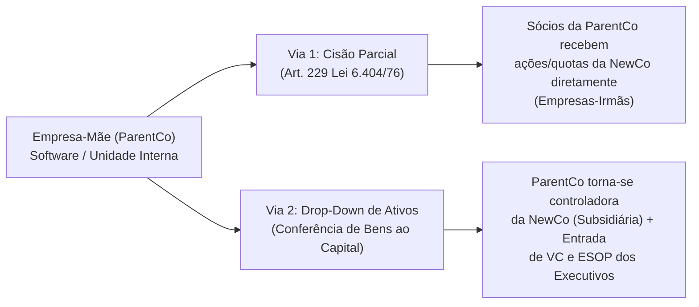

#### 4.1. Cisão Parcial (Art. 229 da Lei nº 6.404/1976 e Art. 1.122 do Código Civil)
Na **Cisão Parcial**, a empresa-mãe destaca uma parcela do seu patrimônio líquido (código-fonte, marcas, contratos de clientes, equipe e passivos vinculados) e a transfere para uma NewCo, reduzindo proporcionalmente o capital social da empresa cindida e entregando as quotas/ações da NewCo diretamente aos sócios da empresa-mãe.
* **Requisitos Legais e Neutralidade Fiscal:** Exige **Protocolo e Justificação de Cisão** (arts. 224 e 225 da Lei das S.A.) e **Laudo de Avaliação Patrimonial** assinado por peritos/auditores independentes registrados no CRC. Quando a versão do patrimônio é feita pelo **valor contábil (custo histórico de balanço)**, a operação tem **neutralidade fiscal total** (sem incidência de IRPJ/CSLL sobre ganho de capital, conforme art. 21 da Lei nº 9.249/1995).
* **Atenção à Sucessão e Solidariedade de Passivos (Art. 233 da Lei 6.404/76):** Por regra legal, a empresa cindida e a NewCo respondem **solidariamente** pelas obrigações anteriores à cisão. Embora o ato de cisão possa estipular que cada sociedade responde apenas pelas dívidas que lhe forem transferidas (desde que credores anteriores não se oponham em 90 dias), **no âmbito trabalhista (art. 2º, § 2º e arts. 10 e 448 da CLT) e tributário (art. 132 do CTN), a jurisprudência mantém responsabilidade solidária/subsidiária pelos fatos geradores anteriores à cisão**.

#### 4.2. *Drop-Down* de Ativos (*Conferência de Bens ao Capital Social*)
Para operações de **Equity Carve-out** (onde a empresa-mãe continuará como acionista relevante e a NewCo receberá aporte de investidores e dará *equity* aos executivos), o **Drop-Down** é o caminho mais rápido e seguro:
1. **Constituição da NewCo:** A empresa-mãe abre uma nova sociedade (LTDA ou S.A. Fechada).
2. **Integralização pelo Valor Contábil:** A empresa-mãe realiza um aumento de capital na NewCo conferindo a propriedade intelectual do software (registrada no INPI), domínios e contratos pelo **exato valor contábil escriturado no seu balanço** (art. 21 da Lei nº 9.249/1995 e art. 520 do RIR/2018), **sem apuração de ganho de capital tributável** na criação.
3. **Emissão Primária para Executivos e Investidores:** Em seguida, a NewCo emite novas ações/opções para os executivos operadores e recebe o aporte primário do fundo de VC com ágio na emissão de ações (isento de IRPJ/CSLL na NewCo pelo art. 38 do Decreto-Lei nº 1.598/1977).

---

### 5. Desenho de *Cap Table*, Governança e Incentivos da Spin-off

#### 5.1. Por que Spin-offs Lideradas por "Diretores CLT sem Pele em Jogo" Fracassam
O erro fatal de 90% das corporações brasileiras ao criar uma *spin-off* é reter **98% a 100% do *cap table* na empresa-mãe** e nomear um diretor CLT assalariado para tocar a operação.
* **O duplo fracasso:** Primeiro, um diretor CLT sem *equity* relevante otimiza para evitar riscos e proteger o bônus anual, jamais tendo a obsessão de um fundador. Segundo, **nenhum fundo de Venture Capital investe em uma startup onde a empresa-mãe é dona de 90%+ do *cap table* (*dead equity*) e o CEO/CTO operacional tem menos de 5%**.

#### 5.2. A Divisão Saudável do *Cap Table* da Spin-off
Para que a *spin-off* seja financiável (*investable*) por fundos de primeira linha e atraia talentos empreendedores de elite, estruture o *cap table* inicial dentro das seguintes faixas:
* **Empresa-Mãe (*ParentCo*):** **50% a 75%** na largada (diluindo de forma saudável para 35%–50% nas rodadas Série A/B subsequentes).
* **Equipe Fundadora / Executiva da Spin-off (CEO, CTO e Pool de ESOP):** **15% a 25%** do *cap table* total, condicionados ao desligamento integral das funções na empresa-mãe (foco 100% na NewCo) e sujeitos a **Vesting de 4 anos com Cliff de 1 ano** e cláusulas de *Good/Bad Leaver*.
* **Capital Externo (Fundo Seed / Series A ou Parceiro Estratégico):** **15% a 25%**, injetando caixa próprio na NewCo e assumindo assento no Conselho para garantir governança independente.

#### 5.3. *Transitional Services Agreement (TSA)* e Contratos *Intercompany* (*Arm's Length*)
Durante a transição, a NewCo frequentemente utiliza estrutura administrativa da empresa-mãe ou presta serviços tecnológicos para ela. Para evitar autuação da Receita Federal por **Distribuição Disfarçada de Lucros (DDL — Art. 464 do RIR/2018)** ou caracterização de confusão patrimonial (art. 50 do Código Civil):

> [!warning] As 3 Regras de Ouro dos Contratos *Intercompany*
> 1. **TSA (*Transitional Services Agreement*) / *Cost-Sharing* com Prazo Definido:** Formalize um contrato temporário (6 a 18 meses) de reembolso de custos compartilhados (contabilidade, RH, espaço físico) baseado em critérios objetivos de rateio, sem margem de lucro sobre reembolso puro.
> 2. **Contrato Comercial a Preço de Mercado (*Arm's Length*):** Se a empresa-mãe for cliente do software da *spin-off*, deve haver contrato formal e emissão mensal de Nota Fiscal a preços equivalentes aos praticados com clientes terceiros independentes.
> 3. **Segregação Trabalhista Total:** Transfira formalmente os contratos de trabalho do time dedicado para o CNPJ da NewCo. Nunca mantenha engenheiros subordinados simultaneamente a gestores das duas empresas, evitando passivo solidário por confusão operacional.

---

### 6. Checklist Operacional de Spin-off e Carve-out

- [ ] **Tese de Destravamento:** A separação captura arbitragem de múltiplo (ex.: *SaaS 8x ARR vs. Operação 6x EBITDA*), neutralidade competitiva (*Chinese Wall*) ou capital de risco dedicado?
- [ ] **Via Societária e Fiscal:** Definida entre **Cisão Parcial** (empresas-irmãs) ou **Drop-Down de Ativos** (subsidiária controlada) pelo valor contábil com laudo contábil e limpeza prévia da Propriedade Intelectual no INPI?
- [ ] **Alinhamento de *Cap Table*:** ParentCo com **50%–75%**, time executivo dedicado 100% com **15%–25%** (*vesting* de 4 anos) e espaço para investidores externos?
- [ ] **Governança e *Intercompany*:** Contratos de cliente-âncora e TSA formalizados a preços de mercado (*arm's length*) para blindar contra contingências de DDL e confusão patrimonial?

---

## CAPÍTULO 16 — LIQUIDEZ SECUNDÁRIA (SECONDARIES): REALIZAÇÃO PARCIAL DE CAPITAL PARA FUNDADORES, EXECUTIVOS E INVESTIDORES ANTES DO EXIT

**Como Desenhar, Precificar, Aprovar e Executar Transações Secundárias no Brasil e no Exterior sem Sinalizar Descompromisso ou Destruir o *Cap Table***

> [!abstract] Posição no livro
> Este capítulo unifica a teoria, a mecânica global e a execução prática brasileira das operações de **Liquidez Secundária (*Secondaries*)** — a venda de participação societária já existente (*ações ou quotas*) por fundadores, executivos iniciais (*early employees*) ou investidores de estágios iniciais antes de um evento de saída total (*M&A* ou *IPO*). Conecta-se diretamente à Fase 14 e aos Capítulos de Captação e *Valuation* (no Volume 5), ao Capítulo de *Stock Options / ESOP* (no Volume 6) e à Fase 20 e ao Capítulo de Tributação do *Exit* (neste Volume 9).

---

### 1. O Paradoxo Patrimonial do Fundador em Série B+ e Por Que Liquidez Antecipada Importa

A narrativa clássica do Vale do Silício vende uma linha reta: o fundador cria a empresa na garagem, passa 8 a 12 anos vivendo com salário abaixo do mercado, nunca vende uma única ação e, no final, realiza centenas de milhões de dólares em um IPO ou M&A bilionário. Na vida real — especialmente no Brasil, onde o ciclo até a liquidez plena frequentemente supera 9 a 12 anos — essa rigidez cria uma distorção psicológica e estratégica perigosa.

> [!important] O Paradoxo "Rico no Papel, Pobre no Banco"
> Em estágios de *Série B* em diante, é comum encontrar um fundador brasileiro cuja participação de 25% na companhia vale **R$ 100 milhões a R$ 300 milhões no papel** (pela cotação da última rodada), mas que possui **menos de R$ 150 mil líquidos na conta bancária pessoal**, mora de aluguel e carrega estresse financeiro familiar acumulado após 6 anos de jornada.
> Um fundador financeiramente asfixiado na pessoa física toma **decisões estratégicas ruins para a empresa**:
> 1. **Ou aceita vender a empresa inteira cedo demais** na primeira proposta mediana de M&A apenas para colocar R$ 10 milhões no bolso (matando uma companhia que poderia valer 10x mais em 4 anos);
> 2. **Ou se torna excessivamente avesso ao risco operacional**, paralisando apostas estratégicas de longo prazo por medo de perder a única reserva patrimonial da sua vida.

**Liquidez secundária moderada não é sinal de descrença no negócio — é gestão de risco e alinhamento de horizonte.** Quando um fundador vende **5% a 15% da sua própria fatia societária** em uma rodada Série B ou Série C, coloca R$ 3 milhões a R$ 15 milhões líquidos no bolso, compra a casa da família e garante a educação dos filhos, ele **alinha seu horizonte de tempo com o dos fundos de Venture Capital e Growth Equity**, ficando psicologicamente livre para jogar o jogo longo em busca de um *exit* 5x ou 10x maior com os **85% a 95% de *equity* que continuam na mão dele**.

O mesmo vale para **executivos iniciais (*early employees*)** cujos pacotes de *Stock Options / ESOP* já cumpriram 4 a 6 anos de *vesting*: se as opções nunca tiverem janela de liquidez antes do ano 10, o *equity* deixa de ser visto pela equipe como patrimônio real e passa a ser tratado como "bilhete de loteria de papel".

---

### 2. Primária vs. Secundária: A Mecânica Estrutural da Transação

Na **Rodada Primária (*Primary Round*)**, a empresa emite **novas ações**, dilui proporcionalmente todos os sócios atuais e **100% do dinheiro entra no caixa da empresa** para financiar crescimento.

Na **Transação Secundária (*Secondary*)**, **não há emissão de novas ações nem diluição do *cap table***: um titular existente (fundador, executivo ou fundo *Pre-Seed/Seed*) transfere parte de suas ações/quotas existentes para um comprador, e **o dinheiro vai diretamente para a conta bancária de quem vendeu**.

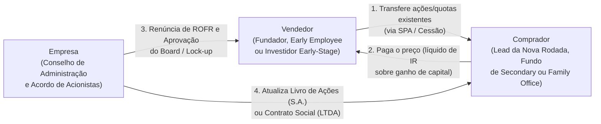

#### As 4 Modalidades de Operação Secundária

| Modalidade | Como Funciona | Estágio Típico | Vantagens e Riscos |
| :--- | :--- | :--- | :--- |
| **1. *Founder Liquidity* Embutida em Rodada Primária** | O fundo líder da nova rodada (ex.: Série B de R$ 80M) destina R$ 70M para o caixa da empresa (*primária*) e R$ 10M para comprar ações dos fundadores/anjos (*secundária*). | Série A tardia, Série B, Série C+ | **A estrutura mais limpa e comum no Brasil.** Aproveita a mesma *due diligence* e documentação da rodada, com desconto zero ou mínimo (0% a 15%). |
| **2. *Tender Offer* Estruturada (Oferta Pública Interna de Recompra)** | A empresa (ou um grupo de investidores) abre uma janela formal de 20–30 dias permitindo que todos os colaboradores elegíveis (com *vesting* cumprido) e fundadores vendam até X% (ex.: 10% a 20%) de suas ações a um preço fixo. | Série C+, *Late Stage* e Pré-IPO | Transforma o ESOP em dinheiro real para o time sênior, gerando retenção massiva e cultura de dono. Exige cuidado tributário para não caracterizar remuneração salarial. |
| **3. *Direct Secondary* (Venda Direta de Bloco entre Rodadas)** | Um fundador, ex-sócio ou fundo *Seed* em fim de ciclo (ano 8–10 do fundo) vende um bloco de ações diretamente a um investidor existente, *Family Office* ou fundo secundário fora de uma rodada primária. | Pós-Série B ou maturidade | Resolve saída de sócio inativo ou fim de vida de fundo *early-stage*, mas exige negociação individual de ROFR e sofre desconto maior (20% a 40%). |
| **4. *GP-Led Secondary / Continuation Fund*** | O gestor de um fundo de VC que atingiu o 10º ano cria um veículo de continuação com novos LPs para comprar as participações das 2 ou 3 melhores empresas do fundo antigo, dando liquidez aos LPs originais sem forçar a startup a um M&A prematuro. | Maturidade (*Late Stage*) | Alivia a pressão artificial do fundo antigo no *Board* para vender a empresa fora de hora. |

---

### 3. Restrições Societárias: ROFR, *Co-Sale (Tag-Along)*, *Lock-Up* e Aprovação do *Board*

Nenhum fundador ou acionista de uma startup investida pode simplesmente vender suas ações para um terceiro na rua. Todo **Acordo de Acionistas (*Shareholders' Agreement* — SHA)** profissional contém **quatro travas contratuais** que governam qualquer transferência secundária:

1. **Cláusula de *Lock-Up* (Período de Vedação à Venda):** Proíbe que os fundadores vendam qualquer participação durante um prazo determinado após a rodada (ou exige consentimento unânime dos investidores preferenciais).
2. **Direito de Preferência (*Right of First Refusal* — ROFR):** Antes de vender suas ações a um comprador externo, o vendedor é obrigado a notificar formalmente a empresa e/ou os atuais acionistas (detentores de ROFR), informando o preço, a quantidade e as condições exatas da oferta firme recebida. Os acionistas atuais têm um prazo (tipicamente 15 a 30 dias) para **exercer o ROFR e comprar aquelas ações pelo mesmo preço**, ou **renunciar formalmente ao ROFR (*ROFR Waiver*)** para permitir que o terceiro compre.
3. **Direito de Venda Conjunta (*Right of Co-Sale / Tag-Along*):** Mesmo que os investidores atuais não queiram comprar suas ações (não exerçam o ROFR), a cláusula de *Co-Sale* dá a eles o direito de **"pegar carona" proporcionalmente** no pacote que você negociou com o comprador. *(Ex.: se um comprador quer adquirir R$ 10 milhões em ações secundárias e os investidores exercem o Co-Sale, você só consegue vender R$ 7 milhões e os investidores vendem R$ 3 milhões da cota deles)*. Logo, para uma secundária de fundador funcionar, os investidores precisam assinar um ***Waiver* de ROFR e de *Co-Sale***.
4. **Aprovação do Conselho de Administração (*Board Approval*):** O estatuto/acordo quase sempre exige aprovação prévia do *Board* para evitar que ações caiam nas mãos de concorrentes estratégicos, fundos predatórios ou pessoas com restrições de *compliance*.

> [!tip] A Regra dos 10% a 20% (Limites Saudáveis de Venda pelo Fundador)
> Tanto no Brasil quanto nos EUA, o mercado institucional aceita com naturalidade que um fundador venda **entre 10% e 20% da sua própria participação societária** (ou que a parcela secundária represente até **10% a 20% do cheque total** de uma rodada Série B/C). Pedir para vender 40% ou 50% das suas ações acende um alerta vermelho imediato no comitê de investimento: *"O fundador sabe de algum problema estrutural que nós não vimos e quer pular do barco"*.

---

### 4. Precificação no Mercado Secundário: Como Funciona o Desconto sobre a Última Rodada

Diferente da bolsa de valores, ações de empresas privadas não têm liquidez diária, e ações detidas por fundadores e funcionários são quase sempre **Ações Ordinárias (*Common Stock*)**, enquanto os fundos de VC compram **Ações Preferenciais (*Preferred Stock*)** na rodada primária (que possuem *Liquidation Preference* de 1x, *anti-dilution* e direitos de veto).

Por isso, ações ordinárias vendidas no mercado secundário costumam sofrer um **desconto de avaliação (*Secondary Discount*)** em relação ao preço por ação da última rodada primária:

| Fator de Precificação | Impacto no Desconto Secundário | Faixa Prática de Desconto (Brasil e EUA) |
| :--- | :--- | :--- |
| **Secundária embutida na própria rodada primária (*Founder Liquidity*)** | O novo investidor líder precifica o pacote global; às vezes converte as ações compradas do fundador em preferenciais | **0% a 15% de desconto** sobre o preço da rodada primária |
| **Transação avulsa (*Standalone*) em empresa crescendo > 80% a.a.** | Alta demanda de investidores que perderam a rodada primária e querem entrar no *cap table* | **10% a 20% de desconto** sobre a última rodada |
| **Diferença de Classe (*Common Stock* vs. *Preferred Stock*)** | Ações ordinárias não têm *liquidation preference* (ficam no fim da fila em um M&A abaixo do *valuation*) | **15% a 25% de desconto** estrutural |
| **Tempo decorrido desde a última rodada (> 18–24 meses) ou crescimento moderado** | Maior incerteza sobre o *valuation* atual e distância até o *exit* | **25% a 40% de desconto** |
| **Empresa estagnada ou fundo precisando liquidar posição em fim de ciclo** | Assimetria total de poder a favor do comprador especializado em *secondaries* | **40% a 70% de desconto** |

#### Quem Compra Participações Secundárias no Brasil?
1. **O próprio Fundo Líder (*Lead Investor*) da Série B, C ou Growth:** É o comprador mais frequente para *founder liquidity*, pois precisa alocar um cheque mínimo (ex.: US$ 15M a US$ 50M) sem diluir excessivamente a companhia na emissão primária.
2. **Investidores atuais do *Cap Table* (*Follow-on*):** Fundos *Seed/Series A* com reserva de *follow-on* ou *Family Offices* já presentes no *cap table* que conhecem a operação por dentro e aproveitam para aumentar sua fatia com desconto.
3. **Fundos Especializados em *Secondaries* e *Late Stage*:** No Brasil, gestoras dedicadas a *secondaries* de VC/PE (como Spectra Investments, Jera Capital, fundos de *Growth* do BTG/XP/Itaú e plataformas globais quando a *holding* já está em Cayman/Delaware, como Lexington Partners, StepStone, Forge e EquityZen).

---

### 5. Passo a Passo de Execução e Tributação no Brasil

#### 5.1. O Roteiro de 6 Passos para Executar uma Secundária Limpa
1. **Diagnóstico Societário e Tributário Prévio:** Revise o Acordo de Acionistas (ROFR, *Co-Sale*, *Lock-up*) e verifique onde suas ações estão detidas (Pessoa Física no Brasil, *Holding* Patrimonial LTDA ou *Offshore* em Cayman/BVI/Delaware).
2. **Alinhamento Transparente com o *Board* e Investidores Líderes:** Nunca saia oferecendo ações no mercado pelas costas do seu Conselho. Converse abertamente com seus principais investidores: *"Estamos indo para o 7º ano da empresa, vamos escalar para R$ 200M de ARR nos próximos 4 anos e quero vender 10% da minha posição pessoal nesta rodada Série B para tirar risco familiar da mesa e focar 100% no longo prazo."* Bons investidores apoiam e ajudam a estruturar.
3. **Definição do Veículo e da Classe de Ações:** Se a venda ocorrer dentro de uma rodada primária, negocie se o comprador adquirirá diretamente suas ações ordinárias via *Share Purchase Agreement (SPA)* (com reclassificação aprovada em AGE para preferenciais, se exigido pelo fundo) ou se a empresa fará recompra/resgate.
4. **Coleta Formal de *Waivers* (ROFR e *Co-Sale*):** O jurídico societário circula o termo de renúncia ao direito de preferência e de venda conjunta para assinatura de todos os acionistas relevantes.
5. **Assinatura do SPA (*Share Purchase Agreement*) e Fechamento (*Closing*):** O vendedor presta declarações e garantias restritas à **titularidade e livre desembaraço das ações vendidas** (evite assumir indenizações operacionais amplas da companhia no seu CPF em uma secundária!).
6. **Averbação no Livro de Registro e Transferência de Ações (S.A.) ou Alteração Contratual (LTDA) e Recolhimento do DARF de Ganho de Capital.**

#### 5.2. Tributação da Venda Secundária no Brasil (Fundadores e Executivos)
A venda de ações ou quotas por pessoa física residente no Brasil gera **Ganho de Capital** (diferença entre o valor de venda e o custo contábil de aquisição/integralização original — que para o fundador costuma ser próximo de zero):
* **Alíquotas Progressivas de IRPF sobre Ganho de Capital (Lei nº 13.259/2016):**
  * **15%** sobre a parcela dos ganhos até **R$ 5 milhões**;
  * **17,5%** sobre a parcela entre **R$ 5 milhões e R$ 10 milhões**;
  * **20%** sobre a parcela entre **R$ 10 milhões e R$ 30 milhões**;
  * **22,5%** sobre a parcela dos ganhos que ultrapassar **R$ 30 milhões**.
* **Prazo fatal de pagamento:** O imposto (apurado no programa GCAP da Receita Federal) deve ser pago via DARF **até o último dia útil do mês subsequente** àquele em que o valor da parcela foi recebido (regime de caixa).
* **Atenção para Executivos (*Early Employees*) em *Tender Offers*:** Se o executivo detém *Stock Options* ainda não exercidas e a própria empresa paga em dinheiro a diferença entre o preço da rodada e o *strike price* (*cashless exercise* liquidado pela própria empregadora), a Receita Federal e o CARF frequentemente autuam a operação como **remuneração trabalhista disfarçada**, cobrando **27,5% de IRPF + ~28% de INSS patronal + 20% de FGTS/reflexos**! Para tributar a 15% como ganho de capital mercantil, o plano precisa ser estritamente mercantil (com onerosidade e risco de mercado, conforme o Marco Legal das Startups e jurisprudência do STJ — Tema 1.226) e a compra das ações já exercidas deve ser feita pelo investidor terceiro via SPA, e não paga na folha pela empresa.

---

### 6. Checklist Operacional de *Secondary*

- [ ] A empresa já atingiu maturidade real (tipicamente Série B+, *Product-Market Fit* consolidado e crescimento saudável)?
- [ ] O volume vendido pelo fundador respeita a faixa saudável de governança (**≤ 10% a 20% da participação total do fundador**)?
- [ ] O Conselho de Administração (*Board*) foi alinhado previamente antes de qualquer sondagem externa?
- [ ] Os termos de **ROFR (*Right of First Refusal*)** e ***Co-Sale / Tag-Along*** do Acordo de Acionistas foram formalmente renunciados (*waived*) por escrito?
- [ ] As declarações e garantias do vendedor no *Share Purchase Agreement (SPA)* estão limitadas à titularidade das ações vendidas e limitadas (*cap*) ao valor líquido recebido?
- [ ] O custo de aquisição original no IRPF está comprovado documentalmente e o DARF de Ganho de Capital (15% a 22,5%) foi provisionado para pagamento até o último dia útil do mês seguinte?
- [ ] Para colaboradores em *Tender Offer*, a estrutura jurídica separa claramente a venda mercantil de ações para o investidor comprador de qualquer pagamento via folha salarial?

---

## CAPÍTULO 17 — IPO NO BRASIL: QUANDO, COMO E O QUE MUDA

> [!note] Posição no livro
> Este capítulo complementa a [[#FASE 20 — ESTRATÉGIA DE SAÍDA (EXIT STRATEGY)|Fase 20 — Exit Strategy]]. Cobre o IPO (Initial Public Offering, ou oferta pública inicial de ações) como caminho específico de exit (evento de liquidez para os sócios), com foco no contexto brasileiro (B3, CVM, Novo Mercado). M&A (fusões e aquisições) como caminho de exit está na Fase 16 e no [[#CAPÍTULO 13 — M&A ATIVO E ROLL-UPS: FUNDADOR COMO COMPRADOR|Capítulo 13 (M&A ATIVO E ROLL-UPS: FUNDADOR COMO COMPRADOR)]].

---

### IPO não é o objetivo — é um instrumento

A maioria dos fundadores que contempla IPO trata o evento como meta de chegada. É um erro. IPO é instrumento de liquidez e de acesso a capital público, com custo operacional permanente e restrições relevantes de governança. Algumas empresas ficam melhores depois do IPO. Muitas ficam piores, porque foram a mercado cedo demais ou pelos motivos errados.

A pergunta certa não é "quando vou abrir capital?" mas "o IPO é o melhor caminho para os meus objetivos específicos neste momento?".

---

### Pré-requisitos reais para um IPO no Brasil

O regulatório (CVM, B3) tem requisitos mínimos. O mercado tem requisitos implícitos muito mais altos.

**Requisitos regulatórios (B3 Novo Mercado — padrão de referência):**

- Free float (ações em circulação no mercado) mínimo de 25% após o IPO
- Apenas ações ordinárias (ON) com tag along (direito do minoritário de vender junto) de 100%
- Board com mínimo 20% de conselheiros independentes (mínimo 5 membros)
- Auditoria por empresa independente registrada na CVM
- Divulgação em inglês de documentos relevantes

**Requisitos de mercado (não formais, mas determinantes):**

- Receita anual recorrente ou previsível acima de R$ 300–500M (orientação geral para IPOs viáveis no Novo Mercado; 2024–2026)
- Histórico de 3 anos de demonstrações financeiras auditadas
- EBITDA positivo ou trajetória clara de rentabilidade nos próximos 12–18 meses
- Governança corporativa já funcionando (board independente, comitê de auditoria)
- Time de CFO e IR experientes em mercado de capitais
- Story coerente para investidor institucional: por que IPO agora, qual o uso dos recursos

> [!warning] O mercado brasileiro é pequeno e sazonal
> A janela de IPOs no Brasil abre e fecha com o humor macroeconômico. 2020 e 2021 foram anos excepcionais. De 2022 a 2024, a janela ficou praticamente fechada. Planejar IPO sem levar em conta esse ciclo é ingenuidade operacional.

---

### Estrutura do processo de IPO

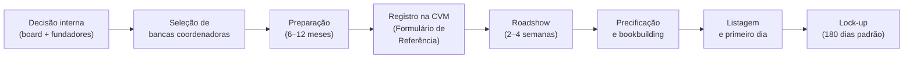

**Duração total:** 12–24 meses do início da preparação até a listagem.

---

### As três fases internas de preparação

#### Fase 1 — Decisão e estruturação (meses 1–6)

- Alinhamento do board e dos sócios relevantes sobre a decisão
- Avaliação interna: a empresa está pronta? O mercado está receptivo?
- Seleção de coordenadores (bancos de investimento): BTG, XP, Itaú BBA, Goldman, JPMorgan são os mais frequentes em IPOs brasileiros
- Seleção de advogados (empresa e bancas têm assessores separados)
- Auditores: BigFour é padrão para mercado de capitais
- Reestruturação societária se necessário (holding, conversão de LTDA para SA, etc.)

#### Fase 2 — Preparação técnica (meses 6–18)

- Elaboração do Formulário de Referência (documento regulatório central da CVM — equivalente ao S-1 americano)
- Auditoria dos últimos 3 exercícios em padrão IFRS
- Construção ou fortalecimento do time de IR (Investor Relations)
- Road show de aquecimento com investidores institucionais (não-deal roadshow)
- Governança: eleição do board definitivo, instalação de comitês
- Estrutura de incentivos pós-IPO: ESOP adaptado para empresa pública

#### Fase 3 — Execução do IPO (meses 18–24)

- Protocolo na CVM: início do prazo regulatório (~30 dias para análise)
- Prospecto preliminar (red herring): versão pública sem preço
- Roadshow formal: apresentações para investidores institucionais em São Paulo, Rio, Nova York, Londres (para IPOs com tranche internacional)
- Bookbuilding: formação do livro de ordens e definição da faixa de preço
- Precificação: definição do preço final com as bancas
- Liquidação: D+2 após precificação
- Lock-up: fundadores e investidores anteriores ficam impedidos de vender por 180 dias

---

### Custos do IPO

**Custos de transação (one-time):**

| Item | Estimativa |
|---|---|
| Comissão de coordenação (bancas) | 3,5–5% do valor captado |
| Advogados (empresa + bancas) | R$ 5–15M dependendo da complexidade |
| Auditoria | R$ 2–5M |
| CVM, B3 e custos regulatórios | R$ 500K–2M |
| Roadshow, marketing e impressão | R$ 1–3M |
| **Total estimado para IPO de R$ 500M** | **R$ 25–40M** |

**Custos recorrentes (pós-IPO, anuais):**

| Item | Estimativa |
|---|---|
| Equipe de IR (2–5 pessoas) | R$ 3–8M |
| Auditoria externa contínua | R$ 2–4M |
| Relações com reguladores e compliance | R$ 1–3M |
| Custos de listagem B3 | R$ 100–500K |
| Assessoria jurídica contínua | R$ 1–3M |
| **Total recorrente estimado** | **R$ 7–18M/ano** |

> [!important] O custo real é o tempo do fundador
> CEO de empresa pública passa 20–30% do tempo em atividades de IR: calls com analistas, apresentações em conferências, comentários de resultados trimestrais. Isso é tempo que não vai para produto, clientes ou time. Para empresas em aceleração, esse custo de oportunidade é muitas vezes maior que os custos financeiros.

---

### O que muda depois do IPO

**Governança:**
- Resultados financeiros divulgados trimestralmente (ITR) e anualmente (DFP)
- Qualquer fato relevante deve ser divulgado imediatamente ao mercado
- Insider trading tem consequências criminais — não apenas civis
- Períodos de silêncio (blackout) antes de divulgação de resultados

**Gestão:**
- Pressão por resultados trimestrais pode distorcer decisões de longo prazo
- Decisões estratégicas que antes levavam dias agora levam semanas (board, compliance, disclosure)
- Ativistas acionários: em empresas com free float relevante, fundos ativistas podem exigir mudanças de estratégia ou de management

**Fundadores:**
- Riqueza "no papel" — ações não vendem livremente no lock-up
- Após lock-up: necessidade de plan 10b5-1 (ou equivalente brasileiro) para vender sem acusação de insider trading
- Remuneração e benefícios passam a ser públicos

---

### Alternativas ao IPO tradicional no Brasil

| Alternativa | O que é | Quando considerar |
|---|---|---|
| **Follow-on** | Emissão de novas ações por empresa já listada | Quando precisa de capital mas não quer diluição de fundadores via novo IPO |
| **CRA/CRI/Debentures** | Dívida pública sem abrir capital | Quando precisa de capital sem diluição — para agritech, real estate, infra |
| **SPAC** | Special Purpose Acquisition Company | Incomum no Brasil; mais relevante para empresas com planos de listagem nos EUA |
| **BDR** | Brazilian Depositary Receipt | Empresa listada no exterior com BDRs na B3 — para empresas com estrutura holding no exterior |
| **Listagem direta nos EUA** | NYSE ou NASDAQ via F-1 (empresa estrangeira) | Para empresas com receita significativa em dólar e tese global |

---

### IPO vs. M&A — a escolha no momento certo

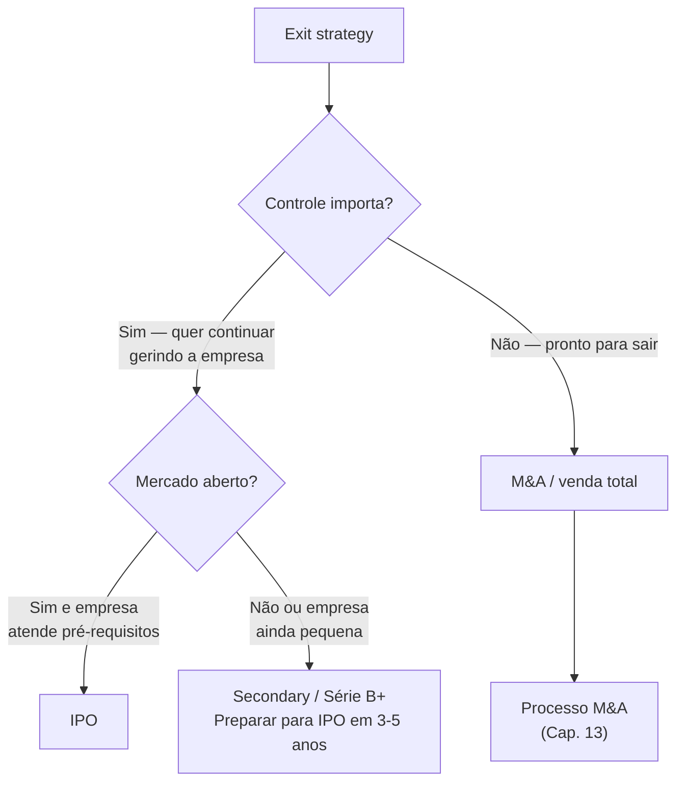

| Critério | Favorece IPO | Favorece M&A |
|---|---|---|
| Tamanho | > R$ 500M de receita anual | Qualquer tamanho |
| Controle | Fundador quer continuar gerindo | Fundador quer sair ou reduzir exposição |
| Liquidez necessária | Parcial (lock-up 180 dias) | Total (closing em 3–6 meses) |
| Mercado | Janela aberta, tese clara para público | Independente do ciclo macro |
| Governança | Empresa já tem board e compliance funcionando | Adquirente assume a governança |
| Prêmio de controle | Não existe em IPO | Adquirente paga prêmio de controle típico de 20–40% |

> [!info] Fases relacionadas
> Referenciado em: Fase 16.

---

### Armadilhas

1. **Abrir capital para resolver problema de produto ou de mercado.** Capital resolve problema de capital. Não resolve PMF fraco, churn alto ou margem negativa.
2. **IPO sem governança real.** CVM e B3 aprovam no papel. Mercado pune na precificação.
3. **Subestimar o custo de manutenção.** Fundadores calculam o custo do IPO, não o custo de ser público.
4. **Lock-up como único plano de liquidez.** Prepare o plano de venda com antecedência e com assessoria jurídica especializada.
5. **Ignorar o ciclo macro.** IPO em janela fechada destrói valor — melhor esperar ou encontrar alternativa.
6. **CFO sem experiência em mercado de capitais.** CFO de startup privada e CFO de empresa pública são perfis diferentes.

**Ver também:** [[#FASE 20 — ESTRATÉGIA DE SAÍDA (EXIT STRATEGY)|Fase 20 — Exit]], [[#CAPÍTULO 13 — M&A ATIVO E ROLL-UPS: FUNDADOR COMO COMPRADOR|Capítulo 13 — M&A]], [[#CAPÍTULO 16 — LIQUIDEZ SECUNDÁRIA (SECONDARIES): REALIZAÇÃO PARCIAL DE CAPITAL PARA FUNDADORES, EXECUTIVOS E INVESTIDORES ANTES DO EXIT|Capítulo 16 — Secondary e Liquidez de Founder]], [[#CAPÍTULO 1 — BOARD E GOVERNANCE|Capítulo 1 — Board e Governance]]

---

## CAPÍTULO 18 — TRIBUTAÇÃO DO EXIT PARA FUNDADORES BRASILEIROS

> [!note] Aviso legal
> Este capítulo é material educacional, não assessoria tributária. Alíquotas, bases de cálculo e regimes especiais mudam com frequência no Brasil. Antes de qualquer transação de exit, consulte advogado tributarista e planejador patrimonial com experiência em participações societárias. Decisões sem planejamento prévio podem resultar em carga tributária irreversível.

> [!note] Posição no livro
> Complementa a [[#FASE 20 — ESTRATÉGIA DE SAÍDA (EXIT STRATEGY)|Fase 20 — Exit]], o [[#CAPÍTULO 13 — M&A ATIVO E ROLL-UPS: FUNDADOR COMO COMPRADOR|Capítulo 13 — M&A]] e o [[#CAPÍTULO 16 — LIQUIDEZ SECUNDÁRIA (SECONDARIES): REALIZAÇÃO PARCIAL DE CAPITAL PARA FUNDADORES, EXECUTIVOS E INVESTIDORES ANTES DO EXIT|Capítulo 16 — Secondary]]. Foco em tributação do fundador pessoa física (PF) e das estruturas de holding (sociedade que detém participações em outras empresas) mais comuns.

---

### O problema tributário do exit

Um fundador que vendeu participação em uma startup por R$ 50M pode chegar às mãos com R$ 35 a 40M, ou com R$ 45 a 48M, conforme decisões de estrutura tomadas anos antes da venda. A diferença não é fraude. É planejamento, ou a ausência dele.

O Brasil tributa ganho de capital de forma progressiva, mas com várias estruturas que alteram a carga efetiva de forma relevante. Entender o básico é obrigação do fundador, não privilégio do rico.

---

### Ganho de capital — fundador pessoa física

#### Regra geral

Quando uma pessoa física vende participação societária, o ganho é tributado como ganho de capital:

| Faixa de ganho líquido | Alíquota |
|---|---|
| Até R$ 5 milhões | 15% |
| De R$ 5M a R$ 10M | 17,5% |
| De R$ 10M a R$ 30M | 20% |
| Acima de R$ 30M | 22,5% |

**Base de cálculo:** Preço de venda menos custo de aquisição (o valor pelo qual as cotas/ações foram adquiridas ou integralizadas).

**Exemplo:**

```
Fundador fundou a empresa em 2020 com custo de integralização de R$ 10.000.
Vende participação em 2026 por R$ 20.000.000.

Ganho líquido = R$ 20.000.000 - R$ 10.000 = R$ 19.990.000

Tributação progressiva:
  Até R$ 5M:        R$ 5.000.000 × 15%  = R$ 750.000
  R$ 5M a R$ 10M:   R$ 5.000.000 × 17,5% = R$ 875.000
  R$ 10M a R$ 19,99M: R$ 9.990.000 × 20% = R$ 1.998.000

Total IRPF = R$ 3.623.000 (≈ 18,1% efetivo)
```

**Prazo de recolhimento:** Até o último dia útil do mês seguinte à alienação (não espera o IR anual).

---

### Holding familiar — planejamento antes do exit

A estrutura mais comum de planejamento patrimonial para fundadores é a constituição de uma holding (pessoa jurídica) para deter a participação na startup antes da venda.

#### Como funciona

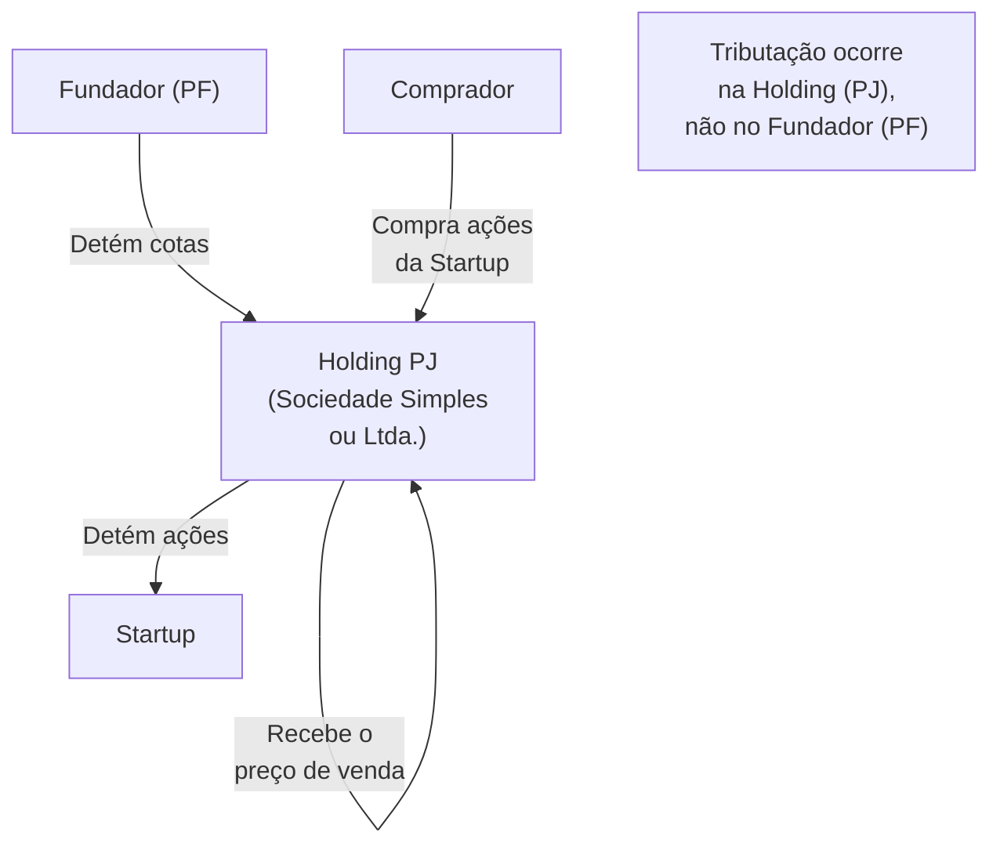

#### Tributação da venda pela holding

Se a holding for optante do **Lucro Real**, o ganho na venda de participações é tributado como:

- **IRPJ:** 15% sobre o lucro
- **CSLL:** 9% sobre o lucro
- **Adicional de IRPJ:** 10% sobre lucro acima de R$ 240K/ano
- **Total aproximado:** 34% sobre o ganho

Se a holding for optante do **Lucro Presumido** com atividade de participações (holding pura), a base presumida para ganho de capital é 8% da receita bruta (para algumas atividades) — mas ganhos de capital são tributados integralmente.

> [!warning] Holding não é sempre melhor
> Para ganhos menores (abaixo de R$ 5M), a alíquota de PF (15%) pode ser mais favorável que a tributação da PJ (34%). A vantagem da holding aparece em ganhos maiores **e** quando há planejamento de reinvestimento do capital antes da distribuição para o sócio.

#### Quando a holding é vantajosa

1. **Diferimento:** O lucro na venda pode permanecer na holding (sem distribuição) e ser reinvestido em outros ativos sem tributação imediata para o sócio PF.
2. **Reinvestimento em FIIS, ações, ou outros negócios:** O capital dentro da holding cresce sem a tributação de IRPF que ocorreria se distribuído.
3. **Planejamento sucessório:** Holding facilita doação de cotas com cláusulas de incomunicabilidade, inalienabilidade e usufruto vitalício.

#### Quando a holding não resolve

1. **Criada depois que a startup já tem valor.** Transferir participação de PF para holding quando a empresa já vale muito gera evento tributável na transferência.
2. **Holding criada muito próxima do exit.** Receita Federal pode questionar o propósito negocial — planejamento tardio tem risco de ser desconsiderado.
3. **Custos de manutenção.** Holding tem IRPJ, CSLL, contabilidade, abertura e encerramento — para patrimônios pequenos, o custo pode superar o benefício.

---

### Estrutura offshore — quando e como

Alguns fundadores brasileiros constituem estruturas no exterior (BVI, Cayman, Delaware) para deter a participação na startup antes de uma venda ou IPO.

#### Contexto legal

A Receita Federal exige que **pessoas físicas residentes no Brasil** declarem ativos no exterior (CBE — Declaração de Capitais Brasileiros no Exterior). A existência de estrutura offshore é perfeitamente legal — a tributação sobre os rendimentos é que deve ser observada.

#### Tributação de rendimentos de offshore

Desde a Lei 14.754/2023, entidades controladas no exterior por pessoas físicas residentes no Brasil têm seus lucros tributados **anualmente** pelo IRPF (15% para lucros distribuídos ou retidos em entidade "transparente"). Antes dessa lei, havia diferimento indefinido — que não existe mais.

> [!important] A lei offshore mudou o jogo
> Antes de 2024 (efeitos da Lei 14.754/2023), holding offshore era estratégia de diferimento significativo. Após a lei, a vantagem se reduziu substancialmente para residentes no Brasil. Planejamento offshore deve ser revisitado com tributarista à luz desta mudança.

#### Quando offshore ainda faz sentido

- Fundador que planeja mudar de residência fiscal antes do exit (ver seção abaixo)
- Empresa com operações reais e substanciais no exterior
- Estrutura de captura de investimento estrangeiro (Cayman para fundo americano investir em startup brasileira)

---

### Mudança de residência fiscal antes do exit

A estratégia mais agressiva — e legal — disponível para fundadores com grande ganho esperado é a **mudança de residência fiscal** antes da venda.

#### Como funciona

Um fundador que se torna residente fiscal em outro país **antes** de vender sua participação pode ser tributado pelas regras desse país, não do Brasil. Países com tributação favorável para ganho de capital incluem Portugal (NHR), Emirados Árabes (0%), Estados Unidos (depende da estrutura), entre outros.

> [!warning] Saída do Brasil exige cuidado
> A Receita Federal tributa o **ganho de capital latente** no momento da saída definitiva do Brasil (tributação de saída — "exit tax"). O fundador que já detém participação valorizada e sai do Brasil precisa calcular e recolher o imposto sobre a valorização até a data de saída, mesmo sem vender. Depois da saída, ganhos futuros são tributados pelo país de destino.

#### Países frequentemente usados por fundadores brasileiros

| País | Regime para novos residentes | Tributação de ganho de capital |
|---|---|---|
| **Portugal** | IFICI (sucessor do NHR, Lei 82/2023, vigência para novos residentes a partir de 2024), 10 anos, restrito a P&D, ciência, inovação tecnológica e investidor qualificado | Menos amplo que o antigo NHR. Varia por tipo de rendimento elegível |
| **Emirados Árabes** | Residência disponível via imóvel ou empresa | 0% imposto de renda (2023+, imposto corporativo não se aplica a PF) |
| **Uruguai** | Residência simples; regime territorial | Ganho de capital de fonte estrangeira pode ser isento |
| **Irlanda** | Favorável para IP e holdings | Ganho de capital: 33%, mas com isenções específicas |

> [!note] Não existe solução universal
> Cada estrutura tem suas próprias regras, prazos mínimos de residência e riscos de planejamento abusivo. Planejamento de mudança de residência fiscal deve ser feito com pelo menos 2–3 anos de antecedência do exit esperado, com assessoria especializada.

---

### Tributação de stock options no exit

Quando fundadores ou funcionários têm stock options que se convertem em ações e são vendidas no exit, a tributação depende da classificação:

**Se as opções forem tratadas como remuneração (tese da Receita Federal):**
- A diferença entre valor de mercado e preço de exercício é tributada como rendimento do trabalho no momento do exercício (IRPF progressivo até 27,5% + encargos previdenciários potenciais)
- O ganho posterior (entre exercício e venda) é tributado como ganho de capital

**Se as opções forem tratadas como investimento (tese favorável ao contribuinte):**
- Tributação somente no exit, como ganho de capital (tabela progressiva de 15–22,5%)
- Base: preço pago no exercício (strike price)

A disputa está em aberto. Para detalhes, ver [[IGNICAO-Vol-6-Receita-e-Pessoas#CAPÍTULO 16 — STOCK OPTIONS E ESOP NO BRASIL|Capítulo 16 — Stock Options e ESOP (Vol. 6)]].

---

### Cronograma de planejamento tributário

| Horizonte até exit esperado | O que fazer |
|---|---|
| > 3 anos | Avaliação da estrutura atual; decisão sobre holding; planejamento sucessório; consideração de mudança de residência se for o caso |
| 2–3 anos | Formação da holding (se for o caso) com tempo de maturação; revisão do cap table e estrutura societária |
| 1–2 anos | Revisão com tributarista; simulação de carga em diferentes estruturas de exit (total vs. parcial, earnout, swap de ações) |
| 6–12 meses | Documentação de custo de aquisição; organização de comprovantes históricos; due diligence interna |
| < 6 meses | Nenhuma mudança estrutural relevante é recomendada — risco de questionamento de propósito negocial |

> [!info] Fases relacionadas
> Referenciado em: Fase 16.

---

### Worked example, tributacao de earnout em M&A

Earnout e parcela do preco de venda condicionada a metas futuras (geralmente EBITDA, receita, ou retencao de clientes). E mecanismo comum em M&A brasileiro, e o tratamento tributario depende criticamente da estrutura do vendedor (PF direto, ou holding PJ). O exemplo abaixo ilustra o trade-off.

**Setup.** Fundador vende empresa por R$ 50 milhoes totais. R$ 30 milhoes pagos no closing. R$ 20 milhoes em earnout, distribuidos em tres anos, atrelados a EBITDA da unidade adquirida (R$ 6,67 milhoes por ano, se metas atingidas integralmente).

**Tratamento como pessoa fisica (PF).** Regime de caixa. R$ 30 milhoes do closing tributados como ganho de capital no mes seguinte ao recebimento, conforme tabela progressiva (15 por cento ate R$ 5 milhoes, 17,5 por cento de R$ 5 a R$ 10 milhoes, 20 por cento de R$ 10 a R$ 30 milhoes, 22,5 por cento acima). Considerando custo de aquisicao desprezivel, o ganho liquido aproximado no closing tributa em torno de R$ 5,8 milhoes. Cada parcela anual de earnout, na medida em que e efetivamente recebida, gera novo evento tributario, com aliquotas recalculadas conforme tabela progressiva sobre o ganho daquele mes. A vantagem central, se uma das metas nao se realiza, simplesmente nao ha tributacao sobre aquilo que nao foi recebido.

**Tratamento como pessoa juridica holding em Lucro Real.** Regime de competencia. A Receita Federal entende que o ganho de capital se consolida no momento do contrato definitivo, ainda que parte do preco seja diferida e condicionada. Resultado, R$ 50 milhoes integrais entram na base de IRPJ, mais CSLL, mais adicional de IRPJ, no exercicio do closing. Aliquota efetiva de aproximadamente 34 por cento sobre R$ 50 milhoes, equivalente a R$ 17 milhoes de imposto, recolhidos antes mesmo do recebimento das parcelas. Se uma meta de earnout nao se realiza no ano seguinte, a holding paga indevidamente sobre valor nao recebido, e precisa pleitear repeticao de indebito tributario via processo administrativo, caminho que demora dois a quatro anos e raramente recupera o valor integral em valor presente.

**Risco principal da PJ.** Antecipa imposto sobre dinheiro que pode nao chegar. Em earnouts agressivos, com metas dificeis ou condicoes vinculadas a fatores fora do controle do fundador (decisao do adquirente sobre integracao de produto, migracao de clientes, mudanca de pricing), o risco e material. A holding pode pagar R$ 17 milhoes em imposto e receber, no horizonte de tres anos, R$ 35 milhoes em vez de R$ 50 milhoes. Carga efetiva sobre o realmente recebido, perto de 49 por cento.

**Recomendacao pratica.** Em casos de incerteza alta de realizacao do earnout, faz mais sentido vender pela PF, mesmo perdendo eventual vantagem de holding em outras dimensoes. Em casos em que o earnout e altamente provavel (metas conservadoras, baixa interferencia do adquirente nas variaveis, periodo curto), a PJ pode ser preferivel pelo conjunto da estrutura. A decisao deve ser feita com tributarista e advogado de M&A, antes do signing, com clausulas contratuais que minimizem risco de execucao.

Cross-ref. Para liquidez antecipada e secondary, ver [[#CAPÍTULO 16 — LIQUIDEZ SECUNDÁRIA (SECONDARIES): REALIZAÇÃO PARCIAL DE CAPITAL PARA FUNDADORES, EXECUTIVOS E INVESTIDORES ANTES DO EXIT|Capítulo 16 (LIQUIDEZ SECUNDÁRIA (SECONDARIES): REALIZAÇÃO PARCIAL DE CAPITAL PARA FUNDADORES, EXECUTIVOS E INVESTIDORES ANTES DO EXIT)]]. Para sucessao patrimonial em estruturas de holding, ver [[#CAPÍTULO 19 — SUCESSÃO NO EXIT E TRANSIÇÃO PÓS-AQUISIÇÃO|Capítulo 19 (SUCESSÃO NO EXIT E TRANSIÇÃO PÓS-AQUISIÇÃO)]] e a secao de holding familiar acima.

---

### Armadilhas

1. **Não documentar o custo de aquisição.** Sem documentação, a Receita Federal pode presumir custo zero — tributando o valor total da venda como ganho.
2. **Criar holding perto do exit.** Planejamento tardio tem risco jurídico e custo de transferência.
3. **Confundir offshore com planejamento completo.** A lei de 2023 mudou as regras; estrutura criada antes pode não funcionar como esperado.
4. **Negligenciar o estado civil.** Regime de casamento (comunhão universal, parcial) afeta quem é o "proprietário" das cotas — com implicações tributárias e sucessórias.
5. **Earnout sem planejamento.** Parte do preço recebida em parcelas futuras é tributada no recebimento — o planejamento precisa levar isso em conta.
6. **Swap de ações sem avaliar tributação.** Em M&A onde o fundador recebe ações do adquirente em vez de dinheiro, há questões sobre o momento de tributação.

> [!warning] Combinação tesoura cambial mais tributário
> Fundador com exposição patrimonial em USD (operação internacional, holding offshore, captação dolarizada) e exit precificado em BRL combina dois problemas. A volatilidade BRL/USD na janela entre signing e closing pode mover dezenas de milhões. E a base de cálculo do ganho de capital em reais reflete a taxa do dia da venda, não a taxa do investimento original. Hedge cambial específico para o evento de exit, estrutura de holding e cronograma de conversão estão tratados no [[#CAPÍTULO 7 — HEDGING CAMBIAL E GESTÃO DE MOEDA MULTICOUNTRY|Capítulo 7 (HEDGING CAMBIAL E GESTÃO DE MOEDA MULTICOUNTRY)]]. Avaliar antes do signing, não depois.

**Ver também:** [[#FASE 20 — ESTRATÉGIA DE SAÍDA (EXIT STRATEGY)|Fase 20 — Exit]], [[#CAPÍTULO 13 — M&A ATIVO E ROLL-UPS: FUNDADOR COMO COMPRADOR|Capítulo 13 — M&A]], [[#CAPÍTULO 16 — LIQUIDEZ SECUNDÁRIA (SECONDARIES): REALIZAÇÃO PARCIAL DE CAPITAL PARA FUNDADORES, EXECUTIVOS E INVESTIDORES ANTES DO EXIT|Capítulo 16 — Secondary]], [[IGNICAO-Vol-6-Receita-e-Pessoas#CAPÍTULO 16 — STOCK OPTIONS E ESOP NO BRASIL|Capítulo 16 — Stock Options e ESOP (Vol. 6)]], [[IGNICAO-Vol-5-Financas-e-Captacao#CAPÍTULO 2 — CONTABILIDADE, TRIBUTÁRIO E REGIMES FISCAIS PARA STARTUP BRASILEIRA|Capítulo 2 — Tributário (Vol. 5)]], [[#CAPÍTULO 7 — HEDGING CAMBIAL E GESTÃO DE MOEDA MULTICOUNTRY|Capítulo 7 — Hedging Cambial]]

---

## CAPÍTULO 19 — SUCESSÃO NO EXIT E TRANSIÇÃO PÓS-AQUISIÇÃO

> [!note] Nota de escopo
> Este capítulo cobre o que acontece com o fundador e a empresa depois da venda ou exit. Complementa a Fase 16 (exit) com profundidade operacional sobre os doze a trinta e seis meses pós-deal. Casos brasileiros baseados em informação pública.

A [[#FASE 20 — ESTRATÉGIA DE SAÍDA (EXIT STRATEGY)|Fase 20]] trata da decisão e execução da venda. Este capítulo trata do que vem depois: os doze a trinta e seis meses pós-aquisição. É quando o fundador costuma permanecer na empresa sob novo dono, o earnout (parcela do preço atrelada a metas futuras) é pago ou não, a retenção de time é testada e a trajetória pessoal do fundador é redefinida. É fase crítica e mal-preparada. Os fundadores chegam ao exit (saída via venda ou IPO) planejando "finalmente descansar" e descobrem que o trabalho mais difícil pode estar por vir.

### O que este capítulo cobre e por que importa

A sucessão no exit cobre seis dimensões: estrutura contratual (earnout, retention ou retenção, clawback ou cláusula de devolução, continuidade como CEO ou executivo), papel operacional pós-aquisição, retention do time-chave, integração cultural, transição pessoal do fundador e vida pós-exit. Conecta a Fase 16 com os 12 a 36 meses seguintes ao closing (fechamento do deal).

Importa porque o exit não é o fim. Os fundadores despreparados enfrentam ressentimento, conflito com comprador e earnout perdido. Muitos deals (negociações) carregam 30 a 60 por cento do valor em earnout ou retention que só fecha com boa execução pós-deal. O time sai quando o fundador sai mal. A cultura não sobrevive sem cuidado deliberado.

> [!warning] Identidade em jogo
> Fundador perde identidade. Anos construindo algo próprio, de repente sócio de zero por cento, funcionário do comprador, decisões fora de suas mãos. Transição pessoal é real. Segunda empresa é prejudicada se a primeira termina mal. Second-time founder com saída pós-exit amarga carrega peso reputacional e psicológico que afeta novo empreendimento.

### Quando atuar

Durante negociação do deal: estrutura de earnout, retention e continuidade precisa ser pensada antes de assinar. Pós-closing, primeiros cem dias: integração inicial, definição de papel operacional, retention de time. Seis a dezoito meses pós-closing: execução de earnout metrics, adaptação cultural, decisões de continuidade. Doze a trinta e seis meses pós-closing: fim de earnout típico, decisão de ficar ou sair, transição para próxima fase pessoal.

### Quem envolver

Na negociação: fundador (dono da decisão), cofundadores (se existem, decisões conjuntas), board e investidores (aprovam deal, podem ter preferências diferentes das do fundador), advogado M&A (do lado vendedor, negocia termos, identifica riscos), investment banker ou M&A advisor (conduz processo, maximiza valuation) e advisor pessoal do fundador (sobre implicações financeiras, fiscais, pessoais).

Pós-deal: fundador (se continua, reporta a nova liderança), C-level da empresa comprada (definem se ficam ou saem), integration lead (do comprador, coordena integração), buyer CEO ou responsável pela aquisição (relacionamento direto com fundador) e HR/People de ambos os lados (retention, integração cultural).

Na dimensão pessoal: família e parceiro (dimensão pessoal é grande), financial advisor ou wealth manager (gestão do patrimônio pós-liquidez) e terapeuta ou coach (se necessário, para transição pessoal).

### Como executar

#### 1. Estrutura de deal — o que negociar antes de assinar

Os componentes típicos do valor total de um deal de exit são cinco.

Cash upfront é o valor pago no closing. É mais importante para fundadores com dívidas a resolver ou que querem sair completamente. Em deals com earnout significativo, representa porcentagem menor do total.

Stock do comprador (quando aplicável) são ações da empresa compradora (se pública ou provável IPO) com lock-up period de seis a vinte e quatro meses. Vale mais se o comprador é saudável e cresce, aproxima-se de zero se o comprador tem problemas.

Earnout é o valor contingente pago ao longo de doze a trinta e seis meses se metas forem atingidas. As metas típicas incluem revenue targets, EBITDA targets, retention de time-chave e integrações entregues. Earnout com metas agressivas que dependem de recursos do comprador pode ser impossível de atingir por fatores fora do controle do fundador.

Retention bonus (compensação por continuidade) é o pacote pago ao fundador pela **permanência** na empresa por período específico — distinto da palavra "retention" usada em outros contextos (retention period = tempo de permanência exigido; retention de talentos = manter time-chave durante a transição, mencionada como meta de earnout no item anterior). Aqui, retention bonus pode ser cash, equity nova, RSUs do comprador ou mix, com vesting típico de dois a quatro anos pós-closing.

Clawback é a cláusula que permite ao comprador recuperar valor pago se o fundador violar termos (competir, quebrar NDA, má-fé). É normal, mas negociar escopo e condições.

Os trade-offs centrais da negociação são três. O fundador tipicamente prefere mais cash upfront enquanto o comprador prefere mais earnout (reduz risco). Fundador confiante prefere metas agressivas com valor alto enquanto comprador cético prefere conservadoras. E a questão de controle operacional durante o earnout: quanto o comprador vai influenciar as decisões? Quanto budget e autonomia o fundador tem?

Earnout bem-estruturado tem metas claras, objetivas e atingíveis com esforço razoável, proteção contra interferência do comprador (se o comprador reduz o budget de marketing e por isso a receita cai, o fundador não pode ser penalizado), termos de substituição se o fundador for demitido "without cause" (full earnout ou pro-rated), auditoria independente em caso de disputa e prazo razoável (vinte e quatro meses é bom, quarenta e oito ou mais é longo demais).

> [!warning] Sinais de earnout mal-estruturado
> Metas subjetivas ("success on integration"). Metas dependentes de recursos do comprador sem proteção. Pagamento "all or nothing" (atingiu cem por cento ganha tudo, noventa e nove por cento ganha zero). Vinculado a métricas do comprador inteiro, não só da empresa adquirida.

#### 2. Papel operacional pós-aquisição

São cinco as opções típicas de continuidade.

Fundador continua como CEO da empresa adquirida. É comum em aquisições estratégicas onde o comprador quer preservar identidade e operação. Reporta para o CEO do comprador ou SVP/EVP, com autonomia operacional média (OKRs alinhados mas execução local) por período típico de dois a quatro anos.

Fundador continua como President ou Division Lead. A empresa adquirida vira unidade dentro do comprador, com role executivo de escopo mais integrado e possibilidade de ter equipe e P&L próprios.

Fundador continua como C-level no comprador inteiro (CTO, CPO ou similar). Cargo maior mas menos autonomia sobre "sua" empresa. Comum quando o comprador vê o fundador como talento individual valioso mais do que como operador da unidade.

Fundador vira Board Member ou Advisor, com reduced engagement e papel estratégico. Comum quando o fundador não quer operar mas o comprador quer manter o expertise e o relacionamento.

Fundador sai imediatamente (clean break). Raro em deals grandes, mais comum em deals pequenos ou acqui-hires. Earnout menor ou zero, tudo em cash upfront. Decisão pessoal: dinheiro suficiente mais desejo de começar outra coisa.

A decisão-chave é: qual opção serve você? As perguntas são diretas. Quanto do meu patrimônio depende do earnout? Tenho apetite de continuar em ambiente corporate? Meu produto continua interessante para mim pessoalmente? Posso aguentar perder autonomia (decisões não serão mais minhas)? Tenho próximo projeto em mente ou preciso de pausa? Família e pessoas próximas suportam mais dois a quatro anos nessa intensidade?

> [!important] Honestidade radical obrigatória
> Muitos fundadores negociam continuidade como padrão ("claro que vou ficar, é o que esperam") sem avaliar honestamente se querem. O resultado são um a dois anos de miséria e saída ruim. A negociação é o único momento em que você tem poder real para definir o papel — use esse poder.

#### 3. Primeiros 100 dias pós-closing

Nas semanas um e dois: anunciar internamente para os times de ambas as empresas, realizar town hall conjunto do fundador com o CEO do comprador comunicando visão, identificar dois a três quick wins visíveis que melhoram imediatamente por causa da aquisição (benefícios, ferramentas, recursos) e comunicar o que da empresa adquirida não vai mudar.

Nas semanas três a seis: fazer assessment do comprador (como opera, cultura, processos), identificar integrações prioritárias (o que integra primeiro: tech stack, RH, finanças, vendas), fazer retention conversations com time-chave e construir relacionamento com peers do comprador (C-levels, VPs).

Nas semanas sete a doze: apresentar o plano de integração formal, executar os primeiros quick wins, iniciar o cultura blending de forma deliberada e fazer comunicações externas (clientes, parceiros, imprensa) sobre continuidade.

Nas semanas treze a dezesseis: check-in dos cem dias com o CEO do comprador, ajustes no plano baseados em aprendizados e medição de moral do time (pulse survey, one-on-ones).

#### 4. Retention de time-chave

Time-chave no contexto de exit inclui cofundadores (se existem), C-levels e VPs, engineering leads críticos, clientes com key account owners dedicados e product leads com conhecimento institucional.

Os retention packages típicos cobrem três modalidades. Retention bonus: cash pago após determinado período de permanência (tipicamente doze a vinte e quatro meses), no valor de vinte a cem por cento do salário anual, em tranches ou ao final. Equity refresh: RSUs do comprador vestidas ao longo de dois a quatro anos, no valor equivalente a meio a duas vezes o salário anual. Promoção ou novo role maior dentro do comprador como forma de retenção.

> [!tip] Boas práticas de retention
> Comunicar retention packages cedo — antes do closing — dá tempo para a pessoa planejar. A abordagem precisa ser pessoal e não-uniforme: cada pessoa-chave tem contexto próprio. O fundador do lado vendedor precisa lutar pelos seus, porque o comprador nem sempre sabe quem importa de verdade. Com quem sair apesar de retention, fazer exit interviews para entender o motivo.

#### 5. Integração cultural — o mais difícil

Há três tipos de aquisição por intenção de integração. Full integration: empresa adquirida absorvida completamente, marca some ou fica para trás, produtos integrados ao portfolio do comprador, mudança cultural significativa. Autonomous operation: empresa adquirida continua com marca, time e cultura próprias, relação de holding mais do que integração, comprador espera ROI sem interferir no dia a dia (como Facebook com Instagram por anos ou Google com YouTube). Hybrid (o mais comum): algumas funções integradas (finanças, RH, jurídico, TI) e outras permanecem (produto, engenharia, marketing, CS), negociado caso a caso.

As armadilhas culturais mais comuns são: imposição de processos do comprador que triplicam o tempo de aprovações, tool switching forçado que derruba produtividade, cadência de reuniões corporate pesada sobre equipe acostumada com ritmo de startup, diferenças de comp bands descobertas pelo time e decisions bottleneck em aprovações que antes eram locais.

O que o fundador pode fazer: negociar carve-outs antes do closing para preservar certas práticas, defender os interesses da empresa adquirida no comprador, educar o comprador sobre por que certas coisas funcionam e comunicar com transparência o que muda e o que não muda, sem prometer o que não pode cumprir.

#### 6. Transição do fundador — dimensão pessoal

As mudanças de identidade são três: de "CEO e dono" para "funcionário e sócio minoritário ou zero", de "última palavra em tudo" para "aprovação necessária em muita coisa" e de "empresa é minha" para "empresa é do comprador, eu trabalho lá".

As fases emocionais comuns têm progressão previsível. Euforia do closing nas primeiras uma a quatro semanas: deal fechado, dinheiro recebido, reconhecimento, sensação de conquista. Realidade operacional no primeiro a quarto mês: primeiras decisões que não são mais suas, primeiras reuniões corporate desnecessárias, primeiro "não, isso precisa passar por aprovação", frustração começa a se acumular. Adaptação ou resistência dos quatro aos doze meses: o fundador ou se adapta (encontra espaço, constrói relacionamentos, foca nas earnout metrics) ou resiste e vira figura problemática (reclama, subverte, perde interesse). Estabilidade ou saída dos doze aos vinte e quatro meses: ou o fundador encontra modo de operar que funciona, ou decide que não vale continuar. Vida pós-empresa após a saída: reinvenção pessoal e profissional.

O que ajuda na transição: expectativas realistas antes do deal (conversar com outros founders pós-exit), terapeuta ou executive coach desde o primeiro mês pós-closing, hobbies e relacionamentos fora do trabalho mantidos, foco em quick wins e pequenos sucessos diários, saúde física como âncora e cronograma claro do que vem depois do earnout. O que agrava: ausência de plano pós-exit, identidade cem por cento fundida à empresa, isolamento, e relacionamentos pessoais negligenciados durante os anos da empresa — o fundador chega no exit com casamento em crise, filhos distantes, família ressentida, e o dinheiro não resolve.

#### 7. Vida financeira pós-exit

A sequência recomendada de wealth management tem três passos. Primeiro: pagar impostos devidos (ver [[IGNICAO-Vol-5-Financas-e-Captacao#CAPÍTULO 2 — CONTABILIDADE, TRIBUTÁRIO E REGIMES FISCAIS PARA STARTUP BRASILEIRA|Capítulo 2 (CONTABILIDADE, TRIBUTÁRIO E REGIMES FISCAIS PARA STARTUP BRASILEIRA) (Vol. 5)]], a estrutura pós-deal afeta isso). Segundo: reserva de segurança de dezoito a trinta e seis meses de despesas pessoais em caixa ou aplicação líquida. Terceiro: alocação estratégica com diversificação, horizonte e risco definidos. Financial advisor sênior é quase obrigatório em deals acima de certo valor.

As armadilhas financeiras mais comuns são quatro. Gastos excessivos imediatos (casa grande, carro caro, gastos adiados): razoável em escala, mas se somado passa de dez a vinte por cento do total líquido é red flag. Investimentos em "causa de amigo": todo mundo quer que você invista na startup deles agora, e boa fração são projetos que não teriam conseguido capital em mercado normal. Concentração residual em stock do comprador: se o deal foi em ações, pode haver dependência em um ticker, e diversificar é possível após lock-up. E não planejar fiscalmente: IR sobre ganho de capital, estrutura offshore (quando aplicável dentro da lei) e previdência precisam de atenção.

> [!important] Regras de ouro
> Não tome decisão financeira grande nos seis meses após o closing (casa, apartamento, grande investimento, doação significativa). Pressa aqui cria erros permanentes. Cerque-se de profissionais experientes: financial advisor mais tax advisor e possivelmente family office advisor. Documentação fiscal impecável — auditoria pode vir.

#### 8. Próxima fase profissional

As opções mais comuns são seis, e a maioria dos fundadores combina duas ou três delas.

Second empreendimento: tempo ideal antes de começar é de doze a vinte e quatro meses para processar e reinventar. Ver [[#CAPÍTULO 22 — SECOND-TIME FOUNDER|Capítulo 22 (SECOND-TIME FOUNDER)]] e [[IGNICAO-Vol-1-Ideacao#CAPÍTULO 2 — SAÚDE MENTAL, DINÂMICA DE CO-FOUNDERS E HUMANIDADE DO FUNDADOR|Capítulo 2 (SAÚDE MENTAL, DINÂMICA DE CO-FOUNDERS E HUMANIDADE DO FUNDADOR) (Vol. 1)]].

Venture capital (investidor profissional): criar fundo próprio ou entrar em fundo existente. Usa a expertise adquirida, mas é carreira diferente, não "semi-retirement".

Angel investor e advisor portfolio: meio-termo entre "trabalhar" e "aposentar", com dez a trinta investimentos individuais mais três a oito advisor roles. Renda moderada mais upside nos home runs.

Executive role em outra empresa: alguns fundadores se tornam CEO de empresa mais madura (escolhida) ou C-level em empresa grande. Troca de complexidade (menos ambiguidade, mais escala).

Pausa estruturada (sabático): seis a vinte e quatro meses intencionalmente off. Leitura, viagem, estudo, projeto pessoal. Difícil para fundadores acostumados à intensidade, mas frequentemente necessário.

Filantropia e impacto social: fundação própria, board de organização, projeto de impacto. Alguns fundadores descobrem propósito aqui que não encontraram no mundo comercial.

A combinação mais comum é sessenta por cento do tempo em angel e advisor portfolio, vinte por cento em second empreendimento (quando chegar), dez por cento em board positions externos e dez por cento em vida pessoal expandida.

#### 9. Casos brasileiros

> [!note] Nota metodológica
> Análise baseada em informação pública. Respeita privacidade nas dimensões não-públicas.

Os padrões observáveis em fundadores brasileiros pós-exit são quatro. Fundadores que permaneceram e se integraram bem executaram o earnout, construíram carreira dentro do comprador e chegaram a roles executivos regionais ou globais. Fundadores que saíram cedo mas amigavelmente completaram o primeiro ano ou earnout inicial, transicionaram para advisor ou board role e buscaram próximo projeto. Fundadores que se tornaram investidores criaram fundos próprios (family offices, micro VCs) ou se juntaram a fundos estabelecidos. Fundadores que fizeram second empreendimento — com resultado variado, alguns com sucesso novo, outros enfrentando dificuldades do segundo ato.

Os casos brasileiros notáveis para estudo incluem Movile para Naspers/Prosus (vários deals ao longo dos anos com iFood, Sympla, outros): estudo de integração parcial com autonomia operacional. 99 para Didi em 2018: fundadores Ariel Lambrecht, Paulo Veras e Renato Freitas continuaram por diferentes períodos, alguns saíram para novos empreendimentos. Resultados Digitais para Totvs em 2021: consolidação setorial com founders em transição. E exemplos como Hi Platform para Apollo.io (exit internacional) e casos de founders que pivotaram para thought leadership e educação.

Quatro lições transversais emergem. Earnout bem-negociado é a diferença entre exit de sucesso e exit decepcionante. Integração cultural é a área onde mais deals "dão certo no papel e errado na prática". Fundadores que se prepararam para a transição (mental e financeiramente) se adaptam melhor. E a rede de relacionamentos construída durante a empresa é ativo durador que vale muito no pós-exit.

### Métricas

Na fase pré-closing: porcentagem do deal em cash upfront vs earnout (depende da estrutura preferida), clareza de earnout metrics e protections contra interferência do comprador, retention packages negociados para time-chave.

Nos primeiros cem dias: retention rate de time-chave (alvo de noventa por cento ou mais), retention rate de clientes-chave (alvo de noventa e cinco por cento ou mais), integration milestones atingidos conforme plano.

Durante o earnout: performance vs metas trimestral, satisfação do fundador semestral (com coach ou internamente), satisfação do CEO comprador com integração via one-on-ones.

Pós-earnout: porcentagem do earnout pago vs prometido (alvo de oitenta por cento ou mais), decisão de continuar ou sair como ponto de decisão explícito, retention rate final da adquirida trinta e seis meses pós-deal.

### Definição de sucesso

Sucessão no exit está bem-executada quando o deal está estruturado com termos justos para fundador e comprador, cash upfront é suficiente para segurança pessoal independente de earnout, earnout metrics são claras, objetivas e atingíveis com proteções contra interferência, retention packages para time-chave foram negociados antes do closing, primeiros cem dias foram executados bem (comunicação, quick wins, relacionamentos construídos), retention de time-chave ficou acima de oitenta por cento em doze meses, cultura foi preservada onde importa e integrada onde faz sentido, earnout foi atingido em nível razoável (acima de setenta por cento do total possível), transição pessoal do fundador foi processada com apoio adequado, relacionamento pós-exit entre fundador e comprador é funcional e fundador tem próxima fase clara.

### Armadilhas

> [!warning] Armadilhas de pós-exit
> Deal com earnout agressivo sem proteções: fundador perde por fatores fora do controle. Aceitar continuidade como default sem avaliar honestamente se quer. Não negociar retention para time-chave: time sai, earnout desaba. Não planejar integração: cultura morre, produtividade cai. Over-promise ao time sobre "nada vai mudar": mudanças inevitáveis quebram confiança.
>
> Fricção pública com comprador: briga no Twitter ou LinkedIn destrói earnout e reputação. Ausência durante primeiros cem dias: fundador de férias ou checked-out no momento crítico. Ignorar integração cultural focando só na técnica e operacional.
>
> Não ter plano pós-exit: vácuo emocional vira crise. Gastos compulsivos pós-closing: decisões financeiras ruins. Virar figura problemática pós-aquisição: reclamar publicamente, subverter, sabotar queima todos os bridges. Não cuidar da saúde mental durante transição: desmoronar silenciosamente. Second empreendimento compulsivo: começar nova empresa sem processar a primeira.

> [!tip] Checklist
> Pré-closing: estrutura de deal (cash vs earnout vs stock) alinhada com objetivos pessoais? Earnout metrics claras, objetivas, atingíveis? Protections em earnout (buyer interference clauses)? Change-of-control e termination-without-cause protections? Retention packages para time-chave negociados e comunicados? Role operacional pós-closing definido e aceito? Non-compete, non-solicit e confidentiality negociados? Plano pessoal pós-exit esboçado? Financial advisor e tax advisor engajados?
>
> Primeiros cem dias: announcement executado em ambas as empresas? Town hall conjunto realizado? Quick wins identificados e executados? Preserving what works comunicado? Relationship building com peers do comprador? Integration plan formal apresentado? One-on-ones regulares com CEO comprador? Cem-day check-in formal?
>
> Earnout period: performance vs metas monitorada trimestralmente? Ajustes negociados quando metas impactadas por decisões do comprador? Time-chave retido? Cultura mantida onde importa? Fundador com coach ou terapeuta para transição? Saúde física e relacionamentos pessoais mantidos?
>
> Pós-earnout: earnout finalizado e documentado? Decisão de continuar ou sair tomada com clareza? Transição executada sem queimar bridges? Próxima fase pessoal e profissional mapeada? Wealth management estruturado? Rede de relacionamentos mantida?

### Ver também

[[#CAPÍTULO 2 — EMPRESA FAMILIAR E SUCESSÃO: GOVERNANÇA, DINÂMICA E PSICOLOGIA|Capítulo 2 (EMPRESA FAMILIAR E SUCESSÃO: GOVERNANÇA, DINÂMICA E PSICOLOGIA)]] cobre empresa familiar e sucessão. [[#CAPÍTULO 13 — M&A ATIVO E ROLL-UPS: FUNDADOR COMO COMPRADOR|Capítulo 13 (M&A ATIVO E ROLL-UPS: FUNDADOR COMO COMPRADOR)]] cobre M&A ativo. [[IGNICAO-Vol-1-Ideacao#CAPÍTULO 2 — SAÚDE MENTAL, DINÂMICA DE CO-FOUNDERS E HUMANIDADE DO FUNDADOR|Capítulo 2 (SAÚDE MENTAL, DINÂMICA DE CO-FOUNDERS E HUMANIDADE DO FUNDADOR) (Vol. 1)]] cobre humanidade do fundador.

> [!info] Fases relacionadas
> Referenciado em: Fase 16.

---

## CAPÍTULO 20 — RETENÇÃO DE TALENTOS APÓS M&A: O QUE MUDA E O QUE SE PERDE

> [!note] Posição no livro
> Complementa a [[#FASE 20 — ESTRATÉGIA DE SAÍDA (EXIT STRATEGY)|Fase 20 — Exit]], o [[#CAPÍTULO 13 — M&A ATIVO E ROLL-UPS: FUNDADOR COMO COMPRADOR|Capítulo 13 — M&A]] e o [[#CAPÍTULO 19 — SUCESSÃO NO EXIT E TRANSIÇÃO PÓS-AQUISIÇÃO|Capítulo 19 — Sucessão no Exit]]. Foco específico na retenção de pessoas após a aquisição — o problema mais subestimado do M&A (mergers and acquisitions, ou fusões e aquisições).

---

### O problema real do M&A é de pessoas

A maioria das análises de M&A foca em valuation (avaliação da empresa), sinergias e due diligence (auditoria prévia) financeiro. O principal motivo de destruição de valor pós-aquisição é a perda de talentos. Estudos mostram, com consistência, que 70 a 75% dos gestores-chave de uma empresa adquirida saem nos primeiros dois a três anos. Quando a empresa foi adquirida pelo time e pelo conhecimento (aquisição acqui-hire, compra para absorver o time, ou de produto em estágio inicial), isso é catastrófico.

Entender o problema antes de assinar permite ao fundador negociar melhores condições de retenção e ao comprador evitar destruir o que acabou de comprar.

---

### Por que pessoas saem após uma aquisição

**1. Incerteza estrutural**

Nos primeiros 90 dias, os funcionários não sabem:
- Se vão continuar empregados
- Qual será seu cargo, gestor e responsabilidades
- Se a cultura vai mudar
- Se seus projetos vão continuar

A incerteza cria busca ativa por novas oportunidades. Funcionários bons têm mais opções — eles saem primeiro.

**2. Perda do "porquê"**

Pessoas que estão em startup estão lá por missão, velocidade e autonomia. A empresa adquirida se torna unidade de negócio de corporação. Rituais de aprovação, políticas de compliance, burocracia de procurement. O ambiente muda independentemente de boas intenções.

**3. Aceleração do vesting (double-trigger)**

Funcionários sênior que têm aceleração double-trigger (change of control + demissão sem causa) recebem suas opções no momento da aquisição — e ficam livres para sair. Para eles, a saída tem custo financeiro zero.

**4. Choque de cultura e gestão**

Novo gestores, novos processos, nova linguagem. O fundador que era o lead agora reporta para um VP de uma multinacional. A equipe sente isso — e frequentemente sai junto com o fundador.

**5. Falha na comunicação**

"Tudo vai continuar igual" é a mentira mais comum do M&A. Não vai. A questão é o quanto muda e quão rápido. Expectativas mal gerenciadas criam ressentimento.

---

### O que pode ser negociado antes do closing

O fundador tem mais poder de negociar proteções para o time **antes** de assinar o term sheet do que depois. Itens que devem ser negociados explicitamente:

**Retention packages (bônus de retenção):**

Compradores responsáveis oferecem pools de retenção específicos para funcionários-chave, separados do preço de aquisição. Estrutura típica: 10–15% do valor da transação como pool de retenção, distribuído em 24–36 meses após o closing, com cliff.

```
Exemplo:
Transação: R$ 40M
Pool de retenção: R$ 4M (10%)
Distribuído: 20 funcionários-chave
Vesting: mensal ao longo de 24 meses após closing
Cliff: 6 meses (se sair antes do cliff, perde tudo)
```

**Autonomia operacional:**

Negociar período de autonomia definido (12–24 meses) onde o produto e o time continuam operando com a mesma estrutura. Especificar o que "autonomia" significa no contrato: relatório a qual nível hierárquico, aprovação de orçamento, política de contratação.

**Proteção contra demissão:**

Cláusula que impede demissão sem causa dos funcionários-chave por período definido (12–24 meses), ou que determina que demissão sem causa dentro desse período ativa double-trigger no vesting.

**Localização:**

Se a empresa adquirida é remota ou está em cidade diferente da sede do adquirente, negociar por escrito que não haverá exigência de relocation como condição de permanência.

**Manutenção de benefícios:**

Diferenças de benefícios (plano de saúde, stock options vs. RSUs, flexibilidade) são causas comuns de saída pós-M&A. Negociar período de manutenção dos benefícios originais ou equivalência.

---

### O plano de comunicação dos primeiros 90 dias

Os primeiros 90 dias são mais determinantes para retenção do que os 12 meses seguintes. Cada semana de incerteza sem comunicação clara representa saídas adicionais.

**Semana 0 (dia do anúncio):**

- Comunicar simultaneamente aos funcionários e ao mercado (ou antes — nunca depois)
- Mensagem para o time: por que aconteceu, o que muda, o que não muda, quem são os pontos de contato
- Não prometer o que não pode garantir — promessa quebrada é pior do que incerteza
- Sessão de Q&A no mesmo dia com o fundador e o representante do adquirente

**Semanas 1–4 (estabilização):**

- Confirmação de organograma: quem reporta a quem a partir de hoje
- Confirmação de projetos: o que continua, o que para, o que muda de escopo
- 1:1s individuais com os 20–30 funcionários mais críticos (não delegue isso)
- Comunicação de retention packages (se houver)

**Semanas 5–12 (integração gradual):**

- Apresentação dos processos do adquirente — com prazo de adaptação, não imposição imediata
- Definição de interfaces com o time da empresa adquirente
- Primeira rodada de OKRs ou metas integradas

**Mês 3–6 (consolidação):**

- Review de cultura: o que foi assimilado, o que foi perdido, o que deve ser preservado
- Pesquisa de engajamento da equipe adquirida — com ação concreta sobre os resultados
- Check-in com funcionários que receberam retention packages — estão satisfeitos com a decisão?

---

### Mapeamento de risco de saída

Antes do closing, o fundador deve mapear internamente o risco de saída de cada pessoa relevante. Não para o adquirente — para ele mesmo, como instrumento de prioridade.

| Critério | Peso | Avaliação (1–5) |
|---|---|---|
| Tem double-trigger no vesting? | Alto | — |
| Tem oferta de mercado acima do salário atual? | Alto | — |
| Expressa insatisfação com mudança de cultura? | Médio | — |
| É o único com conhecimento crítico de domínio? | Alto | — |
| Tem vínculo pessoal forte com o fundador? | Médio | — |
| Tem família / raiz geográfica que limita mobilidade? | Médio | — |

Pessoas com score alto nos primeiros três critérios são risco real de saída nos primeiros 6 meses. Devem ter conversa direta, oferta de retention explícita, e atenção da liderança sênior do adquirente.

---

### Variantes de aquisição e seus riscos de retenção

| Tipo de M&A | Risco de retenção | Por quê |
|---|---|---|
| **Acqui-hire** (time é o ativo) | Altíssimo | Produto será descontinuado; time perde missão imediatamente |
| **Aquisição de produto early stage** | Alto | Produto integra stack do adquirente; equipe original é redundante |
| **Aquisição de empresa madura** (por receita) | Médio | Empresa opera como unidade independente por mais tempo |
| **Fusão entre pares** | Médio–alto | Duplicação de funções cria incerteza sobre quem fica |
| **Aquisição estratégica** (por tecnologia/IP) | Alto para equipe técnica | Tecnologia é o ativo, não as pessoas — risco de reestruturação |

---

### O papel do fundador na retenção pós-M&A

O fundador é o ator mais crítico para retenção nos primeiros 12–18 meses. Sua presença (ou ausência) define o clima.

**O que o fundador deve fazer:**

- Ser honesto sobre o que muda — não minimizar
- Ser pessoalmente acessível nos primeiros 90 dias
- Negociar proteções para o time antes de negociar o preço da sua própria saída
- Se tiver earnout vinculado à retenção do time, alinhar incentivos

**O que destrói a retenção:**

- Fundador que sai logo após o closing (mesmo que contratualmente obrigado a ficar)
- Fundador que defende o adquirente em vez do time quando há conflito
- Fundador que não foi honesto durante o processo de M&A (promessas que o adquirente não pode manter)
- Founder que recebeu liquidez total e perdeu urgência

---

### Indicadores de retenção para monitorar

| Métrica | Como medir | Sinal de alerta |
|---|---|---|
| Turnover 90 dias pós-closing | # saídas / headcount pré-closing | > 10% nos primeiros 90 dias |
| Turnover 12 meses pós-closing | # saídas cumulativas | > 25% dos funcionários-chave |
| Taxa de aceitação de retention package | % dos elegíveis que assinaram | < 80% é sinal de ceticismo |
| Engajamento (pesquisa) | eNPS ou survey trimestral | Queda de > 15 pontos nos primeiros 6 meses |
| Absenteísmo e demissões voluntárias | Acompanhamento mensal de RH | Aceleração acima da média histórica |

> [!info] Fases relacionadas
> Referenciado em: Fase 16.

---

### Armadilhas

1. **Retention package mal calibrado.** Valor baixo demais não segura quem tem opção de mercado; concentrado em poucos não segura o time todo.
2. **Comunicar tarde.** Cada dia de silêncio após o rumor de aquisição circulou internamente é um dia de atrito.
3. **Promessa de "independência" sem definição.** "Vão continuar independentes" sem definir o que isso significa em termos operacionais vira promessa quebrada em 6 meses.
4. **Ignorar os contribuidores individuais.** Gestores sênior recebem atenção; ICs críticos são esquecidos — e são eles que têm o conhecimento de produto.
5. **Fundador que faz turnover antes do earnout.** Prejuízo financeiro para o fundador e sinal negativo para o time.

**Ver também:** [[#CAPÍTULO 19 — SUCESSÃO NO EXIT E TRANSIÇÃO PÓS-AQUISIÇÃO|Capítulo 19 — Sucessão no Exit]], [[#CAPÍTULO 13 — M&A ATIVO E ROLL-UPS: FUNDADOR COMO COMPRADOR|Capítulo 13 — M&A]], [[#FASE 20 — ESTRATÉGIA DE SAÍDA (EXIT STRATEGY)|Fase 20 — Exit]], [[#CAPÍTULO 11 — LAYOFFS E DOWNSIZING: COMO DEMITIR EM ESCALA SEM DESTRUIR A EMPRESA|Capítulo 11 — Layoffs e Downsizing]]

---

## CAPÍTULO 21 — POST-MORTEMS BRASILEIROS: CATÁLOGO DE CASOS EM PROFUNDIDADE

> [!important] Relacao com o Capítulo 4 (Vol. 2) (CASOS DE FRACASSO BRASILEIROS E LIÇÕES)
> BH cataloga casos individuais brasileiros em profundidade. Para a leitura por PADRAO transversal de fracasso (sete padroes destilados dos casos), ver [[IGNICAO-Vol-2-Descoberta-e-Mercado#CAPÍTULO 4 — CASOS DE FRACASSO BRASILEIROS E LIÇÕES|Capítulo 4 (CASOS DE FRACASSO BRASILEIROS E LIÇÕES) (Vol. 2)]].

> [!note] Nota de integridade
> Este capítulo complementa o [[IGNICAO-Vol-2-Descoberta-e-Mercado#CAPÍTULO 4 — CASOS DE FRACASSO BRASILEIROS E LIÇÕES|Capítulo 4 (CASOS DE FRACASSO BRASILEIROS E LIÇÕES) (Vol. 2)]], que é temático e extrai padrões. Aqui, tratamos casos brasileiros específicos em profundidade individual, com nome da empresa, trajetória e análise honesta. Base, material público exclusivo, reportagens, entrevistas de fundadores, relatórios financeiros de empresas listadas, livros e podcasts. Nenhuma especulação sobre motivações pessoais. Quando o contexto completo é desconhecido, declaramos. O propósito é aprender padrões com humildade analítica e não julgar pessoas.

### O que este capítulo cobre

Catálogo de doze casos brasileiros, colapsos, dificuldades estruturais, vitórias com lições e casos em progresso com sinais ambíguos. Cada caso está estruturado em cinco seções. Contexto, quando, quem, mercado, tese original. Trajetória, marcos, números, eventos-chave. Diagnóstico, o que deu ou está dando errado. Contrafactuais, o que poderia ter mudado o curso, com humildade. Lições transferíveis, o que o fundador hoje extrai.

### Por que importa

Casos em profundidade complementam padrões. O [[IGNICAO-Vol-2-Descoberta-e-Mercado#CAPÍTULO 4 — CASOS DE FRACASSO BRASILEIROS E LIÇÕES|Capítulo 4 (CASOS DE FRACASSO BRASILEIROS E LIÇÕES) (Vol. 2)]] traz sete padrões, abstratos por necessidade. Este capítulo traz o tecido concreto, como o padrão se manifesta numa empresa real, quais foram os sinais e qual foi a velocidade de degradação.

Empresas brasileiras têm contexto único, macro, regulação, capital, cultura. Casos americanos ensinam estratégia. Casos brasileiros ensinam adaptação local. O fundador aprende mais com fracasso detalhado do que com sucesso detalhado. Sucesso é multicausal e difícil de replicar. Fracasso é diagnóstico com padrões emergentes. E a honestidade analítica sobre o ecossistema brasileiro importa, porque celebrar só sucessos cria mitologia que prejudica empreendedores iniciantes.

### Quando usar

Antes da [[IGNICAO-Vol-1-Ideacao#FASE 0 — PREPARAÇÃO DO EMPREENDEDOR|Fase 0 (Vol. 1)]], para calibrar expectativa. Antes de decisão estratégica grande, lendo caso análogo ao que você considera. Em momento de tração forte, lendo casos de empresas que também voavam antes de cair, humildade analítica. Em decisão de captação ou exit, saída via venda ou IPO, porque os casos ensinam dinâmicas do mercado de capital brasileiro.

### Organização dos casos

Os doze casos estão agrupados por natureza. Cada caso pode ser lido individualmente, a ordem não é estrita.

---

### Grupo 1 — COLAPSOS COM PADRÕES CLAROS

### Caso 1 — Peixe Urbano e o colapso do modelo daily deals

**Contexto:**
Peixe Urbano foi fundada em 2010 por Emerson Andrade, Alex Tabor e Julio Vasconcellos, inspirada no sucesso americano do Groupon. Modelo: email diário ofertando descontos agressivos (30-80%) em restaurantes, beleza, entretenimento, viagens. Cresceu explosivamente no primeiro ano, atingindo milhões de usuários em meses.

**Trajetória:**

- **2010-2011**: crescimento explosivo. Captou cerca de US$ 22 milhões em Série A liderada por Benchmark e Tiger Global em 2011, antes da aquisição pelo Groupon. Expansão para 30+ cidades.
- **2011**: negociação com Groupon culmina em aquisição de ~US$ 300M em ações do Groupon pós-IPO.
- **2012-2013**: Groupon globalmente enfrenta queda massiva de ações (pico US$ 26 → vale de US$ 5). Valor de aquisição evapora.
- **2014-2015**: Groupon vende operação brasileira de volta. Peixe Urbano pivota múltiplas vezes.
- **2016**: aquisição por Baidu (Chinesa) por valor não-divulgado, estimativas de mercado apontam para fração do valor original.
- **2019-2020**: Peixe Urbano continua operando mas em escala drasticamente reduzida. Modelo daily deals essencialmente morto globalmente.

**Diagnóstico:**
Mercado daily deals tinha características de bolha: crescimento rápido de ambos os lados (consumidor ama desconto, comércio ama tráfego) sem retenção real. Comércios descobriram problemas estruturais: "caçadores de cupom" não viraram clientes recorrentes. Margem negativa em venda promocional não compensava em vendas subsequentes. Unit economics inexoravelmente degradavam: aquisição de consumidor barata no início, comércios desistiam após 1-2 ciclos, precisava de mais comércios para manter oferta, cada novo comércio adicionava menos valor. Competição global: Groupon, LivingSocial e outras queimaram capital simultaneamente, mercado inteiro descobriu que modelo não sustentava retenção. Timing infeliz do deal Groupon: aquisição em ações de empresa pré-IPO que desabaria, fundadores vendem quando mercado "quente" mas valor resulta em fração do esperado após 24 meses.

**Contrafactuais (com humildade):**

- Pivotar mais cedo para modelo diferente de relacionamento com consumidor? Possivelmente, mas modelo que virou viável (engagement, serviços recorrentes) já estava sendo explorado por outros.
- Vender deal no ponto mais alto em 2011? Deal efetivamente foi assim, problema foi que ações do Groupon despencaram depois.
- Não aceitar pagamento em ações do Groupon? Negociar em dinheiro era difícil dado tamanho do deal.

**Lições transferíveis:**

1. **Crescimento explosivo não é PMF**: é tração inicial potencialmente transitória. Validar retenção em coortes antes de assumir PMF.
2. **Unit economics devem melhorar com escala, não piorar**: se cada novo cliente/comércio custa mais que o anterior, modelo não escala.
3. **Pagamento em ações de empresa pública é risco**: avaliar lockup, volatilidade, trajetória antes de aceitar.
4. **Cuidado com modelos "que todo mundo está fazendo"**: hype global é sinal de possível bolha, maioria não sobrevive.
5. **Diversificação de saída**: dependência de um comprador (Groupon) limitou opções.

---

### Caso 2 — Easy Taxi: pioneira que perdeu a liderança

**Contexto:**
Easy Taxi foi fundada em 2011 no Rio de Janeiro por Tallis Gomes e Daniel Cohen, com Vinicius Gracia e Bernardo Bicalho integrando o time fundador nas primeiras semanas. Primeira a agregar táxis em app no Brasil, anteriormente à entrada de Uber. Rapidamente expandiu para mais de 30 países pelo mundo. Rocket Internet entrou como investidor a partir de 2012 e se tornou parceira-chave da expansão internacional.

**Trajetória:**

- **2011-2013**: crescimento explosivo. Primeira em vários mercados emergentes globais.
- **2013**: captação de US$ 15M (Série A). Expansão agressiva.
- **2014**: Uber entra no Brasil. Inicia transformação da categoria.
- **2014-2015**: captações adicionais ($80M+ totais). Batalhas regulatórias e de mercado em paralelo.
- **2016**: fusão com Cabify, com Easy Taxi operando sob marca Cabify em alguns mercados.
- **2019**: 99 (já adquirida por Didi por cerca de US$ 1 bilhão em janeiro de 2018) e Uber dominam mercado brasileiro. Easy Taxi essencialmente desaparece.
- **2020-2025**: marca Easy Taxi sobrevive em nichos pequenos, operação principal encerrada em mercados maiores.

**Diagnóstico:**
Modelo de agregação sem lock-in real: Easy Taxi conectava táxis existentes a passageiros. Sem switching cost, passageiro ia onde tinha carro mais perto, motorista ia onde tinha corrida. Primeiro a chegar não se traduziu em liderança sustentável. Uber trouxe produto estruturalmente diferente: carros particulares, dispatch algorítmico, preço dinâmico, cashless desde sempre, experiência de usuário superior. Não era "concorrente direto", era categoria adjacente. 99 (inicialmente 99Taxis) também evoluiu: competiu agressivamente, captou capital, foi adquirida pela Didi (que trouxe playbook chinês de intensa competição). Expansão internacional diluiu foco: em 30+ países com operação rasa em cada um vs. concorrentes focados em poucos mercados com profundidade. Pivô tardio: quando tentou replicar modelo Uber (carros particulares), já era tarde, Uber dominava mindshare.

**Contrafactuais:**

- Focar em Brasil e 1-2 LatAm em vez de 30+ países globais? Possivelmente teria construído defensibilidade local mais forte.
- Lançar produto Uber-like antes da Uber chegar? Dependeria de ter visão e capital. Easy Taxi em 2011-2013 estava competindo com outros "agregadores de táxi", não antecipando mercado diferente.
- Merger com 99 mais cedo (em vez de Cabify)? Consolidação doméstica teria criado player mais forte.

**Lições transferíveis:**

1. **Primeiro no mercado não é defensibilidade**. Network effects superficiais (agregação sem lock-in) são fracos.
2. **Produto estruturalmente superior vence first-mover**. Uber não competiu com Easy Taxi, redefiniu categoria.
3. **Expansão geográfica excessiva dilui foco**. Rocket Internet pressionou por 30+ países, resultado foi presença rasa em todos.
4. **Categoria pode mudar embaixo dos seus pés**. Vigilância contínua sobre mudanças estruturais.
5. **Capital é condição necessária mas não suficiente**: Easy Taxi captou muito, não salvou.

---

### Caso 3 — 123 Milhas: colapso de modelo que dependia de crescimento perpétuo

**Contexto:**
123 Milhas foi fundada em 2013 por Ramiro Madeira em Belo Horizonte. Modelo inicial: venda de passagens aéreas com desconto, financiadas por antecipações e contratos com adiantamento dos clientes. Cresceu para virar uma das maiores agências de viagens online do Brasil.

**Trajetória:**

- **2013-2019**: crescimento consistente em nicho de turismo acessível.
- **2020**: pandemia afeta operação mas empresa sobrevive.
- **2021-2022**: crescimento acelerado, faturamento em torno de R$ 2-3 bilhões.
- **2023 (agosto)**: anúncio abrupto de suspensão de pacotes e cancelamento de reservas pagas antecipadamente. Milhares de clientes afetados. R$ 2,3 bilhões em reservas pendentes estimadas.
- **2023 (setembro)**: pedido de recuperação judicial.
- **2024-2025**: recuperação judicial em andamento, disputa judicial com clientes, intervenção de órgãos de defesa do consumidor.

**Diagnóstico:**
Modelo dependia de fluxo de caixa antecipado crescente: clientes pagavam antecipadamente, empresa usava caixa para operar e para campanhas agressivas, sucesso dependia de **sempre entrar mais dinheiro do que sair**. Descasamento fundamental: passagens emitidas no futuro (6-18 meses depois) com dinheiro já gasto. Se fluxo de novos clientes caísse, descasamento viraria insolvência. Crescimento dos ingressos virou dependência: empresa precisava crescer para honrar compromissos antigos. Pirâmide financeira em essência, sem necessariamente intenção de fraude, modelo estruturalmente frágil. Mudanças de mercado: alta dos preços de passagens aéreas, fim de subsídios de pandemia a companhias, custos de combustível, tudo pressionando modelo que já operava em margem fina. Ausência de reservas regulatórias: diferentemente de operadoras formais de turismo, 123 Milhas operava com estrutura societária que não exigia reservas de capital correspondentes a compromissos futuros.

**Contrafactuais:**

- Modelo alternativo com garantia de emissão em janela menor? Reduziria risco mas também reduziria competitividade de preço.
- Estruturação como operadora com reservas técnicas? Mudaria regime regulatório e custos.
- Suspensão controlada de novas vendas em 2022-2023 quando sinais apareciam? Possivelmente, mas teria sinalizado problemas ao mercado e acelerado crise.

**Lições transferíveis:**

1. **Modelos com caixa antecipado e entrega futura são frágeis**. Se fluxo cai, insolvência é imediata.
2. **Regulação existe por razão**. Operadoras de turismo têm reservas exigidas, quem opera fora do regime corre risco maior.
3. **Crescimento obrigatório para sobrevivência é red flag**. Empresas saudáveis conseguem estabilizar em qualquer tamanho.
4. **Transparência com clientes em tempo de crise**: anúncio abrupto destruiu qualquer chance de solução ordenada.
5. **Empresa que não pode fazer pausa sem quebrar é empresa em risco permanente**.

---

### Caso 4 — Hi Technologies: IPO desastroso e lições de governança

**Contexto:**
Hi Technologies (Laboratório Hi Tech) tem origem em 1985 como Laboratório Hitech (Vagner Nardi). A holding atual Hi Technologies foi reorganizada para o IPO de 2020. Focada em diagnóstico médico. Em 2020, na onda de IPOs de empresas ligadas à pandemia, realizou IPO na B3.

**Trajetória:**

- **Pré-IPO (até 2020)**: empresa estabelecida em diagnóstico laboratorial, com expansão em kits de teste durante pandemia.
- **Setembro 2020**: IPO na B3 a R$ 13,50/ação. Captação de ~R$ 700M.
- **Final 2020 - início 2021**: ação sobe para ~R$ 18-20.
- **2021-2022**: problemas começam a emergir. Questionamentos sobre receita, governança, auditoria.
- **2023-2024**: ações em queda livre. Investigações. Suspensão da negociação em momentos.
- **2024-2025**: ações valendo fração do preço de IPO. Processos em curso.

**Diagnóstico:**
Timing de IPO em janela favorável demais: pandemia criou apetite por qualquer empresa de saúde/diagnóstico, premissas otimistas passaram sem escrutínio profundo. Governança pré-IPO insuficiente: empresa familiar transitando para listada precisa de estrutura robusta. Transição pode ter sido apressada. Dependência de receita pandêmica: testes COVID geraram receita excepcional, contração pós-pandemia expôs fragilidade estrutural. Estrutura de controle familiar: não é erro intrínseco, mas exige governança ainda mais rigorosa em empresa listada. Conflitos aparentes entre controle familiar e interesse de acionistas minoritários. Mercado de capital brasileiro: IPO em janela quente vs. empresa genuinamente preparada é distinção importante.

**Contrafactuais:**

- IPO 12-18 meses depois, com estrutura mais robusta e governança madura? Possivelmente teria melhor trajetória pós-listagem.
- Transição para S.A. e profissionalização antes do IPO? Processo exige tempo que janela de mercado não permite.
- Due diligence mais rigorosa por underwriters? Mercado aquecido reduz rigor, é padrão.

**Lições transferíveis:**

1. **Janela de mercado quente não justifica IPO prematuro**. Empresa precisa estar genuinamente pronta.
2. **Governança pré-IPO é investimento, não despesa**. Estrutura robusta protege empresa e fundadores em longo prazo.
3. **Receita extraordinária pandêmica não deve ser extrapolada**. Separar receita recorrente de receita conjuntural.
4. **Transição de empresa familiar para listada exige maturidade de décadas**, não meses.
5. **Mercado brasileiro cobra caro pós-IPO problemático**: confiança institucional perdida leva anos para reconstruir.

---

### Caso 5 — Americanas: fraude contábil e fim de era

**Contexto:**
Americanas S.A. é uma das mais antigas empresas brasileiras (fundada em 1929). Varejista histórica, com operações físicas e digitais, parte do controle do trio 3G Capital (Lemann, Telles, Sicupira) desde 1982. Em janeiro de 2023, empresa divulgou descoberta de "inconsistências contábeis" de ~R$ 20 bilhões, depois revisadas para R$ 40+ bilhões.

**Trajetória (crise):**

- **Janeiro 2023**: CEO recém-empossado (Sergio Rial) divulga "inconsistências contábeis". Ação despenca 80%+ em um dia. Rial renuncia em 10 dias.
- **Janeiro 2023**: pedido de recuperação judicial.
- **Fevereiro-Junho 2023**: investigações avançam. Esquema envolve contabilização indevida de "risco sacado", operações com fornecedores classificadas incorretamente como fluxo operacional, ocultando dívida efetiva.
- **2024-2025**: recuperação judicial em andamento. Acordos com credores. Investigações criminais. Processos contra administradores, auditores (PwC), reguladores.

**Diagnóstico:**
Fraude contábil estruturada por anos: não foi erro, foi prática deliberada de ocultar dívida operacional. Falha de auditoria: auditor externo (PwC) assinou balanços por anos. Mecanismos de controle falharam. Falha de governança: conselho, comitê de auditoria, controladores, múltiplas camadas de governança falharam. Pressão competitiva: varejo físico perdendo para e-commerce, pressão para mostrar desempenho pode ter incentivado distorções. Controladores de peso: 3G Capital é referência global de governança, caso gera questionamentos sobre como fraude passou.

**Contrafactuais:**

- Não é "se fundador tivesse feito diferente", é caso de governança sistêmica falhando. Múltiplos atores (administradores, auditores, conselho) falharam simultaneamente.
- Sistema de denúncias internas mais robusto poderia ter revelado antes? Possivelmente.

**Lições transferíveis:**

1. **Fraude contábil destrói valor irrecuperavelmente e rápido**. R$ 40+ bilhões em valor de mercado evaporaram em dias.
2. **Governança robusta não é garantia contra fraude**, mas é a única defesa estrutural. Sistemas múltiplos de verificação independente são essenciais.
3. **Auditoria externa é segunda linha, não primeira**. Controles internos são primeira linha, auditoria verifica.
4. **Pressão de mercado pode corromper cultura**: quando competir "limpo" parece insuficiente, alguns recorrem a atalhos contábeis.
5. **"Risco sacado" e outras práticas financeiras complexas precisam de controles**: empresa grande tem múltiplos instrumentos, cada um exige controle específico.
6. **Para startup**: estabelecer cultura de transparência contábil **desde o início**. É muito mais fácil criar cultura que corrigir depois.

---

### Grupo 2 — DIFICULDADES ESTRUTURAIS E APRENDIZADOS

### Caso 6 — Kekanto e a featurização por plataformas globais

**Contexto:**
Kekanto foi fundada em 2008 por Eduardo Henrique. Plataforma brasileira de reviews de restaurantes, comércio local, serviços. Modelo semelhante a Yelp e TripAdvisor. Atingiu ~5 milhões de usuários em seu pico.

**Trajetória:**

- **2008-2012**: crescimento em categoria emergente.
- **2012-2014**: expansão, captações. Posição forte em reviews locais no Brasil.
- **2014 em diante**: Google Maps incorpora reviews como feature central. TripAdvisor expande. Foursquare/Swarm no auge. Facebook adiciona recomendações.
- **2015-2018**: declínio gradual de tráfego e engajamento.
- **2018+**: encerramento ou operação residual. Empresa efetivamente desaparece do mainstream.

**Diagnóstico:**
Featurização clássica: categoria "reviews de lugares" virou feature de plataforma dominante (Google Maps) em vez de produto próprio. Usuário já estava na plataforma global para outras coisas: busca no Google, navegação com Google Maps. Reviews integradas ali eliminavam razão para Kekanto. Sem defensibilidade específica: conteúdo (reviews) não tinha efeito de rede forte em dimensão local. Google agregou reviews de múltiplas fontes e dominou. Transição gradual não provocou reação: decline lento é mais difícil de diagnosticar que colapso abrupto. Quando empresa percebeu escala do problema, já era tarde.

**Contrafactuais:**

- Pivotar para nicho vertical (reviews de restaurantes de alta gastronomia, reviews B2B, reviews com componente profissional)? Possivelmente.
- Integrar-se com Google Maps como provedor de dados? Poderia ter virado empresa menor e sustentável.
- Expandir para serviços além de reviews (reservas, pagamentos, fidelidade)? Tentativas foram feitas mas sem escala.

**Lições transferíveis:**

1. **Featurização é risco categorial**. Pergunta constante: "se Google/Amazon/Meta virar isso em feature, sobrevivo?"
2. **Decline gradual é mais difícil de combater que colapso**. Sintomas demoram a ser claros.
3. **Conteúdo gerado por usuários não é moat se plataforma maior pode agregar**. Google indexou reviews de todos.
4. **Network effects precisam ser fortes e locais**: reviews genéricas não têm efeito de rede forte.
5. **Janela para pivô existe mas fecha**: empresa em categoria featurizada tem 2-4 anos tipicamente, depois é exit ou fim.

---

### Caso 7 — Brainn: bootstrap até aquisição

**Contexto:**
Brainn.co foi fundada em 2013 por Andre Castellar e outros, como consultoria digital boutique em Curitiba. Bootstrapped (sem captação de venture capital). Construiu reputação em desenvolvimento de software de qualidade, especialmente em setores regulados (saúde, financeiro).

**Trajetória:**

- **2013-2018**: crescimento orgânico. ~30-50 pessoas. Qualidade reconhecida no ecossistema tech brasileiro.
- **2019**: expansão cuidadosa. ~80 pessoas.
- **2020-2021**: adquirida por DXC Technology (gigante global de serviços). Valor não-divulgado, estimativas apontam para múltiplos saudáveis sobre receita.
- **Pós-aquisição**: integração com DXC. Fundadores permaneceram por período de transição.

**Diagnóstico (sucesso com aprendizados):**

- **Escolha deliberada de bootstrap**: nunca captou VC. Crescimento mais lento mas controle total.
- **Foco em nicho de qualidade**: não competiu em escala, competiu em excelência técnica.
- **Cultura consistente**: baixo turnover, forte engajamento, marca empregadora forte em tech BR.
- **Exit não por urgência, mas por fit estratégico**: DXC trouxe escala internacional que Brainn não conseguiria organicamente.

**Lições transferíveis (no lado positivo):**

1. **Bootstrap é caminho viável** quando mercado e margem permitem. Não é inferior, é diferente.
2. **Nicho de excelência vale mais que escala ruim**. Cliente paga premium por qualidade em serviço profissional.
3. **Cultura pode ser moat sustentável**. Talento top vai onde se sente valorizado.
4. **Exit por estratégia, não por desespero**: melhor posição de negociação.
5. **Cidade secundária pode ser vantagem**: menos competição por talento, custos menores, diferenciação cultural.

**Limitações do modelo:**

- Escala é inerentemente menor. Bootstrap não chega a unicórnio tipicamente.
- Fundadores carregam risco por mais tempo.
- Janela de exit mais estreita (menos compradores naturais para boutique).

---

### Caso 8 — Enjoei: IPO, correção e aprendizado de escala

**Contexto:**
Enjoei foi fundada em 2009 por Tiê Tavares e Ana Luiza McLaren. Marketplace de moda usada com estética curada. Começou como blog, virou plataforma. Posicionamento de "consumo consciente" antes de ser tendência mainstream.

**Trajetória:**

- **2009-2016**: crescimento orgânico, posicionamento único, base fiel.
- **2017-2019**: captações, crescimento acelerado.
- **Novembro 2020**: IPO na B3. Captação R$ 1,1 bilhão. Ação abre a R$ 10,25.
- **2021**: ação sobe para pico ~R$ 20.
- **2022-2023**: correção profunda. Ação cai para ~R$ 0,80-1,50. Market cap evapora de ~R$ 2,5 bilhões para ~R$ 200M.
- **2024-2025**: empresa opera, ajustando estrutura de custos e buscando viabilidade em estrutura mais enxuta.

**Diagnóstico:**
Expansão agressiva pós-IPO: com capital de R$ 1,1 bilhão, empresa investiu pesadamente em crescimento. Marketing, operações, estrutura. Unit economics em pressão: marketplace de moda usada tem ticket baixo, frete caro, margem apertada. Escala não necessariamente melhorou unit economics. Tech stack e operações em expansão rápida: problemas operacionais, reclamações de usuários em volume. Mercado público impiedoso com queda de crescimento: empresa listada enfrenta pressão trimestral. Empresa sobreviveu: diferentemente de casos 1-5, Enjoei continua operando com ajustes. Lição é sobre **calibração**, não colapso total.

**Contrafactuais:**

- IPO menor (captação R$ 300-500M em vez de R$ 1,1 bi)? Teria menos pressão para crescimento agressivo.
- Manutenção de foco em nicho de "consumo consciente" em vez de marketplace amplo? Diferenciação mais sustentável.
- Fase privada mais longa antes de IPO? Modelo mais testado antes de escrutínio público.

**Lições transferíveis:**

1. **IPO não resolve problemas, expõe eles**. Capital público não cria unit economics, requer que já existam.
2. **Pressão trimestral muda incentivos**. Decisões que faziam sentido em privado podem prejudicar em pública.
3. **Marketplace vertical com margem fina precisa de volume absurdo**. Avaliar realisticamente se modelo chega lá.
4. **Diferenciação de nicho pode ser mais defensável que liderança em categoria ampla**.
5. **Sobrevivência é sucesso**: Enjoei continua existindo, calibrou estrutura de custos. Fundadores aprenderam e ajustaram. Caminho não-linear é caminho comum.

---

### Caso 9 — Loggi: hypergrowth e calibração pós-ajuste

**Contexto:**
Loggi foi fundada em 2013 por Fabien Mendez. Serviço de delivery/last-mile, começando com motoboys em São Paulo e expandindo para mercado de encomendas e-commerce. Atingiu status de unicórnio em 2019.

**Trajetória:**

- **2013-2017**: crescimento em nicho de motoboys urbanos.
- **2018-2019**: pivô para e-commerce delivery. Captações crescentes. Unicórnio em 2019 (valuation US$ 1 bi+).
- **2020-2021**: explosão com pandemia. Expansão agressiva. Rumores de IPO iminente.
- **2022-2023**: IPO adiado indefinidamente. Correção de expectativas. Demissões significativas.
- **2024-2025**: empresa opera, focada em eficiência operacional e caminho para lucratividade.

**Diagnóstico:**
Apesar do pivot bem-sucedido para logística em 2013, tratado em [[IGNICAO-Vol-4-Tracao-e-PMF#CAPÍTULO 16 — PIVOT: TIPOLOGIA, DECISÃO E EXECUÇÃO|Capítulo 16 (PIVOT: TIPOLOGIA, DECISÃO E EXECUÇÃO) (Vol. 4)]] como exemplo de transição bem feita, o modelo de last-mile delivery enfrenta margem estruturalmente fina. Last-mile delivery tem unit economics estruturalmente desafiadoras: frete, operação, escala de logística. Margens são pequenas mesmo em escala. Crescimento pandêmico foi conjuntural: e-commerce cresceu desproporcionalmente, estrutura de custos cresceu proporcional, mercado normalizou e estrutura ficou sobredimensionada. Pressão de valuation: empresa que captou em valuation alto precisa crescer agressivamente ou aceitar down-round. Competição intensa: mercado de last-mile tem múltiplos players (Mercado Livre com logística própria, Correios, entregas nativas de varejistas, múltiplas startups). Ajustes operacionais significativos: demissões, revisão de rotas, foco em eficiência.

**Contrafactuais:**

- Expansão mais conservadora durante pandemia? Difícil, mercado parecia crescer permanentemente.
- IPO em 2021 na janela quente? Possivelmente teria captado mais capital mas também expôs problemas mais cedo.
- Foco em nicho mais rentável (delivery premium, B2B)? Possivelmente maior margem mas menor escala.

**Lições transferíveis:**

1. **Crescimento conjuntural não deve virar estrutural**: se demanda cresceu por razão extraordinária, estrutura não deve assumir permanência.
2. **Unit economics de logística são estruturalmente difíceis**: margem baixa, escala exigida é enorme, competição intensa.
3. **IPO adiado não é fracasso**: ajustar timing é decisão correta se condições não estão prontas.
4. **Correção é dolorosa mas necessária**: demissões em massa são fracasso, mas aceitar cedo é melhor que cortar tarde.
5. **Empresa sobrevive ajustando**: ajuste estrutural não é fim.

---

### Grupo 3 — VITÓRIAS COM LIÇÕES TRANSFERÍVEIS

> [!note] Mapa dos padrões — todos os grupos
> Antes de ler os casos individuais, o mapa abaixo mostra como os doze casos se distribuem pelos sete padrões arquetípicos. Use como guia de navegação rápida.

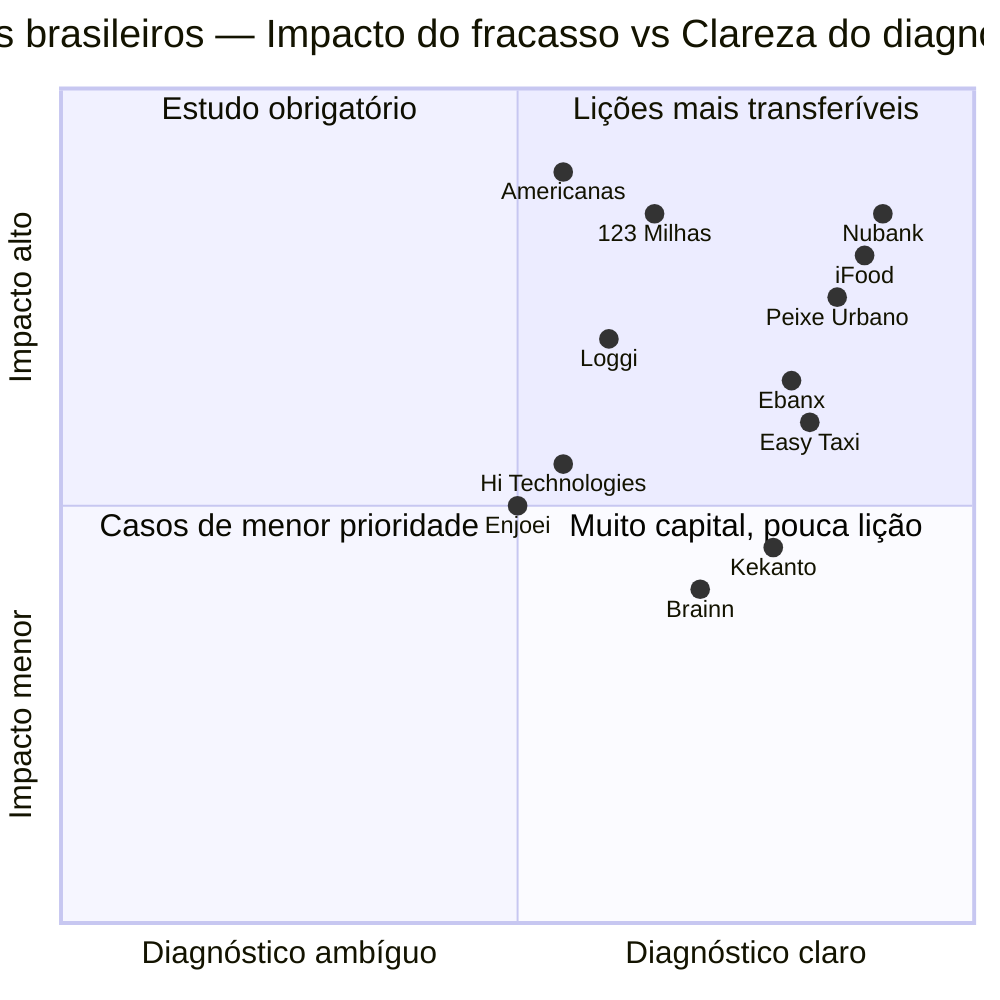

| Padrão de fracasso | Casos arquetípicos | Fase de risco |
|---|---|---|
| 1. Sem defensibilidade estrutural | Easy Taxi | [[IGNICAO-Vol-2-Descoberta-e-Mercado#FASE 6 — MAPEAMENTO DE MERCADO E CONCORRÊNCIA|Fase 6 (Vol. 2)]]-6 |
| 2. PMF falso (retenção não existe) | Peixe Urbano, daily deals | [[IGNICAO-Vol-4-Tracao-e-PMF#FASE 12 — VALIDAÇÃO DO MODELO DE NEGÓCIO|Fase 12 (Vol. 4)]]-12 |
| 3. Unit economics ruins em escala | Delivery verticais 2014-17, Liv Up | [[IGNICAO-Vol-4-Tracao-e-PMF#FASE 12 — VALIDAÇÃO DO MODELO DE NEGÓCIO|Fase 12 (Vol. 4)]]-14 |
| 4. Dependência de fundador único | Múltiplos casos | [[IGNICAO-Vol-8-Juridico-LGPD-e-Seguranca#FASE 18 — ESTRUTURAÇÃO JURÍDICA, SOCIETÁRIA E BLINDAGEM OPERACIONAL|Fase 18 (Vol. 8)]]-14 |
| 5. Mudança estrutural ignorada | Kekanto, reviews locais | [[IGNICAO-Vol-6-Receita-e-Pessoas#FASE 16 — TIME, LIDERANÇA EXECUTIVA E CULTURA EM ESCALA|Fase 16 (Vol. 6)]]-15 |
| 6. Sobreextensão geográfica precoce | Rappi, múltiplos LatAm | [[IGNICAO-Vol-6-Receita-e-Pessoas#FASE 16 — TIME, LIDERANÇA EXECUTIVA E CULTURA EM ESCALA|Fase 16 (Vol. 6)]] |
| 7. Perda de momentum de produto | Casos variados em escala | [[IGNICAO-Vol-6-Receita-e-Pessoas#FASE 16 — TIME, LIDERANÇA EXECUTIVA E CULTURA EM ESCALA|Fase 16 (Vol. 6)]]-15 |

### Caso 10 — iFood: vitória brutal contra Rappi e lições de execução

**Contexto:**
iFood foi fundada em 2011 por Patrick Sigrist, Felipe Fioravante, Eduardo Baer, Guilherme Bonifácio e Daniel Oliveira. Modelo inicial: agregador de restaurantes para pedidos. Adquirida por Movile (subsidiária da Naspers/Prosus) em 2013. Competiu com múltiplos players, vitória decisiva contra Rappi em 2018-2022 consolidou liderança.

**Trajetória:**

- **2011-2015**: crescimento nacional com consolidação de players locais.
- **2016-2018**: competição com Rappi (colombiana) que entrou agressivamente no BR. iFood respondeu com investimento massivo (Movile/Prosus injetou bilhões).
- **2018-2021**: "guerra de delivery". Ambos queimaram capital. iFood venceu em escala e presença.
- **2022**: Rappi reduziu operação BR substancialmente, iFood consolidou liderança.
- **2023-2025**: iFood em operação dominante, em busca de rentabilidade sustentada.

**Diagnóstico (vitória com contexto):**

- **Backing de Prosus foi fundamental**: capital "paciente" e em volume massivo permitiu suportar guerra prolongada.
- **Execução operacional superior**: iFood aprendeu rápido, adaptou localmente, construiu relações com restaurantes.
- **Cobertura nacional antes de Rappi entrar**: iFood já tinha presença em milhares de cidades. Rappi precisaria expandir em paralelo à competição.
- **Vantagem de dados**: iFood acumulou dados comportamentais por anos antes.
- **Brand local**: "iFood" virou verbo no Brasil ("vou pedir iFood").

**Contrafactuais (lado Rappi):**

- Rappi poderia ter focado só em LatAm fora do BR? Possivelmente, mas ausência do BR era problemática para thesis LatAm.
- Aliança com player local em vez de entrada direta? iFood provavelmente não aceitaria. Uber Eats também tentou e falhou.

**Lições transferíveis:**

1. **Defender liderança em mercado atacado exige capital e execução simultâneos**.
2. **Corporate VC paciente (Prosus) permitiu iFood suportar guerra que outras empresas teriam perdido**.
3. **Primeira escala em mercado doméstico é defensibilidade real** quando network effects existem de verdade (dois lados: restaurantes e consumidores).
4. **Execução é vantagem competitiva quantificável**: melhor app, mais restaurantes, entregas mais rápidas consistentemente ganham.
5. **Brand como substantivo** ("iFoodar") é marca de dominância.

---

### Caso 11 — Nubank: sucesso, mas com lições de trajetória longa

**Contexto:**
Nubank foi fundada em 2013 por David Vélez (colombiano), Cristina Junqueira (brasileira) e Edward Wible (americano). Tese: construir banco digital no Brasil desafiando oligopólio bancário (Itaú, Bradesco, Santander, BB, Caixa). Começou com cartão de crédito sem anuidade.

**Trajetória:**

- **2013-2015**: construção do produto. Lista de espera de centenas de milhares.
- **2015-2018**: crescimento viral. Cartão de crédito digital vira fenômeno.
- **2019-2021**: expansão para conta digital, crédito, investimentos, México, Colômbia.
- **Dezembro 2021**: IPO na NYSE. Valuation pico ~US$ 50 bilhões.
- **2022-2023**: correção macro global afeta ações. Queda significativa no valuation.
- **2024-2025**: recuperação. Empresa atinge lucratividade sustentada. Valuation se recupera parcialmente.

**Lições transferíveis (vitória com contexto):**

1. **Timing de mercado foi importante**: bancos tradicionais tinham NPS baixíssimo e produtos ruins. Janela existia.
2. **Foco em experiência do cliente como moat**: simplicidade, sem anuidade, design, tudo construído contra o que bancos faziam.
3. **Backing de VC internacional top-tier** (Sequoia, Tiger Global, Berkshire Hathaway posteriormente): capital e credibilidade.
4. **Fundador com skin in the game**: David Vélez não brasileiro, vinha de Sequoia, não tinha laços com incumbentes, visão de outsider ajudou.
5. **Persistência em thesis longa**: 8+ anos até IPO. Short-term thinking não funcionaria.
6. **Expansão internacional pós-PMF sólido**: México e Colômbia depois de domínio no Brasil.
7. **Correção pós-IPO é parte da jornada**: empresa madura sobrevive correção de mercado, não-madura quebra.

**Limitações do modelo:**

- Replicar Nubank é praticamente impossível, timing, capital, talento, janela regulatória foram excepcionais.
- Outras fintechs (Inter, C6, Stone) são sucessos também mas em trajetórias próprias.
- Sucesso não é garantia de lucratividade, Nubank atingiu lucratividade só em 2023-2024 após uma década de operação.

---

### Caso 12 — Ebanx: de bootstrapped em Curitiba a IPO adiado

> [!note] Sobre a classificacao de Ebanx
> Ebanx esta neste grupo por trajetoria de crescimento e exit potencial, mas o proprio texto descreve IPO adiado, demissoes e processos de exit em avaliacao. E caso hibrido, parte vitoria de longo prazo (relevancia, cobertura), parte dificuldade estrutural (timing publico). Mantido aqui pelo aprendizado em mercados emergentes mais que por status binario.

**Contexto:**
Ebanx foi fundada em 2012 por Alphonse Voigt, Wagner Ruiz e João Del Valle em Curitiba. Inicialmente: gateway de pagamento para empresas internacionais venderem no Brasil (cross-border payments). Foco em pagamentos locais (boleto, parcelamento) para e-commerce internacional.

**Trajetória:**

- **2012-2017**: crescimento orgânico, bootstrapped por anos. Foco em cross-border para Brasil.
- **2018-2021**: expansão LatAm. Captações. Atingiu unicórnio.
- **2021**: planejou IPO nos EUA com valuation alvo ~US$ 10 bi.
- **2022**: IPO adiado devido a condições de mercado.
- **2022-2023**: ajustes operacionais, demissões.
- **2024-2025**: empresa opera, processos de exit em avaliação.

**Diagnóstico:**
Bootstrap inicial foi vantagem e limitação: construiu negócio sustentável sem queimar, mas escala demorou. Captação grande em 2021 foi em janela quente: valuations inflados. IPO adiado não é fracasso: empresa continua operacional, ajustando. Modelo tem margem comprimida: processamento de pagamentos é commodity em competição com gigantes (Stripe, Adyen, players locais). Vantagem em LatAm específica: conhecimento profundo de pagamentos locais (boleto, PIX, OXXO) é diferencial difícil de replicar.

**Lições transferíveis:**

1. **Bootstrap longo pode construir negócio real antes de capital**: Ebanx provou viabilidade por 6+ anos antes de grande captação.
2. **Expansão para LatAm como thesis**: fit entre Brasil e outros mercados LatAm em pagamentos é real.
3. **Valuation em janela quente vira âncora quando janela fecha**: captar em múltiplo alto cria pressão difícil de sustentar.
4. **Cidade secundária pode ser vantagem em atração de talento e retenção**: Curitiba tem menos competição por talento tech que São Paulo.
5. **Processos de pagamento são complexos e defensíveis**: Ebanx construiu relações regulatórias e operacionais em cada país ao longo de anos.

---

### Grupo 4 — casos 2024-2026 em desenvolvimento

Esses casos ainda estao se desenvolvendo e merecem post-mortem completo apenas quando o ciclo fechar. Aqui ficam como observacao em curso.

**Wildlife Studios**, valuation US$ 3 bi em 2020 (Serie B SoftBank/Vulcan) seguido de demissoes recorrentes 2022-2024. Padrao de hipercrescimento mobile gaming na pandemia.

**Liv Up**, captou cerca de R$ 220 mi em multiplos rounds (Kaszek, Monashees) e foi adquirida em 2024 pelo grupo CD&R. Padrao de unit economics estruturalmente apertado em food-tech delivery.

**Olist**, captou Series E US$ 186 mi em janeiro 2022 (Wellington) durante pico do mercado, com demissoes em 2023-2024.

**Loggi**, ja analisada em profundidade no Caso 9, citada aqui apenas pela atualizacao de unit economics em 2024-2025.

**Escale**, encerramento ordenado em 2023 apos crescimento agressivo durante pandemia.

**C2 Ventures**, reduzio significativamente operacoes em 2023-2024 sem comunicado publico de encerramento.

**Meliuz**, NAO e caso de fracasso. Listado aqui pela decisao operacional ousada de alocar tesouraria em Bitcoin em 2025, que pode virar caso de aprendizado positivo ou negativo.

---

### PADRÕES TRANSVERSAIS NOS 12 CASOS

Lendo os casos transversalmente, cinco padrões emergem:

**1. Unit economics são destino.** Peixe Urbano, 123 Milhas, delivery verticais, e outros modelos com unit economics problemáticos eventualmente colapsaram ou foram drasticamente ajustados. Loggi, iFood enfrentaram desafios estruturais de margem fina. Sem unit economics que melhoram com escala, capital atrasa mas não evita o desfecho.

**2. Defensibilidade exige esforço deliberado.** Easy Taxi e Kekanto tinham liderança de tempo mas não de estrutura. Uber e Google não eram "concorrentes diretos", redefiniram categorias. Empresas vencedoras (iFood, Nubank) construíram moats ativamente: rede densa, dados proprietários, relacionamento regulatório, experiência superior.

**3. Governança escala mais devagar que operação.** Americanas, Hi Technologies, e outros casos de problemas em empresas listadas ou grandes mostram que governança precisa ser construída ativamente. Crescimento operacional é mais fácil que crescimento de governança.

**4. Janela de mercado importa mas não define.** Nubank aproveitou janela, bancos demoraram a reagir. Mas janela fechada não é desculpa, Brainn venceu em nicho apesar de não ter janela favorável. iFood derrotou Rappi em guerra onde ambos tinham capital.

**5. Correção é regra, não exceção.** Enjoei, Loggi, Ebanx tiveram ajustes significativos sem colapsar. Nubank teve correção pós-IPO e recuperou. Empresas que aprendem a corrigir sobrevivem, que não corrigem morrem.

---

### MÉTRICAS E AUTOAVALIAÇÃO

Use os 12 casos como lente para sua empresa:

| Caso/Padrão | Pergunta para sua empresa | Ação se resposta é "sim" |
|---|---|---|
| Peixe Urbano | Minha tração é retenção real ou novidade+capital? | Medir cohort de 6+ meses |
| Easy Taxi | Sou primeiro sem defensibilidade? | Construir moat ativo |
| 123 Milhas | Dependo de fluxo de caixa crescente para honrar compromissos? | Revisitar modelo urgentemente |
| Hi Technologies | Meu IPO (se planejado) é por janela ou por prontidão? | Adiar se não pronto |
| Americanas | Tenho controles internos independentes da administração? | Implementar antes de crescer |
| Kekanto | Featurização por big tech é ameaça real? | Construir defensibilidade específica |
| Brainn | Bootstrap é viável em meu mercado? | Considerar vs. VC |
| Enjoei | IPO captaria mais do que preciso? | Calibrar captação |
| Loggi | Crescimento atual é conjuntural ou estrutural? | Separar receitas |
| iFood | Liderança em mercado doméstico está consolidada? | Antes de expandir |
| Nubank | Minha thesis sobrevive 8+ anos? | Alongar horizonte |
| Ebanx | Bootstrap pré-capital traz vantagem? | Considerar |

### Definição de sucesso

Você aplicou este capítulo bem quando identificou três a cinco casos análogos ao seu contexto, extraiu de cada caso relevante uma lição específica transferível, usou padrões transversais para autoavaliação trimestral e compartilhou casos relevantes com time executivo e board.

### Armadilhas

> [!warning] Armadilhas ao estudar post-mortems
> "Não é meu caso" é padrão comum antes do colapso. Cada um desses fundadores provavelmente disse o mesmo em algum momento. Julgar em retrospecto distorce: decisões que parecem óbvias hoje eram ambíguas no momento. Copiar vencedores sem contexto é erro simétrico: Nubank é irrepetível, lições gerais sim, receita específica não. Ignorar casos porque são "grandes demais" é desperdício, porque padrões se manifestam em qualquer tamanho. Leitura de uma só vez é insuficiente: revisitar periodicamente conforme empresa evolui.

> [!tip] Checklist
> Li os doze casos ao menos uma vez? Identifiquei três a cinco mais análogos à minha situação? Extraí lição específica de cada análogo? Revisitei quando empresa atinge milestone importante (primeira captação, cinquenta funcionários, internacionalização, IPO)? Compartilho lições com cofundadores e board? Consigo dizer "o que não faria" tão claramente quanto "o que farei"?

### Ver também

[[IGNICAO-Vol-2-Descoberta-e-Mercado#CAPÍTULO 4 — CASOS DE FRACASSO BRASILEIROS E LIÇÕES|Capítulo 4 (CASOS DE FRACASSO BRASILEIROS E LIÇÕES) (Vol. 2)]] cobre casos de fracasso brasileiros (temático). [[#CAPÍTULO 9 — CRISE E CONTINUIDADE: PREVENÇÃO, RESPOSTA, RECUPERAÇÃO|Capítulo 9 (CRISE E CONTINUIDADE: PREVENÇÃO, RESPOSTA, RECUPERAÇÃO)]] cobre crise e recuperação. [[#CAPÍTULO 11 — LAYOFFS E DOWNSIZING: COMO DEMITIR EM ESCALA SEM DESTRUIR A EMPRESA|Capítulo 11 (LAYOFFS E DOWNSIZING: COMO DEMITIR EM ESCALA SEM DESTRUIR A EMPRESA)]] cobre layoffs.

> [!info] Fases relacionadas
> Referenciado em: Fase 3, Fase 15.

---

## CAPÍTULO 22 — SECOND-TIME FOUNDER

> [!abstract] Posicao no livro
> Este capítulo trata especificamente do fundador que ja vendeu, fechou ou saiu de empresa anterior. Trilha de leitura adjacente,
>
> - [[IGNICAO-Vol-2-Descoberta-e-Mercado#CAPÍTULO 4 — CASOS DE FRACASSO BRASILEIROS E LIÇÕES|Capítulo 4 (CASOS DE FRACASSO BRASILEIROS E LIÇÕES) (Vol. 2)]] e [[#CAPÍTULO 21 — POST-MORTEMS BRASILEIROS: CATÁLOGO DE CASOS EM PROFUNDIDADE|Capítulo 21 (POST-MORTEMS BRASILEIROS: CATÁLOGO DE CASOS EM PROFUNDIDADE)]] para padroes que second-time tendem a evitar mas alguns repetem
> - [[IGNICAO-Vol-1-Ideacao#CAPÍTULO 3 — ARMADILHAS MENTAIS E VIESES|Capítulo 3 (ARMADILHAS MENTAIS E VIESES) (Vol. 1)]] e [[IGNICAO-Vol-1-Ideacao#CAPÍTULO 6 — TOMADA DE DECISÃO COMO DISCIPLINA|Capítulo 6 (TOMADA DE DECISÃO COMO DISCIPLINA) (Vol. 1)]] para vieses tipicos do second-time (overconfidence, ancoragem na empresa anterior)
> - [[IGNICAO-Vol-1-Ideacao#CAPÍTULO 2 — SAÚDE MENTAL, DINÂMICA DE CO-FOUNDERS E HUMANIDADE DO FUNDADOR|Capítulo 2 (SAÚDE MENTAL, DINÂMICA DE CO-FOUNDERS E HUMANIDADE DO FUNDADOR) (Vol. 1)]] para a dimensao humana do recomeco

> [!note] Aplicabilidade
> Fundadores que já tiveram empresa anterior (exit, fechamento, ou aprendizado). Minoria dos leitores. Mas com dinâmica específica.

### O que este capítulo cobre

A dinâmica de empreender pela segunda vez. Diferente da primeira porque o fundador tem recursos, rede, cicatrizes, e armadilhas próprias.

### POR QUE

Second-time founders (fundadores em segunda empreitada) têm taxa de sucesso maior em média. Mas não automática.

Há armadilhas específicas que first-time founders (fundadores de primeira viagem) não têm.

Vantagens. Rede, capital próprio, credibilidade com investidores, e aprendizado.

### VANTAGENS E ARMADILHAS

**Vantagens reais.**

1. Rede de investidores já estabelecida. Warm intros em qualquer VC relevante.
2. Rede de talento. Pessoas de empresa anterior topam trabalhar de novo.
3. Capital próprio. Do exit anterior. Reduz pressão financeira pessoal.
4. Credibilidade de mercado. PR mais fácil. Primeiros clientes mais dispostos.
5. Aprendizado real. Erros concretos não cometer de novo.
6. Padrões de execução internalizados. Onboarding, processos, e decisões mais rápidas.

> [!warning] Armadilhas específicas
> "Já fiz isso antes". Contexto anterior não é contexto atual. O mercado muda, o cliente muda, a tecnologia muda. Replicar playbook antigo é erro.
> Hubris. Investidores enchem de capital cedo. Vem a tentação de escalar antes do PMF. Same story from zero.
>
> Recusar mentoria. O sucesso anterior inibe a busca por conselho e piora as decisões.
>
> Nova ideia menos genuína. É frequente o fundador "voltar porque deve", não porque encontrou dor real. Empresa bootstrapped por obrigação.
>
> Atrito com cofundadores novos. Fundador veterano com novatos cria dinâmica de poder desbalanceada.
>
> Conforto financeiro reduz urgência. Fundador com dez milhões do exit anterior não tem pressão e pode deixar a empresa à deriva por anos.
>
> Comparação com a anterior. "Na outra empresa, em doze meses tínhamos dez milhões de ARR". Ignora que o contexto era diferente.
>
> ### RECOMENDAÇÕES
>
> **1. Validar fome genuína.** Antes de começar, responder honestamente. Estou empreendendo porque encontrei problema que me obceca? Ou porque é "o que eu faço"? Se segundo, pausar.
>

**2. Tratar como primeira vez onde relevante.** Customer discovery rigorosa (não assumir que sabe ICP). Validação de hipóteses com disciplina (ver [[IGNICAO-Vol-3-Experimentos-e-Prototipagem#FASE 7 — FORMULAÇÃO RIGOROSA DE HIPÓTESES|Fase 7 (Vol. 3)]]). Humildade em novo contexto, ou mercado.

**3. Usar vantagens estruturais inteligentemente.** Rede para primeiros clientes. Não para pular etapas. Capital próprio como runway maior. Não como desculpa para ineficiência.

**4. Buscar novos mentores.** Pessoas que fizeram o que você está tentando fazer *agora*. Não o que você fez antes. Advisors em categoria diferente da empresa anterior.

**5. Cofundador com peso similar.** Se veterano, mais novato, formalizar equity significantly unequal (reflete experiência trazida). Alinhar expectativas de "jeito de trabalhar". Veterano pode ter opiniões fortes que sufocam.

**6. Board cedo, e com independentes.** Even more importante que primeira vez. Veterano com tudo nas mãos sem contrapeso, igual a decisões ruins.

**7. Rigor com equity.** Vesting next empresa. Quatro anos. Cliff um ano. Mesmo para founders que já tiveram sucesso. Não diluir extra sem contrapartida.

> [!important] Saúde mental
> Empreender é maratona. Não importa quantas vezes já correu. O esgotamento acumula. Segundo esgotamento em quinze anos é diferente do primeiro. Se primeiro teve trauma (exit ruim, conflito, ou burnout), tratar antes de repetir.

### Checklist

- [ ] Validei fome genuína pela ideia (versus inércia profissional)?
- [ ] Tratando com disciplina de primeira vez nos elementos estruturais?
- [ ] Buscando mentores em contexto *atual*, não repetindo conselheiros anteriores?
- [ ] Cofundadores com dinâmica alinhada (expectativas de trabalho, e poder)?
- [ ] Board com independentes cedo?
- [ ] Equity, e vesting, rigorosos (mesmo sendo veterano)?
- [ ] Saúde mental de trauma anterior endereçada?
- [ ] Cautela com capital próprio (não como desculpa para ineficiência)?

> [!info] Fases relacionadas
> Referenciado em: Fase 0, Fase 15.

---

## CAPÍTULO 23 — A EMPRESA CASH COW (DIVIDENDOS PERPÉTUOS), HOLDINGS PATRIMONIAIS, FAMILY OFFICE E GESTÃO DE FORTUNA PÓS-EXIT

**O Manual de Preservação e Multiplicação de Fortuna para o Fundador Vitorioso: Quando NÃO Vender sua Empresa, Como Operar uma Máquina de Dividendos com CEO Profissional e Como Estruturar sua Holding, Offshore, Family Office e Sucessão**

> [!abstract] Posição no livro
> Todo o ecossistema de tecnologia ensina como fundar uma empresa (Volumes 1 a 4), como escalar (Volumes 5 a 8) e como vender no M&A ou fazer IPO (Volume 9). Este capítulo fecha o ciclo empreendedor respondendo às duas perguntas decisivas para a riqueza intergeracional do fundador: **(1) quando o melhor negócio da sua vida é NÃO vender a empresa, operando-a como uma *Cash Cow* perpétua de dividendos liderada por um CEO profissional?** e **(2) após acumular dezenas ou centenas de milhões de reais (via dividendos ou *Exit*), como estruturar seu *Family Office*, suas Holdings no Brasil, sua estrutura *Offshore* e seu planejamento sucessório em vida?**

---

### Parte 1 — Quando o Melhor *Exit* é NÃO Vender: A Arquitetura da Empresa *Cash Cow* (Máquina de Dividendos Vitalícios)

Muitos dos empresários mais ricos e líquidos do Brasil jamais venderam suas empresas. Enquanto o mercado celebra o fundador que vendeu sua startup por R$ 80 milhões (mas detinha apenas 25% do *cap table* após quatro rodadas de diluição, pagou ganho de capital e embolsou R$ 16 milhões líquidos), centenas de fundadores de softwares verticais (SaaS de nicho), *tech-enabled services*, indústrias especializadas e plataformas B2B detêm **80% a 100% do próprio negócio e distribuem de R$ 5 milhões a R$ 50 milhões+ em fluxo de caixa livre anual**.

#### 1.1. A Matemática da *Cash Cow* vs. Venda no M&A
Quando você não tem fundos de Venture Capital no *cap table* exigindo liquidez com prazo fixo, a escolha entre vender ou manter deve ser calculada na ponta do lápis:
* Imagine uma empresa madura gerando **R$ 40 milhões de receita anual**, **R$ 12 milhões de Fluxo de Caixa Livre (FCF / EBITDA convertido em caixa)**, crescendo 15% ao ano com **ROIC > 30%**, na qual o fundador detém **85% do capital**.
* Se um comprador oferecer **6x EBITDA (R$ 72 milhões)**:
  1. **Vendendo no M&A:** A fatia bruta do fundador é de R$ 61,2 milhões. Descontando assessores (~3%), retenção em *Escrow Account* para contingências (15% travados por 3 a 5 anos) e Imposto de Renda sobre Ganho de Capital (15% a 22,5%), sobram cerca de **R$ 41 milhões líquidos imediatos**. Investidos em uma carteira conservadora rendendo juro real líquido seguro de **5,5% a.a. acima da inflação (IPCA)**, esses R$ 41 milhões geram uma renda passiva sustentável de **~R$ 2,25 milhões por ano**.
  2. **Mantendo como *Cash Cow*:** Dos R$ 12 milhões de caixa livre anual, a empresa reinveste R$ 2 milhões em crescimento, paga R$ 1,5 milhão de bônus variável agressivo para o CEO profissional e distribui **R$ 8,5 milhões em dividendos**. Os 85% do fundador pingam **R$ 7,2 milhões por ano em caixa** (mais de **3x a renda anual** que ele teria vendendo a empresa!), mantendo 85% de um ativo real protegido contra a inflação que repassa preços todo ano.

> [!tip] Regra de Ouro: Quando Vender vs. Quando Manter
> **Venda no M&A** quando o comprador pagar um múltiplo estratégico assimétrico (ex.: 8x a 12x ARR, equivalente a 25x–35x o seu fluxo de caixa anual) ou quando houver risco tecnológico existencial no setor. **Mantenha como *Cash Cow*** quando as propostas forem de múltiplos financeiros baixos (4x a 6x EBITDA) e o negócio tiver alta retenção de clientes, baixo CapEx e forte geração de caixa.

---

#### 1.2. De Fundador-CEO para Acionista-Conselheiro (*Chairman*): Sucessão e Incentivos sem *Exit*
Como sair da operação diária sem que a empresa perca eficiência? O erro fatal é contratar um CEO profissional e oferecer um plano de *Stock Options* tradicional copiado do Vale do Silício. **Se a empresa nunca será vendida, opções de compra de ações sem liquidez não valem nada para o executivo.**

Em uma empresa *Cash Cow*, substitua o ESOP de saída por uma **Arquitetura de Incentivos Baseada em Caixa Livre e Dividendos**:
1. **Bônus Anual Atrelado a EBITDA Convertido em Caixa Livre (*Free Cash Flow — FCF*) e ROIC:**
   Nunca premie apenas receita bruta (que incentiva vendas sem margem) nem EBITDA contábil isolado (que ignora inadimplência e capital de giro). Use a trava tripla auditada:
   $$\text{Pool de Bônus Executivo} = X\% \times \text{Fluxo de Caixa Livre (FCF)} \quad (\text{condicionado a } \text{ROIC} \ge 30\% \text{ e } \text{Retenção Líquida} \ge 100\%)$$
2. ***Phantom Shares* Pagáveis em Dinheiro e Participação nos Dividendos (*Profit Sharing / Quotas Restritas*):**
   * Destine de **5% a 10% do fluxo anual de dividendos** (via plano de *Phantom Dividends* ou ações/quotas restritas com direito econômico e sem direito a voto irrestrito, adquiridas com *vesting* de 4 anos) para o CEO e os 3 diretores-chave. Se a empresa gera R$ 10M de dividendos, um CEO com 5% recebe R$ 500 mil/ano direto do resultado, pensando exatamente como dono.
   * **Cláusula de Liquidez Interna (*Formula-Based Buyback*):** Após 5 anos de casa (*Good Leaver*), o contrato garante que a própria empresa recomprará as *Phantom Shares* do executivo aplicando uma fórmula pré-acordada (ex.: **4,5x a média do FCF dos últimos 3 anos** multiplicada pelo percentual dele), paga em 24 parcelas mensais com o próprio caixa gerado.
3. **Os 4 Rituais Mensais de Controle do Fundador-Conselheiro:**
   * **Trava Estatutária de Alçada:** Proibição no Contrato Social/Estatuto de contratação de dívida bancária, alienação de ativos, prestação de aval ou despesas acima de R$ X mil sem assinatura do acionista controlador.
   * **Reunião Mensal de Conselho (2 horas no 6º dia útil):** Revisão de 5 métricas: ARR/Receita Líquida, *Churn*/NRR, Margem EBITDA, Conversão em Caixa Livre (FCF) e ROIC.
   * **Auditoria Independente Anual:** Contratação obrigatória de auditoria contábil externa todos os anos para validar saldos bancários, contingências e reconhecimento de receita.
   * **Varredura Trimestral de Caixa (*Cash Sweep*):** Todo caixa excedente acima do colchão operacional de segurança (4 a 6 meses de custos fixos) sobe trimestralmente como dividendo para a **Holding Patrimonial** do fundador, blindando o dinheiro contra bloqueios judiciais (Sisbajud) no CNPJ operacional.

---

### Parte 2 — O Dia Seguinte à Liquidez (Pós-Exit ou Acúmulo de Dividendos): *Family Office* e Alocação Patrimonial

Quando dezenas de milhões de reais entram na conta, o fundador enfrenta um paradoxo psicológico: **o comportamento que construiu a fortuna (concentração extrema, otimismo agressivo e apetite a risco ilíquido) é exatamente o que destrói fortunas no mercado financeiro**.

#### 2.1. A Síndrome Pós-Exit e a Regra dos 12 Meses de Quarentena Financeira
Nos primeiros 12 meses após o *Exit*, fundadores recém-capitalizados costumam destruir de 25% a 50% do patrimônio em três armadilhas: (1) virar **"mega-anjo" sem tese**, distribuindo cheques de R$ 500 mil a R$ 2 milhões em startups de conhecidos e negócios ilíquidos que vão a zero; (2) comprar **passivos de luxo ilíquidos** (barcos, jatos, mansões de veraneio) que criam um *burn rate* familiar perpétuo de R$ 200 mil/mês; e (3) cair em **assessores comissionados** que empurram produtos estruturados (COEs) e fundos caros para capturar *spreads* ocultos na distribuição.

> [!warning] A Regra dos 12 Meses de Quarentena Financeira
> Pelo período de **12 meses após o recebimento do *Exit***, comprometa-se por escrito a **NÃO realizar nenhum investimento ilíquido, não entrar em nenhuma nova sociedade e não comprar imóveis de lazer**. Estacione 100% do capital em liquidez soberana máxima (**Tesouro Selic / IPCA+** no Brasil e **US Treasury Bills** nos EUA) enquanto estrutura friamente sua **Política de Investimentos da Família (*IPS — Investment Policy Statement*)**.

---

#### 2.2. A Política de Investimentos (*IPS*) e a Arquitetura dos 4 Baldes Patrimoniais

Para blindar o padrão de vida intergeracional e crescer acima da inflação em moeda forte, estruture o patrimônio nos **4 Baldes Patrimoniais**:

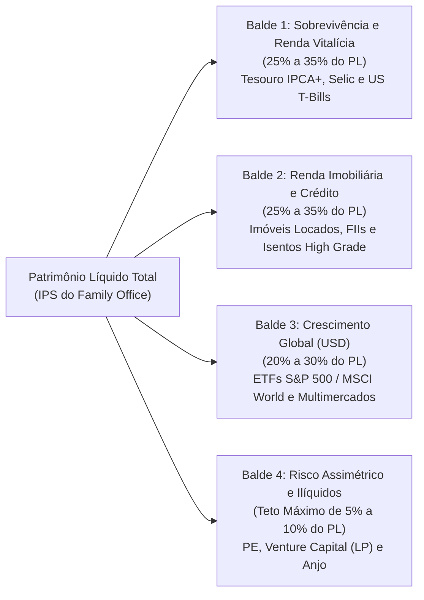

##### Tabela de Alocação Recomendada dos 4 Baldes Patrimoniais

| Balde Patrimonial | Alocação (% do PL) | Classes de Ativos Elegíveis | Liquidez | Objetivo Estratégico no IPS |
| :--- | :--- | :--- | :--- | :--- |
| **Balde 1 — Reserva de Sobrevivência e Renda Vitalícia Blindada** | **25% a 35%** | • **Tesouro Selic (LFT)** (caixa imediato para 24–36 meses de despesas familiares)<br>• **Tesouro IPCA+ (NTN-B)** com juros semestrais (trava juro real de IPCA + ~6% a.a.)<br>• **US Treasury Bills / TIPS** (títulos soberanos americanos em dólar) | **Imediata** (D+0 a D+2) | **Garantia de inquebrabilidade.** Os cupons semestrais das NTN-Bs e T-Bills pagam 100% do custo de vida da família sem jamais consumir o principal. |
| **Balde 2 — Preservação e Renda Imobiliária / Crédito** | **25% a 35%** | • Imóveis comerciais locados (*Built-to-Suit*, galpões logísticos, lajes AAA)<br>• Fundos Imobiliários (FIIs) de tijolo e papel *High Grade*<br>• Crédito Privado Incentivado **AAA** (Debêntures de Infraestrutura, CRIs e CRAs isentos de IR) | **Média** (D+2 em FIIs a baixa em imóveis físicos) | Geração de renda mensal isenta ou eficiente tributariamente, com proteção real contra a inflação. |
| **Balde 3 — Crescimento Global e Renda Variável** | **20% a 30%** | • **ETFs Globais em Dólar** (S&P 500 e MSCI World — preferencialmente via ETFs *UCITS* sediados na Irlanda para eficiência fiscal e sucessória)<br>• Fundos de ações e multimercados institucionais consagrados | **Alta** (D+2 a D+30) | **Descorrelação do Risco-Brasil** e composição de capital no longo prazo em moeda forte (Dólar/Euro). |
| **Balde 4 — Risco Assimétrico e Ilíquidos** | **5% a 10% (TETO ABSOLUTO)** | • Fundos de *Private Equity* e *Venture Capital* de 1º quartil (como LP)<br>• Carteira diversificada de 15 a 25 investimentos-anjo diretos<br>• *Seed money* para eventual próxima startup do próprio fundador | **Ilíquido** (maturação de 5 a 10 anos) | Capturar assimetria (5x a 20x) usando o *network* do fundador, com trava rígida: **se todo o Balde 4 zerar, 90% da fortuna familiar continua intacta**. |

#### 2.3. *Private Bank* vs. *Multi-Family Office (MFO)* vs. *Single Family Office (SFO)*
* **Private Bank Tradicional vs. Modelo *Fee-Based*:** No *Private Bank* ou corretora tradicional "gratuita", o gerente é remunerado pelas comissões embutidas nos produtos que vende a você. Exija sempre o modelo **Fee-Based / Consultoria Independente**, pagando uma taxa fixa transparente (0,35% a 0,70% a.a.) com **devolução contratual (*cashback*) de 100% das comissões e *rebates* de distribuição**.
* **Multi-Family Office (MFO — ideal entre R$ 25M e R$ 200M):** Gere o patrimônio integrado de várias famílias, consolidando investimentos locais e *offshore*, planejamento tributário, contabilidade das holdings e governança sucessória sob taxa fixa alinhada.
* **Single Family Office Próprio (SFO — justificável acima de R$ 150M a R$ 300M+):** Montar uma estrutura exclusiva com CIO, analistas, jurídico e *controller* próprios custa de **R$ 1,5 milhão a R$ 3 milhões por ano** no Brasil. Só crie um SFO próprio quando esse custo fixo anual representar menos de **0,75% a 1,0% do patrimônio líquido total**.

---

### Parte 3 — Engenharia Societária, Tributária e Sucessória da Fortuna (Brasil e Offshore)

#### 3.1. Holding Patrimonial Pura vs. Holding Imobiliária no Brasil
Jamais mantenha patrimônio pessoal acumulado no mesmo CNPJ da sua operação comercial (*OpCo*) nem espalhado desorganizadamente no CPF:
* **Holding Pura de Participações:** Detém as quotas/ações das empresas operacionais, recebendo dividendos e isolando o andar societário.
* **Holding Imobiliária Familiar:** Destinada à guarda, locação e administração de bens imóveis da família, sem funcionários operacionais.
  * **Tributação de Aluguéis e Venda (Lucro Presumido vs. PF e Reforma Tributária IBS/CBS):** Enquanto na Pessoa Física o aluguel sofre até **27,5% de IRPF** e o ganho de capital na venda paga de 15% a 22,5%, na Holding no **Lucro Presumido** a locação paga **11,33% a 14,53%** de tributos federais, e a venda de imóveis contabilizados no **Ativo Circulante (Estoque Imobiliário)** é tributada a **5,93% a 6,73%** sobre a receita bruta. Com a **Reforma Tributária (EC 132/2023 e LC 214/2025)**, as operações imobiliárias em PJ (e em PF que ultrapassem os limites legais de quantidade e receita de imóveis) passam a se sujeitar ao regime específico de **IBS e CBS com redutores de alíquota (70% na locação e 50% na venda, além do redutor social)**, exigindo simulação caso a caso antes da conferência de bens residenciais.
  * **ITBI na Integralização e o Tema 796 do STF:** O art. 156, § 2º, I da CF/88 garante **imunidade de ITBI** na integralização de imóveis ao capital social, **exceto se a atividade preponderante da empresa (> 50% da receita nos 2 anos anteriores ou 3 anos seguintes) for imobiliária** (compra, venda ou locação de imóveis). Pelo **Tema 796 do STF**, a imunidade limita-se ao valor do capital social efetivamente subscrito — portanto, ao integralizar imóveis pelo valor histórico declarado no IRPF (art. 23 da Lei nº 9.249/1995, sem ganho de capital), lance 100% do valor diretamente na conta de **Capital Social** (e nunca em reserva de ágio).

---

#### 3.2. Estruturas *Offshore* sob a Lei nº 14.754/2023 (Lei das Offshores e Fundos Exclusivos)
Investir diretamente no exterior como pessoa física acima de **US$ 60.000 em ativos americanos (*US Situs Assets*, como ações da NYSE/Nasdaq ou T-Bills)** expõe sua família ao **Imposto de Herança Americano (*US Estate Tax*) de até 40%** em caso de falecimento.

A blindagem padrão para o capital internacional (tipicamente a partir de US$ 500 mil a US$ 1 milhão+) combina uma **PIC (*Private Investment Company*)** em **BVI (Ilhas Virgens Britânicas), Bahamas ou Cayman** (ou LLC em Delaware/Wyoming investindo em ativos fora de *US Situs*, como ETFs irlandeses *UCITS*) sob o regime da **Lei nº 14.754/2023**:
* **Alíquota Linear de 15% no Ajuste Anual (Regime Opaco vs. Transparente):**
  * No **Regime Opaco (Padrão para Offshores em BVI/Bahamas/Cayman)**, os lucros financeiros apurados no balanço anual da controlada em 31 de dezembro são tributados à alíquota linear de **15% no IRPF**, permitindo **compensar integralmente prejuízos de um ativo com lucros de outro dentro do mesmo balanço**, deduzir custos de manutenção da estrutura e manter **isenta a variação cambial do capital social investido**. Uma vez tributado à medida que o lucro é apurado no balanço anual, a posterior distribuição de dividendos para a pessoa física ocorre sem novo imposto.
  * No **Regime Transparente (Opcional)**, os ativos da entidade são declarados individualmente como se detidos pela PF, postergando os 15% para o momento do resgate/venda efetiva de cada ativo (útil para carteiras passivas 100% alocadas em ETFs de acumulação irlandeses que não distribuem dividendos nem giram carteira).
* **Uso de *Trusts* (Revogáveis e Irrevogáveis):** Regulamentados pela primeira vez no direito tributário brasileiro pela Lei nº 14.754/2023 (art. 10), os **Trusts** no exterior permitem separar a propriedade formal dos ativos (entregue a um *Trustee* profissional sob uma *Letter of Wishes* e supervisão de um *Protector* de confiança da família) em favor dos beneficiários (herdeiros), garantindo governança multigeracional, proteção contra dilapidação juvenil e sucessão imediata sem inventário.

---

#### 3.3. Planejamento Sucessório em Vida: Doação com Reserva de Usufruto, Cláusulas Restritivas e ITCMD
Nunca deixe o patrimônio empresarial ou familiar cair em um inventário judicial pós-morte no Brasil: além de anos de paralisia societária, o custo total consome de 12% a 20% do patrimônio líquido.

1. **Doação de Quotas das Holdings em Vida com Reserva de Usufruto Vitalício (Político e Financeiro):**
   O fundador doa a **nua-propriedade** das quotas da Holding aos filhos em vida, mas reserva para si (e para o cônjuge) **100% do Usufruto Vitalício Político (direito exclusivo de voto e administração isolada da sociedade) e Financeiro (direito a 100% dos dividendos distribuídos)**. Enquanto viver, o fundador mantém poder absoluto e renda integral; no falecimento, o usufruto se extingue automaticamente na Junta Comercial sem inventário das quotas.
2. **As 4 Cláusulas Restritivas Obrigatórias na Escritura/Contrato de Doação:**
   * **Incomunicabilidade:** Impede que as quotas doadas (e seus frutos/dividendos) entrem na meação de cônjuges ou companheiros dos filhos em qualquer regime de bens;
   * **Impenhorabilidade:** Blinda as quotas contra execuções por dívidas pessoais futuras dos herdeiros;
   * **Inalienabilidade:** Impede a venda ou oneração das quotas pelos filhos sem a assinatura dos pais usufrutuários;
   * **Reversão (Art. 547 do Código Civil):** Se o filho donatário falecer antes do fundador, as quotas retornam automaticamente ao patrimônio do fundador doador, sem passar pelo inventário do filho.
3. **Liquidez Fora de Inventário (VGBL e Seguro *Whole Life*) e a Progressividade do ITCMD (EC 132/2023):**
   Com a **Emenda Constitucional nº 132/2023**, o **ITCMD (Imposto sobre Transmissão Causa Mortis e Doação)** passou a ser **obrigatoriamente progressivo em razão do valor da transmissão em todos os estados brasileiros** (atingindo a alíquota máxima de **8%** para grandes patrimônios, inclusive em estados que antes aplicavam alíquota fixa de 4%, além de alcançar bens no exterior). Para evitar que os herdeiros precisem vender imóveis ou empresas às pressas para pagar o ITCMD e custos jurídicos, mantenha de **5% a 8% do patrimônio** em **Seguro de Vida Vitalício (*Whole Life*)** (isento de IR pelo art. 6º, XIII da Lei 7.713/88 e impenhorável) e/ou **Previdência VGBL**, que são liquidados diretamente aos beneficiários em poucos dias úteis sem entrar em inventário (art. 794 do Código Civil).

---

### 4. Checklist de Fechamento do Ciclo Patrimonial

- [ ] **Arquitetura *Cash Cow*:** CEO profissional alinhado via bônus de Fluxo de Caixa Livre (FCF) + *Phantom Dividends*, com auditoria independente anual e *Cash Sweep* trimestral para a Holding?
- [ ] **Quarentena e IPS:** Respeitada a quarentena de 12 meses em títulos soberanos pós-*Exit* e aprovada a Política de Investimentos (IPS) nos **4 Baldes Patrimoniais** (com teto estrito de **5% a 10%** para ativos ilíquidos/VC no Balde 4)?
- [ ] **Gestão Sem Conflito:** Contratação de consultoria ou *Multi-Family Office* estritamente no modelo **Fee-Based** com devolução integral (*cashback*) de comissões?
- [ ] **Holdings e Offshore:** Patrimônio isolado do risco operacional em Holdings no Brasil (observando o Tema 796 do STF e a LC 214/2025) e ativos dolarizados estruturados via PIC Offshore (BVI/Bahamas/Cayman) em conformidade com a Lei nº 14.754/2023 para elidir o *US Estate Tax* de 40%?
- [ ] **Sucessão em Vida:** Quotas doadas com **reserva de usufruto político e financeiro vitalício** + cláusulas de incomunicabilidade, impenhorabilidade, inalienabilidade e reversão, apoiadas por liquidez imediata em *Whole Life*/VGBL para cobertura do ITCMD progressivo (até 8%)?

---

# ENCERRAMENTO DA JORNADA EMPREENDEDORA

### Fechamento da Jornada Empreendedora

O **[[#EPÍLOGO|Epílogo]]** a seguir encerra a narrativa cronológica das 21 Fases (Fases 0 a 20), sintetizando a filosofia operacional que atravessa toda a coleção IGNIÇÃO.

---

## EPÍLOGO

Você chegou ao fim, ou talvez apenas abriu aqui, última página, pela curiosidade de ver como termina. De qualquer forma, um recado.

Este livro foi escrito para acompanhar alguém em uma jornada longa, íngreme, frequentemente solitária, ocasionalmente gloriosa, e sempre mais difícil do que quem nunca empreendeu imagina. Se você é o leitor pretendido, ou seja, eu mesmo, relendo em algum momento futuro da minha trajetória, as quase 500 mil palavras aqui reunidas são resultado do tempo que investi organizando o que sabia, o que aprendi com quem já passou, o que desejaria ter sabido antes. Um documento canônico é, nesse sentido, uma carta para si mesmo em outro tempo.

Algumas reflexões finais.

**Sobre métodos e enciclopédias.** Tudo que está aqui é modelo, e todo modelo é simplificação da realidade. Nenhum verbete deste livro substitui a fase real da sua empresa. Nenhum framework resolve sozinho o dilema específico que você vai viver às 2h da manhã. Use isto como bússola, não como GPS. Bússola aponta direção. GPS promete rota. Empreendedorismo não tem rota.

**Sobre fracasso.** Se a empresa quebrar, quebrar bem é possível, e vale. Encerramento digno preserva relações, reputação e capacidade de tentar de novo. A maior parte dos fundadores de sucesso que você conhece hoje tem pelo menos uma tentativa anterior fracassada. Fracasso não é o oposto de sucesso, é matéria-prima dele.

**Sobre tempo.** A jornada é mais longa do que parece na pressa inicial. Os fundadores bem-sucedidos que você admira tipicamente levaram 8-15 anos para chegar onde estão. Empresa não nasce em Série A, nasce em cinco anos de trabalho antes do radar público. Paciência é vantagem competitiva subestimada.

**Sobre pessoas.** Produto, mercado, capital, regulação, tudo se resolve com ferramentas discutíveis. Pessoas não. As decisões de sócio, time fundador, primeiros funcionários e investidores vão definir mais da sua experiência como fundador do que qualquer tese ou mercado. Invista tempo desproporcional nessas escolhas.

**Sobre você.** A trajetória de empreender vai te moldar. Algumas mudanças serão boas, disciplina, clareza, resiliência, capacidade de decisão sob incerteza. Outras serão custosas, relações familiares tensionadas, saúde deteriorada se não cuidada, anos em que você esteve presente de corpo mas ausente de mente. Empreender não é neutro, deixa marcas. A melhor orientação que este livro pode oferecer é: preserve o que é essencial fora da empresa, porque o que está dentro vai demandar tudo.

**Volte aqui em um ano.** Este foi escrito para ser companhia de longa data, não leitura única. Reabra em momentos de decisão, de crise, de virada. Você vai encontrar coisas diferentes em cada leitura, porque você vai ser uma pessoa diferente em cada leitura.

Boa sorte.

---

*Compilado em abril de 2026 para uso pessoal do autor. Reflete opiniões dele, e não pretende ser autoridade final sobre nenhum dos temas tratados. Se você chegou até aqui por empréstimo, compartilhamento ou cópia, saiba que o que leu é material de trabalho de uma pessoa específica em uma trajetória específica, use com esse contexto em mente.*

---

# GLOSSÁRIO E SIGLAS DESTE VOLUME

> [!abstract] Vocabulário técnico e siglas deste volume
> Para garantir que este **Volume 9** funcione de forma 100% independente e autocontida sem exigir consulta a outro livro, esta seção reúne as definições dos **103 termos técnicos e de negócios** e das **57 siglas e abreviações** utilizados ao longo das Fases e Capítulos deste volume.

---

## GLOSSÁRIO E SIGLAS DESTE VOLUME

### Termos Técnicos e de Negócios Usados neste Volume

**Acqui-hire.** Aquisição de empresa cujo objetivo principal é contratar o time, não o produto ou receita. O produto é frequentemente descontinuado. Pagamento típico: R$ 500 mil a R$ 3 milhões por engenheiro sênior em pacote de retenção.

**Advisor.** Conselheiro externo que orienta o fundador em áreas específicas (técnica, comercial, regulatória, captação). Tipicamente compensado com 0,1% a 1% de equity sob contrato FAST.

**Ambidestria organizacional.** Capacidade de uma empresa de explorar o modelo atual (exploit) e explorar novos modelos (explore) simultaneamente. Estrutura central na [[#FASE 19 — REINVENÇÃO E SEGUNDA CURVA|Fase 19]].

**ANPD (Autoridade Nacional de Proteção de Dados).** Autarquia federal brasileira responsável por fiscalizar e aplicar a LGPD. Pode aplicar multas até 2% do faturamento (limite R$ 50 milhões por infração).

**Anti-dilution.** Cláusula societária que protege investidores de diluição em rodadas futuras a valuation menor. Variantes: full ratchet (ajuste integral) e weighted average (mais comum, ajuste ponderado).

**ARR (Annual Recurring Revenue).** Receita anual recorrente. Soma de todos os contratos ativos anualizados. Principal métrica de tamanho de empresa SaaS. ARR = MRR × 12.

**BATNA (Best Alternative to a Negotiated Agreement).** Melhor alternativa caso a negociação não resulte em acordo. Quanto melhor o BATNA, mais poder o negociador tem. Conceito central de Fisher e Ury (Getting to Yes, 1981).

**BCB (Banco Central do Brasil).** Autoridade monetária e regulatória do sistema financeiro brasileiro. Regula bancos, fintechs, instituições de pagamento e sandbox regulatório de inovação financeira.

**Bet-the-company (aposta central).** Hipótese cuja refutação invalida o modelo de negócio inteiro. Diferente de hipóteses secundárias, que podem ser refutadas sem comprometer a empresa. Todo negócio tem duas a cinco apostas-centrais.

**Blitzscaling.** Estratégia de crescimento deliberadamente ineficiente em velocidade extrema para capturar mercado winner-takes-most antes dos competidores. Conceito de Reid Hoffman. Aceita custo e caos em troca de velocidade. Ver Framework: Blitzscaling (Reid Hoffman & Chris Yeh, 2018) (Fase 19).

**Board.** Conselho de administração. Órgão de governança da empresa. Em startups, tipicamente 3-5 membros: fundadores, investidores e independentes.

**Burn Multiple.** Net burn (caixa gasto) dividido por net new ARR gerado. Mede eficiência de queima de caixa. Referência: ≤ 1.5x excelente, ≤ 2.5x aceitável, acima de 3x preocupante.

**Burn rate.** Velocidade de consumo de caixa por mês. Caixa disponível dividido pelo burn rate mensal = runway.

**CAC (Customer Acquisition Cost).** Custo total de marketing e vendas dividido pelo número de novos clientes no período. Calculado por canal para diagnóstico preciso, não apenas blended.

**CAC Payback.** Número de meses necessários para recuperar o CAC com a margem bruta gerada pelo cliente. Referência: ≤ 12 meses B2C, ≤ 18 meses B2B enterprise.

**Cap table (Tabela de capitalização).** Documento que registra a estrutura de propriedade de uma empresa: quem tem quantas ações, de qual classe, com qual vesting e a que preço foram emitidas.

**Carta de intenção (LOI, Letter of Intent).** Documento não-vinculante que formaliza interesse de uma parte em realizar transação (investimento, aquisição) com outra, antes da due diligence completa.

**Category design.** Estratégia de criar e dominar uma categoria de mercado nova, em vez de competir em categoria existente. Empresa define o problema de forma nova, tornando-se referência da categoria. Ver Framework: Category Design (Play Bigger, 2016) (Fase 6).

**Churn.** Taxa de cancelamento ou perda de clientes ou receita em um período. Churn de clientes: percentual de clientes que cancelaram. Churn de receita (MRR churn): percentual da receita mensal perdida por cancelamentos e downgrades.

**CIM (Confidential Information Memorandum).** Documento confidencial preparado pelo banco de investimento ou advisor que descreve a empresa para potenciais compradores em processo de M&A.

**Cliff (de vesting).** Período inicial de vesting em que nenhuma parte da participação veste. Tipicamente 12 meses para cofundadores e funcionários: se sair antes de 1 ano, não recebe nada.

**Closing.** Momento de assinatura e execução de uma transação (rodada de investimento, M&A). Marca a transferência efetiva de capital e participação. Tipicamente precedido por due diligence, term sheet e SPA.

**Cofundador.** Pessoa que funda a empresa em conjunto com um ou mais sócios desde o início. No Brasil, distinto de "co-founder" — usar termo em português é a convenção do livro.

**COGS (Cost of Goods Sold).** Custo dos produtos ou serviços vendidos. Em SaaS: custos de infraestrutura, suporte e serviços diretamente vinculados à entrega. Determina a margem bruta.

**Compliance.** Conformidade regulatória. Em startups, refere-se à aderência a normas de LGPD, anticorrupção, trabalhistas, fiscais e setoriais. Capítulo 12 (Vol. 8) (COMPLIANCE E ANTICORRUPÇÃO PARA STARTUPS) trata de Compliance e Anticorrupção em profundidade.

**CRM (Customer Relationship Management).** Sistema de gestão de relacionamento com clientes. Registra interações, pipeline de vendas e histórico do cliente. Exemplos: Salesforce, HubSpot, Pipedrive.

**CSD (Certezas, Suposições, Dúvidas).** Framework de mapeamento de hipóteses que separa o que se sabe com certeza, o que se supõe e o que é genuinamente desconhecido.

**DCF (Discounted Cash Flow).** Método de valuation que desconta fluxos de caixa futuros pelo custo de capital (WACC). Teoricamente rigoroso, altamente sensível a premissas em startups.

**Deal flow.** Fluxo de oportunidades de investimento ou aquisição que chega a um investidor ou a uma empresa compradora.

**Delaware Flip.** Reestruturação societária em que uma empresa brasileira passa a ser detida por holding em Delaware (EUA). Comum para startups que captam fundos americanos. Custo típico: US$ 30 mil a US$ 80 mil.

**Dilution.** Redução da participação percentual de um acionista em decorrência de novas emissões de ações. Ocorre em cada rodada de captação.

**Down round.** Rodada de captação a valuation menor que o da rodada anterior. Penaliza fundadores e investidores anteriores.

**DPO (Data Protection Officer).** Encarregado de proteção de dados. Função obrigatória sob a LGPD para empresas que processam grandes volumes de dados pessoais ou dados sensíveis.

**Drag-along.** Cláusula societária que permite ao acionista majoritário forçar os minoritários a vender suas participações nas mesmas condições, em caso de venda da empresa.

**Due diligence (DD).** Processo de investigação e verificação de informações sobre empresa-alvo antes de investimento ou aquisição. Cobre dimensões financeiras, jurídicas, operacionais, tecnológicas e tributárias.

**Earnout.** Parte do preço de aquisição condicionada ao atingimento de metas pós-closing. Tipicamente 20-40% do deal value, pago ao longo de 12 a 36 meses.

**EBITDA.** Lucro antes de juros, impostos, depreciação e amortização. Métrica de geração operacional de caixa, usada em valuation por múltiplos (EV/EBITDA) e em covenants bancários.

**eNPS (Employee Net Promoter Score).** Adaptação do NPS para medir engajamento e satisfação de funcionários. Pergunta: "Em escala de 0 a 10, o quanto você recomendaria trabalhar aqui a um amigo?" Referência saudável: ≥ 30.

**EOR (Employer of Record).** Empresa que atua como empregadora formal de funcionários no exterior, permitindo a startup contratar globalmente sem abrir entidade local. Exemplos: Deel, Remote, Oyster.

**ERP (Enterprise Resource Planning).** Sistema de gestão integrada que centraliza processos operacionais como financeiro, estoque, RH e produção. Exemplos: SAP, Totvs, Oracle.

**ESOP (Employee Stock Option Plan).** Plano de outorga de opções de ações a funcionários. Tipicamente reserva de 10-20% do cap table para o pool. Mecanismo central de retenção em startups.

**EV (Enterprise Value).** Valor total da empresa: capitalização de mercado mais dívida líquida. Usado como numerador nos múltiplos de valuation (EV/ARR, EV/EBITDA).

**Exit.** Saída do fundador ou investidor da empresa, geralmente via M&A, IPO ou secondary.

**FMF (Founder-Market Fit).** Alinhamento entre o perfil, experiência e motivação do fundador e as características do problema e mercado que a empresa ataca. Primeiro filtro de avaliação de ideia.

**Founder Mode.** Estilo de gestão hands-on do fundador-CEO em estágio early-to-growth, em contraste com o "manager mode" delegativo. Conceito popularizado por Paul Graham (2024).

**FP&A (Financial Planning & Analysis).** Função financeira responsável por planejamento, orçamento e análise de variâncias. Em startups, surge tipicamente após Série B.

**Freemium.** Modelo de negócio com camada gratuita permanente e camada paga com funcionalidades avançadas. Taxa de conversão típica: 2 a 5% dos usuários gratuitos.

**GMV (Gross Merchandise Value).** Volume bruto de transações processadas em uma plataforma. A receita da plataforma é o take rate aplicado sobre o GMV.

**Go-to-market (GTM).** Estratégia de como a empresa leva o produto ao mercado: quais segmentos atacar, por quais canais, com qual motion de vendas e posicionamento.

**GRR (Gross Revenue Retention).** Percentual da receita mantida de um período para o outro, excluindo expansão. Mede churn puro. GRR ideal: acima de 90% em B2B.

**Headcount.** Número total de funcionários de uma empresa.

**ICP (Ideal Customer Profile).** Perfil ideal do cliente: a empresa ou pessoa para quem o produto foi especificamente construído e que extrai mais valor dele. Mais específico que persona, que é mais específico que segmento.

**Innovator's Dilemma.** Fenômeno documentado por Clayton Christensen onde empresas bem-sucedidas são incapazes de adotar tecnologias disruptivas por serem racionalmente focadas em seus clientes atuais. Ver Framework: Innovator's Dilemma / Disruptive Innovation (Clayton Christensen, 1997) (Fase 19) e [[#FASE 19 — REINVENÇÃO E SEGUNDA CURVA|Fase 19]].

**IP (Intellectual Property).** Propriedade intelectual: patentes, marcas registradas, código-fonte, segredos comerciais. Em startups, instrumento de cessão de IP do fundador para a empresa é cláusula obrigatória de contrato societário.

**IPO (Initial Public Offering).** Oferta pública inicial — abertura de capital na bolsa de valores. No Brasil, na B3. Tipicamente alvo de empresas com ARR ≥ R$ 300 milhões e crescimento ≥ 30% YoY.

**JTBD (Jobs to be Done).** Framework de pesquisa que entende comportamento do consumidor como contratação de produtos para realizar um "trabalho" funcional, emocional ou social. Originado por Tony Ulwick (Strategyn, 1990, aplicando Six Sigma à inovação), popularizado por Clayton Christensen em *The Innovator's Solution* (2003), e operacionalizado em Switch Interviews por Bob Moesta. Ver Framework: Jobs to Be Done Framework (Clayton Christensen, Anthony Ulwick, Bob Moesta) (Fase 19) e Framework: Jobs to Be Done Switch Interviews (Bob Moesta & Chris Spiek, via Clayton Christensen) (Fase 5).

**Lead.** Potencial cliente que demonstrou interesse inicial. Pode ser MQL (Marketing Qualified Lead) ou SQL (Sales Qualified Lead) dependendo do nível de qualificação.

**LGPD (Lei Geral de Proteção de Dados).** Lei 13.709/2018 que regula o tratamento de dados pessoais no Brasil. Multa máxima: 2% do faturamento, limite R$ 50 milhões por infração. Fiscalizada pela ANPD.

**Liquidation preference.** Direito dos investidores preferenciais de receber seu investimento de volta (com ou sem juros) antes dos fundadores e acionistas ordinários em caso de exit. Pode ser 1x, 2x ou mais.

**Lock-up.** Período pós-IPO ou pós-aquisição durante o qual os acionistas (fundadores, investidores) não podem vender suas ações. Tipicamente 180 dias pós-IPO, 12 a 36 meses pós-M&A.

**LTV (Lifetime Value).** Valor presente líquido da receita gerada por um cliente ao longo de toda a sua relação com a empresa. LTV/CAC ≥ 3x é referência para modelo sustentável.

**M&A (Mergers and Acquisitions).** Fusões e aquisições. Caminho mais comum de exit para startups brasileiras.

**Magic Number.** Net new ARR do período dividido pelo investimento em Sales & Marketing do período anterior. Mede eficiência de crescimento. ≥ 0.75 indica que escalar gasto em GTM faz sentido.

**Margem bruta.** (Receita - COGS) / Receita. Em SaaS: tipicamente 65-80%. Em marketplace: 30-50%. Em hardware: 30-55%.

**Market fit.** Versão mais ampla de PMF que inclui adequação ao momento de mercado, não apenas ao produto.

**MECE (Mutually Exclusive, Collectively Exhaustive).** Princípio de estruturação de problemas em categorias mutuamente exclusivas (sem sobreposição) e coletivamente exaustivas (cobrem todo o espaço). Ferramenta de consultoria estratégica. Ver Framework: MECE (Mutually Exclusive, Collectively Exhaustive) — McKinsey (Fase 3).

**MoM (Month over Month).** Crescimento mês a mês. Em early-stage, crescimento saudável é ≥ 10% MoM sustentado.

**Moat.** Barreira competitiva difícil de replicar. Pode ser efeito de rede, custo de troca, marca, escala, IP ou regulação. Conceito popularizado por Warren Buffett. Ver Framework: 7 Powers (Hamilton Helmer, 2016) (Fase 6).

**MQL (Marketing Qualified Lead).** Lead qualificado pelo marketing com base em critérios de engajamento, mas ainda não abordado pelo time de vendas.

**MRR (Monthly Recurring Revenue).** Receita recorrente mensal. Soma de todos os contratos ativos, normalizada para mensal.

**MVP (Minimum Viable Product).** Versão mínima do produto com funcionalidades suficientes para validar hipóteses críticas com usuários reais e coletar feedback. Não é produto incompleto: é produto deliberadamente mínimo.

**NDA (Non-Disclosure Agreement).** Acordo de confidencialidade. Documento legal que restringe o compartilhamento de informações confidenciais entre as partes.

**NPS (Net Promoter Score).** Métrica de lealdade e satisfação. Pergunta: "Em escala de 0 a 10, o quanto você recomendaria [empresa/produto] para um amigo?" Promotores (9-10) menos Detratores (0-6) = NPS. Referência: ≥ 40 consumer, ≥ 30 enterprise.

**Onboarding.** Processo de entrada e ativação de um novo usuário ou colaborador. Onboarding de cliente: caminho do cadastro até o "aha moment". Onboarding de funcionário: integração nas primeiras 4-12 semanas.

**Outbound.** Motion de vendas onde a empresa ativamente prospecta clientes, em vez de esperar inbound. Inclui cold outreach, SDRs e prospecção ativa.

**P&L (Profit and Loss).** Demonstração de resultados. Mostra receita, custos, despesas e lucro/prejuízo no período.

**Pivot.** Mudança estrutural de uma ou mais dimensões do modelo de negócio (cliente, problema, solução, canal, modelo de receita) mantendo aprendizados anteriores. Diferente de pivô cosmético (renomear) e de "abandonar".

**PLG (Product-Led Growth).** Motion de crescimento onde o produto é o principal veículo de aquisição, conversão e expansão. Produto gera valor suficiente para que usuário traga outros usuários. Contraposto a SLG (Sales-Led Growth).

**PMF (Product-Market Fit).** Momento em que produto e mercado se encaixam: produto resolve dor real de segmento identificado de forma que gera retenção, engajamento e crescimento orgânico. Diagnóstico central da [[IGNICAO-Vol-4-Tracao-e-PMF#FASE 13 — PRODUCT-MARKET FIT|Fase 13 (Vol. 4)]].

**Positioning.** Posicionamento — escolha estratégica de como a empresa quer ser percebida em relação a concorrentes e alternativas, na mente do cliente.

**Post-mortem.** Análise retrospectiva de falha ou incidente, com foco em aprendizado sistêmico em vez de atribuição de culpa. Blameless post-mortem é variante que explicitamente remove julgamento pessoal.

**Pre-seed.** Rodada de captação anterior à Série Seed. Tipicamente R$ 300 mil a R$ 3 milhões, de anjos ou fundos micro-VC, para time e MVP inicial.

**ROFR (Right of First Refusal).** Direito de preferência. Cláusula que dá a uma parte (tipicamente investidores existentes) o direito de igualar oferta externa antes que a venda aconteça.

**ROI (Return on Investment).** Retorno sobre investimento. (Ganho - Custo) / Custo. Métrica genérica de eficiência de capital aplicado.

**RPO (Recovery Point Objective).** Quantidade máxima de dados que a empresa pode perder em caso de falha, medida em tempo. Define frequência de backups. Parte do BCP.

**RTO (Recovery Time Objective).** Tempo máximo tolerável de interrupção de um processo crítico antes que cause dano irreparável. Define prioridade de recuperação.

**Rule of 40.** Crescimento percentual de ARR somado com margem EBITDA percentual. Startups saudáveis em escala devem ter Rule of 40 ≥ 40. Criada para avaliar trade-off entre crescimento e lucratividade.

**Runway.** Número de meses antes de a empresa ficar sem caixa, considerando o burn rate atual. Referência: mínimo 12 meses após rodada, ideal 18 a 24 meses.

**SAFE (Simple Agreement for Future Equity).** Instrumento de captação criado pela Y Combinator. Conversível em ações em rodada futura, sem juros e sem prazo de vencimento. Adaptação brasileira é a "Nota Conversível".

**Scenario Planning.** Planejamento por cenários — método desenvolvido pela Royal Dutch Shell nos anos 1970 para preparar a empresa para múltiplos futuros plausíveis, em vez de apostar em uma única previsão. Ver Framework: Scenario Planning (Pierre Wack na Royal Dutch Shell, anos 1970) (Fase 19) e [[IGNICAO-Vol-4-Tracao-e-PMF#CAPÍTULO 16 — PIVOT: TIPOLOGIA, DECISÃO E EXECUÇÃO|Capítulo 16 (PIVOT: TIPOLOGIA, DECISÃO E EXECUÇÃO) (Vol. 4)]] (cenários como antessala da decisão de pivot).

**Seed.** Rodada de captação inicial de startup. No Brasil, tipicamente R$ 1 milhão a R$ 10 milhões, de fundos seed ou anjos, para validar PMF e motor inicial de crescimento.

**SLA (Service Level Agreement).** Acordo de nível de serviço. Define métricas de disponibilidade, performance e tempo de resposta que a empresa se compromete a manter. Violações geram créditos ou penalidades.

**SPA (Share Purchase Agreement).** Contrato de compra e venda de participação societária. Documento principal de fechamento de rodada de investimento ou M&A.

**Tag-along.** Cláusula que garante ao acionista minoritário o direito de vender suas ações nas mesmas condições que o majoritário em caso de venda. Proteção do minoritário.

**TAM (Total Addressable Market).** Mercado total endereçável: receita máxima possível se a empresa capturasse 100% do mercado. Calculado preferencialmente bottom-up.

**Term sheet.** Documento que resume os termos comerciais de uma rodada de investimento ou M&A antes do contrato definitivo. Não vinculante na maior parte das cláusulas, mas vinculante em exclusividade e confidencialidade.

**Unit economics.** Métricas de rentabilidade no nível da unidade básica do negócio (um cliente, uma transação, um produto). CAC, LTV, margem por transação, payback period.

**Valuation.** Valor estimado de uma empresa. Em startups privadas, determinado por rodadas de captação. Pode ser calculado por múltiplos (EV/ARR, EV/EBITDA), DCF ou transações comparáveis.

**Venture Debt.** Financiamento por dívida para startups que já captaram equity. Concedido por bancos especializados (Silicon Valley Bank historicamente) ou fundos de venture debt. Não-diluitivo, mas exige garantias e covenants.

**Vesting.** Mecanismo pelo qual a participação em uma empresa é ganha gradualmente ao longo do tempo. Vesting padrão: 4 anos com 1 ano de cliff. Protege a empresa se fundador ou funcionário sai cedo.

**WACC (Weighted Average Cost of Capital).** Custo médio ponderado de capital. Taxa de desconto usada em DCF para refletir o custo de capital próprio e de dívida da empresa.

**YoY (Year over Year).** Crescimento ano a ano. ARR crescendo ≥ 3x YoY é referência para startup em escala.

**ZOPA (Zone of Possible Agreement).** Zona de acordo possível em negociação: sobreposição entre o mínimo aceitável de uma parte e o máximo aceitável da outra. Conceito de Fisher e Ury (Getting to Yes, 1981).

---

### Siglas e Abreviações Usadas neste Volume

**AARRR:** Acquisition, Activation, Retention, Referral, Revenue (framework de métricas de growth, Dave McClure). *Growth.*

**ANPD:** Autoridade Nacional de Proteção de Dados. *Regulação / LGPD.*

**API:** Application Programming Interface. *Tecnologia.*

**ARR:** Annual Recurring Revenue (receita recorrente anual). *SaaS / métricas.*

**B2B:** Business-to-Business. *Modelo de negócio.*

**BMC:** Business Model Canvas. *Estratégia / modelagem de negócio.*

**BNDES:** Banco Nacional de Desenvolvimento Econômico e Social. *Financiamento.*

**CAC:** Customer Acquisition Cost (custo de aquisição de cliente). *Unit economics.*

**CEO:** Chief Executive Officer. *Gestão.*

**CFO:** Chief Financial Officer. *Gestão.*

**CLT:** Consolidação das Leis do Trabalho (regime trabalhista brasileiro com vínculo formal). *Trabalho.*

**COGS:** Cost of Goods Sold (equivalente em inglês ao CMV). *Finanças.*

**CPO:** Chief Product Officer. *Gestão.*

**CRM:** Customer Relationship Management (sistema ou prática). *Vendas.*

**CTO:** Chief Technology Officer. *Gestão.*

**CVM:** Comissão de Valores Mobiliários. *Regulação.*

**DCF:** Discounted Cash Flow (valuation por fluxo de caixa descontado). *Finanças.*

**DPO:** Data Protection Officer (encarregado de dados sob LGPD). *LGPD.*

**EBITDA:** Earnings Before Interest, Taxes, Depreciation and Amortization. *Finanças.*

**EOR:** Employer of Record (estrutura para contratação internacional). *Expansão / RH.*

**EPP:** Empresa de Pequeno Porte (classificação brasileira). *Regulação.*

**EVP:** Employee Value Proposition. *RH.*

**GMV:** Gross Merchandise Value (volume bruto de transações). *Marketplaces.*

**HR / RH:** Human Resources / Recursos Humanos. *Gestão.*

**ICP:** Ideal Customer Profile. *Vendas e marketing.*

**IFRS:** International Financial Reporting Standards. *Contabilidade.*

**INSS:** Instituto Nacional do Seguro Social. *Regulação trabalhista.*

**IPCA:** Índice de Preços ao Consumidor Amplo (indicador de inflação). *Economia brasileira.*

**IPO:** Initial Public Offering (abertura de capital em bolsa). *Exit.*

**IRPJ:** Imposto de Renda Pessoa Jurídica. *Tributos.*

**JTBD:** Jobs To Be Done. *Framework de produto.*

**LGPD:** Lei Geral de Proteção de Dados (Lei 13.709/2018). *Regulação.*

**LTV:** Lifetime Value (valor vitalício de cliente). *Unit economics.*

**LTV:CAC:** razão entre LTV e CAC. *Unit economics.*

**M&A:** Mergers and Acquisitions (fusões e aquisições). *Exit.*

**MQL:** Marketing Qualified Lead. *Vendas.*

**MRR:** Monthly Recurring Revenue. *SaaS / métricas.*

**MVP:** Minimum Viable Product (produto mínimo viável). *Produto.*

**NDA:** Non-Disclosure Agreement (acordo de confidencialidade). *Jurídico.*

**NPS:** Net Promoter Score (métrica de recomendação). *Satisfação.*

**P&L / DRE:** Profit and Loss / Demonstração de Resultado. *Contabilidade.*

**PIX:** sistema de pagamentos instantâneos do BACEN. *Pagamentos Brasil.*

**PJ:** Pessoa Jurídica (regime de contratação). *Trabalho.*

**PLG:** Product-Led Growth. *Growth.*

**PLR:** Participação nos Lucros e Resultados. *RH.*

**PMF:** Product-Market Fit. *Conceito central.*

**ROI:** Return on Investment. *Finanças.*

**SaaS:** Software as a Service. *Modelo de negócio.*

**SAFE:** Simple Agreement for Future Equity (instrumento de captação). *Captação.*

**SMB:** Small and Medium Business. *Segmento.*

**SWOT:** Strengths, Weaknesses, Opportunities, Threats. *Estratégia.*

**TAM / SAM / SOM:** Total Addressable Market, Serviceable Addressable Market, Serviceable Obtainable Market. *Estratégia de mercado.*

**VC:** Venture Capital. *Captação.*

**VP:** Vice President. *Gestão.*

**VPC:** Value Proposition Canvas. *Framework de produto.*

**YoY:** Year-over-Year (comparação ano a ano). *Métricas.*

**ZOPA:** Zone of Possible Agreement. *Negociação.*
